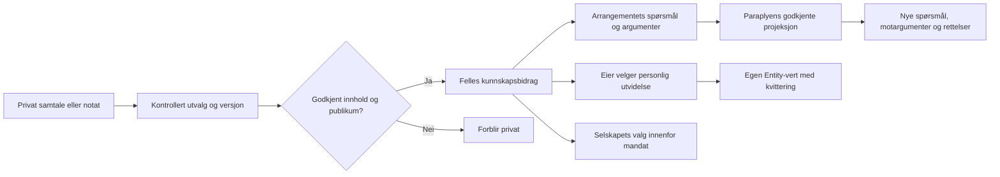

# Designforslag — felles kunnskap, møter og entiteter

Dato: 2026-10-02. Alle navn på nye objekter/felter nedenfor er **konseptuelle forslag**, ikke eksisterende API-er, schemas eller registrerte Cell-typer. Eksisterende implementasjon er identifisert i EVIDENCE.md og rådgivervedleggene.

## Seks flater

| Flate | Hovedspørsmål og handling | Viktig tilstand |
|---|---|---|
| Felles innsikt | Hva prøver vi å forstå sammen? Se spørsmål, kilder, argumenter, dissens og neste forsøk; bidra med valgt innsikt | Kilden mangler, påstanden er omstridt, innholdet er rettet/tilbaketrukket, eller det finnes ingen bidrag ennå |
| Finn og bidra | Hvilke personer og arrangementer trenger det jeg kan bidra med, og når passer det? | Vis matchgrunn, publisert tilgjengelighet, begrenset innsyn og nulltreff. Match gir ingen tilgang eller automatisk påmelding |
| Mitt arrangement | Hva skal bli mulig etterpå? Lag utkast, tilbud/behov, sted/tid/kapasitet og formål; få DiMy-forslag | Utgiver og aktiv rolle synlig; draft/publisert/paraplytilknytning er separate statuser |
| Møtet vårt | Hva er vi enige om å gjøre og dele? | Deltakelse, opptaksplan, faktisk capture, kontroll, valgt utdrag, publikum og kvittering er separate tilstander |
| Selskapet | Handler jeg som meg selv eller innenfor en konkret fullmakt? | Selvdeklarert/verifisert selskap, gjeldende medlemsrettigheter, utløp/tilbakekalling, private kontra selskapseide bidrag |
| Simulering | Hva forventet vi at aktørene skulle gjøre, og hva skjedde faktisk? | Run/status/seed/revisjoner, scenario, aktørrolle, forventet/faktisk resultat og isolerte testdata; ikke syntetiske tall fremstilt som målte |

Den interaktive skissen viser alle seks med fiktive navn, selskaper, arrangementer og innhold. «Simuler Jonas sitt samtykke» er en kontroll i skissen, aldri en foreslått produktknapp for å samtykke på andres vegne. Opptaksknappen bruker ingen mikrofon. Rådgiversvar er illustrasjoner, ikke resultat av et aktivt DiMy-kall.

En liten frivillig kunnskapsflate er anbefalt først, men fullfører ikke alene integrasjonsmålet. Den personlige Entity-utvidelsen skal være synlig og mulig, også for den som ikke ønsker å bidra offentlig.

## Foreslåtte informasjonsobjekter og myndighet

| Objekt | Innhold | Hvem kan bestemme |
|---|---|---|
| Paraply | Formål, periode/tidssone, arrangementreferanser, publiserings-/moderasjonsregler, offisiell kilde og tilknytningsstatus | Paraplyens identifiserte kontrollmyndighet; deltakere eier ikke automatisk paraplyadministrasjonen |
| Arrangement | Eier/publisher, utkast og publisert versjon, formål/mål, tilbud/behov, kapasitet, sted/tilgjengelighet, tidsrom og eventuelle påmeldingslenker | Eksisterende publisher-ACL for arrangementets egne data; tilknytning godkjennes separat |
| Matchbart tilbud | Aktørens valgte formål, bidrag/behov, publikum, tilgjengelige intervaller/møtelengde og utløp | Aktøren selv eller en avgrenset selskapsfullmakt; ikke hele privatkalenderen |
| Kunnskapsbidrag | Kildereferanse/utdrag, påstand eller spørsmål, versjon, forfatter, representasjonsrolle, opprinnelse, publikum og konkret hjemmel | Rettighetshaver(e) for valgt materiale. Arrangørens `publishEvent` dekker ikke automatisk deltakernes møter |
| Møte | Deltakerliste, planversjon, opptaker, formål, prosessor/rute, bevaring, godkjenninger og faktisk tilstand | Hver deltaker for egen medvirkning; portable Cells/Resolver håndhever handlingens rettigheter |
| Felles møteresultat | Versjonert transkripsjon/utdrag, korrigert talertilordning, delte formål, åpne spørsmål, dissens og neste handling | Eksakte innholds-/publikumsgodkjenninger; utledning fra AI er forslag inntil akseptert |
| Entity-utvidelse | Valgt referanse eller kopi, kildeversjon, egen hensikt, mottakers lagringskvittering og rettelser | Hver personlig eier, eller selskapsmyndighet innenfor mandat; felles publisering og personlig lagring er forskjellige valg |
| Gruppe-/selskapsentitet | Egen identitet, formål, ressurser, medlemsoppføringer, fullmakter og valgfri verifiserbar organisasjonskobling | Navngitte kontroll-/delegasjonsrettighetshavere, ikke en delt privat nøkkel |

Ingen av disse objektforslagene introduserer nye protocol primitives. Før implementering bindes de til eksisterende Entity/Agreement/Resolver/Explore-kontrakter, med egne domene-celler bare der dagens typer ikke uttrykker produktbehovet.

## Hvordan felles kunnskap og egen Entity henger sammen

Felles kunnskap er en referert, kuratert projeksjon med forvaltning og historikk. Den er ikke summen av private Entity-grafer. Paraplyen kan vise at et arrangement arbeider med et spørsmål uten å få hele deltakerlisten. Tilgang til ett møte gir ikke søk i alle møter.

Forslag til kvalitetsregel: skill **kildeobservasjon**, **AI-/mennesketolkning**, **akseptert formulering** og **beslutning**. Et samtykke til et utdrag beviser rett til å dele, ikke at hvert utsagn i transkripsjonen er sant. Ikke gi mennesker en «kvalitets-/nyttepoengsum» for hvor mye de deler.

## Kommunikasjon mellom scaffolds

Bruk eksisterende enrollment, domeneidentitet, grant/Agreement og Bridge/Resolver. Ingen ny generell proxy eller vertseier som stedfortredende requester. Gjenbruk portabiliteten som finnes, og la en capability-oversikt gjøre ufullstendig støtte synlig.

Foreslått første reise:

1. Konferansens felles bidrag har fast kilde-/versjonsreferanse og eksplisitt publikum.
2. Personen velger «Til min Entity» og sin innmeldte Entity-vert. Verten rapporterer støttede kontraktversjoner, lagrings-/leseevner og nødvendig authority-path.
3. Det konkrete utdraget/referansen sendes med faktisk aktør, mottaker/domene, formål, operasjon og grant. Formål er kontekst, aldri en autorisasjon i seg selv.
4. Mottakeren validerer før effekt og skriver under riktig eier/namespace. Tapt svar blir «ukjent», avstemt med samme operasjons-ID. Lokal suksess er ikke fjern lagringskvittering.
5. Avsender viser mottakerens eksplisitte kvittering. Read-back etter restart og nektet kryssdomene-tilgang verifiseres.
6. Rettelse, utløp eller tilbakekalling gir en synlig ny kilde-/rettighetsstatus. Ikke lov at allerede eksporterte kopier er slettet uten mottakerbevis.

Støtteoversikten må minst dekke konferansevert/CellScaffold, Binding, DiMy-relevante tjenester, Palazzo og UserSimulationScaffold. **Denne listen er et integrasjonsmål, ikke en påstand om at alle nå har nødvendige endepunkter eller er deployet.** Binding er klient/native capability-host; Swarm er testaktør, ikke kanonisk eier av reelle menneskers Entity. Runtime som mangler en evne skal fortsatt kunne vise et tillatt utdrag eller en tydelig fallback, uten å påstå gjennomført lagring.

Start med en kanonisk eiervert og versjonerte avledede visninger. Dagens lokale grafprojeksjon og in-memory replica-referanse er ikke bevis for ferdig varig multi-master-synk. Konflikter og rettelser skal vises, ikke stilletiende avgjøres ved siste skriveoperasjon.

## Møteflyt og samtykkegrenser

1. **Oppdaget:** nearby viser bare valgt og tillatt utdrag. Fysisk nærhet er ikke identitetsbevis, møtemedlemskap eller opptakstillatelse.
2. **Invitert / deltar uten opptak:** hver part bekrefter deltakelse. Møtet kan fortsette slik. Web kan bruke avtalt møtelenke/QR; radio er en native evne.
3. **Opptaksplan vN:** vis eksakt deltakerliste, hensikt, opptakerenhet, prosessor/lagringssted, bevaring, felter for utledning og mottakere. Fangst, transkripsjon, AI-bearbeiding, deling og personlig lagring er separate rettigheter. En samlet tydelig plan kan godkjennes uten en strøm av gjentatte dialoger.
4. **Klar / opptak:** start krever ferske godkjenninger for samme plan og fungerende OS-/hardwaretillatelse. Begge ser reell tilstand og kan stoppe. Ny deltaker eller tapt lease pauser/stoppes; mottatt stopp og ukjent fjernstatus skilles. Ingen automatisk gjenopptak etter krasj.
5. **Kontroll:** vis tekst og kildespor, usikker talertilordning, rettelser, foreslåtte formål og dissens. Ny tekst gir ny versjon og ugyldiggjør relevant eldre godkjenning.
6. **Utvalg / deling:** velg bare felles formål, neste forsøk, et utdrag eller eventuelt hele transkripsjonen. Velg presise mottakere; møtedeltakere, arrangement og paraply er ulike publikum. Et annet publikum krever ny rettighet/godkjenning.
7. **Levering / lagring / avslutning:** vis kvittering per mottaker og per personlig Entity. Retention, anmodet sletting, bekreftet sletting og ukjent kopistatus er ulike ting.

De foreslåtte skisserammene (lokal transkripsjon, ingen varig lydfil, sju dager for utkast) er foreløpige designvalg, ikke implementerte innstillinger eller juridisk godkjent oppsett. Ingen mikrofon brukes i skissen. Hvis lydlagring ønskes, må det legges til som et eget eksplisitt valg og testes.

Prioriterte feiltester: tilbakekalling mens en await venter før mikrofon-/modell-/lagringseffekt, utløpt plan, endret deltakerliste, falsk vertseier-identitet, nektet OS-tillatelse, ny lydrute, offline part, tapt svar, dobbeltklikk, ugyldig signatur, endret publikum og feilattribuert formål. Native hjelpefunksjonen som tolker nil/ukjent svar som suksess må ikke gjenbrukes for disse handlingene.

## Gruppeentitet for selskap

Et selskap har egen kontinuitet, formål, ressurser og representasjon. En person kan være medlem og samtidig ha andre formål, roller og private data. Selskapets Entity kan derfor ikke være en sammenkobling som gir administrator innsyn i alle ansattes Entity-er.

Gjenbruk allerede nå: publisher-medlemmer med eksplisitte rettigheter, flere administratorer og vern av siste `manageMembers`. Presenter hvem som handler, på vegne av hvem, og innenfor hvilket ressurs-/handlingsomfang. Ikke bygg en ny fullmaktsmotor for vanlig redigering/publisering av arrangørens egne event-data når dagens ACL dekker det.

Tillegg som må designes/valideres:

- Bind en portabel fullmakt til selskapets kontrollmyndighet, delegert person, handling/ressurs, domene/publikum, utløp og eventuell delegasjonsgrense. Firmaets navn, en rollelabel eller lik UUID er ikke tilstrekkelig over en ny ingress.
- Skill uformell gruppe, selvdeklarert virksomhet, registerbekreftet virksomhet og verifisert representant. Brønnøysundregistrenes enhets-/rolledata kan være en kilde, men gir ikke i seg selv en innlogget requester myndighet.
- Sørg for medlemsfjerning, rettighetstap og kontroll ved pågående handlinger. Dagens `setMemberAccess` med ikke-tom liste viser rettighetsendring, ikke nødvendigvis full fjerning.
- Behold personlig kontroll etter utmelding; selskapseide ressurser forblir selskapets, personlige notater forblir personlige. Godkjente fellesskapsbidrag følger sin avtalte publiserings-/rettelsespolicy.
- Kontrollskifte, tapte nøkler, recovery og eventuell quorum-godkjenning får egen kontrakt. Flere administratorer alene løser ikke disse spørsmålene.

Første pilot kan være et delt publisher-arbeidsrom for kjente medlemmer. Det er nyttig uten å hevde full verifisert selskapsgovernance. En kjent håndtering av tapt tilgang trengs før virksomheter blir avhengige av piloten.

## RENDERINGSERKLÆRING

Skissen er en interaktiv visuell produktmodell, ikke CellConfiguration og ikke bevis for rendererparitet. Produktet foreslås bygget med eksisterende Skeleton-typer som VStack/HStack/Section/Text/List/Button/TextField/TextArea/Toggle/Picker/Tabs/Reference. Ingen ny radar-, lyd- eller karttype fremstilles som eksisterende.

| Ansvar | Portable Cells/Skeleton | Native Binding-adapter |
|---|---|---|
| Møteplan, deltakere, rettigheter, review og kvitteringer | Autoritativ domenetilstand og tilgjengelige handlinger, håndhevet via Resolver | Viser samme meningsbærende tilstand og sender handling som riktig deltaker |
| Nearby radio/ranging | Capability/status/fallback og tillatte utdrag | Radio, OS-enheter og fysisk discovery |
| Capture/transkripsjon | Godkjent plan og livssyklus | Mikrofon/OS/Speech, avbrudd, stopp, faktisk adapterkvittering |
| Web | Fullt brukbar tillatt møte-/reviewflate | Ingen fungerende scanner-knapp der capability mangler |

Paritet betyr samme data, handlinger, status, feil og rettighetsgrenser der evnen finnes. Native hardware skal ikke etterlignes av en «grønn» webfixture. Sept30-kandidatens historiske tester må knyttes til faktisk installert build, original konferansestil og de nye flytene. Test kompakt/bred, lys/mørk, endringer etter rendering og child-action-oppdateringer i begge virkelige hosts. iOS trenger eget bevis når det tas med.
