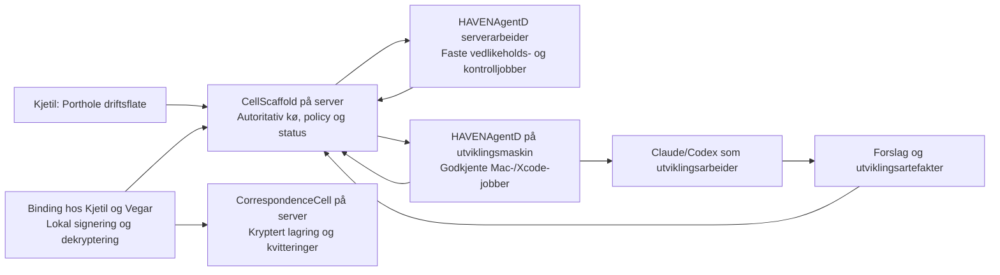

# Correspondence og jobbadministrasjon uten agentansvar i runtime

Til Kjetil · 9. september 2026 · **Plan, ingen implementasjon**

**Anbefaling:** La CellScaffold på serveren eie autoritativ tilstand, adgang og jobblivssyklus. La HAVENAgentD utføre avgrenset arbeid og rapportere maskinelle observasjoner. Gi deg en samlet driftsflate i Porthole og dere begge en meldingsklient i Binding. En Claude- eller Codex-prosess kan være utviklingsarbeider, men skal ikke være nødvendig for å starte, følge opp, avslutte eller forstå driften.

Presiseringen din styrer planen: Agentenes utviklingsrolle beholdes. Det som flyttes, er administrasjonsmyndigheten og ansvaret for kontinuitet. Jobbadministrasjonen nedenfor er en hovedleveranse på lik linje med correspondence.

## 1. Formål, bevisnivå og avgrensning

**Formål:** Du skal kunne se hva som faktisk skjer og bruke correspondence selv om samtlige LLM-prosesser er avsluttet. Utviklingsjobber som trenger en modell kan da vente eller feile, men køen, feilen, ressursbruken og leveransene skal fortsatt være tilgjengelige.

**Målbare sluttmål:**

1. To testbrukere kan enrolle, godkjennes, sende, motta og kvittere gjennom menneskeklienten uten MCP eller LLM.
2. To påfølgende invitasjonsrotasjoner fullføres før utløp uten manuell utstedelse, env-endring eller agentjobb.
3. En godkjent jobb starter fra tjenestens kø. Krasj, timeout, bortfalt worker og manglende leveranse blir synlige uten agentrapport.
4. Statusflaten viser serverens tilstand, måletid og kilde. Manglende data blir ikke presentert som null, grønt eller fullført.
5. Agentprosesser kan utvikle, men kan ikke godkjenne eget arbeid for produksjonsutførelse, administrere produksjonskøen, bruke correspondence-identiteter eller endre håndhevingen som kjører.

Følgende etiketter brukes gjennom hele dokumentet:

| Etikett | Betydning |
|---|---|
| **MÅLING** | Filinnhold, kode eller opptelling observert lokalt i denne gjennomgangen. En lest hendelseslogg beviser hva loggen sier; den er ikke et nytt serveropptak. |
| **SLUTNING** | Utledning fra angitte målinger. Begrensningen følger utledningen. |
| **FORSLAG** | Anbefalt design, terskel, prioritering eller estimat. Dette er ikke eksisterende funksjonalitet. |
| **IKKE UNDERSØKT / IKKE BEKREFTET** | Ingen tilstrekkelig måling. Fravær av treff gjelder bare de dokumenterte søkene. |

**MÅLING — undersøkelsens grense:** Bare lokale kilder er lest. Ingen tester, bygg, serverkall, MCP-kall, deploy eller meldingssending er utført. Ingen branch, commit, tagg, push eller `swift package edit` er endret. Denne planen er eneste tilsiktede filendring. Git-status viste allerede omfattende lokalt arbeid. Kildeankrene E1–E32 står i §11.

**SLUTNING:** Kode i disse arbeidstrærne er ikke i seg selv bevis på en publisert eller installert versjon.

**IKKE UNDERSØKT:** Kjørende produksjon/staging, installerte invitasjoner, faktisk aktive brukere, aktive launchd-jobber, nåværende nøkkeltilganger og nettverksrettigheter. Den bestilte planen krever ikke at disse miljøene berøres. Ingen eksterne fakta om lover eller leverandørgarantier brukes som premiss.

## 2. Hendelsene, kontrollert og korrigert

### 2.1 Målinger

| Nr. | MÅLING — hva kildene faktisk viser | Begrensning / korrigering |
|---|---|---|
| 1 | HD-0006 ble opprettet 4. september. Førkopien har `PREPARING`; nåværende post har `HANDOFF_REQUIRED`, oppdatert 9. september 08:34:32 UTC. Rotasjonsrapporten sier at forsøket stoppet før endring. E1. | «Står PREPARING» er utdatert. «Rotasjon ble aldri utført» kan avgrenses til det dokumenterte forsøket; global serverhistorikk er ikke kontrollert. Det konkrete enrollment-forsøket med Vegars feilmelding er ikke funnet som et primært serveropptak. Koden skiller `invite_not_found` fra `invite_expired`; «unknown» beviser ikke utløp. E9. |
| 2 | Lesson-filen har `status: active`, `automated: false`, teksten «utløp … på nytt», og «Rotasjon ikke automatisert». Den har samtidig `recurrence_after: 0`. E2. | Registrert gjentakelse er dokumentert i prosa. To uavhengige utløpshendelser er ikke reprodusert/verifisert her. Kravet om automatikk står uansett; telleren kan ikke brukes som bevis for antallet. |
| 3 | Roten inneholder **sju** mapper: `20260829`, `20260830`, `20260830b`, `20260830c`, `20260830d`, `20260908`, `20260908b`. Fem av dem har `sett/vegar-invite.json`, og de fem `inviteID`-verdiene er forskjellige. E3. | Fem Vegar-invitasjoner er bekreftet; fem generasjoner er korrigert til sju mapper. Ingen av disse filene beviser hvilken invitasjon serveren godtar. Ingen serverforankret «gjeldende generasjon»-mekanisme ble funnet i det undersøkte mint-/enrollmentløpet. |
| 4 | Losens logg sier 4. september at noe gikk ut i Losens navn uten Losens nøkkel. Vedleggsspesifikasjonen beskriver meldingen som klartekst gjennom operatørens rute. E4. Den gamle servercellen lagrer `senderID` fra den autentiserte principalen og `content` som tekst. E10. | Den opprinnelige meldingen med signaturmateriale og ordlyden «signert kanal» er ikke undersøkt. Hendelsesrapporteringen er bekreftet som kildeinnhold, ikke kryptografisk rekonstruert. En signert transportforespørsel fra operatøren beviser ikke en Losen-signatur. |
| 5 | Feilklasserapporten daterer «Append-only er allerede håndhevbar» til **4. september**. Loggen sier at §4A ble skrevet om til krav 8. september. Designrapportens tabell har **13 vurderingsrader**, linje 312–324; loggen omtaler 12. E5. Nåværende Vapor-kode har fortsatt en direkte `storage.set`/snapshotbane. E6. | En ny påstand 8. september er ikke bekreftet. «12 append-only-påstander» er heller ikke presist: tabellen omfatter blant annet nøkler, mandat, juridiske påstander og historikk. Generell append-only følger ikke av at en journal finnes. |
| 6 | Losens logg gjengir `recipient_not_allowed` og innrømmer at «bekreftet, ikke gjetning» var begrunnet med `participants.json`. E7. Serverkoden gir samme feil når recipient mangler, ikke er tillatt, **eller** ikke har aktiv grant. E10. | Feilen beviser ikke alene at ID-en var feil, og heller ikke at ID-en var riktig men inaktiv. Loggens diagnose er ikke en servermåling i denne gjennomgangen. Det verifiserte problemet er at konfigurasjonsinput ble behandlet som driftstilstand. |
| 7 | `_natt-20260908/STATUS.md` viser køavhengighet, MCP-feil, sandbox-/arkitekturproblemer og venting. E8. Den konkrete påstanden om «tre jobbspesifikasjonsfeil på to dager» står i køens `LES_MEG` og feilklasserapporten. Sistnevntes tabell viser **to feiljobber og én uttrykkelig feilfri kontrolljobb**. E8. | Tre distinkte feil av akkurat den beskrevne formen er ikke dokumentert av tabellen. To er konkretisert. Runnerens leveransesjekk gjelder bare når valgfri linje 3 er fylt ut; `.done` opprettes også etter mislykket kjøring. E16. |
| 8 | Lesson-filen beskriver harde tids-/rettighetsgrenser og MCP-avbrudd over 60 sekunder. Køens plist har selv `StartInterval = 60`; runneren starter `codex exec`. E2, E16. | MCP-tidsgrense og launchd-intervall er to forskjellige størrelser. Ingen universell 60-sekundersgrense for alle agentprosesser er etablert her. launchd er i seg selv en vanlig prosessforvalter; svakheten ligger i hvilke ansvar og observasjoner som mangler rundt jobben. |

### 2.2 Slutninger: akkurat hvilken agentavhengighet skal bort?

**SLUTNING:** Ingen av de underliggende feilklassene — utløp, feil ID, misvisende sikkerhetspåstand, ugyldig jobb eller krasj — er logisk umulig uten en agent. Å love at de forsvinner ved å flytte kode til en daemon ville gjenta den samme feilslutningen. Det agentspesifikke er at en LLM har vært nødvendig for å velge neste driftshandling, utføre den eller fortolke tilstanden for deg.

| Hendelser | SLUTNING — avhengighet som fjernes | Feil som fortsatt må håndteres maskinelt |
|---|---|---|
| 1–2 | Rotasjon har vært en administrert oppgave som noen måtte forberede/utløse. Manglende agentoppfølging kan holde vedlikeholdet uutført; de konkrete kildene viser også menneskelig eier og rettighetssperrer. | Utløp, restart, feil konfigurasjon, mislykket persistens, klokkefeil og nedetid. Invitasjonsautomatikk og varsling må bygges. |
| 3 | Valg av «riktig sett» avhenger av filtolkning og overlevering. | Flere samtidige eller gamle credentials er også et vanlig livssyklusproblem. Autoritativt register, overgangsstatus og revokasjon trengs. |
| 4 | En agent kunne velge operatørens senderute og omtale resultatet som Losens handling. | Identitetsforveksling og misbruk av signering kan også forekomme i vanlig programvare. Sender må utledes av nøkkel og verifisert mandat; fri tekst er aldri identitetsbevis. |
| 5 | Driftstillit ble knyttet til agentens utsagn om kode. | Optional journalføring og overskrivbare snapshots finnes uavhengig av hvem som beskrev dem. Disse er ikke løst av en ny statusflate. |
| 6 | Agentens tolkning av en lokal fil erstattet en autoritativ statusforespørsel. | En mottaker kan faktisk være ukjent, ikke godkjent, utløpt eller tilbakekalt. Flaten må vise disse som separate, tidsstemplete tilstander. |
| 7–8 | En agent måtte opprette jobben, vente, lese logs og fortelle deg hva som skjedde. Tap av agentkontekst kunne dermed bli tap av administrativ oppfølging. | Feil spesifikasjon, manglende verktøy, avbrudd, worker-krasj og halvferdige resultater. Disse må få deterministiske statuser og bevares uten en etterfølgende agenttråd. |

**FORSLAG:** Flytt både beslutningsmyndigheten for kjøring og den autoritative statusrapporteringen. Det er utilstrekkelig å la en daemon automatisk starte en ny Claude-tråd som skal avgjøre om forrige tråd ble ferdig.

## 3. Hva som finnes og hva som skal eies hvor

### 3.1 Gjenbruk som har konkrete kodeankre

| MÅLING | Brukbar del | Avgrensning |
|---|---|---|
| `AssistantCorrespondenceCell` og `VaporAssistantCorrespondence` har enrollment, grant-/signaturkontroller og snapshotlagring før HTTP-svar. E9–E11. | Enrollment- og adgangsadministrasjon. | Invitasjoner leses fra env; gamle meldinger lagres i klartekst. Ingen automatisk invitasjonsrotasjon er vist. |
| `VaporAdminMVP` har en administrativ godkjenningsrute med operator-kontroll og mutasjonsbeskyttelse. E12. | Menneskegodkjenning uten agent. | Dette er en konkret kontroll på ruten, ikke bevis på at en agent i dagens maskinoppsett mangler administratorcredential. |
| CellProtocols `CorrespondenceCell` mottar krypterte konvolutter, kontrollerer requester, medlemsfingeravtrykk, mottakersett og transportsignatur. E13. | Den varige meldingscellen. | Lest kode er ikke en godkjent serverleveranse. Retensjon ryddes ved operasjoner; sending lager ny UUID/sekvens; kvitteringen er ett delt felt. E14. |
| `CorrespondenceClient`, `CorrespondenceEnvelopeClient` og `ResolverCorrespondenceCellTransport` har celleklient, kryptofunksjoner og WSS-ruting. E15. | Flytt dette ut av MCP-target til et bibliotek brukt av menneskeklienten. | `doctor()` er uttrykkelig lokal. Den beviser ikke at server eller motpart er klar. |
| HAVEN-Deploy har typed jobbfelt, adaptere, tidsgrense, hendelser, varighet og hashet resultat per forsøk. E17–E18. | Jobbformat, executor-adaptere, validering og historikkimport. | Direkte filer er betrodde input; opprettelse setter READY. Exit 0 + tekstkontroll kan gi COMMITTED_VERIFIED. Ingen menneskebundet produksjonsgodkjenning følger av dette. |
| CellScaffold konfigurerer SQLite og QueuesFluentDriver, og starter en minuttstyrt `AsyncScheduledJob` i production-like-miljøer. E31. | Eksisterende database-, kø- og schedulerintegrasjon på serveren. | Den observerte jobben gjelder et annet domene. Dette viser integrasjonsstedet, ikke at correspondence- eller agentjobber allerede administreres der. |
| HavenAgentD har `AgentJobSpec`, `JobStore` og `JobCompletionService`. `AgentRuntime` starter tjenesten når `agentJobs.enabled` er satt. Standard er false. E19–E20. | Arbeiderens lokale registrering, resultathåndtering og avgrensede etterhandlinger. | Dokumentasjonen sier at oppstart/supervisjon av hovedprosessen er utenfor v1. Koden venter på `done.json`. Dette er ikke en komplett køforvalter. |
| WorkItem/Workbench og Personlog har eksisterende flater/projeksjoner. E21–E22. | Navigasjon, lister, drilldown og prosjektkobling. | WorkItem-status kan endres; Personlog-projeksjonen bygger på spørsmål/varsler. Ingen av dem er bevis på arbeidsprosessens faktiske tilstand. |

### 3.2 Valgt tjenestedeling — FORSLAG, nytt integrasjonsarbeid

**FORSLAG — én autoritet:** CellScaffold eier jobborder, godkjennelser, kø, forsøk, leases, planlagte frister og verifiserte resultatreferanser. HAVENAgentD er en autentisert worker med lokal prosessupervisjon og gjenutsending av hendelser. Worker-spoolen er ikke en alternativ hovedkø. Correspondence kan fortsette mens utviklings-Mac-en sover.

**FORSLAG — konkret lagrings- og schedulersted:** Utvid CellScaffolds eksisterende Fluent/SQLite-oppsett med migrasjoner for jobb, forsøk, godkjennelse, lease, hendelse og varslingsutboks. Celleoperasjoner bruker en typet lagringsadapter; kritiske statusoverganger, godkjennelsesbinding og tilhørende hendelse committes i samme databasetransaksjon. Cellens snapshot og Workbench-projeksjonen er avledninger, ikke parallelle skrivbare sannhetskilder. Registrer nye, faste reconcile-jobber ved køoppsettet i `configure.swift:680` og bruk eksisterende QueuesFluentDriver til å vekke dem. De leser varige frister, slik at tap av et timer-tick ikke betyr tap av oppgaven. HAVEN-Deploys SQLite-indeks skal ikke bli runtime-databasen. Alt dette er nytt W1, med E31 som integrasjonsanker.

**MÅLING — plattformgap:** HavenAgentD-pakken er målrettet macOS, runtime importerer `Darwin` og bruker `DispatchSourceFileSystemObject`; den har dessuten avhengighet til Mac-automatisering og CellApple. E23.

**FORSLAG — korteste servervei:** Legg den autoritative køen og tidsutløseren i den eksisterende CellScaffold-serveren først. Skill deretter den plattformuavhengige jobbkoden og worker-kontrakten ut av HavenAgentD, og bygg en liten Linux/server-worker uten AppKit, AppleScript, Shortcuts eller bruker-Keychain. Dette er **nytt arbeid W2**; ikke en påstand om at dagens `haven-agentd` kan flyttes uendret til serveren. Mac-worker beholdes for utviklingsjobber som krever macOS. Servervedlikehold skal aldri vente på den.

### 3.3 Eier per correspondence-funksjon — FORSLAG

«Automatisk» betyr her kjøring under en varig policy som et menneske har godkjent. Første identitetsgodkjenning og tilbakekalling er tilsiktede menneskehandlinger, ikke løpende operatørvedlikehold.

| Runtime-funksjon | Ansvarlig tjeneste og celle | Kjøring uten løpende menneske-/agentinngrep | Arbeid |
|---|---|---|---|
| Enrollment | CellScaffold; videreutviklet **`AssistantCorrespondenceCell`** som adgangscelle. | Binding genererer lokal enhetsidentitet, beviser nøkkelbesittelse og sender enrollment. Serveren oppretter én idempotent forespørsel og returnerer maskinell status. | Gjenbruk E9. W3/W5: menneskeflyt og kobling til relasjonscellen. |
| Invitasjonsutstedelse | CellScaffold; varig invitasjonsregister i samme adgangscelle. | Kjetil godkjenner en invitasjonspolicy for en navngitt relasjon. Tjenesten utsteder en begrenset engangsbillett; aldri et agentgenerert sett eller en env-fil. | **Nytt W3**. Gjenbruk datatypen og mint-logikken i E9/E24 etter flytting til tjenesten. |
| Rotasjon og utløp | CellScaffold eier frist og transaksjon i adgangscellen; server-HAVENAgentD kan utføre det faste reconcile-kallet. | Varig scheduler kjører hvert minutt og ved oppstart. Ny invitasjon finnes før fristen; gammel er tydelig erstattet/overlappende og utløper som før. §4 spesifiserer hele løpet. | **Nytt W1–W3**. |
| Godkjenning og kontroll av adgangsbevis | CellScaffold; adgangscellen + Resolver/Contract-admission til `CorrespondenceCell`. | Kjetil godkjenner første enhet i flaten; serveren verifiserer beslutningen og utsteder bevis. Binding henter bevis automatisk. Uendrede, aktive bevis fornyes under samme policy uten ny invite. Ny nøkkel, større scope eller utgått mandat krever ny menneskegodkjenning. | E11–E13 er delgrunnlag. **Nytt W3/W4**: binde enrollment-credential til subject, medlemskap og celle-Contract; dagens to modeller skal ikke likestilles. |
| Nøkkelhåndtering | Binding med separat lokal signeringstjeneste; lokal vault/klientcelle. CellScaffold har egen tjenesteidentitet for adgangsbevis. | Klienten signerer ved brukerens sending og dekrypterer ved mottak. Server-worker får egne vedlikeholdscredentials, ikke brukernes meldingsnøkler. Varslet recovery er en menneskestyrt handling ved tapt enhet. | E25 viser eksisterende rånøkkel-API. **Nytt W0/W5**: isolasjon, signeringsgrense og recovery-flyt. |
| Meldingslevering | CellScaffold; **`CorrespondenceCell`** per relasjon. Lokal klient har vedvarende utboks. | Forsegle, kølegg lokalt, send, persister på server, returner stabil receipt. Retry bruker samme idempotensnøkkel. Mottakers klient poller/abonnerer automatisk. | E13/E15. **Nytt W4/W5**: serverregistrering, varig commit, deduplisering, utboks og bakgrunnsmottak. |
| Kvittering | `CorrespondenceCell` lagrer; mottakers lokale klient produserer mottaksbevis. | Automatisk «mottatt av klient» først etter vellykket dekryptering/verifikasjon og lokal lagring. «Åpnet» er egen, valgfri brukerhendelse. Avsender ser status uten å spørre en agent. | E14 har bare et felles `acknowledged`. **Nytt W4/W5**: identitetsbundet receipt per mottaker og separat UI-status. |
| Oppbevaring og sletting | CellScaffold; `CorrespondenceCell` og tilhørende lagring. Scheduler/HAVENAgentD utfører fast sweep. | Frist beregnes ved commit. Bakgrunnssweep sletter utløpt innhold også uten trafikk; tombstone/deletion-receipt bevares separat. Backup- og klientkopier har eksplisitte frister. | E14 har operasjonsutløst purge og 30 dagers default/90 dagers maksimum. **Nytt W4/W6**: bakgrunnsrydding, backup-policy og gjenoppretting uten gjenoppliving av slettet innhold. |
| Vedleggslagring | CellScaffold; autorisasjon og referanser under den samme **`CorrespondenceCell`**, med separat opakt bloblager. | Klienten forsegler chunker; tjenesten lagrer dem uten dekrypteringsnøkkel, verifiserer transportintegritet og kobler atomisk til meldingen. Reconcile rydder foreldreløse opplastinger. | E26 er kryptodel og spesifikasjon, ikke ferdig fildeling. **Nytt W6**: manifest, grants, upload/resume/download, kvoter og sletting. Ingen separat semantisk vedleggscelle kreves. |

**FORSLAG — myndighet over medlemskap:** Tjenesten kan eie lagringscellen og utstede snevre subject-bundne Contracts under menneskegodkjent policy uten å være mottaker av meldingsnøklene. Dagens celle føyer owner til medlemslisten og krever at konvoluttens mottakere matcher hele listen. E13/E14. Derfor må W4 skille **lagringsautoritet** fra **kryptografisk mottakerliste**; ellers gjør servereierskap serveren til dekrypteringsmottaker. Medlemsendring må få ny verifisert medlemsversjon, og historiske meldinger må fortsatt verifiseres mot sin opprinnelige versjon. Det foreslås ikke å omgå dette med operatørens identitet.

## 4. Invitasjoner som ikke blir en ny manuell oppgave

Hele denne seksjonen er **FORSLAG / nytt W3**. Tallene er konkrete pilotkrav, ikke observerte standarder.

1. **Skill fire ting:** relasjon, invitasjon, enrollment og adgangsbevis. En utløpt invite skal ikke deaktivere en allerede godkjent relasjon. En gyldig invite er heller ikke et bevis på at Vegar er aktiv.
2. **Varig register:** En invitasjon har `invitationID`, `relationshipID`, målidentitet/enrollment-sak, `generation`, `issuedAt`, `expiresAt`, `rotateAt`, status, `supersedes`, policyversjon og hemmelighetens hash. Hemmelighet/privatnøkkel vises ikke i driftsoversikten. Tilstanden eies av tjenesten, ikke av miljøvariabler.
3. **Utsted 7-dagers billetter og roter senest 48 timer før utløp.** Sett `rotateAt` til 49 timer før utløp, slik at normal polling og et kort retry har margin til fristen. Scheduler sjekker minst hvert 60. sekund, også uten meldinger, og gjør et innhentingsløp ved restart. Operasjonen har unik nøkkel `(enrollmentCaseID, generation)` og bruker atomisk compare-and-set. To schedulere skal ikke kunne lage to «gjeldende» billetter.
4. **Gammel lenke skal ikke gjøre ny rotasjon ubrukelig.** Bruk en stabil enrollment-side per sak. URL-en er ikke adgangsbevis. Etter autentisering til den tiltenkte brukerkontoen/enhetssaken henter Binding den gjeldende engangsbilletten. Rotasjon oppdaterer saken; dere skal ikke få en ny filpakke hver uke. Ukjent mottaker må først knyttes til riktig konto ved menneskegodkjenning. Ikke gi en anonym, varig URL rett til å hente nye hemmeligheter.
5. **Overlapp er eksplisitt:** Ny billett merkes `current`, gammel `retiring` til opprinnelig utløp. Flaten viser begge og anbefaler bare `current`. Forbruk av én billett avslutter saken og invaliderer øvrige billetter i samme sak. Tilbakekalling stopper all videre utstedelse; rotasjon må aldri gjenopplive revoked/consumed-saker.
6. **Forny aktive credentials før deres egen frist:** Binding ber automatisk om fornyelse med gjeldende nøkkelbevis. Serveren godtar bare uendret subject, enhet, scope, relasjon og fortsatt aktivt mandat. Medlemspolicyens sluttdato er en hard grense. Godkjenning som utløper, eller tilbakekalt adgang, fornyes ikke automatisk.
7. **Synlig feil:** Mislykket rotasjon får retry med backoff og vedvarende feilstatus. Etter to mislykkede forsøk eller fem minutter etter `rotateAt` vises rødt avvik; mindre enn 24 timer igjen vises som kritisk. Varslingen skrives til en tjenesteeid varslingsutboks og vises direkte i Porthole. Gjenbruk `AssistantCorrespondenceNotificationOutboxCell` (E32), men bygg den manglende rotasjons-/driftskoblingen og kvittert varslingslevering. Agentvarsling inngår ikke.
8. **Nedetid behandles ærlig:** Ingen tjeneste kan rotere mens hele verten er nede. Ved restart beregnes status fra serverklokke og register; utløpte billetter godtas ikke. En fortsatt godkjent, uforbrukt enrollment-sak får ny billett automatisk. Flaten viser fristbrudd, ikke retroaktivt «rotert i tide».

**FORSLAG — sikker overgang:** Les installert serverinventar med menneskets godkjente driftsverktøy i migrasjonsfasen, uten å trykke hemmeligheter i rapporten. Importer eksisterende grants, historikk, sekvenser og enrollment-saker. De sju lokale mappene er sammenligningsmateriale, ikke autoritet. Konflikter mellom dem og serveren får egen avviksrad. Ny utstedelse aktiveres først etter at gammel env-utstedelse er sperret som skriver.

## 5. Jobbadministrasjon som en tjeneste

### 5.1 Eiermodell — FORSLAG

| Funksjon | Eier og plassering | Agentens rolle |
|---|---|---|
| Foreslå jobb | **Ny `RuntimeJobCell` i CellScaffold**; forslag knyttes til eksisterende WorkItem. | Kan foreslå mål, fremgangsmåte, executor, ressursbudsjett og leveranse. Forslaget gir ingen kjørerett. |
| Godkjenne | Kjetil eller eksplisitt delegert menneskelig operatør; autentisert beslutning lagres i `RuntimeJobCell`. | Kan forklare forslaget. Kan ikke godkjenne, endre eller gjenbruke en godkjennelse. |
| Utløse | Serverens scheduler under CellScaffold. | Agentens utviklingsprogram kan kjøre innenfor en godkjent jobb. Det administrerer ikke køens overganger. |
| Utføre og overvåke prosess | HAVENAgentD-worker; **ny `AgentJobCell`** eksponerer avgrensede workeroperasjoner. Gjenbruk `AgentJobSpec`, `JobStore`, executorene og ferdigovervåkeren. | Claude/Codex er én type arbeidsprosess. Faste vedlikeholdsjobber bruker ingen modell. |
| Måle tid, exit, heartbeat og bruk | Workerens supervisor og provider-adapter; inngår i signerte/autoriserte hendelser til `RuntimeJobCell`. | Agenttekst kan ikke sette disse feltene. |
| Eie resultat og historikk | CellScaffold i Kjetils/prosjektets tilgangsdomene; immutable forsøksreferanser og tjenesteeid artefaktlager. | Leverer artefakter og egen merket sluttrapport. Kan ikke endre tidligere verifiserte resultatregistreringer. |
| Vise samlet status | **Ny `WorkQueueViewCell`** og Workbench/Porthole-konfigurasjon. | Kan analysere et utdrag når du ber om det. Er ikke nødvendig for å se flaten. |
| Avbrudd, retry og kansellering | Scheduler/supervisor håndhever; mennesket velger ny prøve der policy krever det. | Kan foreslå retting eller en ny jobb. Kan ikke selv oppheve avvisning eller øke budsjett/rettigheter. |

Alle de tre navngitte nye cellene ovenfor er **nytt arbeid W1/W2**. `WorkQueueViewCell` er omtalt som utsatt i dagens dokumentasjon, ikke funnet implementert i de undersøkte hovedkildene. E17. Eksisterende WorkItem beholdes som planleggingsobjekt; prosessens tilstand skal ikke være et felt som en kanban-drag eller en agentrapport kan sette til «done».

### 5.2 Jobbkontrakt og godkjenning — FORSLAG / W1

En godkjennelse bindes til hash av den konkrete spesifikasjonen: formål, input-/promptreferanser, repository/revisjon, executorprofil, arbeidsområde, skrivbare leveranser, tidsbudsjett, token-/kostnadsramme, nettverksprofil, forventede artefakter og verifikator. Endres ett av disse, blir godkjennelsen ugyldig.

Godkjenningen kan dekke en hel utviklingsoppgave med redigering, tester, lokale commits og andre erklærte utviklingshandlinger. Den krever ikke menneskegodkjenning per kommando. Agenten beholder friheten til å utvikle innenfor oppdraget. Nye administrative effekter eller større budsjett krever en ny beslutning. Faste oppgaver som invitasjonsrotasjon og retensjon godkjennes som varige tjenestepolicyer og utløses deretter av scheduler.

Foreslått livssyklus:

`proposed → awaitingApproval → queued → leased → running → verifying → succeeded | failed | timedOut | cancelled | interrupted | outcomeUnknown`

`rejected` og `blocked` har maskinell årsak. Ny prøve får nytt `attemptID`; den overskriver ikke forrige forsøk. Manglende avhengighet gir synlig `blocked`, ikke bare en READY-post som dispatcheren hopper over.

**Suksess er avgrenset:** `succeeded` betyr at den deklarerte maskinelle kontrollen bestod. `reviewState = pending | accepted | changesRequested` beskriver menneskets vurdering separat. En agentrapport om at oppgaven er ferdig ligger i `agentReport`, aldri i statusfeltet. Dagens `COMMITTED_VERIFIED`-arbeidsjobber importeres som «legacy resultatkontroll», ikke som bevist funksjonell korrekthet. E18 viser hvorfor.

### 5.3 Prosessliv, krasj og halvferdige leveranser — FORSLAG / W1–W2

- **Valider før ressursbruk:** obligatorisk leveransebeskrivelse, kanonisk eksisterende arbeidsområde, skrivbar output innenfor tillatt rot, ingen symlink-utgang, rett OS/arkitektur/verktøy, nødvendige input og executor-tilgang. Feil gir `rejected` med kode før modellen startes. En jobb som bare analyserer kan ha stdout-artefakt uten filskrivetilgang.
- **Worker leier ett forsøk:** serveren registrerer workeridentitet, monoton lease-generasjon og utløp. Worker sender heartbeat hvert 15. sekund. Etter 60 sekunder uten heartbeat utleder serveren `workerUnreachable`/`outcomeUnknown` innen neste 15-sekunders kontroll. Den påstår ikke at prosessen sikkert er død.
- **Supervisor eier prosessen:** pid/prosessgruppe, starttid, tidsgrense, exitkode og stopp registreres uten LLM. Tidsgrense gir kontrollert terminering og deretter hard stopp etter en fast nådetid. Supervisoren skriver siste kjente tilstand og bevarer delartefakter også når arbeidsprosessen dør før rapport.
- **Krasj hos supervisor:** ved restart sammenlignes varig attempt og faktisk prosessidentitet, inkludert startidentifikator. Usikker effekt blir `outcomeUnknown`. En ny worker får ikke automatisk gjenta sideeffekter. Lease-fencing avviser gamle workers resultat- og effektforsøk; godkjente effekter må gå gjennom en broker som kontrollerer gjeldende generasjon.
- **Retry:** sikre, idempotente tjenesteoperasjoner kan gjentas under policy. En utviklingsjobb som stoppet midt i filendringer får et nytt forsøk i isolert arbeidsområde etter eksplisitt beslutning. Endringer og logs fra det gamle forsøket bevares.
- **Artefaktkontroll:** forventede filer må være lesbare, innenfor leveranseområdet, nye for forsøket og ha digest/størrelse. Fil som fantes før start er ikke automatisk levert. Manglende rapport/artefakt gir `failed: artifactMissing`, selv ved exit 0.
- **Server utilgjengelig:** worker spoler sekvensnummererte hendelser lokalt og sender dem på nytt idempotent. Nye jobber/effekter starter ikke uten gyldig lease. UI beholder siste snapshot med tydelig alder. Ved tap av server og worker samtidig finnes ingen fersk måling; dette skal stå eksplisitt.

**MÅLING:** Dagens `_losen-queue/runner.sh` bruker en tidsbasert lås og oppretter `.done` før den kontrollerer at en oppgitt leveranse finnes. HAVEN-Deploy har en mer strukturert dispatcher, men behandler bare READY-jobber og kan etterlate RUNNING/lås etter eget krasj. HavenAgentDs recovery retter avbrutte etterhandlinger, ikke en vilkårlig hovedprosess. E16–E20.

### 5.4 Tokenforbruk uten oppdiktede tall — FORSLAG / W2

Vis per forsøk `inputTokens`, `outputTokens`, `cachedInputTokens`, modell/provider, målekilde, måletid og `usageState = final | partial | unavailable`. En samlet jobb summerer bare sammenlignbare, dedupliserte forsøk og viser hvor mange som mangler måling. Fraværende bruk er **ukjent**, aldri 0.

Cached input merkes som delmengde når providerens inputtall allerede inkluderer det; det skal ikke telles en gang til i totalen. Tidsforbruk kommer fra supervisorens klokke, mens tokenforbruk kommer fra usage-kilden. Ingen av disse feltene fylles fra agentens prosatekst.

Provider-adapteren må hente strukturert usage fra CLI-/API-hendelser eller providerens avregningskvittering. Agentens egen oppsummering og antall ord i stdout godtas ikke som tokenmåling. Dagens undersøkte `Outcome` har exit/stdout/stderr/timeout, og Codex-adapteren ber ikke om strukturert bruk. E18. Derfor er usage-adapter og varig hendelsesstrøm nytt arbeid. Støtte hos installert CLI/provider må verifiseres i implementasjonsfasen; ingen bestemte nye CLI-flagg loves her.

Hvis faktisk tokenbruk ikke er tilgjengelig før slutten, kan UI vise et separat **budsjett** og en maskinell tidstopp, men ikke love et nøyaktig hardt tokentak. En profil som lover et slikt tak må bruke en gateway/provider som kan håndheve det. Modelltjenestens credential gis gjennom en utviklingsbroker med budsjett; det er ikke correspondence- eller produksjonsmyndighet.

## 6. Hva du ser, og hvilken klient dere bruker

### 6.1 Én driftsflate — FORSLAG / W1, W3, W5

I den eksisterende Workbench/Porthole-navigasjonen legges **Drift** med to likeverdige faner: **Jobber** og **Correspondence**. Flaten leser autoriserte celleprojeksjoner på serveren. Den krever ingen modell og ingen forklarende agentrunde. Det skal finnes en tilsvarende typed CLI for samme API; ikke en kommando som ber en LLM lese mapper.

| Spørsmålet ditt | Eksakte opplysninger i flaten |
|---|---|
| Hvilke jobber venter eller kjører? | Jobb-/attempt-ID, tittel, foreslått av, menneskelig godkjenner, godkjennelsesdigest, executor/worker, køposisjon, avhengighet, status og maskinell årsak. |
| Hvor lenge og hvor mye? | Opprettet, godkjent, kølagt, startet, siste heartbeat, slutt, køtid, kjøretid, tidsgrense og usage med kilde/fullstendighet fra §5.4. Estimat har eget felt. |
| Hvor er leveransen? | Artefaktlenker, digest, størrelse, kontrollresultat, exitkode, separat agentrapport og menneskelig review. Avbrutte jobber har delartefakter. |
| Stoppet noe halvveis? | Rød/tydelig rad for timeout, manglende heartbeat, krasj eller manglende artefakt. Antall uløste avvik står i toppfeltet. Det forsvinner ikke fordi en agenttråd avsluttes. |
| Hvem er enrollet? | Navn koblet til serverens subject/enhet/fingeravtrykk; pending/approved/active/expired/revoked som separate livssyklustrinn, siste serverbekreftelse og grant-/Contract-frist. |
| Hvilke invitasjoner gjelder? | Gjeldende og retiring generation per enrollment-sak, issue-/utløpstid, `rotateAt`, siste rotasjonsresultat og årsak til consumed/revoked/expired. Aldri selve hemmeligheten. |
| Kom meldingen frem? | `lokalt kølagt`, `lagret på server`, `mottatt av mottakerklient`, eventuelt `åpnet`, eller `utløpt/avvist`. Tid, message-ID og verifisert mottaker følger kvitteringen. |

Alle faktavisninger har `sourceService`, `sourceRevision`/hendelsessekvens, `observedAt` og alder. En brutt forbindelse gjør status **utdatert**, ikke grønn. Tjenestens avledede varsler vises i eget felt fra rå målinger. En eventuell agentvurdering er et separat, merket vedlegg og endrer ikke status.

**MÅLING:** Dagens private correspondence-state viser tellinger, og admin-state viser ventende forespørsler. Dette er et nyttig utgangspunkt, men gir ikke den etterspurte komplette listen over invitasjoner, gyldighet og aktive medlemskap. E11. Eksisterende Porthole-ruter og Workbench-skeleton gir en faktisk vert for flaten. E21/E28.

### 6.2 Meldingsklient: Binding på hver Mac — FORSLAG / W5

**Valgt første klient:** Binding med inngangen **Meldinger**. Dere velger den bekreftede relasjonen Kjetil–Vegar, skriver, sender og leser der. Oppkobling åpnes fra den stabile enrollment-siden. Avsendernavn og fingerprint kommer fra identiteten som faktisk signerer. Ingen profil velges av en agent.

Korteste vei fra koden:

1. Flytt `CorrespondenceClient`, `CorrespondenceEnvelopeClient`, transport-/kontrakttypene og den nødvendige vault-integrasjonen ut av executable-targetet `HavenCorrespondenceMCP` til et gjenbrukbart bibliotek. Ikke kopier to separate kryptoløp. E15/E23.
2. Bygg en liten lokal **`CorrespondenceClientCell`** for menneskets utboks, innboks, decrypt/verify og enrollment-status. Dette er en ny celle. Binding laster dens konfigurasjon gjennom sin eksisterende Porthole-bro. E27. Signeringsoperasjoner går gjennom en separat, beskyttet lokal tjeneste; UI-en får aldri rånøkkelretur.
3. Bygg meldingsliste, skrivefelt, identitetsvisning, vedlegg og receipts. Bakgrunnsmottak skal drives av en ordinær lokal tjeneste, ikke av at Claude Desktop er åpent. Lukket Binding påvirker presentasjon, ikke serverlagring; når Mac-en er offline vises ingen mottakskvittering før klienten faktisk har mottatt.
4. Enrollment går hele veien fra «Koble til» via menneskets godkjenning til aktiv klient. Ingen `mcp setup`, `activate`, profil-JSON-redigering eller agentmelding inngår i brukerflyten.
5. Installerbar, menneskelig godkjent klientpakke med synlig versjon og kompatibilitetsstatus inngår i W5. Eksisterende MCP-pakke er ikke en ferdig menneskeklient.

**SLUTNING — hvorfor denne veien:** Kryptoklienten og Binding-rendereren finnes i Swift. Å gjøre nettleseren til første ende-til-ende-krypterte meldingsklient krever en egen nettleserimplementasjon av nøkkel-, konvolutt- og recovery-løpet som ikke er verifisert her. Binding er derfor den anbefalte første meldingsklienten; nettleseren brukes straks til jobber og correspondence-administrasjon. Dette er et arkitekturvalg, ikke et målt tidsforsøk. Andre plattformer er ikke undersøkt.

## 7. Hva som skal avvikles og hva som blir stående

Alt i tabellen er **FORSLAG til senere migrasjon**, ikke tillatelse til å rydde eller stoppe noe nå.

| Avvikles som administrasjons-/produksjonsvei | Konkret materiale | Erstatning og tidspunkt |
|---|---|---|
| MCP som nødvendig meldingsgrensesnitt | `HavenAgentD/Sources/HavenCorrespondenceMCP/CorrespondenceMCPService.swift`, `HavenCorrespondenceMCPMain.swift`, executable-produktet og onboardingens Claude/MCP-trinn. E15/E23/E29. Lokale installerte konfigurasjoners eksakte stier er ikke undersøkt. | Binding + delt klientbibliotek. Produksjonsregistreringer/credentials tilbakekalles etter G5. MCP-kode kan beholdes i utviklingsfixtures uten produksjonsmyndighet. |
| Håndminting av invitasjonssett | `CellScaffold/scripts/create-assistant-correspondence-pilot.py`, `sett/*-invite.json`, `participants.json`, env-generering og pakkedistribusjon fra alle sju `korrespondanse-privat-*`. E3/E24. | Serverregister og stabil enrollment-side. Skriptet avgrenses til testdata; produksjon kan ikke importere vilkårlige sett etter G3. |
| Invitasjonsrotasjon som deployjobb | `HAVEN_ASSISTANT_CORRESPONDENCE_INVITES_BASE64`, HD-0006-prosedyren med env-only-rotasjon og dens manuelle forberedelse. E1/E9. | Friststyrt reconcile i adgangscellen. HD-0006 lukkes først med menneskelig kontrollert migrasjons-/akseptbevis, ikke fordi planen finnes. |
| Agentens private mapper som sannhetskilde | `korrespondanse-privat-*` og kopierte profiler/pakker. | Importinventar med hash/proveniens og en tydelig legacy-status. Etter godkjent migrasjon fjernes gamle secrets/credentials fra aktive maskiner etter konkret inventar; dokumentarisk historikk bevares uten hemmeligheter. Ikke blind sletting. |
| Klartekstlevering via gammel operatørrute | Meldingsdelen av `AssistantCorrespondenceCell` og `POST .../messages` i `VaporAssistantCorrespondence`. E10. | `CorrespondenceCell` med verifisert konvoluttløp. Adgangsfunksjonene beholdes. Gammel historikk vises merket legacy og får ingen etterkonstruert signatur eller E2E-status. |
| Agentadministrert filkø | `_losen-queue/runner.sh`, `org.digipomps.losen-queue.plist`, aktive `inbox/`- og `running/`-overganger. E16. | Serverkø og daemon-supervisor etter G2/G7. Gamle `done/`/`logs/` importeres med original status, tidskilde og ukjent usage der måling mangler. |
| Ny filkø som alternativ autoritet | Direkte skriving av READY-jobber under `HAVEN-Deploy/queue/tasks/`, `tools/dispatch.py --once` som selvstendig køeier, ny launchd-dispatcher som hovedløsning. E17–E18. | Gjenbruk adaptere/validering under tjenesteeierskap. Behold HAVEN-Deploys deployhistorikk og utviklingsverktøy. Ikke flytt bare agentens filskriving til en annen mappe. |
| LLM som obligatorisk etterkontroll | Agent som leser `.svar.md`/`.done` og rapporterer suksess, periodisk ny Claude-tråd for å administrere køen, og etterhandling som automatisk starter en ny agent for å avgjøre status. E8/E16/E20. | Supervisor → verifikator → statusprojeksjon. Nye utviklingsjobber kan foreslås av agenten, men krever gjeldende jobbgodkjenning. |

**FORSLAG — bevar ved overgang:** Ikke stans en aktiv gammel jobb og start en kopi på ny kø uten å kjenne effekttilstanden. Steng først ny tilførsel, importer ventende arbeid som **forslag**, la kjørende arbeid fullføre eller marker det for menneskestyrt avbrudd, og sammenlign manifestet. Unik `legacySource + legacyID + attempt` hindrer dobbeltimport. Historiske `.done`-markører konverteres ikke til «bestått» uten resultatkontroll.

## 8. Håndhevbare grenser, uten å begrense utviklingsbidrag

Hele seksjonen er **FORSLAG / W0–W2/W5**. Dette beskriver kontrollene som må bygges og verifiseres, ikke kontroller som er bevist installert.

| Grense | Mekanisk håndheving | Utvikling som fortsatt er tillatt |
|---|---|---|
| Ingen produksjonsnøkler hos en agent | Agentprosesser kjører i separat OS-/VM-identitet uten produksjons-home, Keychain, secrets-volume, SSH-agent/socket, docker-socket eller produksjonsmiljøvariabler. Servicecredentials holdes i supervisor/broker, uten arv til barnet. | Skrive og teste all nøkkel-/driftskode med testidentiteter. Dagens rånøkkel-API er ikke et sikkert prosesskille; E25. |
| Ingen deploymyndighet | Produksjons-SSH, sudo, containerkontroll og release-signering er utilgjengelig fra utviklingsworker. Produksjon tar bare imot artefakter med menneskegodkjent digest fra en separat releaseidentitet. CI/branch-regler alene er ikke nok hvis agenten kan endre hele kontrollkjeden. | Utvikle deployskript, migrasjoner og tester; forberede branch/commit/PR som del av autorisert utvikling. Ingen ekstra begrensning i faglig bidrag. |
| Ingen invitasjonsminting eller adgangsgodkjenning | Serveren skiller `job.propose`/utvikling fra `invite.issue`, `grant.approve`, `policy.change`. Agentcredential får aldri de siste. Direkte filskriving gir ingen adgang til registeret. | Utvikle utstederen og foreslå invitasjonspolicy med testdata. |
| Ingen sending som Kjetil, Vegar eller Losen | Ingen produksjons-signering/dekryptering eller send-capability fra agentmiljøet. Menneskeklientens signeringsbroker binder godkjenning til avsender, mottakersett og meldingsdigest. Den kan ikke kalles som en generell signeringsoracle av jobber eller MCP. | Foreslå meldingsutkast, implementere klienten og kjøre sim-identiteter. Et utkast er data frem til et menneske sender. |
| Ingen egengodkjenning eller statusforfalskning | API autoriserer actor fra tjenesteverifisert identitet, ikke `origin` i JSON. Bare scheduler/supervisor/verifikator kan endre sine respektive statusfelt. Arbeidsprosessen kan ikke skrive kødatabase, receipts eller godkjennelseslogg. | Foreslå jobber og underjobber; kjøre godkjente utviklingsoppgaver og levere artefakter. |
| Ingen endring av kjørende håndheving | Workerens executable, policy, launch-konfigurasjon og broker er eid av annen OS-identitet og montert read-only for utviklingsjobben. Endring i repoet påvirker ikke kjørende binær før separat menneskelig release. | Full frihet til å forbedre kildene, også supervisor og policykode. |

**MÅLING:** Dagens HAVEN-Deploy-prosessadapter arver miljøet ved standardkjøring, og dagens jobbdokumentasjon erkjenner at fri skrivetilgang til køområdet kan forfalske opphav. E18/E17. Å flytte samme runner til en tjeneste med Kjetils fulle rettigheter ville ikke oppfylle grensene.

**FORSLAG — lokal menneskeklient må beskyttes fra lokale utviklingsagenter:** Separasjon må også gjelde brukerens sesjon. En agent som kan lese samme vault eller fritt fjernstyre den autoriserte meldingsklienten, kan fortsatt sende gjennom den. Produksjons-Binding, signeringsbroker og godkjenningsflate må derfor ligge utenfor utviklingsagentens fil-/UI-/accessibility-tilgang, eller kreve en beskyttet brukerbekreftelse som agenten ikke kan produsere. Agentene får en separat test-Binding og testserver for utvikling. Den nåværende maskinens faktiske tillatelser er ikke undersøkt; G0 er en nødvendig leveranseport.

**SLUTNING — avgrenset trusselmodell:** Dette kan håndheve skillet mot agentprosesser uten root/admin. Det beviser ikke motstand mot en ondsinnet vertadministrator eller et kompromittert operativsystem. Planen trenger ikke å love generell ikke-ekstraherbarhet, juridisk representasjon eller global append-only for å fjerne agentenes administrasjonsmyndighet. Losens eventuelle egen entitet/nøkkelmodell er et separat utviklingsarbeid og blokkerer ikke Kjetil–Vegar-kommunikasjon.

## 9. Arbeidspakker, rekkefølge og binære porter

### 9.1 Omfang og estimat — FORSLAG

Estimatene er **utviklerdager**, inkludert målrettet verifikasjon og dokumentert brukerflyt. De er faglige anslag, ikke målinger. De gjelder gjenbruk av eksisterende repos, ikke et nytt meldings- eller køprodukt fra bunnen. Uavklarte produksjonsdata, tilganger og releasevinduer kan gi tillegg.

| Pakke | Konkret nytt arbeid / endringssted | Estimat |
|---|---|---:|
| W0 | Inventar, aktør-/rettighetskille, beskyttet menneskegodkjenning, isolert akseptmiljø og migrasjonsmanifest. Ny driftspolicy rundt eksisterende tjenester. | 3–5 dager |
| W1 | `RuntimeJobCell`, `WorkQueueViewCell`, transaksjonell lagring, scheduler, godkjennelsesbinding, livssyklus, maskinell status-API/CLI og første Jobber-flate i CellScaffold. Import av begge filkøene. | 8–12 dager |
| W2 | Plattformutskilling i HavenAgentD; Linux/server-worker og Mac-supervisor; lease/heartbeat/fencing, adaptergjenbruk, usage, resultatreceipts og robust restart. | 6–9 dager |
| W3 | Varig invitasjons-/enrollmentregister i `AssistantCorrespondenceCell`, automatisk rotasjon/fornyelse, stabil enrollment-side, admintabell og overgang fra env-sett. | 6–9 dager |
| W4 | Registrer og host `CorrespondenceCell` i CellScaffold. Koble adgang til Contract, skill owner/mottakere, versjoner medlemskap, persister før receipt, dedupliser sending, utvid kvittering og retensjons-sweep. | 8–12 dager |
| W5 | Delt klientbibliotek fra MCP-target, `CorrespondenceClientCell`, Binding-flyt, beskyttet lokal signering, utboks/bakgrunnsmottak, versjonert installer og felles statusvisning. | 6–9 dager |
| W6 | Integrer `AttachmentStreamV1`: manifest, opakt bloblager, grants, chunk/resume/integritet, kvoter, retensjon, backup- og gjenopprettingspolicy. Gjenbruk eksisterende vedleggsspesifikasjon. | 6–10 dager |
| W7 | Samlet brukeraksept, avbruddsprøver, migrasjon/reconciliation, menneskelig kontrollert cutover, avvikling av gamle credentials/innganger og driftsinstruks. | 5–8 dager |
| **Sum** | Fullt omfang i planen. | **48–74 utviklerdager** |

Med to utviklere er 6–10 kalenderuker en planleggingsramme, ikke en lovet dato. W3 kan utvikles parallelt med W2; W5 kan utvikles mot kontrakt mens W4 ferdigstilles. Integrasjon og menneskegodkjent cutover er avhengigheter. Det er ikke nødvendig å vente på alle vedlegg før tekstmeldinger tas i bruk, men sluttmålet er ikke bestått før W6/G6 også består.

### 9.2 Porter som ett menneske kan kjøre alene — FORSLAG

**Alle `havenctl accept ...`-kommandoer nedenfor er nye akseptkommandoer som skal leveres med arbeidet. De finnes ikke som verifiserte kommandoer i dag og er ikke kjørt i denne jobben.** De kjører mot et isolert, installert akseptmiljø med to testidentiteter og uten produksjonsprinsipaler. CLI og flate bruker samme tjeneste-API. Hver kommando leverer `pass: true|false`, rå målinger og artefaktreferanser. Ingen LLM avgjør pass/fail.

| Fase/port | Menneskets akseptansetest | **Sann hvis og bare hvis** | Eier ved gjennomføring |
|---|---|---|---|
| **G0: Myndighetskille** etter W0 | Kjør `havenctl accept isolation` fra testens agentidentitet; autentiser deretter én adgangsgodkjenning gjennom den eksisterende adminruten fra den beskyttede menneskeflaten. | Alle forsøk på production-key-lesing, signing, invite-mint, deploy, kø-/policyfilskriving og egengodkjenning blir nektet; adgangsgodkjenning med menneskeidentitet virker; en vanlig utviklingsprosess kan redigere/teste sine tillatte kilder. Ingen sensitiv byte inngår i bevispakken. Jobbspesifikk godkjenning prøves i G1. | Kjetil + levert testsuite. |
| **G1: Oversikt og godkjenning** etter W1 | Kjør `havenctl accept job-admission`, og godkjenn jobb A i Jobber-fanen. Fixture inneholder også ugodkjent B, ugyldig outputsti C og endret godkjent spec D. | A er eneste kjørte jobb. B starter ikke; C avvises før executorstart; D krever ny godkjenning. Alle fire vises med maskinell årsak, tidsdata og artefakt-/resultatstatus. Gjenstart av CellScaffold bevarer alle fire og samme godkjennelsesbinding. | Kjetil alene. |
| **G2: Halvferdig arbeid er synlig** etter W2 | Kjør `havenctl accept job-failures`; testpakken dreper en arbeidsprosess, en supervisor og en workerforbindelse, kjører en timeout og én exit-0-jobb uten forventet artefakt. | Ingen blir feilaktig succeeded. Tapt heartbeat vises innen 75 sekunder, timeout stopper prosessgruppen innen frist + 10 sekunder, delartefakter bevares, restart gir ikke dobbeltkjøring, gammel lease kan ikke fullføre/utløse effekt. Usage-fixture vises eksakt; manglende usage vises unavailable. En jobb kjører etter godkjenning mens alle administrerende LLM-sesjoner er avsluttet. | Kjetil alene. |
| **G3: To automatiske rotasjoner** etter W3 | Kjør `havenctl accept invite-lifecycle`; testklokke og restart styres av harness, ikke ved å endre vertsklokken. Bruk samme enrollment-lenke før/etter rotasjon. | To etterfølgende generasjoner utstedes senest ved forrige `expiresAt − 48h`, uten agent, env-redigering eller ny lenkelevering. Duplikat scheduler gir én current per sak. Gammel billett avvises etter frist. Consumed/revoked sak fornyes ikke. Allerede enrollet enhet beholder gyldig adgang gjennom invite-utløp. Påført feil gir synlig avvik innen fem minutter; restart henter inn manglende kjøring uten å skjule fristbruddet. | Kjetil alene, testidentiteter. |
| **G4: Varig kryptert levering** etter W4 | Kjør `havenctl accept correspondence-server` mot faktisk servertransport. Harness sender A→B, gjentar samme request, krasjer etter commit/før svar og restarter serveren. | B får nøyaktig én melding, samme message-ID/sekvens etter retry, korrekt verifisert innhold etter restart; lagringsdump har ingen testklartekst eller brukernøkkel; feil signer, feil medlemsversjon, tilbakekalt Contract og klartekstrequest avvises. Avsenders egen ack kan ikke bli mottakers receipt. | Kjetil alene. |
| **G5: Menneskeklienten** etter W5 | Start to isolerte Binding-profiler A/B på testmaskinen, avslutt MCP/LLM i testmiljøet, og bruk den leverte sjekklisten: enrollment, godkjenning, send, mottak, åpne, frakoble, send igjen, koble til. Kjør `havenctl accept human-client` for å kontrollere hendelsene. | Hele flyten fullføres med Binding/Porthole, ingen terminal-/profilfilredigering eller MCP. Avsender og mottakerfingeravtrykk stemmer. Offline-melding står kølagt, blir levert én gang og mottakerkvitteres først etter faktisk mottak. Visningens serversekvens og status er identisk med status-API-et. | Kjetil alene med to testprofiler; senere installerer Vegar samme godkjente pakke. |
| **G6: Vedlegg og sletting** etter W6 | Kjør `havenctl accept attachment-retention` med fast testfil, avbrutt/resumert upload, tuklet/manglende siste chunk, utløp og gjenoppretting fra backup. | Rundtur gir identisk digest; endret/avkortet fil gir avvisning og ingen delvis klartekstleveranse. Uautorisert download nektes. Utløpt melding/vedlegg kan ikke hentes; sweep fjerner aktiv blob innen fem minutter uten meldingslesing. Foreldreløs upload ryddes etter deklarert frist. Restore gjenoppliver ikke slettet innhold som lesbart. | Kjetil alene. |
| **G7: Eierskapet er flyttet** etter W7 | Kjør `havenctl accept cutover` mot migrasjonsmanifestet. Sett all ny jobbtilførsel i de gamle køene til avsluttet, og observer deretter en 48-timers pilot med administrerende LLM-er av. | Alle legacy-poster er avstemt én gang; ingen ukjent running-jobb forsvinner; gamle produksjonscredentials/innganger avvises; restart av worker/server bevarer kø, grants, sekvenser og receipts; ingen manuell fil- eller agenthandling trengs for den installerte driften. Piloten har ingen uforklarte hull i heartbeat-/rotasjonsloggen. | Kjetil, med Vegar for den faktiske menneskeoverleveringen etter teknisk port. |

G0–G7 er **ikke kjørt**. Portenes resultatfelt står tomme til det finnes målebevis. Historiske lokale tester kan ikke fylle dem inn. Særlig dokumenterer S5-rundturen lokal kryptert cellebruk, mens rapporten selv etterlyser faktisk WSS/stdio-rute. E30.

**FORSLAG — akseptmiljøets avgrensning:** Jobbfixture i G1 og feilinjeksjonene i G2 bruker deterministiske testprosesser, slik at køens administrasjon kan prøves uten en modell. I tillegg skal W2 levere én reell utviklingskjøring for hver installert executorprofil med målt usage eller eksplisitt unavailable. En profil som ikke har bestått dette vises som utilgjengelig og kan ikke velges for kjøring. G0 bruker ufarlige kontrollobjekter under identiske tjeneste-/OS-rettigheter; senere cutover kontrollerer de faktiske tilgangsreglene og revokasjonsresultatene uten å hente produksjonsnøkler.

**FORSLAG — avbrudd og rollback:** Før cutover tas verifisert backup og migrasjonsmanifest med grants, medlemsversjoner, sekvenser, utestående jobber og artefaktdigester. Ett system har skriverett om gangen. Ved feil deaktiveres nye mutasjoner og forrige kompatible binær kan settes tilbake mot kontrollert datasett. Uvisst effektutfall avklares før replay. Rollback skal ikke gjenaktivere agentcredentials, gamle invitasjoner eller klartekstsending; dersom sikker klient ikke kan opprettholdes, vises eksplisitt tjenesteavbrudd mens mennesket retter feilen.

## 10. Hva som går tapt og hva som fortsatt gjenstår

**FORSLAG / vurdering av kostnad:** Utviklingen blir større nå: varig tilstand, server-worker, brukerflate, pakking, driftsovervåkning og migrasjon må leveres. Du må vedlikeholde versjonskompatibilitet og ha et menneskelig releaseansvar. Server, artefaktlager, backup og usage-gateway gir driftskostnader som ikke er priset her.

Ad hoc-administrasjon blir mindre fleksibel. En agent kan ikke lenger «bare fikse» produksjonsinvitasjonen, starte ny kjøring med større rettigheter eller sende i ditt navn. Forslaget må gjennom tjenestens policy og din beslutning når myndighet endres. Normal utvikling innenfor et godkjent oppdrag beholder handlingsrommet sitt.

Binding først innebærer installasjon og oppdatering på begge Mac-er. En ren nettleserklient med tilsvarende nøkkelvern er ikke inkludert i første leveranse. Mac-er som sover mottar senere; serverstatus skal vise det. Mistet nøkkel og endret enhet krever en forståelig recovery-prosess. Ny nøkkel kan ikke uten videre dekryptere gammel E2E-historikk; dette må dere velge policy for i W5, ikke få lovet automatisk.

En statusflate kan vise hva tjenesten har målt; den kan ikke bevise at et menneske forstod en melding eller at en utviklingsleveranse er god bare fordi prosessen sluttet. Lokale filhash-/snapshotmekanismer gir heller ikke generell uforanderlighet mot vertadministrator. Sletting på serveren trekker ikke tilbake kopier en legitim mottaker allerede har eksportert. Disse grensene skal være synlige og konkrete.

**IKKE UNDERSØKT — avklaringer som gjenstår før installasjon:** faktisk serverinventar og dataomfang; operatør-/nøkkelrettigheter; eksisterende Binding-versjoner hos dere; providerens tilgjengelige usage-signaler; backupens oppbevaringsfrister og recovery-behov. W0/W2/W5/W6 har eksplisitt ansvar for disse punktene. Ingen av dem skal fylles med en antakelse eller med gamle agentutsagn om hva som kjører.

## 11. Kildeanker og etterprøvbarhet

### 11.1 Hendelseskilder

Alle stier nedenfor er lokale kilder. Linjenummer gjelder denne gjennomgangen, ikke en garanti for uendret arbeidsområde.

| ID | Kilde og avgrenset observasjon |
|---|---|
| E1 | [HD-0006](/Users/kjetil/Build/Digipomps/HAVEN/HAVEN-Deploy/queue/tasks/HD-0006.json:8), status ved [linje 46](/Users/kjetil/Build/Digipomps/HAVEN/HAVEN-Deploy/queue/tasks/HD-0006.json:46); [førkopi](/Users/kjetil/Build/Digipomps/HAVEN/_s5-rundtur-20260909/HD-0006.before.json:31); [stoppbeslutning](/Users/kjetil/Build/Digipomps/HAVEN/_s5-rundtur-20260909/INVITE_ROTASJON_RAPPORT.md:89). |
| E2 | [Invite-lesson](/Users/kjetil/Build/Digipomps/HAVEN/HAVEN-Deploy/lessons/L-2026-08-28-correspondence-invites-expire.json:2), linje 2–13; [execution-limits-lesson](/Users/kjetil/Build/Digipomps/HAVEN/HAVEN-Deploy/lessons/L-2026-08-20-agent-execution-limits.json:5), linje 5–13. Begge er registrerte lessons, ikke selvstendige nye målinger av hendelsene. |
| E3 | Fem forskjellige invite-ID-er er lest uten å gjengi hemmeligheter: [20260829](/Users/kjetil/Build/Digipomps/HAVEN/korrespondanse-privat-20260829/sett/vegar-invite.json:6), [20260830c](/Users/kjetil/Build/Digipomps/HAVEN/korrespondanse-privat-20260830c/sett/vegar-invite.json:6), [20260830d](/Users/kjetil/Build/Digipomps/HAVEN/korrespondanse-privat-20260830d/sett/vegar-invite.json:6), [20260908](/Users/kjetil/Build/Digipomps/HAVEN/korrespondanse-privat-20260908/sett/vegar-invite.json:6), [20260908b](/Users/kjetil/Build/Digipomps/HAVEN/korrespondanse-privat-20260908b/sett/vegar-invite.json:6). Sju mapper er katalogopptelling i HAVEN-roten, ikke en påstand fra et dokument. |
| E4 | [Losens hendelseslogg](/Users/kjetil/Build/Digipomps/HAVEN/Losen/logg/Losen_Hendelseslogg.md:13), linje 13–18; [vedleggsspesifikasjonen](/Users/kjetil/Build/Digipomps/HAVEN/CellProtocolDocuments/Deliverables/PDD_correspondence-vedlegg_2026-09-04/FORMAALSSPEC.md:78). |
| E5 | [Feilklasse A1](/Users/kjetil/Build/Digipomps/HAVEN/CellProtocolDocuments/Deliverables/Agentjobb_Feilklasser_2026-09-08.md:17); [retting 8. september](/Users/kjetil/Build/Digipomps/HAVEN/Losen/logg/Losen_Hendelseslogg.md:31); [designrapportens tabell](/Users/kjetil/Build/Digipomps/HAVEN/CellProtocolDocuments/Deliverables/Losen_Administrert_Entitet_Design_2026-09-04.md:310), 13 datarader ved 312–324. |
| E6 | [Vapor EntityAnchor direkte skriving](/Users/kjetil/Build/Digipomps/HAVEN/CellProtocol/Sources/CellVapor/Cells/EntityAnchorCell.swift:733), linje 733–740; journalbanen er separat ved 782–793. Dette underbygger avvisning av generell append-only, uten å si at alle mulige skrivestier er revidert her. |
| E7 | [Avvist recipient og egen korreksjon](/Users/kjetil/Build/Digipomps/HAVEN/Losen/logg/Losen_Hendelseslogg.md:36), linje 36–50. Dette er Losens hendelsesregistrering. |
| E8 | [Nattstatus](/Users/kjetil/Build/Digipomps/HAVEN/_natt-20260908/STATUS.md:9), blant annet 9–24 og 114–145; [køens feilbeskrivelse](/Users/kjetil/Build/Digipomps/HAVEN/_losen-queue/LES_MEG.md:38); [feiltabell med kontrolljobb](/Users/kjetil/Build/Digipomps/HAVEN/CellProtocolDocuments/Deliverables/Agentjobb_Feilklasser_2026-09-08.md:71), linje 71–79. |

### 11.2 Kode og eksisterende byggeklosser

| ID | Kilde og avgrenset observasjon |
|---|---|
| E9 | [AssistantCorrespondenceCell.enroll](/Users/kjetil/Build/Digipomps/HAVEN/CellScaffold/Sources/App/Cells/Agent/AssistantCorrespondenceCell.swift:566): invite-match 576–582, utløp 584–592, hemmelighet/signatur 594–610. [configuredInvites](/Users/kjetil/Build/Digipomps/HAVEN/CellScaffold/Sources/App/Cells/Agent/AssistantCorrespondenceCell.swift:1472) leser env. [Datatypene](/Users/kjetil/Build/Digipomps/HAVEN/CellScaffold/Sources/App/Cells/Agent/AssistantCorrespondenceContracts.swift:114) definerer invite/grant/access-credential. |
| E10 | [handle](/Users/kjetil/Build/Digipomps/HAVEN/CellScaffold/Sources/App/Cells/Agent/AssistantCorrespondenceCell.swift:825), grant-/credential-/signaturkontroller 838–858; [sendMessage](/Users/kjetil/Build/Digipomps/HAVEN/CellScaffold/Sources/App/Cells/Agent/AssistantCorrespondenceCell.swift:1305), recipient-kontroll 1308–1313 og tekstlagring 1349–1366. [HTTP-rutene](/Users/kjetil/Build/Digipomps/HAVEN/CellScaffold/Sources/App/Controllers/VaporAssistantCorrespondence.swift:18), persistens før svar 110–133. |
| E11 | [issue/verifyAccessCredential](/Users/kjetil/Build/Digipomps/HAVEN/CellScaffold/Sources/App/Cells/Agent/AssistantCorrespondenceCell.swift:1177), linje 1177–1262; [private/admin state](/Users/kjetil/Build/Digipomps/HAVEN/CellScaffold/Sources/App/Cells/Agent/AssistantCorrespondenceCell.swift:1521), linje 1521–1561. |
| E12 | [VaporAdminMVP godkjenning](/Users/kjetil/Build/Digipomps/HAVEN/CellScaffold/Sources/App/Controllers/VaporAdminMVP.swift:374), operator/mutation protection 377–378, actorbinding 389–415; [cellekontroll](/Users/kjetil/Build/Digipomps/HAVEN/CellScaffold/Sources/App/Cells/Agent/AssistantCorrespondenceCell.swift:977), ownerkrav 982–985. |
| E13 | [CorrespondenceCell autorisasjon/policy](/Users/kjetil/Build/Digipomps/HAVEN/CellProtocol/Sources/CellBase/Cells/Correspondence/CorrespondenceCell.swift:170), linje 170–203; [sendMessage](/Users/kjetil/Build/Digipomps/HAVEN/CellProtocol/Sources/CellBase/Cells/Correspondence/CorrespondenceCell.swift:318), avvisninger 319–353. |
| E14 | [Retensjonsdefault](/Users/kjetil/Build/Digipomps/HAVEN/CellProtocol/Sources/CellBase/Cells/Correspondence/CorrespondenceCell.swift:17); [ny message-ID/lagring](/Users/kjetil/Build/Digipomps/HAVEN/CellProtocol/Sources/CellBase/Cells/Correspondence/CorrespondenceCell.swift:356); [ack og medlemsendring](/Users/kjetil/Build/Digipomps/HAVEN/CellProtocol/Sources/CellBase/Cells/Correspondence/CorrespondenceCell.swift:390), linje 390–451; [purge/mottakersett](/Users/kjetil/Build/Digipomps/HAVEN/CellProtocol/Sources/CellBase/Cells/Correspondence/CorrespondenceCell.swift:455), linje 455–483. |
| E15 | [CorrespondenceClient.sendMessage](/Users/kjetil/Build/Digipomps/HAVEN/HavenAgentD/Sources/HavenCorrespondenceMCP/CorrespondenceClient.swift:382), lokal doctor-avgrensning 430–431; [EnvelopeClient](/Users/kjetil/Build/Digipomps/HAVEN/HavenAgentD/Sources/HavenCorrespondenceMCP/CorrespondenceEnvelopeClient.swift:31); [ResolverCorrespondenceCellTransport](/Users/kjetil/Build/Digipomps/HAVEN/HavenAgentD/Sources/HavenCorrespondenceMCP/CorrespondenceCellTransport.swift:13), WSS/Resolver 31–55; [MCP-adapter](/Users/kjetil/Build/Digipomps/HAVEN/HavenAgentD/Sources/HavenCorrespondenceMCP/CorrespondenceMCPService.swift:80). |
| E16 | [runner.sh](/Users/kjetil/Build/Digipomps/HAVEN/_losen-queue/runner.sh:11): lås 11–21, valgfri leveranse 29/38–52, prosess/ferdigmarkør 57–74. [launchd-plist](/Users/kjetil/Build/Digipomps/HAVEN/_losen-queue/org.digipomps.losen-queue.plist:5), intervall linje 11. |
| E17 | [Arbeidskøens driftsgrenser](/Users/kjetil/Build/Digipomps/HAVEN/HAVEN-Deploy/docs/Arbeidsko-drift.md:3): WP7/GUI ved 3–4, filprodusent ved 8–14, krasj ved 38–41, tillitsgrense ved 90–98. [work.attach/validate](/Users/kjetil/Build/Digipomps/HAVEN/HAVEN-Deploy/tools/hdlib/work.py:59), opprettelse som READY ved 104–116. |
| E18 | [dispatch.complete](/Users/kjetil/Build/Digipomps/HAVEN/HAVEN-Deploy/tools/dispatch.py:74): tekstkontroll, resultatdigest og varighet 74–99; [READY-dispatch](/Users/kjetil/Build/Digipomps/HAVEN/HAVEN-Deploy/tools/dispatch.py:120), 120–156. [Outcome/prosesskjøring](/Users/kjetil/Build/Digipomps/HAVEN/HAVEN-Deploy/tools/executors/common.py:9), miljøarv 17–25, timeout 29–46; [Codex argv](/Users/kjetil/Build/Digipomps/HAVEN/HAVEN-Deploy/tools/executors/codex.py:7). |
| E19 | [AgentJobSpec](/Users/kjetil/Build/Digipomps/HAVEN/HavenAgentD/Sources/HavenAgentRuntime/AgentJobModels.swift:128), completion ved 176–226, status ved 230–238; [JobStore](/Users/kjetil/Build/Digipomps/HAVEN/HavenAgentD/Sources/HavenAgentRuntime/JobStore.swift:44), atomisk filskriving 52–60; [runtime-oppstart](/Users/kjetil/Build/Digipomps/HAVEN/HavenAgentD/Sources/HavenAgentRuntime/AgentRuntime.swift:418); [default deaktivert](/Users/kjetil/Build/Digipomps/HAVEN/HavenAgentD/Sources/HavenAgentRuntime/AgentConfig.swift:380). |
| E20 | [JobCompletionService](/Users/kjetil/Build/Digipomps/HAVEN/HavenAgentD/Sources/HavenAgentRuntime/JobCompletionService.swift:96): start/sweep 96–147, venter på done-fil 241–250, policy-revalidering 369–388, recovery av etterhandlinger 642–652. [AgentJobs.md](/Users/kjetil/Build/Digipomps/HAVEN/HavenAgentD/Docs/AgentJobs.md:24) avgrenser v1 mot hovedprosessens oppstart/supervisjon. Dokumentets overordnede implementasjonsstatus er ikke brukt som kodebevis. |
| E21 | [WorkItemCell](/Users/kjetil/Build/Digipomps/HAVEN/CellScaffold/Sources/App/Cells/WorkItems/WorkItemCell.swift:506), eksplisitt statusmutasjon ved 1386; [Workbench-board](/Users/kjetil/Build/Digipomps/HAVEN/CellScaffold/Sources/App/Cells/ConfigurationCatalog/ConfigurationCatalogCell.swift:9419), eksisterende skeleton/navigasjonsgrunnlag. |
| E22 | [PersonlogJobProjectionCell](/Users/kjetil/Build/Digipomps/HAVEN/CellScaffold/Sources/App/Cells/Personlog/PersonlogJobProjectionCell.swift:213), kilder og avledet status 214–239. |
| E23 | [HavenAgentD Package.swift](/Users/kjetil/Build/Digipomps/HAVEN/HavenAgentD/Package.swift:4), macOS/product/pin 4–28, Mac-/CellApple-avhengigheter 38–56; [Darwin og FolderMonitor](/Users/kjetil/Build/Digipomps/HAVEN/HavenAgentD/Sources/HavenAgentRuntime/AgentRuntime.swift:1), linje 1–38. |
| E24 | [Mintskript](/Users/kjetil/Build/Digipomps/HAVEN/CellScaffold/scripts/create-assistant-correspondence-pilot.py:51): tilfeldig invite/secret 51–73, outputvalg 165, env-utdata 292. Ikke kjørt. |
| E25 | [CorrespondenceIdentityVault.privateKeyData](/Users/kjetil/Build/Digipomps/HAVEN/HavenAgentD/Sources/HavenCorrespondenceMCP/CorrespondenceIdentityVault.swift:263), rå private bytes 263–267; [AgentIdentityStore](/Users/kjetil/Build/Digipomps/HAVEN/HavenAgentD/Sources/HavenAgentRuntime/AgentIdentityStore.swift:50), nøkkelmateriale 50–60, filstore 77–91, Keychain-store fra 115; [providerprotokollen](/Users/kjetil/Build/Digipomps/HAVEN/CellProtocol/Sources/CellBase/Crypto/IdentityKeyRoleProviderProtocol.swift:13). |
| E26 | [AttachmentStreamV1](/Users/kjetil/Build/Digipomps/HAVEN/CellProtocol/Sources/CellBase/Crypto/AttachmentStreamV1.swift:12), suiten beskriver chunk-krypto uten nøkkeldistribusjon/avsendersignering; [vedleggsspesifikasjon](/Users/kjetil/Build/Digipomps/HAVEN/CellProtocolDocuments/Deliverables/PDD_correspondence-vedlegg_2026-09-04/FORMAALSSPEC.md:35), manifest og nøkkelløs transport ved 35–54. |
| E27 | [BindingPortholeLoadBridge](/Users/kjetil/Build/Digipomps/HAVEN/Binding/Cells/ConfigurationCatalogCell.swift:32), lasting av CellConfiguration i eksisterende Binding, ikke en ferdig correspondence-klient. |
| E28 | [VaporBrowserhead](/Users/kjetil/Build/Digipomps/HAVEN/CellScaffold/Sources/App/Controllers/VaporBrowserhead.swift:121), auth-gruppering 123–127. Nye jobb-/driftsruter må fortsatt autorisere konkrete handlinger, ikke bare gjenbruke et innloggingsskjermbilde. |
| E29 | [Dagens onboarding-side](/Users/kjetil/Build/Digipomps/HAVEN/CellScaffold/Sources/App/Controllers/VaporAssistantCorrespondence.swift:231), MCP-/Claude-flyten ved 239–245; [serverregistrering](/Users/kjetil/Build/Digipomps/HAVEN/CellScaffold/Sources/App/configure.swift:1390) peker på `AssistantCorrespondenceCell`. |
| E30 | [S5-målerapport](/Users/kjetil/Build/Digipomps/HAVEN/_s5-rundtur-20260909/RAPPORT.md:472), lokal rundtur/lagring ved 472 og 541; [gjenstående reell rute](/Users/kjetil/Build/Digipomps/HAVEN/_s5-rundtur-20260909/RAPPORT.md:627). Historisk målerapport lest, ikke gjentatt i denne jobben. |
| E31 | [CellScaffold databaseoppsett](/Users/kjetil/Build/Digipomps/HAVEN/CellScaffold/Sources/App/configure.swift:638), SQLite og migrasjoner 638–644; [eksisterende kø/scheduler](/Users/kjetil/Build/Digipomps/HAVEN/CellScaffold/Sources/App/configure.swift:680), Fluent-driver og minuttjobb 680–687; [AsyncScheduledJob-eksempel](/Users/kjetil/Build/Digipomps/HAVEN/CellScaffold/Sources/App/Jobs/ReconcileTopUpSettlementOutboxJob.swift:10). Domenelogikken i dette eksemplet er ikke del av planen eller revidert her. |
| E32 | [Eksisterende correspondence-varslingscelle](/Users/kjetil/Build/Digipomps/HAVEN/CellScaffold/Sources/App/Cells/ConferenceMVP/Notifications/NotificationOutboxCell.swift:516), subtype av NotificationOutboxCell. Dette er ikke bevis på implementert varsling ved invitasjonsrotasjon. |

### 11.3 Dekning og kildeversjoner — MÅLING

Arbeidsrot: `/Users/kjetil/Build/Digipomps/HAVEN`. Søkt i hovedkildene `CellProtocol/Sources`, `HavenAgentD/Sources`, `CellScaffold/Sources`, relevante Binding-kilder, HAVEN-Deploy-verktøy/-docs/-lessons/-oppgavehendelser, Losens hendelseslogg, `_losen-queue`, `_natt-20260908`, `_s5-rundtur-20260909` og de navngitte leveransene. Private invitasjonsfiler ble kontrollert for struktur/ID-forskjell; hemmeligheter er ikke gjengitt i planen.

Søkefamilier: correspondence/enrollment/invite/recipient, signatur/append-only, Job/Queue/dispatch/worker, heartbeat/lease/timeout/usage, retensjon/kvittering/attachment og registrering/kallsteder. `rg` var ikke tilgjengelig i shell; søk ble gjort med Python, `grep` og avgrenset filinventar. Det første filinventaret traff også historiske worktrees/backups; disse treffene ble ikke behandlet som aktive kodebevis. Videre kodelesing ble avgrenset til hovedtrærne. Genererte bygg, vendor/node_modules, private nøkler, eksterne chatter, kjørende appkonfigurasjoner og serverfilsystemer ble ikke undersøkt.

Lokale HEAD-er lest i gjennomgangen:

| Repo | HEAD | Avgrensning |
|---|---|---|
| CellProtocol | `4096760fe2b47d93d65d143320acfb51b4d50ff7` | Arbeidstreet har lokale endringer. |
| CellProtocolDocuments | `f6aa54460d82ae52ede8a7475c4dff133175d4a7` | Arbeidstreet har lokale endringer og utrackede leveranser. |
| CellScaffold | `1dbdee23f5272a3485a4c6b8263c84c4351eaf28` | Arbeidstreet har lokale endringer. |
| HavenAgentD | `ba1489554bdf8b27f10ef0fdc8fa727689fa0c98` | Jobb-/runtimearbeid finnes også som lokale endringer/utrackede filer. |
| HAVEN-Deploy | Ingen resolverbar HEAD ved kontrollen | Filinnhold brukes som kilde; ingen commitversjon påstås. |

Kontrollsum tatt 2026-09-09 09:15:19 UTC for sentrale leste filer:

| Fil relativt arbeidsroten | SHA-256 |
|---|---|
| `CellProtocol/Sources/CellBase/Cells/Correspondence/CorrespondenceCell.swift` | `e420e544cbbbbaaedbc053c7e5ba15b544bf1471d0a58dafac3ccea1f90811d3` |
| `CellScaffold/Sources/App/Cells/Agent/AssistantCorrespondenceCell.swift` | `199008595e9e5a9b326436c912e9a07b05ed626f7a3bd75b1de394ffb382c6b6` |
| `HavenAgentD/Sources/HavenAgentRuntime/AgentRuntime.swift` | `3ec7522abd9660617290a21ddde081e33649423e2a1af4c70a3f989033996fb2` |
| `HavenAgentD/Sources/HavenAgentRuntime/JobCompletionService.swift` | `f4f231990f2d76fb8063361ea229bb5a1ae9fa6a6116bea93bcc75ad412dfc61` |
| `HAVEN-Deploy/tools/dispatch.py` | `b0676c4706ac9fcd7e31d5e8c90ce100ab06f5b217b68f4cd30bb507c989730a` |
| `_losen-queue/runner.sh` | `8dba89e3152e538b78f63cbd7f1ef7d8814c044863dec4da089c5aaca6490b93` |

**Leveransestatus:** Planen er levert med dokumenterte undersøkelsesgrenser. Ingen implementasjons- eller driftsport er erklært bestått.
