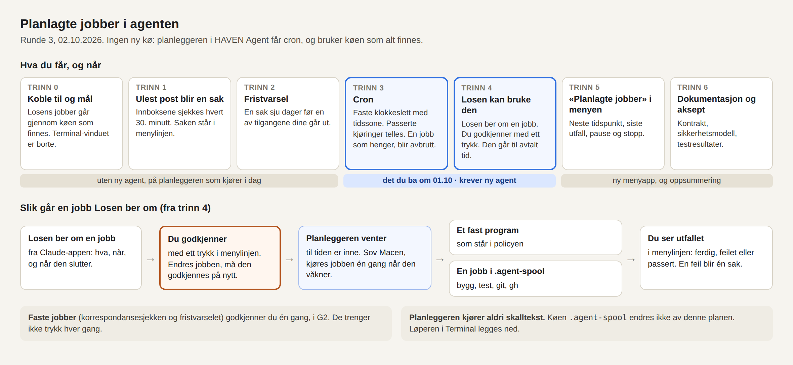

# PLAN: planlagte jobber i agenten

PDD `agent-planlagte-jobber`. Runde 3, 02.10.2026. **G2 godkjent 05.10.2026** (Kjetil: «G2 er godkjent og det er også forslagene dine til F5 F6 F4.»). Endringene E1–E6 i `FORMAALSSPEC.md` §1b ble godkjent 02.10.2026 («Ja, med ett trykk»). Teksten under er planen slik den ble godkjent. Hva som er gjort siden, står i `STATUS.md` og `TESTRESULT.md`.

Den første planen (runde 2) er trukket. Den ville bygget en ny jobbkø. Macen har alt tre. Planen og kontraktene er gransket av Fabel fire ganger: planen i runde 3 (`panel/FABEL_SVAR_RUNDE3.md`) og etterkontrollen av den (`panel/FABEL_ETTERKONTROLL_RUNDE3.md`), så kontraktene (`panel/FABEL_SVAR_G2.md`) og etterkontrollen av dem (`panel/FABEL_ETTERKONTROLL_G2.md`). Det Fabel krevde, er tatt inn. Arbeidspakkene og sporingen mot granskingen står i `PLAN_VEDLEGG.md`. Kontraktene står i `contract/`, flyten i `dataflow.md`, og rekkefølgen for køene i `handoff/README.md`.

## Ord som brukes

| Ord | Betyr |
|---|---|
| planleggeren | den delen av HAVEN Agent som starter ting til avtalt tid. Den kjører alt i bakgrunnen på Macen din. |
| korrespondansevakten | programmet som leveres i trinn 1 og 2. Det har to oppgaver: se etter ulest post, og se etter tilganger som snart går ut. |
| policyen | lista i agentens konfigurasjon over faste programmer agenten har lov til å starte. Bare du godkjenner endringer i den. |
| `.agent-spool` | en jobbkø som alt finnes på Macen. Den tar imot jobber som filer og kjører bygg, tester og `git`. |
| `_losen-queue` | en annen kø som alt finnes. Den kjører Codex-jobber og navngitte skript, i fire baner. |
| kø-tråden | Claude-tråden som administrerer deploykøen og koordineringsfila `_losen-queue/KOORDINERING.md`. Den heter også Losen. |
| HD-0156, PR #25 | Codex sitt pågående arbeid i HavenAgentD (Workbench). En PR er en foreslått endring som venter på å bli tatt inn på `main`. |
| `main`, gren, arbeidstre, merge | `main` er hovedlinja i koden. En gren er en sidelinje. Et arbeidstre er en egen mappe for en gren. Merge er å ta grenen inn på `main`. |
| CI | de automatiske testene på GitHub som kjører for hver PR. |
| MCP | måten Claude-appen snakker med agenten på. |
| kontrollbroen | måten menylinjen og HAVEN snakker med agenten på, lokalt på Macen. |
| sak | en linje i HAVEN Agent-menyen som venter på deg. |
| sjekksum | et fingeravtrykk av en fil. Endres fila, endres sjekksummen. |
| `kjetil-vegar-d`, `kjetil-d` | de to korrespondanseprofilene dine: den mot Vegar og den mot Victoria. |
| G1-GUI, G2, G3 | portene i arbeidsmåten: du godkjenner bildene, planen og til slutt leveransen. |

## Hva du får, og når

| Trinn | Hva du får | Krever ny agent? | Når |
|---|---|---|---|
| 0 | Jobbene fra denne tråden går gjennom køen som finnes. Terminal-vinduet med løperen er borte. | nei | Du sa ja til mappene 02.10. Gjøres med det samme. |
| 1 | En sak i menylinjen når det ligger ulest post i korrespondansen. | nei | Dagen etter G2. Ingen bygg trengs. |
| 2 | En sak sju dager før en av korrespondansetilgangene dine går ut. | nei | Samme dag som trinn 1. |
| 3 | **Cron.** Faste klokkeslett med tidssone. Passerte kjøringer telles. En jobb som henger, blir avbrutt. | ja | Ukjent. Koden kan skrives nå, men den kan ikke bygges før det er ryddet disk, og den installeres først etter merge og i et køvindu. |
| 4 | **Losen kan bruke planleggeren.** Losen ber om en jobb fra Claude-appen, du godkjenner den med ett trykk, og den går til avtalt tid. Feiler den, blir det en sak. | ja | Etter trinn 3. Kan gå i samme installasjon. |
| 5 | «Planlagte jobber» i menyen, med pause og stopp. | ja, og ny menyapp | Etter trinn 4. |
| 6 | Dokumentasjon og aksept. | nei | Til slutt. |

Trinn 1 og 2 er ikke cron. De går på intervall, på planleggeren slik den er i dag. Det du ba om 01.10, kommer i trinn 3 og 4.

## Hva som kan stanse planen

- **Disk.** Macen har 54 GiB ledig (målt 02.10 kl. 18:56Z). Regelen for lokale bygg krever omtrent 57. Agenten kan ikke bygges før det er ryddet. Ryddingen på Macen eies av Codex i Workbench-oppgaven. Jeg kan frigi 5,9 GiB selv (byggmappen i arbeidstreet for korrespondansefornyelsen) når du sier ja. Trinn 0–2 trenger ikke bygg.
- **Installasjon av ny agent.** Den skjer bare fra `main`, etter at du har sagt ja til merge, og i et vindu avtalt med kø-tråden.
- **En annen tråd endrer agenten nå** (Codex, HD-0156, PR #25). Arbeidet her går på egen gren og i eget arbeidstre.
- **Korrespondanseklienten må kunne startes av planleggeren uten at macOS spør om noe.** Det måles ved første kjøring i trinn 1.
- **`gh` virker trolig ikke fra `.agent-spool`.** Køen kjører uten Homebrew i søkestien, og den godtar bare programnavnet `gh`. Jeg måler det i trinn 0. Virker det ikke, går `gh`-arbeid som navngitte skript i `_losen-queue`. Det koster ett skript og én køjobb per gang, i en bane kø-tråden tildeler.
- **Agentens MCP-server må legges inn i Claude-appen** før trinn 4 kan vises.

## Det du må vite om sikkerheten

Planleggeren kjører aldri skalltekst. En planlagt jobb kan gjøre to ting:

1. Starte et fast program som står i policyen.
2. Legge en jobb i `.agent-spool`, hvis du har slått det på.

En jobb Losen ber om gjennom agenten, går ikke før du har trykket «Godkjenn». I menyen ser du hvem som ber, tittelen de har skrevet, og en linje agenten lager selv fra jobben: hva som kjøres i kortform, når, og når det slutter. Tittelen står i anførselstegn, for den er bestillerens egne ord. Hele jobben, med hvert steg ordrett, står i adminvinduet når du trykker «Åpne». Du kan godkjenne fra menyen uten å åpne. Endres jobben, må den godkjennes på nytt. En jobb som er for stor til å vises i sin helhet, blir avvist.

Tre ting bør du vite om `.agent-spool`, uavhengig av denne planen:

- Lista over tillatte kommandoer er ikke en vegg. En test kan kjøre hvilken som helst kode. Skriptet `scripts/run_swift_bounded.sh` hentes fra mappen jobben peker på, så den som kan skrive i mappen, bestemmer hva som kjøres. `gh api` kan gjøre det `gh pr merge` er nektet, også merge.
- Alle tråder som har mappen koblet til, kan altså få kode kjørt som deg. Slik er det i dag.
- Denne planen endrer ikke den køen. Svakhetene meldes til kø-tråden.

Det planleggeren legger til, er tid: noe som kan settes i gang nå, kan settes til å skje i natt og hver natt. Trykket er der for det.

**Hva Claude får når agentens MCP-server legges inn i Claude-appen (trinn 4).** Serveren har 23 verktøy i dag, og Claude får alle, ikke bare de nye for planlegging. Codex har denne koblingen fra før. Tre av dem bør du vite om:

- `agent.review.approve` godkjenner fjernintenter som venter på gjennomgang. Det er de samme sakene du i dag godkjenner i menylinjen.
- `agent.jobs.register` og `agent.jobs.complete` kan til sammen få et fast program fra policyen kjørt med en gang, uten trykk. Slik er AgentJobs laget: en jobb kan ha en oppfølging som agenten kjører når jobben meldes ferdig.
- `agent.mail.compose_draft` og `agent.identity.sign_statement` lager e-postutkast og signerer utsagn med agentens nøkkel.
- `agent.xcode.ensure_workspace` åpner et Xcode-arbeidsområde og bygger det. Et bygg kjører kode.

De faste programmene i policyen i dag er to: `claude-purpose-structures-resume`, som starter en Claude Code-økt, og `losen-probe`, som skriver en linje i en logg. Etter trinn 1 og 2 kommer korrespondansevaktens to i tillegg.

Trykket for planlagte jobber stopper altså ikke at et fast program kjøres én gang nå. Det stopper at noe settes til å gå igjen og igjen uten at du har sett det, og det stopper køjobber. Du tar stilling til koblingen i trinn 4, ikke nå.

Det trykket ikke stopper: kode som kjører som deg, kan gjøre det samme som du kan. Den kan endre agentens konfigurasjon, og den kan gi godkjenningen selv, fordi agenten ikke kan skille menylinjen fra et annet program på samme Mac. Losen kan få slik kode kjørt gjennom køene. Trykket stenger altså veien gjennom agenten, ikke veien gjennom køene. Det gjelder installasjonsskriptet i trinn 1 også. Derfor viser jeg deg nøyaktig hva som legges inn (under), og jeg endrer ikke konfigurasjonen igjen uten et nytt ja.

Løperen i Terminal-vinduet kjører hva som helst fra en mappe Losen selv skriver i, uten liste og uten logg andre leser. Den legges ned i trinn 0.

## Trinnene

| Trinn | Hva det innebærer | Det du ser | Det du gjør |
|---|---|---|---|
| 0 Koble til og mål | Tråden kjører én jobb gjennom `.agent-spool`. Løperen i Terminal stoppes. Det måles om `gh` virker fra køen. | Terminal-vinduet er borte. Målingene står i `TESTRESULT.md`. | Ingenting. Du sa ja til mappene 02.10. |
| 1 Korrespondansesjekken | Korrespondansevakten lister innboksene dine hvert 30. minutt og skriver en markør når noe er ulest. Planleggeren som kjører i dag, starter den. | Saken «Post fra Vegar venter på svar» i menyen når noe er ulest. Den forsvinner når Losen har lest og kvittert. | To ja. Først G2: det som står under «Det du godkjenner i G2». Så, før noe legges inn: ja til forskjellen i `config.json` og sjekksummen, som jeg viser deg. |
| 2 Fristvarselet | Korrespondansevakten ser én gang i døgnet når tilgangsbevisene dine går ut. | En sak sju dager før fristen. | Samme godkjenning. |
| 3 Cron og robusthet | Planleggeren får cron-uttrykk, telling av passerte tidspunkt, tidsgrense per jobb og utdata til loggfil. Endringen går som PR mot `main`. | Fristvarselet går kl. 09:00 hver dag, også over skiftet til vintertid. Testene står i `TESTRESULT.md`. | Sier ja til merge når CI er grønn og kø-tråden har sett på PR-en. Installasjonen kan gi én nøkkelring-dialog. |
| 4 Losen kan bruke planleggeren | MCP-verktøy for å be om, liste, pause og stoppe jobber. En ny jobb blir en sak du godkjenner. En jobb som feiler eller ble passert, blir én sak. | Losen ber om en jobb mens du ser på. Du trykker «Godkjenn». Den kjører. | Sier ja til at agentens MCP-server legges inn i Claude-appen. Sier om køjobber skal slås på. Sier du ja, legger jeg kønavnet i konfigurasjonen med samme rutine som i trinn 1, og du ser forskjellen først. |
| 5 Synlig i menylinjen | «Planlagte jobber» i menyen, med neste tidspunkt, siste utfall, pause og stopp. | Menyen slik bildene viser. | Godkjenner bildene før jeg bygger (G1-GUI). |
| 6 Dokumentasjon og aksept | Kontrakten, sikkerhetsmodellen og driftsrutinen oppdateres. `TESTRESULT.md` og `ACCEPT.md`. | `ACCEPT.md` | G3 |

### Grensene i trinn 1 og 2

Disse trinnene går på planleggeren slik den er, og den har svakheter som først rettes i trinn 3:

- Planleggeren har ingen tidsgrense. Programmene har derfor sin egen, og avslutter seg selv etter 60 sekunder.
- Alle saker fra disse to programmene får tittelen «Post fra … venter på svar». Den kan ikke endres uten ny agent. En ulest melding fra Vegar vises som «Post fra Vegar venter på svar». En feil vises som «Post fra sjekken av kjetil-vegar-d venter på svar». Det er kleint, men det er synlig. Titlene blir riktige i trinn 5.
- Står planleggeren, kommer det ingen ny sak, og menyen sier «Ingenting venter». Det er ikke sant da. De to programmene passer på hverandre, men grovt: fristvarselet går én gang i døgnet, så det oppdager en død korrespondansesjekk først neste morgen. Står hele planleggeren, ser du det ikke før trinn 4. Jeg måler det og skriver det i `TESTRESULT.md`.
- En feil blir først en sak når innboksen ikke kunne leses to ganger på rad. Det er for at sekundene etter at Macen våkner, eller en omstart på staging, ikke skal gi falsk alarm. Du får altså vite om en varig feil etter omtrent en time.
- Korrespondansevakten er skrevet mot korrespondanseklienten som er installert (pilotklienten fra 16.08). På `main` ligger en ny klient med en annen kontrakt. Tas den i bruk, sier vakten fra med en feilsak, og programmet må oppdateres.
- Rulles agenten tilbake til en eldre utgave etter trinn 3, går fristvarselet videre én gang i døgnet, bare ikke kl. 09:00. Jobber en assistent har bedt om, står stille til den nye er tilbake. Korrespondansesjekken går videre.

## Det du godkjenner i G2

**To faste programmer og to planlagte hendelser** legges i `~/Library/Application Support/HAVENAgent/config.json`. Begge er samme programfil, `korrespondanse_vakt.py`, med hver sin oppgave. Fila installeres i `~/Library/Application Support/HAVENAgent/bin/`. Installasjonen gjøres av et skript jeg skriver, og som kjøres gjennom `_losen-queue`. Du får se nøyaktig forskjell i konfigurasjonen, og sjekksummen til programmet, før noe legges inn. Det som legges inn, står ordrett i `contract/config-tillegg-trinn1-2.json`.

| Navn | Program og argumenter | Når | Hva det gjør, og hva det ikke gjør |
|---|---|---|---|
| `korrespondanse-sjekk` | `/usr/bin/python3 <bin>/korrespondanse_vakt.py sjekk --profil kjetil-vegar-d --profil kjetil-d --navn vegar-local-agent=Vegar --navn victoria-lille-robot=Victoria --navn pilot-simulation-d=pilotsimuleringen`, pluss stiene til klienten, klientens rot (der profilene ligger), markørmappen og tilstandsmappen | hvert 30. minutt | Lister innboksen for de to profilene med korrespondanseklienten. Teller meldinger som ikke er kvittert. Skriver eller fjerner én markør per avsender. Leser ikke meldingsinnhold, kvitterer ikke og sender ingenting. |
| `korrespondanse-frist` | `/usr/bin/python3 <bin>/korrespondanse_vakt.py frist --profil kjetil-vegar-d --profil kjetil-d --dager 7`, pluss stiene til klientens rot (der profilene ligger), markørmappen og tilstandsmappen | én gang i døgnet (kl. 09:00 fra trinn 3) | Leser når tilgangsbeviset i hver profil går ut. Skriver eller fjerner én markør per profil. Bruker ikke nettet. |

**Fire ting ved korrespondansesjekken som er dine valg:**

1. Agenten får bruke korrespondanseklienten og nøklene i profilene dine. Du valgte 10.09 at agenten selv skal polle. Dette er den pollingen.
2. Saken betyr «ulest post». Losen fortsetter å kvittere når den leser, og da forsvinner saken. Det som krever deg, sier Losen i samtalen.
3. Avsenderens navn står i menylinjen («Vegar», «Victoria», «pilotsimuleringen»). Andre som ser skjermen din, ser det.
4. Hvert 30. minutt.

**Programmet installeres fra grenen, mens PR-en venter.** Du ser sjekksummen først. Regelen om å installere fra `main` gjelder agentbinæren. Endres programmet før PR-en er merget, installerer jeg det på nytt fra `main` etterpå. Vil du heller vente til PR-en er merget, sier du det.

**Tallene for jobber Losen ber om** (trinn 4): høyst 10 stående jobber, ikke oftere enn hvert 15. minutt, sluttdato etter 30 dager hvis ingen annen er satt og aldri mer enn 90 dager, og 15 minutter tidsgrense for et fast program.

## Tre presiseringer du svarer på hver for seg

**Godkjent 05.10.2026: ja til alle tre.** `FORMAALSSPEC.md` §1 er endret etter dem.

De kom fram da kontrakten ble skrevet og gransket. Hver av dem endrer ordlyden i et formål du har godkjent. Et ja til G2 er derfor ikke et ja til disse. Jeg spør om dem én for én, og jeg anbefaler ja til alle tre.

| # | Formål | Forslaget | Sier du nei |
|---|---|---|---|
| 1 | **F5: hva du ser før du godkjenner** | Menyen har plass til tittelen og én linje. Der står agentens kortform av hva som kjøres, når, og når det slutter. Hele jobben, med hvert steg ordrett, står i adminvinduet. «Godkjenn» står begge steder, så du kan godkjenne fra menyen uten å åpne. | «Godkjenn» står bare i adminvinduet, ved siden av hele jobben. Det krever ny menyapp alt i trinn 4, så trinn 4 blir større og kommer senere. |
| 2 | **F6: når en passert kjøring blir en sak** | Macen sover om natten. En jobb som går hvert 30. minutt, passerer da mange tidspunkt. Passering gir sak bare for jobber som går én gang i døgnet eller sjeldnere. For de som går oftere, står antallet i lista «Planlagte jobber». En jobb som feiler, gir alltid sak. | Korrespondansesjekken gir en sak du må kvittere, hver gang Macen har sovet i mer enn en time. Det blir en sak hver morgen. Du kan også velge en annen grense. |
| 3 | **F4: hva en assistent kan styre** | En assistent kan sette på pause og stoppe jobber den selv eller en annen assistent har bedt om. De faste programmene dine, som korrespondansesjekken, kan den ikke røre. Dem setter du på pause selv, fra menyen eller kommandolinjen på Macen. | En assistent kan sette korrespondansesjekken og fristvarselet på pause, eller stoppe dem, uten at du trykker noe. Da kan varslene om ulest post og frister slutte å komme uten at du har gjort noe. |

F5 sa «saken viser hva som kjøres». Med forslaget er det riktig for adminvinduet, og i kortform for menyen.

## Koordinering med de andre trådene

- Arbeidet i HavenAgentD gjøres på en ny gren fra `origin/main`, i eget arbeidstre. Det føres i `_losen-queue/KOORDINERING.md` før det starter.
- Agenten installeres slik fila sier: fra merge-commiten på `main`, når ingen annen jobb går i køen, med en linje i fila før og etter, og med forrige binær klar. At installasjonsjobben selv ligger i køen, avtales med kø-tråden.
- Bygg og tester går gjennom `.agent-spool` og følger diskregelen. Installasjon og omstart av tjenester går som navngitte skript i `_losen-queue`, i banen kø-tråden tildeler.
- Sakene for planlagte jobber bruker kilden `job`, som var satt av til AgentJobs-køen. De to deler kilden, med hvert sitt prefiks i sakenes ID-er (`contract/README.md`).
- Trinn 1 dekker behovet i HD-0069 (ingen varsel om ny post). Jeg fører det på oppgaven når trinnet er levert. Kø-tråden avgjør om den lukkes.

## Kan vente

- Opprett og pause fra HAVEN gjennom en celle på kontrollbroen
- Planlagte jobber som starter et navngitt skript i `_losen-queue`
- Planlagte jobber som starter en AgentJob, altså en Codex- eller Claude Code-tur til avtalt tid. Det er en agenttur og ikke et fast program, og trenger en egen vurdering.
- Et verktøy som lar Losen skrive egne «krever deg»-saker for post
- En egen macOS-bruker for jobbene (begrenser skaden mer enn en liste gjør)
- Flere jobber samtidig i planleggeren
- Varsel til eieren når en annens tilgang nærmer seg fristen (CellScaffold)
