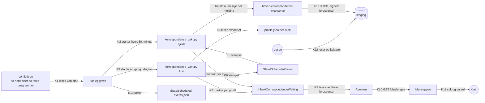
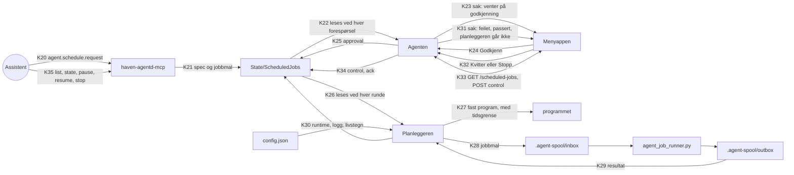

# Dataflyt: planlagte jobber i agenten

PDD `agent-planlagte-jobber`, G2-artefakt, 02.10.2026. Kantene er navngitt (K1, K2 …) så testene og `ACCEPT.md` kan vise til dem. Formatene står i `contract/`.

Tre prosesser går under launchd på Macen i dag, og de er de samme i hele planen:

- **Planleggeren**: `haven-agentd-scheduler schedule-worker` (`io.digipomps.haven.agentd.scheduler`). Starter ting til avtalt tid.
- **Agenten**: `haven-agentd run` (`io.digipomps.haven.agentd`). Eier kontrollbroen på 127.0.0.1:43110 og innboksen for saker.
- **Menyappen**: HAVEN Agent i menylinjen. Spør kontrollbroen hvert 20. sekund.

## Trinn 1 og 2: korrespondansevakten

| Kant | Fra → til | Hva som går | Når det feiler |
|---|---|---|---|
| K1 | `config.json` → planleggeren | `scheduledEvents` og `automationPolicy.localTasks`, lest én gang ved start | Ugyldig konfigurasjon: planleggeren starter ikke. Installasjonsskriptet validerer en kopi først (`schedule-list --config`). |
| K2, K3 | planleggeren → programmet | Fast program og faste argumenter fra policyen. Ingen miljøvariabler utover launchd sine. | Koden og én linje stderr havner i `lastError` (K13). Planleggeren går videre. |
| K4 | `sjekk` → klienten | `initialize`, `tools/list`, og `tools/call` på verktøyet som heter `correspondence_list_inbox` eller `correspondence.list_inbox` | Annen kontrakt, ingen svar eller feil: profilen regnes som ikke lest. Markørene står som de var. |
| K5 | klienten → staging | Signert forespørsel med tilgangsbeviset i profilen | Klienten svarer med feil; se K4. |
| K6 | `frist` → `profile.json` | `accessCredential.payload.expiresAt` | Markøren «fikk ikke lest tilgangsbeviset». |
| K7 | programmet → markørmappen | `haven.correspondence-waiting.v1`, byttet på plass. Aldri emne, innhold eller ID-er. | Skrivefeil: kode 1 og `lastError`. |
| K8 | programmet ↔ tilstandsmappen | Eget stempel skrives. Det andre programmets stempel leses. | For gammelt stempel hos det andre: markøren «har stoppet» (K7). |
| K9 | markørmappen → agenten | Alle `*.json`, validert. Én ugyldig fil gjør kilden `correspondence` ulesbar. | Saken «Får ikke lest correspondence». |
| K10 | agenten → menyappen | Innboksen, `agent-challenge-v1` | Menyen viser hvilken feil det er (ingen kontakt, avvist token, ugyldig svar). |
| K11 | menyappen → Kjetil | Linje i menyen, tall ved ikonet, ett varsel per ny sak. Kommer det mer enn tre nye på én gang, samles de i ett varsel. | Varsler kan være dempet av Fokus. Menyen og tallet vises uansett. |
| K12 | Losen → staging | Losen leser og kvitterer post som i dag, gjennom Claude-appens korrespondanseverktøy | Uten kvittering står saken. Det er meningen: saken betyr «ulest». |
| K13 | planleggeren → tilstandsfila | `lastStartedAt`, `lastFinishedAt`, `lastOutput`, `lastError`, `nextFireAt` | — |

Det som ikke finnes i trinn 1 og 2: ingen kant fra menyappen tilbake til programmene. «Ignorer i dag» demper bare varselet i menyappen. Saken forsvinner når posten er kvittert (K12) og neste sjekk har gått (K2, K7).

## Trinn 3 til 5: cron, bestilte jobber og menyen

| Kant | Fra → til | Hva som går | Regelen som gjelder |
|---|---|---|---|
| K20 | assistent → MCP-serveren | Tittel, tidsplan, sluttdato, og en henvisning til hva som skal kjøres | Bare `kind` og `id` for et fast program. Aldri argumenter eller tekst som kjøres. |
| K21 | MCP-serveren → jobbmappen | Jobbmalen først (`<id>.<tolv tegn>.spool.json`), `<id>.spec.json` sist | Under lås. Takene håndheves her. En eldre `approval` for samme id fjernes. Uten oppgitt id kan en bestilling ikke erstatte en annen. |
| K22 | jobbmappen → agenten | Leverandøren for kilden `job` leser mappen | Ulesbar mappe gir ulesbar kilde, ikke tom liste. |
| K23 | agenten → menyappen | Saken. Tittelen bærer bestillerens tittel i anførselstegn. «Gjelder» og detaljen lager agenten fra `spec`-fila. | Sakens id bærer tolv tegn av sjekksummen. Menyen viser tittel og «Gjelder»; detaljen står i adminvinduet. |
| K24 | menyappen → agenten | `POST /challenges/respond` med sakens id og `approve` eller `reject` | Samme rute som for fjernintenter. |
| K25 | agenten → jobbmappen | `<id>.approval.json` | Skrives bare hvis sjekksummen av `spec`-fila nå stemmer med saken. |
| K26 | jobbmappen → planleggeren | `spec`, `approval`, `control` | Kjører bare når alle seks reglene i `contract/trinn4-jobber-og-godkjenning.md` holder. |
| K27 | planleggeren → programmet | Det faste programmet fra policyen | Egen prosessgruppe, tidsgrense, utdata til loggfil. |
| K28 | planleggeren → køen | Kopi av jobbmalen, som `<id>-<ÅÅÅÅMMDDTttmmssZ>.json` | Bare til mappen `config.json` navngir. Malens sjekksum kontrolleres først. En fil køen ikke har tatt, slettes igjen ved pause, stopp, sluttdato eller utløpt frist. |
| K29 | køen → planleggeren | `<navn>.result.json` | Leses ved en senere runde. Planleggeren venter ikke. |
| K30 | planleggeren → jobbmappen | `<id>.runtime.json`, `worker.json`; logg under `Logs/ScheduledJobs/` | `lastOccurrence` skrives før kjøringen. |
| K31 | agenten → menyappen | Én sak per jobb som feilet eller ble passert; «Planleggeren går ikke» | Livstegnet må være gammelt i to minutter våken tid. |
| K32 | menyappen → agenten | «Kvitter» (`approve`). På en jobb som er bedt om, også «Stopp jobben» (`reject`). | Skriver `ack`, og for stopp også `control`. En sak om en fast hendelse har ikke `reject`, og et svar saken ikke tilbyr, skriver ingenting. |
| K33 | menyappen ↔ agenten | Statuslista; pause, fortsett, stopp | Token i `Authorization`-hodet. Godkjenner ingenting. Faste hendelser kan settes på pause, ikke stoppes. «Fortsett» henter ikke inn pausen; en fast hendelse på intervall uten cron kjøres straks. |
| K34 | agenten → jobbmappen | `<id>.control.json`, `<id>.ack.json` | Hele filer, byttet på plass. Styringen skrives under lås, og `stopped` er endelig. |
| K35 | assistent → MCP-serveren | Les alt; styr jobber som er bedt om | Ingen av verktøyene godkjenner eller kvitterer, og ingen av dem styrer faste hendelser. |

## Hvem som kan skrive hvor

| Mappe eller fil | Skrives av | Leses av |
|---|---|---|
| `config.json` | Kjetil, gjennom installasjonsskriptet etter at han har sett forskjellen | planleggeren, agenten, MCP-serveren |
| `Inbox/CorrespondenceWaiting/` | korrespondansevakten (sine egne markører) og testflyten (sine). Losen har ikke noe verktøy for å skrive markører i dag. | agenten |
| `State/ScheduledTasks/` | korrespondansevakten | korrespondansevakten |
| `State/scheduled-events.json` | planleggeren, og `schedule-stop` | planleggeren; agenten fra trinn 4, for saker om faste hendelser |
| `State/ScheduledJobs/*.spec.json`, `*.spool.json` | bestillingstjenesten (MCP og kommandolinjen) | planleggeren, agenten |
| `State/ScheduledJobs/*.approval.json`, `*.ack.json` | godkjenningstjenesten (menylinjen og kommandolinjen) | planleggeren, agenten |
| `State/ScheduledJobs/*.control.json` | styringstjenesten (MCP, kommandolinjen og kontrollbroen) | planleggeren, agenten |
| `State/ScheduledJobs/*.runtime.json`, `worker.json` | planleggeren | agenten |
| `.agent-spool/inbox/` | planleggeren (bare godkjente maler; den sletter også sine egne filer som ikke er tatt), og alle tråder som har mappen | køen |

Alle disse filene eies av Kjetils bruker. Reglene over er hva programmene gjør, ikke noe operativsystemet håndhever. Kode som kjører som Kjetil, kan skrive alle sammen. Det står i `PLAN.md` under sikkerheten.
