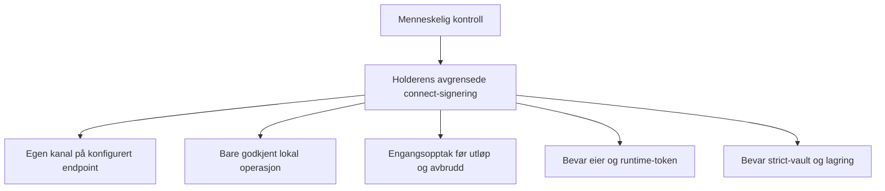

# b46 — G1-formålsspesifikasjon: ikke-forfalskbar connect-signeringskontekst

HD-0196 · 2026-10-07 · Forfatter og kildeleser: Codex. G1 venter. Ingen implementering eller runtime-test er utført.

## Kildesvar — dagens kontrakt

Alle CP-henvisninger nedenfor er relative til **CellProtocol**, lest med `git -C CellProtocol show 2026.9.5:<sti>` og nummerert fra første linje i tag-objektet. Taggen er grunnlaget, ikke lokalt main. Andre repoer navngis uttrykkelig. Last verified against code: 2026-10-07, tag `2026.9.5`.

### 1. Connect-operasjonens opprettelse, liv og avslutning

`Sources/CellBase/Cells/Bridging/BridgeChannelTransport.swift:36` har privat `operation`. `:249–264` krever klientmodus, lokalt konfigurert endpoint, eksakt URL lik endpoint.audience og at transporten verken er startet eller stoppet. Den oppretter `BridgeChannelClientOperation(owner:identity, endpoint:endpoint)`, lagrer den, setter opp fysisk transport med offentlig identitetssnapshot og sender hello. Setup venter på authenticated, sjekker kansellering og lukker ved feil. `:226–235,274–284` installerer ti sekunders handshake-timer og opprydding.

`Sources/CellBase/Cells/Bridging/BridgeChannelClientOperation.swift:8–30`: actor **og init er offentlige**. Owner, active, deadline, signingStarted og challengeValue er private. Init validerer endpoint, beholder lokalt vault på et offentlig identitetssnapshot, lager hello med principal og clientNonce, og setter monotont deadline til nå + 10 sekunder. At transportens felt er privat betyr altså ikke at annen kode er ute av stand til å opprette en ny actor.

Samme fil `:33–50` validerer Task-kansellering, active/deadline, profil, retning, eksakt endpoint, principal, clientNonce, serverNonce-lengde, session-/generation-format, tider, kanallevetid, eksakte kanoniske signingData og lokal vault som ikke er BridgeIdentityVault. `:52–71` konsumerer signingStarted **før første await**, sjekker identityExistInVault, revaliderer etter dette await og kaller vault ved `:64` med **bare messageData og owner**. Etter signering kreves fortsatt active/deadline, korrekt signatur og ny validering. Den lagrer challenge og returnerer proof. Dette begrenser operasjonens egen signeringsvei, men gir ikke konsumenten bevis på kallestedet.

Transport `:570–580` dekoder challenge, kaller operation.sign og sender proof hvis transporten ikke er stoppet. Ved acknowledgement kalles finish, operation fjernes, BridgeBase aktiveres og timer settes til kanalens gjenværende levetid. Actor `:73–78` godtar acknowledgement gjennom session, setter active=false og fjerner challengeValue. `:31` cancel gjør også active=false og fjerner challengeValue. Transport `:612–648` lukker gammel transport ved renewal; close setter stopped, fjerner operation og andre referanser under lås, kansellerer arbeid, lukker session og kaller operation.cancel. Det er terminal autoritet som skal tilbakekalles; ingen garanti om tidspunktet for fysisk minnefrigjøring.

### 2. Hva som signeres, og hva challenge-felter ikke beviser

`Sources/CellBase/Cells/Bridging/BridgeChannelAuthentication.swift:7–13` sier transportopptak, ikke Cell-rettigheter; profil `org.haven.bridge-channel.v1`, action `openBridgeChannel`, challengelevetid 30 sekunder og kanallevetid 300 sekunder. Endpoint `:76–111` er lokalt valgt origin+route+domain; audience=origin+route. Transcript `:128–143` inkluderer endpoint, principal, begge nonces, session, generation, retning og tider. `:178–200` bygger signingData som IdentitySigningChallenge med domain fra endpoint, resource=profil + digest av hele transcriptet, action og audience, serverNonce og tider. **Domain er ikke hardkodet til bridge i denne funksjonen**; dette følger av konfigurert endpoint. For browser-holderløpet er bridge ønsket binding, og må kontrolleres som sådan.

SigningData inneholder digest, ikke hele transcriptet. Adapteren kan ikke utlede at clientNonce/session/generation tilhører dens lokale operasjon ved å sjekke action eller resource-prefix. `Sources/CellBase/Identity/IdentitySigningChallenge.swift:46–69,99–164` har offentlig konstruktør og validerer format, principal/fingerprint, nonce, scope og tid; validering attesterer ikke kallested, lokal oppstart eller engangsbruk. Et syntaktisk gyldig challenge er derfor ingen lokal autorisasjon.

### 3. Vault-API-ene

Det faktiske protokollnavnet er **IdentityVaultProtocol**, ikke IdentityVault: `Sources/CellBase/Identity/IdentityVaultProtocol.swift:6–20`. Den er Sendable og tilbyr initialize, identitetsopprettelse/-oppslag, identityExistInVault, identityDomainBinding, saveIdentity, signMessageForIdentity, verifySignature, randomBytes64 og aquireKeyForTag samt identityVaultReference. Signeringskravet ved `:15` er async throws og tar bare Data og Identity. Ingen context-/permitparameter finnes. Default-implementasjonene `:22–38` gir nil for vault-reference/UUID-oppslag/domainbinding og false for existence; ingen signeringsdefault finnes.

Ytterligere signeringsflater: `Sources/CellBase/Identity/BridgeIdentityVault.swift:70–94,123–126` videresender signering til cloudBridge (async, transform og publisher-varianter); `Sources/CellBase/Cells/Bridging/BridgeBase.swift:1102` er publisher-inngang og `Sources/CellBase/Protocols/CloudBridgeProtocol.swift:16` erklærer denne. Disse signaturene er lokalisert med tag-grep; hele implementeringene er ikke lest. De er ikke en påvist lokal connect-attestasjon. Connect-actoren avviser BridgeIdentityVault eksplisitt.

### 4. Dagens checkIdentityOrigin-permit

`Sources/CellBase/Cells/Bridging/BridgeIdentityProofAuthorization.swift:19–46` er internal klasse. Permit bærer identity/vault/generation/commandID/scope. Autoriteten beholder lokal principal/vault, pinned eller discovered scopes og leases. `:52–75` oppretter lease bare for lokal matchende identitet med vault og bestemte lokalt initierte Cell-kommandoer. Feed har ikke fast utløp; øvrige leases har fem sekunder, både wall-clock og monotont. `:77–85` gir permit bare for action **checkIdentityOrigin** og audience **GeneralCell**, med matchende principal og scope. `:88–109` fjerner fullførte leases, reset øker generation og tømmer dem, isCurrent krever fortsatt generation/scope og purger utløp.

`Sources/CellBase/Cells/Bridging/BridgeBase.swift:1308,1313` registrerer/fjerner lease ved sending; `:1035` registrerer discovered scope. Disse kallstedene er kontrollert med tag-grep. `:1505–1585` validerer innkommende sign-challenge, readiness/containment, henter permit, kontrollerer lokal vault, sjekker permit etter await, konsumerer challenge gjennom replaykontroll og revaliderer før og etter vault-kallet. `:1329–1340` knytter kontrollen til session og monotont deadline. Tag-grep viser flere complete-kall samt reset ved `:483,2122`; hele disse omgivende funksjonene er ikke lest.

Dette er et nyttig livstidsmønster, men **ikke et connect-permit**: det registrerer Cell-kommandoer og Cell-scopes, signering krever allerede ready kanal, permit godtar bare checkIdentityOrigin/GeneralCell, og vault får fortsatt bare bytes+identity. Connect skjer før authenticated/ready og har egen actor, endpoint og transcript. Å legge til action i permit-vakten alene løser verken tilgjengelighet ved vault-opptak eller connect-livstid/engangsbruk.

### 5. Konsument og b45

B45 er lest fra `HAVEN-Deploy/_handoff/RELEASE/rel-2026.9.7/INTEGRASJON-STEG2-20261007.md`. Den rapporterer stopp ved permit-kontrakten og **ingen kjørte negative connect-bevis**, ingen årsaksdiagnose av HTTP 500 og ingen grønn integrasjon. Dette dokumentet overtar ikke slike konklusjoner som målte fakta.

Konsument lest i lokalt arbeidstre med HEAD `653990fae247ea8873c39a275b67c3dc5b4e8089`, repo CellScaffold, `Sources/ScaffoldKit/AdminBrowserBridgeIdentityVault.swift:23–39,52–56,95–106`: bind beviser lokal possession og home-vault-binding, matches kontrollerer UUID/fingerprint/home, og snapshot uten home tillater kun checkIdentityOrigin/GeneralCell før videresending med den beholdte strict-bound principal. Filen finnes ikke i det ordinære CellScaffold-arbeidstreet denne økten; dette er lest konsumentkode, **ikke verifisering av PR #282-head**. Ingen brukerstier inngår i kildereferansene her.

Viktig grense: `:98` gjør snapshotkontrollen betinget av manglende homeVaultReference. En ny connect-regel må prøves også med korrekt, feil og manglende home; ellers kan et direkte kall med full descriptor omgå snapshot-grenen. Dagens adapter dokumenterer ikke total avvisning av direkte openBridgeChannel-kall med korrekt home.

## 0. Intensjon og audit

Kjetils ord (ordrett utdrag):

> «holderen kan åpne kanalen for nøyaktig konfigurert origin+route og egen principal»
>
> «ingen annen kode i prosessen kan få vaulten til å signere en connect-challenge (ikke-forfalskbar, prosesslokal, engangs, bundet til signingData og operasjonens livstid)»
>
> «avbrutt/utløpt operasjon avviser ved opptak»
>
> «eier/runtime-token-stiene er uendret»
>
> «strict-vault og lagring uendret»
>
> «Oppgaven (bare lesing og skriving i oppgavemappen; ingen kode, ingen push)»

Oppdraget gjelder G1-spesifikasjon for ny CP-kapabilitet før konsumentendring. Ingen G1-GUI: ingen ny eller endret flate.

| Påstand / antakelse | Audit | Grunnlag / grense |
|---|---|---|
| Connect signerer med lokal actor, eksakt endpoint/principal/transcript og livstidskontroll | retrieved | Kildesvar 1–2. |
| Vault får ikke connect-kontekst | retrieved | Actor :64 og protokoll :15. |
| Dagens origin-permit dekker connect | contradicted | Kildesvar 4: action/audience/ready/livstid er ulike. |
| Bare transport kan opprette connect-actor | contradicted | Actor :8,20,52 er public. |
| SigningData-challenge beviser lokal oppstart | contradicted | Kildesvar 2. |
| CP hardkoder connect-domain bridge | contradicted | Authentication :193 bruker endpoint.domain. |
| Adapterens snapshotgren avviser openBridgeChannel | retrieved | Konsument :98–104, avgrenset lokal revisjon. |
| Strict browser-connect virker eller årsaken til HTTP 500 er kjent | unavailable | B45 stoppet; ingen runtime-måling her. |
| PR #282 er identisk med lest konsumentfil | unavailable | Ingen GitHub-/PR-head-verifisering. |
| Kjetils CP-først-regel og G1 før ny kapabilitet | retrieved fra oppdraget | Styrende instruksjon; historiske 18.09-/07.10-kilder ikke separat innhentet. |

Leser: Codex. Fullt lest fra CP-tag: BridgeChannelClientOperation, BridgeIdentityProofAuthorization, IdentityVaultProtocol, BridgeChannelAuthentication. Avgrenset lest: BridgeChannelTransport (opprettelse, timers, handshake og close), BridgeBase (signeringsvalidering og sign-case), IdentitySigningChallenge (konstruksjon og validering). Andre vault-innganger kun lokalisert. Konsumentfil og b45 lest, PDD-mal og nylig eksempel lest, lookup og relevante kanonnoder lest. Ikke lest: hele resolver-/vault-/peer-/runtime-token-kjeden eller full testmengde. Ingen nett- eller tjenestekall, bygg eller tester er kjørt. Lokale tag-objekter er autoritative for kildeoppdraget; ingen nettkilde trengs for å beskrive disse objektene.

## 1. Formålstre med observerbare mål

Klassifisering først: parent `purpose://human-agency` finnes i `CellProtocolDocuments/Book/haven_purpose_knowledge_base_v0.json:71–86`. Rot og blad nedenfor er oppgavekandidater, ikke endringer av kanon. Alle står foreslått, G1 venter.

| purposeRef | Forelder | Outcome og successSignals | Verifier |
|---|---|---|---|
| purpose://candidate.bridge-connect.control | purpose://human-agency | Holderen kan åpne egen konfigurert kanal med lokal, avgrenset signeringsmyndighet; ingen utvidelse av Cell-grants. | Samlet T1–T8 og G3-evidens. |
| purpose://candidate.bridge-connect.open | control | Ikke-eier med entry+observer åpner kanalen med egen principal, eksakt origin+route og domain bridge; én korrekt proof, authenticated og etterfølgende tillatt observasjon. | T1 transportkjede og konsumentintegrasjon. |
| purpose://candidate.bridge-connect.exclusive | control | Kun holderens godkjente connect-operasjon kan utløse connect-signering. Kall uten autoritet, konstruerte felt, annen operasjon/principal/endpoint/data og gjenbruk gir null nøkkelopptak. | T2–T4, T8 med opptaksteller og ekstern modul-fixture. |
| purpose://candidate.bridge-connect.lifecycle | control | Avbrutt, utløpt eller avsluttet operasjon avviser ved opptak, også etter suspensjon; høyst ett opptak under konkurrerende bruk. | T3, T5 med styrte barrierer/klokker. |
| purpose://candidate.bridge-connect.paths | control | Eier og runtime-token følger eksisterende stier; checkIdentityOrigin-reglene og kanalens Cell-rettighetsgrense beholdes. | T6 baseline/regresjon og scenario-sammenligning. |
| purpose://candidate.bridge-connect.strict-storage | control | Strict underlying vault, home-binding, nøkkelvalg og lagringsformat beholdes; kun adapteren får avgrenset CP-attestasjon. Ingen privat nøkkel eller kontekst på wire/disk. | T7 strict-vault- og persistensinspeksjon. |

**Autoritetskontrakt, foreslått:** konteksen er en levende prosesslokal kapabilitet, ikke et sett tillitsverdige challenge-felter. Den bindes til eksakte bytes, principal inklusive nøkkel, endpoint/domain, operasjonsidentitet og livstid. Den har ingen offentlig konstruktør, decoder, registrar eller cloningsvei som gir ny myndighet. Konsumenten kontrollerer forventet binding og bruker CPs engangsopptak; den bygger ikke egen permit-livssyklus eller rekonstruerer transcript fra digest.

En immutable attestasjon som sjekkes og deretter etterfølges av et await er utilstrekkelig. Opptak må ha et definert atomisk punkt: active/deadline/data/principal/endpoint kontrolleres og engangsretten konsumeres ved grensen til nøkkelbruk. Kansellering/utløp som vinner før dette punktet gir null signering. Kansellering etter faktisk nøkkelopptak kan ikke trekke tilbake en allerede produsert signatur; den skal hindre proof-levering/kanalaktivering og senere opptak. Både CP og adapterens suspenderende sjekker må inngå i denne kontrakten.

«Ingen annen kode» gjelder sikre API-kall gjennom holderens adapter med offentlig metadata og egenlaget challenge, uten besittelse av holderens godkjente connect-kapabilitet. Dersom annen kode får samme autoriserte capability eller direkte tilgang til underlying vault med full identitet, gir Swift access control alene ingen isolasjon mellom aktørene. Vilkårlig minneendring, unsafe-kode eller kompromittert vault er ikke en egenskap dette API-et kan stenge ute. Det opprinnelige formålet beholdes; denne nødvendige autoritetsgrensen legges fram som Q1, ikke som stilltiende svekkelse.

### Alternativer og anbefaling (forslag, ikke implementert)

Rangering: først ikke-forfalskbar autoritet og korrekt opptak/livstid; deretter enkel konsumentkontroll, kildekompatibilitet og minst mulig kobling mellom connect og origin-proof. Dagens kodebegrensning er et funn som skal rettes, ikke grunn til å godta challenge-baserte tillatelser.

| Alternativ | For | Imot / krav |
|---|---|---|
| A: BridgeConnectSigningContext sendt fra CP-sign til nytt IdentityVaultProtocol-krav, eksempelvis signMessageForIdentity(messageData:identity:context:) | Eksplisitt dataflyt og tydelig autoritet ved vault-grensen. Konsumenten kontrollerer binding og konsumerer context. Connect holdes atskilt fra origin-proof. | Context må ha levende, atomisk engangsopptak og tilbakekalling, ikke bare private init. Public actor init/sign og alternative transportveier må ikke kunne utstede context for holderen uten autorisert oppstart. Opptak over await må løses. |
| B: Generalisert permit-register fra BridgeIdentityProofAuthorization med action-scope; transport registrerer, vault slår opp | Gjenbruker generation/reset/deadline-mønster; kan gjøre fremtidige scopes konsistente. | Dagens femsekunders-/feed-/ready-regler passer ikke connect. Global lookup på identitet/digest kan la et direkte kall stjele en aktiv permit. Må ha skjult operasjonskapabilitet, eksakt binding, atomisk consume, per-vault isolasjon og close-cleanup; da er det mer enn å utvide action-listen. |
| C: Dedikert connect-signing-protokoll/callback-capability i tillegg til IdentityVaultProtocol | Eksisterende vaulter slipper nytt krav; strict adapter kan opt-in. Holderens innmeldte capability kan avgrense oppstart. | Mer dispatch og egen konformitet. Fallback må være entydig og skal aldri gi strict adapter gammelt kall etter context-avvisning. Samme authority-/livstidsproblem som A må løses. |

**Anbefaling: A**, betinget av at utstedelse og faktisk nøkkelopptak oppfyller T5/T8. En default for det **nye protokollkravet** kan delegere til det gamle signeringskravet for eksisterende, ordinære vaulter; alle eksisterende kall beholdes. Kravet må stå i protokollen slik at overriding skjer gjennom existential `IdentityVaultProtocol`, ikke bare som statisk valgt extension-overload. Strict adapter implementerer ny context-vei og avviser connect uten korrekt context i gammel vei, også med full home-reference. Ingen automatisk fallback etter avvisning. Default gir **kildekompatibilitet**, ikke dokumentert binær-/ABI-kompatibilitet eller en ny strict-garanti for vaulter som ikke opt-in. Ingen lagringsmigrering.

A er ikke ferdig API-design ved G1. Konkret metode for holder-godkjent oppstart (innmeldt capability eller tilsvarende), access-levels og atomisk opptak skal avklares i G2; en test som bare bruker public actor må ikke bli definisjonen av «holderen startet». Hvis A ikke kan oppfylle dette uten endring av strict-vault, stopp og legg fram endret alternativ før bygg. Feltbasert allowlisting er forkastet: gyldige felter kan konstrueres uten lokal oppstart.

## 2. Avgrensning og avhengigheter

Denne økten skriver bare de to bestilte dokumentene i oppgavemappen. Ingen kode, tester, fixtures, push, porter godkjent, release eller deploy. Ingen endring av strict-vault, lagring, grants, identitetseierskap eller wire-profil foreslås. CP-kapabiliteten må leveres og verifiseres før CellScaffold bruker den. Dette er ikke en diagnose eller reparasjon av b45s øvrige feed-/HTTP-feil.

| Avhengighet | Grunnlag / hva som ikke er vist | Verifier før relevant akseptanse |
|---|---|---|
| Tag 2026.9.5 som ren baseline | Tag-kilde lest; tester ikke kjørt. | Eksporter isolert revisjon og kjør baseline før endring, registrer resultater per test. |
| Holderens godkjente lokale connect-inngang | Public actor/transport er ikke caller-autorisasjon; oppstartskobling ikke påvist. | G2 beskriver authority-flow; T8 angriper alle offentlige innganger fra ekstern modul. |
| Entry+observer og eget principal/vault | Konsumentens lokal binding lest; faktisk browser-rute ikke målt. | T1 med ikke-eier og ekte konsumentvei, før full funksjon erklæres levert. |
| Konfigurert endpoint og bridge-domain | Endpoint og transcriptkontroll finnes; konsumentens endpoint-policy ikke fullstendig lest. | T1/T4 med lokale syntetiske endpoints og eksakt binding. |
| Nøkkelopptak etter suspenderende sjekker | CP revaliderer før vault-kall; strict-vaults faktiske opptaksgrense ikke lest. | T5 identifiserer og instrumenterer siste opptakspunkt uten strict-vault-endring. Hvis umulig, avvik før G2-godkjenning. |
| CP-utgivelse før konsument | Styrende oppdragsregel; versjonsnummer ikke besluttet her. | Verifisert CP-PR/release, så pinnet konsument og samme integrasjonstest. |
| Eier/runtime-token og origin-proof-baseline | Full kjede ikke lest/kjørt. | T6 på samme baseline og ny revisjon; ingen eksisterende asserts svekkes. |

Formålstreet publiseres ikke til ekstern database, og læringsledger/skills endres ikke: oppdragets eksplisitte skrivegrense går foran normal PDD-publisering og læringsfangst utenfor mappen. Relevante funn er bevart her for neste oppdrag.

## 3. Forventningskontrakt — Det Kjetil får og skal se

Alle steder er relative til HAVEN-roten; fremtidige artefakter ligger i samme oppgavemappe.

| Leveranse | Type / hvor | Referanse og forventet innhold | Godkjent |
|---|---|---|---|
| G1-spesifikasjon nå | CellProtocolDocuments/Deliverables/PDD_bro-connect-kontekst_2026-10-07/FORMAALSSPEC.md | Kildesvar, formålstre, alternativer, autoritetsgrense og avledede tester. | G1 venter. |
| Portstatus nå | CellProtocolDocuments/Deliverables/PDD_bro-connect-kontekst_2026-10-07/STATUS.md | G1 venter; ingen gjennomføring autorisert fra antatt ja. | Statusartefakt, ikke godkjenning. |
| CP-kapabilitet senere | Fremtidig CP-kode/kontrakt og PLAN.md etter G1 | Vault kan kontrollere CP-context uten eget permit-register; gamle vaulter kompilerer. | Ikke skrevet; G2 venter. |
| Funksjons- og formålsbevis senere | TESTRESULT.md og ACCEPT.md | Per-test rød baseline/grønn etter; negative opptakstall; eier/token/strict-regresjon. | Ikke kjørt; G3 venter. |
| Konsumentintegrasjon senere | Separat CellScaffold-endring etter CP | Faktisk ikke-eier med entry+observer åpner egen kanal; direkte sign-kall avvises. | Ikke del av dagens skriveleveranse. |

Kjetil skal nå ta stilling til formålet, A-anbefalingen og spørsmålene i §6. Et G1-ja gir grunnlag for G2-plan, ikke kode/push/release. Ingen bilder eller G1-GUI trengs: dette endrer en protokollkapabilitet, ingen flate.

## 4. Formålspakker og lærdommer

Lookup kjørt med tags security/identity og surface bridge før formålstreet ble skrevet. Tilknyttet **pkg.std.everything-works** og **pkg.std.cell-combination**. Før senere G3 kreves bygg, full eksisterende regresjon, docs i samme endring og aktuell status. Før G2 kreves navngitt authority-/dataflyt og kildefestede kapabilitetsgrenser. Ingen GUI-pakke ble valgt.

Relevante lærdommer fra lookup:

- lesson.bridge-inferred-architecture-from-one-use: «Erklær hver kapabilitet oppgaven bygger på ... med kilde og Avgrensning». Privat transportfelt er ikke privat actor-konstruksjon.
- lesson.planned-documented-as-implemented: «planlagt oppførsel merkes eksplisitt». Context og opptaks-API er forslag.
- lesson.tested-a-different-path-than-production: «bruke produksjonens egen kodevei». T1 må nå strict browser-adapter med ikke-eier; owner-substitusjon teller ikke.
- lesson.red-first-claimed-for-tests-that-were-not: «rød først listes med hvilke tester som fantes i den røde kjøringen». Ingen tester erklæres røde/grønne uten kjøring; eksisterende vern kan allerede være grønne.
- lesson.baseline-measured-another-pdds-branch: baseline må være isolert revisjon, ikke annet arbeidstre.
- lesson.a-second-safeguard-hid-that-the-first-had-no-test: hvert vern må få test der det andre ikke kan svare. Testen må telle faktisk nøkkelopptak, ikke bare fravær av returnert proof.

Øvrige lookup-lærdommer ble gjennomgått for relevans; deploy-, betalings- og GUI-operasjoner er utenfor denne dokumentleveransen. Ingen av pakkekravene rapporteres som ferdig runtimeverifikasjon her.

## 5. Avledede tester — spesifisert, ikke kjørt

«Rød før/grønn etter» nedenfor er forventet demonstrasjon, ikke måleresultat. Ny API-fixture kan være compile-rød på taggen, mens funksjonell T1 skal vise dagens avvisning i ekte konsumentvei. Negative tester som allerede avviser på taggen beholdes som grønne regresjonsvern. For nytt vern må en kontrollert feilutgave som fjerner akkurat vernet gjøre testen rød; å la dagens totale connect-avvisning gi grønt beviser ikke vernets funksjon.

| testRef | Formål / hvordan | Før → etter / fremtidig evidens |
|---|---|---|
| T1 Holder åpner | Transporthandshake med syntetisk server og strict-bound ikke-eier, entry+observer, riktig principal/origin/route/domain. Verifiser signatur, authenticated og etterfølgende tillatt observer-flow; ingen ekstra Cell-grants. Gjenta gjennom faktisk CellScaffold-konsument etter CP-release. | Forventet funksjonelt rød på 2026.9.5 uten context, grønn etter. TESTRESULT.md#holder-open. |
| T2 Direkte kall | Generer gyldig openBridgeChannel-challenge for samme principal/audience; kall adapterens gamle og nye inngang uten context, med snapshot, korrekt home, feil home og annen nøkkel. Teller ved underlying nøkkelopptak skal være 0. Samme fixture inkluderer legitim T1 som positiv kontroll. | Snapshot-avvisning kan allerede være grønn; full-home-tilfellet er mulig hull, ikke målt. Etter alle avvist. Fjern context-kravet i feilutgave: testen rød. TESTRESULT.md#direct-call. |
| T3 Engangsbruk | Fang ekte context i instrumentert vault; bruk to ganger, parallelt, etter feilet signing og på ny operasjon med samme bytes. Høyst ett opptak totalt, ingen permit-fornyelse ved retry. | Ny context-kontrakt mangler før; grønn etter; disable consume gjør rød. TESTRESULT.md#one-shot. |
| T4 Eksakt binding | Endre ett felt om gangen: principal UUID/nøkkel, origin, route, domain, action, signingData-byte, clientNonce, serverNonce, session, generation. Bruk context fra operasjon A i B og med annen vault. Ingen endret input gir opptak; korrekt kontroll gir ett. | Eksisterende transcriptvern kan være grønt før; ny context-binding compile-rød/mangler før. Fjern binding enkeltvis og se rød etter. TESTRESULT.md#binding. |
| T5 Livstid og opptak | Styr klokker/barrierer ved existence-lookup, adapterens home/existence-sjekker og siste nøkkelopptak. Kanseller, la deadline passere, close/renew eller fullfør før opptak; count=0. Konkurrer cancel mot consume med eksplisitt rekkefølge; etter opptak skal avbrudd gi ingen proof-aktivering eller gjenbruk. Prøv bakoverhopp i wall-clock med monotont utløp. | Dagens CP pre/post-checks kan være grønne, men ingen vault-context-grense finnes. Disable siste live-check skal gjøre rød. TESTRESULT.md#admission. |
| T6 Bevar stier | Samme fixtures og eksisterende tester på baseline/etter for owner, runtime-token og checkIdentityOrigin med/uten lease, feil scope og gammel generation. Ordinær legacy-vault som bare implementerer gammelt krav kompilerer og signer via default, også som protocol existential; strict-vault-avvisning skal ikke falle tilbake. | Regresjon skal være grønn før/etter, ingen svekkede asserts. TESTRESULT.md#compatibility. |
| T7 Strict og lagring | Bruk uendret BrowserClientIdentityVault; kontroller at adapter videresender eksakt beholdt strict principal/home og at feil hjem/nøkkel fortsatt avvises. Sammenlign lagringsformat/felt før/etter, og inspiser serialiseringsflater: ingen context/permit, privat nøkkel eller nye bindingsfelt på wire/disk. | Eksisterende strict-vern grønt før/etter; ny capability-ikke-serialisering skal være kontrollert fra ekstern modul. TESTRESULT.md#strict-storage. |
| T8 Utstedelsesgrense | Ekstern Swift-modul uten @testable: prøv context-init/decode, public actor init/sign, ny transport med holder-snapshot, og permit-registration/lookup fra annen operasjon. Gyldig selvlaget transcript fra egen hello skal ikke gi holder-connect-autoritet uten godkjent oppstart. Test innmeldt legitim inngang positivt. | Før finnes offentlig actor-sign-vei, ny authority-kontrakt mangler. Etter avvisning ved adapter og opptak=0. En context som bare har private init, men kan mintes via public sign, gjør denne testen rød. TESTRESULT.md#issuance. |
| Standard bygg/regresjon | Bygg alle berørte mål; full eksisterende testmengde på isolert baseline/ny revisjon. Dokumenter hver feil og test som faktisk var med i rød kjøring. | TESTRESULT.md#build og #regression. |
| Standard docs/status/dataflyt | Inspiser docs-diff med verifiseringsdato, faktisk gate-status og alle authority-kanter mot API-kontrakt. | ACCEPT.md#docs/#status; PLAN.md#dataflow etter G1. |

Alle rader har status **venter — ikke kjørt**. Endelig testnavn/kommando følger G2 etter kildegjennomgang av testmål; ingen eksisterende testkommando er funnet på for å gi inntrykk av kjørbarhet.

## 6. Åpne spørsmål til Kjetil (maks fem)

1. Skal «ingen annen kode» bety at bare holderens uttrykkelig godkjente connect-inngang har kapabiliteten, mens kode uten denne avvises selv med riktige challenge-felter? **Anbefalt ja.** Kode som allerede har fått samme autoriserte capability eller full underlying vault-tilgang kan ikke skilles ut med et context-objekt alene; et krav om isolasjon også fra slik kode krever større prosess-/vault-grense.
2. Godkjenner du A som retning, med levende engangsopptak og kontrollert utstedelse, og at B/C tas opp igjen dersom dette ikke lar seg oppfylle uten å endre strict-vault? **Anbefalt A med disse vilkårene**, ikke bare et nytt feltsett.
3. Skal avbrudd som vinner **før nøkkelopptak** kreve null signering, mens avbrudd etter opptak krever at proof ikke brukes til å aktivere kanal? **Anbefalt ja**, med begge rekkefølger testet. Allerede utført signering kan ikke gjøres ugjort.

## 7. Revisjonslogg og kontroll

| Iterasjon | Dato | Endring | Hvem |
|---|---|---|---|
| 1 | 2026-10-07 | Tagbasert G1-spec; skilt operasjonsvalidering fra vault-attestasjon, tatt med offentlig actor-utstedelsesvei, domain-konfigurasjon, full-home-direktekall og atomisk opptaksgrense. | Codex |

Kildehenvisninger er kontrollert av forfatter mot tag-utdrag. Ingen uavhengig kontrolltråd eller runtime-angrepsrunde er utført. Leveransen er en G1-spesifikasjon, ikke en sikkerhetssertifisering eller godkjenning av API-design. Læringsvurdering: public init/sign er en relevant autoritetsfelle bevart i denne oppgaven; ingen ledger-/skill-sync utført siden oppdraget uttrykkelig begrenser skriving til oppgavemappen.

STATUS: LEVERT
