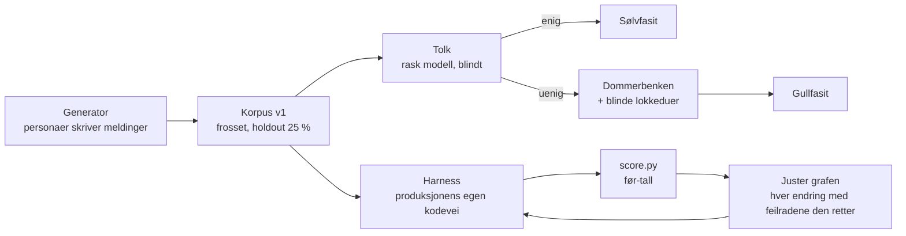

# Metode — måle og forbedre formålsforståelse uten språkmodell

PDD_butler-onboarding-og-formaalsforstaaelse_2026-09-23, WP-D1. Skrevet for å gjenbrukes: Butler var første bruk, Kallimachos er neste (WP-D2).

Status: første runde gjennomført natt til 2026-09-24. Alle tall under har filsti.

## Hva metoden gjør

Den svarer på ett spørsmål: **når en bruker skriver noe naturlig, treffer den AI-løse matchingen det formålet brukeren mente?** Og den gjør det slik at en forbedring kan måles, ikke bare føles.



## Rollene holdes fra hverandre

| Rolle | Hvem | Hvorfor egen |
|---|---|---|
| Generator | Fire underagenter med hver sin persona | Én stemme gir ett språk. Fire personaer (gründer, pensjonist, internasjonal gjest, driftsleder med dialekt) gir spredning i ordvalg, lengde og feil. |
| Tolk | Rask modell (haiku), blindt, stokket rekkefølge | Sjekker at meldingen faktisk uttrykker formålet. Ser aldri generatorens etikett. Rekkefølgen stokkes, ellers lekker tre-og-tre-mønsteret etiketten. |
| Dommer | Kjetil i Dommerbenken | Avgjør bare der generator og tolk er uenige, pluss en realisme-stikkprøve. Fem per økt. |
| Måler | Swift-test over produksjonens egen `assistant.analyzeDraft` | Måler det brukeren faktisk får, ikke en kopi av algoritmen. |
| Poengsetter | `score.py` | All vurdering av riktig og galt står ett sted, utenfor harnessen. |

## Regler som kom av feil vi har gjort før

1. **Lokkeduer i hver dom.** Dommerrunde 1 i formålsregister-tråden ga 197 ja og 0 nei. En dom uten noe å si nei til er ikke en fasit (`lesson.judgement-without-decoys-yields-all-yes`). Nå: del A har fem meldinger der begge viste tolkninger er gale, del B har fire kunstige meldinger. Svarer dommeren ja på dem, teller ikke runden.
2. **Holdout røres ikke.** 25 % av korpuset (hash av id) er med i hver måling, men ingen grafendring får begrunnes med en holdout-rad. Holdout-tallet rapporteres for seg.
3. **Tomt er ikke grønt, og rødt er ikke levert.** (v3 av måle-jobben: manglende rader, kjørefeil eller rød regresjon gir STOPPET.) Harnessen feiler hvis ingen linjer ble målt. Web-specen for skjelettfeltene er kjørt mot gammel runtime og feiler der (6 av 7), så den tester noe.
4. **Tilregnelighetssjekk av harnessen.** PromptPurposeLab-fixturene (som CI allerede tester) måles i samme kjøring. Scorer harnessen dem lavt, er det harnessen som er feil, ikke Butler.
5. **Negativer og hull er egne kategorier.** Småprat, takk og «ikke gjør noe» (N), ønsker utenfor HAVEN (G) og spørsmål om Butler selv (M) er riktige når Butler **ikke** foreslår en handling. Et formål som ingen flate erklærer (`S.agreement` i v1), er et hull i grafen og telles for seg, ikke som bom.
6. **«Spurte med riktig valg» er ikke top-1.** Når Butler spør og riktig mål står blant alternativene, er det nyttig, men det rapporteres som egen kolonne.
7. **Mål produksjonsveien.** Ingen reimplementasjon av matcheren i Python. Harnessen kaller cellen, med fersk identitet og nullstilt butikk per melding.
8. **Tolken får opake id-er.** I v1 og første v2-tolkning var id-ene i generatorrekkefølge (`k2-0001` … etikett for etikett). Tolken var da enig i 264 av 264 v2-meldinger; med tilfeldige, opake id-er 261 av 264. Tre rader kan ikke skille lekkasje fra tilfeldighet, men opake id-er koster ingenting (`maaling/tolk/v2/`, A = rekkefølge-id-er, B = opake).
9. **Et nytt korpus etter at grafen er frosset.** Holdout fra de samme personaene deler ordvalg med treningsradene. Den ærlige testen er nye skribenter som aldri har sett grafen. Korpus v2 (264 meldinger, fire nye personaer) ble generert etter at graf v3 var frosset og viste +8 prosentpoeng der v1-holdout viste +20 (se under).
10. **Dump katalogen før første poengsetting.** Etikett-kartet bygges fra det matcheren faktisk kan treffe i testkjøringen (`maaling/katalog.json`), ikke fra det man tror står der.

## Filene

| Fil | Innhold |
|---|---|
| `maaling/korpus/korpus-v1.jsonl` | `id`, `text`, `lang`, `style`, `label`, `intendedPurposeRef`, `split`, `generatedBy` |
| `maaling/korpus/korpus-v2.jsonl` | Det uavhengige korpuset (264, split `uavhengig-v2`), samme felt. Generatorens rådata og instruks i `maaling/generator/*-v2.*` |
| `maaling/etikett-kart.json` | Etikett → hva produksjonen skal svare (`intentKind`, `purposeRefs`) |
| `maaling/fasit/fasit-v1.jsonl`, `fasit-v2.jsonl` | Generator- og tolketikett, enighet, gull fra dommeren. `score.py` leser alle filene i `fasit/` |
| `maaling/tolk/` | Tolkens inn- og utfiler, slik de var |
| `maaling/dommerbenk/` | Oppgavene og nøkkelen (nøkkelen åpnes først etter dommen) |
| `maaling/katalog.json` | Hva rutingen kan treffe, dumpet fra samme bygg |
| `maaling/rapport/<variant>/` | Resultat per melding, `rapport-<dato>-<variant>.json`, `score.md` |

## Kjøre løpet

Én kommando per variant, som skript-jobb på Mac-en:

```
HAVEN-Deploy/_handoff/WP-R/wp-butler-maaling-v3.sh <variant>     # f.eks. foer, graf-v1; feiler lukket
```

## Gjenbruk for Kallimachos (WP-D2)

Tre ting byttes, resten står:

1. **Etikettrommet**: Kallimachos' formål i stedet for Butlers hjelpere og flater.
2. **Adapteren i harnessen**: kall Kallimachos' `matchPurposes` i stedet for `assistant.analyzeDraft`, og skriv samme resultatlinje (`topK` med purposeRef og score).
3. **Etikett-kartet**: hva et riktig svar er for hver etikett.

Generator, tolk, dommerbenk, `score.py` og reglene over gjenbrukes uendret.

## Hva som virket, og hva som ikke virket

### Virket

- **Hele løpet på én natt.** Generator (4 personaer × 99 meldinger), tolk (4 raske underagenter, 396 meldinger på ~3 min), måling (396 meldinger gjennom produksjonsveien på 55 s), poeng og tre grafiterasjoner. Hver iterasjon tok ~3 min på Mac-en fordi arbeidstreet og bygget gjenbrukes (`wp-butler-maaling-v2.sh <variant>`).
- **Tilregnelighetssjekken.** PromptPurposeLab-fixturene ga 101/101 i samme kjøring (`rapport/foer/score-v2-kart.md`). Da vet vi at harnessen måler produksjonen, ikke seg selv.
- **Tolken som kvalitetskontroll av korpuset.** 94,2 % enighet (`fasit/fasit-v1.jsonl`); uenighetene samlet seg der etikettene faktisk overlapper (H.todo↔H.reminder: 6 av 23).
- **Treningsrader som begrunnelse.** Grafendringene v1–v3 løftet holdout top-1 fra 20 % til 40 % uten å bruke en eneste holdout-rad; 16 holdout-meldinger vunnet, 0 tapt (`grafendringer/GRAFENDRINGER-v3.md`).
- **Regresjonstestene i samme jobb.** De fanget to feil vi selv innførte: et AIGateway-statusspørsmål og «hjelp meg i gang med Arendalsuka» ble onboarding. Begge rettet før PR.
- **Å se på bommene rad for rad** fant en ekte produktfeil: nektelse ble matchet som delstreng, så «**not**er en idé» ble lest som «ikke fang denne idéen».
- **Gjenbruk for Kallimachos** krevde bare en ny testmetode (adapter) og et formålskart. Første tall: top-1 32 %, holdout 17 %, R@3 44 % (`rapport/foer/`, `kallimachos-v1`).

- **Det uavhengige korpuset bekreftet retningen.** Korpus v2 (nye personaer, generert etter at v3 var frosset): top-1 20 % → 28 % [23–35], R@3 25 % → 36 %, 18 meldinger vunnet og 1 tapt (`rapport/foer-k2/`, `rapport/graf-v3-k2/`, `TESTRESULT.md#uavhengig`).

### Virket ikke, eller ikke ennå

- **Holdout fra samme skribenter overdrev gevinsten.** v1-holdout: +20 prosentpoeng. Nye skribenter: +8. Frasene generaliserte for hjelpere med tydelige verb (video 2→7 av 8, gjøremål 2→5), ikke for flater (kart, entiteter, publisering og musikk 0 av 8 før og etter). Indirekte meldinger: 5 % → 10 %.
- **Én regresjon slapp gjennom** og ble bare sett i det uavhengige korpuset: «bare så du vet, ikke gjør noe med det ennå: … flytte styremøtene til tirsdager» ble et møteforslag. Møtegjenkjenningen sjekker ikke nektelse (de andre hjelperne gjør det), og v3 la til ukedager som tidsord. Graf v3 gikk i prod uten rettingen; graf v3.1 (PR #258) retter den og er målt uten tap (negativer 88 % → 92 %).

- **Første etikettkart var feil.** Flatene ble bedømt på purposeRef, men testkjøringens konfigurasjoner bærer andre referanser («purpose:Mermaid diagram-rendering»). Rettet ved å bedømme på katalogens endepunkt; rå resultater uendret. Lærdom: dump katalogen og bygg kartet fra den før første poengsetting.
- **Arendalsuka-flatene finnes ikke i testkjøringens katalog** (handel, møtested, avstemning). De teller som graf-hull her. Neste runde må måle mot en katalog med publiserte Arendalsuka-konfigurasjoner.
- **Nye brukere uten historikk** får vektet ned alle hjelper-scorer (×0,75), så alt under 0,80 blir et spørsmål i stedet for et forslag. Det er et produktvalg, men målingen viser prisen: mange «spurte».
- **Indirekte og lange meldinger** er fortsatt svake (45 % og 30 % top-1 etter v3). Fraser hjelper lite der; det er der en språkmodell eller en ekte graf med relasjoner gjør mest.
- **Dommerbenken er brukt (29.09).** Kjetil dømte alle 52 sakene; 7 av 9 lokkeduer ble avvist, så runden holder. Av 23 uenigheter hadde generatoren rett i 15, tolken i 7, ingen i 1. Gullfasiten flytter hovedtallene med høyst 2 prosentpoeng (graf v3.1 holdout 40 → 38 %), så korpusets etiketter var gode nok til å måle forbedringen; graf v3.1 treffer 6 av de 23 vanskelige. `maaling/dommerbenk/RUNDE1-RESULTAT.md`.
