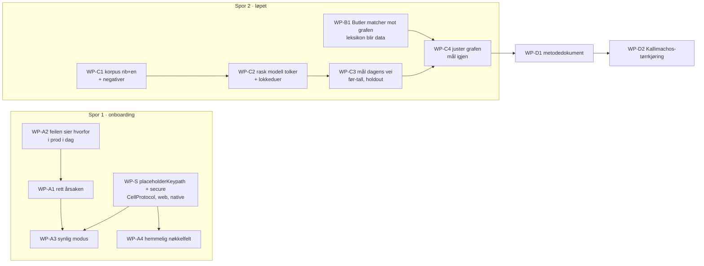
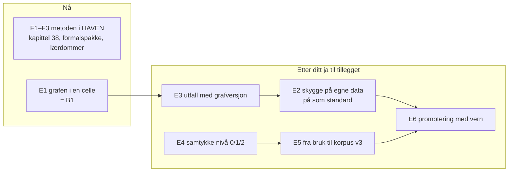

# Plan — Butler: onboarding som virker og synes, og AI-løs forståelse som treffer

Oppgavemappe: `PDD_butler-onboarding-og-formaalsforstaaelse_2026-09-23` · G1 og G1-GUI godkjent 2026-09-23 · **G2 venter**

## Kort fortalt

Tre spor, i denne rekkefølgen:

1. **Onboarding i Butler virker og synes.** Først får feilen en årsak (i prod med leveranse 2 i dag). Deretter retter vi selve årsaken. Så kommer to nye felt i skjelettet: plassholder fra data og skjult inndata. Til slutt bygger vi flaten du godkjente på bildene.
2. **Et løp som måler og forbedrer den AI-løse forståelsen.** Naturlige meldinger → rask modell tolker → vi måler matchingen med bare formål → vi justerer grafen → vi måler på nytt. Alt dette skjer med én kommando.
3. **Metoden skrives ned og prøves på Kallimachos.**

## Arbeidspakker

Hver pakke svarer til ett bladformål i FORMAALSSPEC §1. «Utfører» sier hvem som gjør arbeidet; «Du» sier hva som kreves av deg.

| WP | Formål (purpose://candidate.butler-forstaaelse.…) | Hva det innebærer | Utfører | Du | Test (§5) | Leveranse (§3) |
|---|---|---|---|---|---|---|
| **A2** | onboarding.feil-sier-hvorfor | Tre årsaker gir tre koder og en logglinje, i stedet for én generisk tekst. **Skrevet, og på vei til prod i leveranse 2 nå.** | Losen | Ingenting | test.onb.tre-feil-tre-koder | feil-bildet, kjørende |
| **A1** | onboarding.koble-til-modell-virker | Når A2 er i prod: du klikker «Koble til modell» én gang til. Meldingen og loggen sier nå hvorfor. Jeg retter årsaken og leverer. | Losen | **Ett klikk i prod** | test.onb.start-i-kjoerende-miljoe | ditt klikk, skjermbilde |
| **S** | (kapabilitet for A3/A4) | To nye felt i skjelettet: `placeholderKeypath` (plassholder fra data) og `secure` (skjult inndata) på TextArea/TextField. Gjelder CellProtocol-modellen, den native rendereren (`CellApple/…/SkeletonView.swift`) og web-rendereren (`Public/js/skeleton-runtime.js`), med paritetstest. **Testet mot funksjon og formål før main i CellProtocol**, som du har krevd. | Losen (modell + web), Astra (native, Xcode) | Se testresultatet før push til CellProtocol main | test.gui.parity, paritetsmatrisen | — |
| **A3** | onboarding.synlig-modus | Butler-konfigurasjonen: stripen «Onboarding pågår · steg x av n · Avbryt», og skrivefeltet får stegets spørsmål som plassholder. Svaret går til onboardingen, ikke til chatten. | Losen | Se skjermbildet mot bildet du godkjente | test.gui.parity, test.skeleton.purpose-actions-reachable | steg-bildet, kjørende |
| **A4** | onboarding.hemmelig-inndata | Når steget er hemmelig, skjuler skrivefeltet tegnene. Nøkkelen skal aldri havne i transkriptet, i `state`, i `get`-svar eller i loggen. | Losen | Ingenting | test.onb.noekkel-aldri-i-logg | nøkkel-bildet, kjørende |
| **C1** | loep.naturlige-meldinger | Korpus med naturlige meldinger på bokmål og engelsk, fordelt på formålene i grafen. Stiler: kort og langt, skrivefeil, indirekte, og «jeg vet ikke hva det heter». Pluss negativer som ikke hører til noe formål. Korpuset fryses og versjoneres. | Losen | **Stikkprøve: 20 meldinger i Dommerbenken, ~10 min.** «Ville noen skrevet dette?» | test.loep.korpus-fordeling, test.loep.stikkproeve | `maaling/korpus/` |
| **C2** | loep.tolkning-med-rask-modell | Et utbyttbart tolkergrensesnitt. Første tolker er raske underagenter hos Losen, som setter formål eller «ingen». Der tolkeren og korpusets tilsiktede formål er uenige, går saken til deg, blandet med blinde lokkeduer. | Losen | **Dom over uenighetene, maks fem oppgaver per økt** | test.loep.lokkeduer-avsloeres | Dommerbenken-eksport |
| **C3** | loep.matching-bare-formaal + forstaaelse.maalt-mot-fasit + forstaaelse.vet-ikke-er-aerlig | Kjører dagens AI-løse rute (`ChatPurposeResourceRouter`) over korpuset gjennom en Swift-test som skriver topp-k per melding. Gir før-tall: topp-1, R@3, MRR og negativpresisjon, med et fast holdout-sett ingen justering får se. | Losen | Ingenting | test.fs.foer-etter-holdout, test.fs.negativer | `TESTRESULT.md#forstaaelse` |
| **B1** | forstaaelse.stoerre-graf | Butlers 26 håndskrevne oppføringer i Swift flyttes til formålsgrafen som data, slik at en grafendring ikke krever kode. Ruten leser grafen. Når `PDD_formaalsregister-som-graf` har valgt sin ene motor (WP4 der), bytter Butler til den. Ingen femte matchevei. | Losen, koordinert med formaalsregister-som-graf | Ingenting | test.reg.en-motor-i-kode | kodegjennomgang |
| **C4** | loep.juster-grafen | Feilene fra C3 blir forslag til grafendringer: nye noder, fraser og relasjoner, hver med feilradene den retter. Så måler vi igjen. Holdout-tallene rapporteres for seg. | Losen | **Godkjenn grafendringene** (en diff med begrunnelse) | test.loep.endring-har-grunn, test.loep.en-kommando | `maaling/grafendringer/`, etter-tall |
| **D1** | metode | Metodedokument: hva som virket, og hva som dokumenterbart ikke virket. Lærdommene fra formaalsregister-som-graf er med, for eksempel at en dom uten lokkeduer ga bare «ja». | Losen | Les | test.docs-updated | `Book/` + denne mappen |
| **D2** | metode (gjenbruk) | Samme løp mot Kallimachos' formål og dens `matchPurposes`, med bare konfigurasjonsbytte. | Losen | Ingenting | test.metode.kallimachos-toerrkjoering | `TESTRESULT.md#kallimachos` |

## Rekkefølge

A2 er allerede i gang, i leveranse 2. **C1 og S starter samtidig nå.** C2 og C3 følger C1. A1 skjer når A2 er i prod og du har klikket. A3 og A4 følger S. B1 kan starte parallelt med C1. C4 venter til C3 har gitt før-tallene. D1 og D2 kommer til slutt.

## Avhengigheter som må virke før testene

| Avhengighet | Verifisert av | Status |
|---|---|---|
| Leveranse 2 i prod (A2) | `/health/build` viser sha fra PR-en | pågår (kø: `ab-lev2-a-pr`, `ac-lev2-b1`, `ad-lev2-b2`) |
| Dommerbenken kan ta nye oppgaver | artefakt fra formaalsregister-som-graf | fantes 2026-09-15 |
| Byggkapasitet på Mac-en (≥57 GiB ledig) | diskvakten i `ci/run-tests.sh` | ryddet igjen 2026-09-23 (`aa-rydd2`) |

## Bygg og regresjon (pkg.std.everything-works)

- CellScaffold: `swift build --build-tests` + fokuserte tester + det lokale CI-filteret (`ci/run-tests.sh`), som stopper hvis resultatet er tomt, og ingen nye feil mot referansen.
- CellProtocol (WP-S): `swift build` + `swift test` + paritetsmatrisen, kjørt som skript-jobb på Mac-en.
- Python (løpet): enhetstester med stdlib, som `Tools/PurposePackages/tests`.

---

## Tillegg 2026-09-24 — læring under bruk, og metodikken i HAVEN

Kjetil 2026-09-24: «… Gå videre med G2». Lest slik: F1–F3 og E1 starter nå (E1 er B1 i godkjent G2). E2–E6 lager nye dataflyter; de starter når du har sett dette tillegget.

Løkka når alt står: en justering blir en ny versjon i cellen → den regner i skyggen hos alle som ikke har slått av → utfallene samles hos hver bruker → entiteter som har sagt ja deler tellinger (og eventuelt vaskede meldinger) → samme måleløp som i natt, pluss skyggetallene → versjonen tas i bruk eller forkastes, og lærdommen skrives ned.

| WP | Hva det innebærer | Utfører | Du | Test | Leveranse |
|---|---|---|---|---|---|
| **F1** | Kapittel 38 til `CellProtocolDocuments` main fra et rent arbeidstre, submodulen i CellScaffold flyttes dit, image og utrulling som for graf v3 | Losen | Ingenting | test.met.kap38-i-prod | skjermbilde fra prod |
| **F2** | Metoden blir `pkg.std.maal-formaalsforstaaelse` i `Book/haven_purpose_packages_v0.json`, med de ti reglene som avledede tester | Losen | Ingenting | test.met.pakke-i-lookup | `lookup`-utdata |
| **F3** | Nattens lærdommer inn i `Book/haven_lessons_register_v0.json` | Losen | Ingenting | test.met.laerdommer-i-lookup | fil-diff |
| **E1** | Leksikon og vekter flyttes fra Swift til en versjonert celle; Butler leser cellen; Swift-literalene fjernes. Startversjon = graf v3.1, målt til samme tall | Losen | Ingenting | test.lub.graf-i-celle-samme-tall, dataendring-endrer-treff, bytte-og-tilbakerull | måling + logg |
| **E3** | Læringshendelsen får grafversjon og utfall (godtatt, avvist, annet valg, skrev om). Ingen tekst | Losen | Ingenting | test.lub.utfall-uten-tekst | test |
| **E2** | Kandidatversjonen regner i skyggen; hendelsen får kandidatens forslag ved siden av prods. På som standard, bryter for å slå av | Losen | Se tallene fra din egen Butler | skygge-endrer-ikke-svaret, skygge-av-stopper | `evidence/skygge/` |
| **E4** | Avtale om bidrag med tre nivåer, bygget på `Agreement` og samtykkemønsteret fra konferanseinnsikten. Uavhengig gjennomgang av Astra før prod | Losen, Astra | **Les avtaleteksten** | samtykke-0-1-2-trukket | `contract/samtykke-bidrag.md` |
| **E5** | Nivå 2-meldinger → korpus v3 med samme løp som i natt | Losen | Dommerbenken, som før | korpus-fordeling | `maaling/korpus/` |
| **E6** | Regelen for å ta i bruk en versjon, som skript som skriver promoteringsrapporten | Losen | **Si ja til hver promotering**, eller gi en stående godkjenning som C4 | promotering-har-vern | `maaling/promotering/` |
