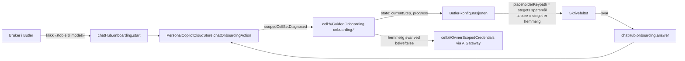

# Dataflyt

## Onboarding (spor 1)



| Kant | Endepunkt / keypath | Kontrakt |
|---|---|---|
| knapp → hub | `chatHub.onboarding.start` (payload `scriptID`) | `PersonalCopilotCells.swift` registerSet-løkken |
| hub → store | `chatOnboardingAction(requester:keypath:payload:)` | `PersonalCopilotCloudStore.swift` |
| store → celle | `cell:///GuidedOnboarding` `onboarding.start/answer/confirmStep/skipStep/cancel` | `GuidedOnboardingContract` |
| celle → flate | `onboarding.currentStep`, `onboarding.progress` | `GuidedOnboardingContract` |
| flate → skrivefelt | `placeholderKeypath`, `secure` (nye) | `contract/skeleton-textinput-felt.md` |
| hemmelig svar | lagres owner-scoped, aldri i `get` (`never_returned_by_get`) | `GuidedOnboardingCell.swift:96–113` |

## Løpet (spor 2)

```mermaid
flowchart LR
  G0[Formålsgrafen<br/>Book/haven_purpose_knowledge_base + Butler-leksikon] --> K1[Korpusgenerator]
  K1 --> K[korpus v<n>.jsonl<br/>frosset]
  K --> T[Tolker (utbyttbar)<br/>v1: raske underagenter]
  T --> F[sølvfasit]
  F -- uenighet + lokkeduer --> D[Dommerbenken]
  D --> F2[gullfasit]
  K --> M[Måleharness<br/>Swift-test over ChatPurposeResourceRouter]
  M --> R[rapport: topp-1, R@3, MRR, negativpresisjon<br/>trening / holdout]
  F2 --> R
  R --> J[forslag til grafendringer<br/>hver med feilrader]
  J -- Kjetil godkjenner --> G0
```

| Kant | Format | Kontrakt |
|---|---|---|
| graf → generator | purposeRef + tittel + fraser | `Book/haven_purpose_knowledge_base_v0.json` |
| generator → korpus | JSONL, én melding per linje | `contract/korpus-v1.md` |
| korpus → tolker → fasit | samme id, `predictedPurposeRef` eller `none` | `contract/korpus-v1.md` |
| korpus → harness | samme fil, lest av Swift-testen | `contract/korpus-v1.md` |
| harness → rapport | JSON med topp-k per id | `contract/korpus-v1.md` |
