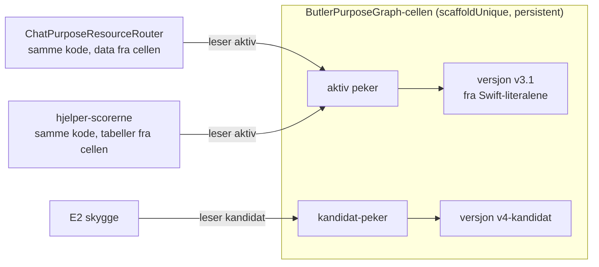

STATUS: v3 — Kjetil valgte B 29.09 («Gjør B) …»); kart, format og flytteplan i E1-KART.md, contract/butler_purpose_graph_v1.schema.json, E1-MIGRERING-TIL-REGISTER.md

# E1 — Butlers formålsgraf i en versjonert celle

PDD_butler-onboarding-og-formaalsforstaaelse_2026-09-23, tillegg 2026-09-24, WP E1 (= B1 i godkjent G2).
Formål: `purpose://candidate.butler-forstaaelse.laering-under-bruk.graf-i-celle` — leksikon og vekter er data i en celle; Butler leser dem; en versjon kan byttes og rulles tilbake uten utrulling.
Kjetils valg 2026-09-24: «I en celle i HAVEN, versjonert». B1 i G2: «Ingen femte matchevei.»

## 1. Hva som finnes i dag (lest fra CellScaffold `origin/main` `6c70a592`)

| Del | Hvor | Form i dag |
|---|---|---|
| Flate-leksikonet | `Sources/App/Support/ChatPurposeResourceRouter.swift` l. 905 (`PurposeLexiconEntry`), l. 2320 (`purposeLexicon`) | 27 Swift-literaler: `purposeRef`, `label`, `queryPhrases`, `requiredQueryTokenGroups`, `resourceHints`, `endpointHints`, `scoreBoost` |
| Særregler i ruteren | samme fil, 11 steder `purposeIntent.purposeRef == "…"` | gulv og tak per formål i kode (f.eks. agenda ≥ 0,60, profil/publisering ≥ 0,78) |
| Hjelper-scorerne | `Sources/App/Cells/PersonalCopilot/PersonalCopilotCloudStore.swift`, 14 `…IntentScore` + `isInviteIntent`, `isPollIntent`, `agentActionMatch` | frasetabeller + logikk (kombinasjoner, regex, klokkeslett, nektelse) + faste scorer (0,76–0,92) |
| Terskler | samme fil l. 1862–1864 | vise 0,60, foreslå 0,72, autofyll 0,85 |
| Personlig vekting | `assistantBaseWeight` l. 14286, `purposeWeightObject` | basis + 0,05 per godtatt − 0,04 per avvist. `learningEnabled` (av som standard) stopper bare registrering av nye hendelser; gamle vekter leses fortsatt |
| Formålsgrafen (Book 23) | `Sources/App/Support/PurposeKnowledgeBase.swift` | også Swift-literaler (`node(…)` med `aliases`, `tokens`, `capabilityHints`), ikke lest fra `Book/haven_purpose_knowledge_base_v0.json` |
| Én motor | `PDD_formaalsregister-som-graf_2026-09-11`: WP4a (måling) avgjør; kandidat i CellProtocol `Sources/CellBase/PurposeAndInterest/InterestPurposeWeightedSum.swift` | ikke valgt |

Det finnes ingen celle i dag som holder formålsdata som kan byttes ved kjøretid.

## 2. Forslaget

1. **Én ny celle, `ButlerPurposeGraph`** (`scaffoldUnique`, persistent). Holder versjoner (uforanderlige etter publisering), en *aktiv* peker og en *kandidat*-peker, og en revisjonslogg over pekerbytter.
2. **Formatet `haven.butler-purpose-graph.v1`** bruker Book 23-feltene der de finnes, så den ene motoren senere kan lese de samme nodene:
   - per formål: `purposeRef`, `aliases` (= `queryPhrases`), `tokens`, `capabilityHints` (= `endpointHints` + `resourceHints`);
   - en Butler-fasett for det Book 23 ikke har: `requiredTokenGroups`, `scoreBoost`, `floor`/`cap` (de 11 særreglene som data);
   - hjelpere: per `intentKind` en liste regler av fire typer — `anyPhrase → score`, `allOf(gruppe, gruppe) → score`, `pattern → score`, `excludeIf` — pluss navngitte predikater som forblir kode (`negation`, `mentionsClockTime`, `asksForAIGatewayStatus`), som reglene peker på ved navn;
   - terskler og basisvekter.
3. **Ingen ny matchevei.** Ruteren og scorerne beholder sin kode og sin rekkefølge; bare dataene flyttes. Swift-literalene fjernes i samme endring. Startversjonen genereres fra literalene av et skript, og måles til identiske tall.
4. **Hvem kan skrive.** Å legge inn en versjon og flytte kandidat-pekeren: scaffold-administrator (entity:digipomps). Å flytte *aktiv*-pekeren: bare med en promoteringsrapport (E6) og Kjetils ja, eller en stående godkjenning som C4. Tilbakerulling til forrige aktive: scaffold-administrator, alltid, logget.
5. **Lesing.** Ruteren leser et hurtigbufret øyeblikksbilde av aktiv versjon, byttet atomisk når pekeren flyttes. Ingen polling; pekerbytte sender en hendelse.

## 3. Hvordan vi vet at det virker

| Test | Hva |
|---|---|
| `test.lub.graf-i-celle-samme-tall` | Måleløpet (`wp-butler-maaling-v2.sh`) med graf fra cellen gir **identisk** `resultat.jsonl` per melding som graf v3.1 fra literalene, på korpus v1, v2 og PromptPurposeLab |
| `test.lub.dataendring-endrer-treff` | En Swift-test legger inn en versjon med én ny frase, flytter aktiv-pekeren, og ser at en melding som før var stille, nå treffer — uten kodeendring |
| `test.lub.bytte-og-tilbakerull` | I staging: legg inn kandidat, flytt aktiv, rull tilbake; `/health` og måleløpet før og etter |
| `test.reg.en-motor-i-kode` (fra formålsregisteret) | `grep` finner ingen `PurposeLexiconEntry(`-literaler og ingen frasetabeller i scorerne etter endringen |
| Tilgang | ikke-administrator får nei på å skrive versjon og flytte peker |

## 4. Det jeg er usikker på

1. **Hjelpernes logikk som data.** Fire regeltyper dekker det jeg har lest, men `agentActionMatch` og invitasjons-regexen er de mest sammensatte. Blir regelspråket en egen liten motor — altså en femte matchevei i forkledning?
2. **Forholdet til formålsregisteret.** Bør cellen heller være *formålsregisterets* lager (Book 23-noder med fasetter per forbruker), så Butler, Kallimachos og `PurposeKnowledgeBase` leser samme sted fra første dag?
3. **Versjoner og persistens.** `scaffoldUnique` + persistent gir ett lager per scaffold. Er det riktig at staging og prod har hver sin versjonshistorikk, eller skal versjoner kunne flyttes mellom dem?
4. **Ytelse.** Ruteren kalles hver gang et utkast analyseres (`assistant.analyzeDraft`); hvor ofte det skjer i web-klienten er ikke målt. Hurtigbuffer + hendelse ved bytte skal holde det likt med literalene; det må måles.

---

## v2 etter Astras motsvar (2026-09-24 ca. 12:57Z)

Astras dom (`handoff/E1-ASTRA-MOTSVAR.md`): **holder med endringer**. Jeg er enig i alle sju kravene. Det viktigste: designet i §2 ville ha laget en ny regelmotor under navnet «lagring». Endret slik:

| Krav fra Astra | Endring i designet |
|---|---|
| Ikke et regelspråk | **Ingen regeltolker.** Hver eksisterende kodegren får typede, navngitte parameterplasser (frasetabell, score, grenlokal eksklusjon). Kontrollflyt, rekkefølge, første-treff, normalisering og predikatene blir i koden. `butlerSignalIntentScores` og `agentActionMatch` beholder adapter og handlingsbeskriver i kode; bare tabellene deres flyttes, eller de står over i første runde. Alle 17 funksjonene kartlegges rad for rad før bygging. |
| Tapsfri datamodell | Leksikonet er **ordnet** (rekkefølgen trekker 0,04 per plass og avgjør formålslås). `endpointHints` og `resourceHints` holdes adskilt. Ruterens egne fraser og normalisering beholdes; ingen `aliases = queryPhrases`. |
| Særreglene | Ikke ett gulv/tak per formål: hver særregel blir en navngitt plass med sin operasjon (tillegg, gulv, tak, fase, målflate), eller blir stående i kode. |
| Én versjon per analyse | Hele `analyzeDraft` bruker ett festet øyeblikksbilde. Forslaget bærer grafens innholdshash og regel-id-ene som traff, fra E1. |
| Riktig test | «Identisk fil» erstattes av en **semantisk differanse** over hele beslutningsstrukturen (ikke kjøretid, UUID, tidsstempler), pluss grenmatrise for særreglene, læringsvekter (også gamle hendelser med læring av), terskelgrenser og samtidige kall med pekerbytte midt i. Porten feiler lukket. |
| Aktivering | Versjon = innholdshash (+ skjemaversjon, kildecommit, predikatversjon). Aktivering er compare-and-swap på forventet gammel hash, med godkjenning bundet til ny hash og rapporthash. Egne rettigheter for å laste opp, nominere, evaluere, promotere og rulle tilbake. Tilbakerulling bare til en identifisert, tidligere godkjent hash som ikke er tilbakekalt. Import avviser tomme tokengrupper, ukjente plasser og ikke-endelige tall. |
| Grunnmur for E2/E6 | Skygge er en **ren evaluator** med eksplisitte input: ingen modellkall, ingen chatlogg, ingen lagring, med tidsbudsjett. Å kalle `analyzeDraft` to ganger er ikke skygge. Hendelsen skiller vist forslag, alternativ og utfall; et forslag som aldri ble vist, får ikke et utfall. |

**Faktarettelse:** `learningEnabled` stopper bare *registrering* av nye læringshendelser. Vekter fra tidligere hendelser leses fortsatt når den er av (Astra, `PersonalCopilotCloudStore.swift` l. 13809 og 14445). Rettet i tillegget.

**Funn om måleverktøyet vårt:** `wp-butler-maaling-v2.sh` skriver «LEVERT» selv om regresjonstestene er røde eller et korpusløp feiler (l. 68, 81, 88). Ingen av målingene i natt hadde røde regresjoner (93/93 hver gang), men porten var åpen. Rettes i `wp-butler-maaling-v3.sh` (feiler lukket, og låser baseline-commit, patchhash og katalog i rapporten).

### Beslutning som trengs fra Kjetil

**Hvem eier lageret?** Astra anbefaler at formålsregisteret (PDD_formaalsregister-som-graf, WP8 `PurposeRegistry` i CellProtocol) eier det, med Butler som forbruker med egen fasett, så det ikke oppstår to kanoniske lagre.

- **A. Registeret eier det (Astras anbefaling).** Én kilde fra start. Men `cell:///PurposeRegistry` (WP8) finnes ikke på main i CellProtocol eller CellScaffold ennå, så E1 og alt etter (skygge, promotering) venter på registerarbeidet.
- **B. Butler først, med registerets kontrakt.** E1 bygges nå som en Butler-celle med typede plasser, i et format avtalt med registerarbeidet, og flyttes inn når WP8 finnes. Raskere, men to lagre en periode.
