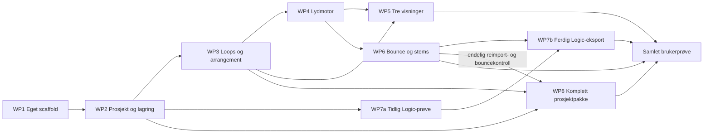

# Plan — Butterpop Method v1

## Nyeste eksportstatus — 2026-10-13 kveld

Last verified against code: 2026-10-13. Kjetils bestilling: «Fortsett med bounce og eksport til Logic av det redigerte prosjektet, slik at loops og miksinnstillinger følger med. Test hele løpet fra redigering og lagring til import i Logic.»

- Implementert: WAV-bounce og Logic-ZIP av åpent prosjektøyeblikksbilde; faktisk clip.assetID, plassering, gain/mute, fire aligned stems, urørte originalressurser, egen prosjektfil og manifest. Solo er audition-only. Eksport er midlertidig lokal konvertering på Macen, ikke hosted prosjektlagring.
- Chrome rediger → lagre → åpne i ny kontekst → bounce/AAF-nedlasting består. Uavhengig PCM-orakel gir 0 trinn feil for miks og alle stems; 2048000 frames, stereo PCM24/48 kHz. Originalfiler og prosjekt bevares. Eksportfeil bevarer aktivt prosjekt; redigeringsfelt låses under eksport.
- Faktisk Logic Pro Creator Studio 12.4-import av nedlastet AAF: fire spor/27 regioner og loopbytte kom inn. Volumautomasjonen må aktiveres på alle fire spor med bryteren ved Read. Mute representeres som nullvolum, ikke Logic sin mute-knapp.
- **WP7b/T7 presis miks er fortsatt åpen:** −6 dB spiller omtrent −5,98245 dB. Ujustert full sammenligning gir maks1113 PCM24-trinn feil. Referansen er ikke endret og ingen gainfit brukes som passgrunnlag. Tidligere WP7a med unity gain består fortsatt; det beviser ikke denne miksen.
- Sluttprosjektet er lagret med fire intakte originalmedier. Siste lukk/gjenåpning er ikke verifisert: Logic sluttet å svare med gjentatte native timeouts. Brukeren er bedt få appen til å svare igjen.
- Gjennomført kontroll: 3 Swift-, 3 Node-, 8 Python-tester og tre Chrome-forløp; fysisk Logic-import/bounce er separat rødt bevis. Avgrenset uavhengig lesing fant manglende aktiveringssteg i importveiledningen; rettet og bekreftet. Ingen full sikkerhetsaudit eller G3.
- Nåværende dokumentasjon og fortsettelsespunkt: `Butterpop_method/docs/REDIGERT_EKSPORT_2026-10-13.md` fra HAVEN-roten. Bevis: `evidence/export-browser.json`, `edited-export-verified.json`, `edited-logic-roundtrip.json`, `edited-logic-saved-media.json`, `logic-import-input.json` under Butterpop_method.
- Full WP6/WP7-akseptanse, Safari/avlytting, brukeravbryt/framdrift, generell ressursimport og øvrige v1-arbeidspakker gjenstår. Aktører, timeplan og undervisningspakker er fortsatt senere planlagt arbeid.

## Historikk før redigert eksport

Plan 1 · utarbeidet 2026-10-12, godkjent 2026-10-13. Implementering av WP1/WP7a er startet; se STATUS.md og TESTRESULT.md. Les sammen med `FORMAALSSPEC.md` og `images/README.md`.

## Dette skal du gjøre

| Hvem | Neste bidrag | Når |
|---|---|---|
| Kjetil | Godkjente formål, plan, skisser og Mac/nettleser | Gjennomført 2026-10-13 |
| Henrik + Kjetil | Velge noen egne/tillatte startloops og maskinen med Logic for faktisk importprøve | Før lyd-/Logic-prøven |
| Utvikler | Gjennomføre arbeidspakkene, samle målinger og vise et komplett brukerforløp | Etter beslutning om gjennomføring |

Kjetil har godkjent formål, GUI og plan, og autorisert oppstart med eget scaffold og tidlig Logic-prøve. Ingen full produktarbeidspakke er erklært ferdig. Syntetiske egne loops brukes i den tekniske prøven; kuratert innhold velges senere.

## Videreføring fra Kjetil 2026-10-13

Logic-prøven skal være grønn før videre prosjektlagring/redigering. Dette er gjennomført: WP7a har sampleidentisk kontrollbounce. Egenlagring og avgrenset fire-spors redigering er så implementert og prøvd i Chrome. WP2 deles praktisk i egenfil og senere hosted lagring med identitetsbundet tilgang; begge skal bevare brukerens eierskap. Egenfil-delen alene lukker ikke full WP2.

Aktører (elever/deltakere, tilrettelegger, psykolog/psykiater og øvrig fagpersonell), timeplan for alle roller, undervisningspakker/gjennomføringer og settingstilpassede flater er tatt inn som neste retning. Første prioritet forblir den enkle musikkflaten. Se `Butterpop_method/docs/AKTORER_OG_UNDERVISNING_PLAN.md` fra HAVEN-roten for avgrensning, foreslåtte generelle komponenter og prøver. Ikke implementert administrasjon er ikke presentert som ferdig.

## Rekkefølge og tidlig avklaring

Start med eget scaffold, en minimal prosjektmodell og en liten AAF-prøve. Bevis at fire loops kan høres synkront og at fire spor faktisk kommer inn i Logic. Deretter bygges hele redigeringen og de tre visningene. Dette reduserer risikoen for en pen flate med en uavklart eksportvei.



WP7a/b er to trinn i samme arbeidspakke F7. WP7a kan undersøkes med en liten frossen modellfixture før hele WP2 er ferdig. Det er ingen tidsfrist eller totalestimat her: eksportbibliotek, lydytelse og tilgjengelig Logic-maskin er ennå ikke målt.

## Arbeidspakker — én per bladformål

| Pakke / formål | Konkret arbeid | Utfører og avhengighet | Bevis og stoppvilkår |
|---|---|---|---|
| WP1 / F1 | Opprett egen Swift-pakke/vert og lokal webflate; velg eksakte dependencies; bootstrap identitet, resolver og storage etter eksisterende mønster | Utvikler; utgangspunkt dokumenteres før kodeendring | T1: bygg/testlogg og startopptak. Ikke gjør CellScaffold App til produktavhengighet. |
| WP2 / F2 | Versjonert MusicProject-model, kommandoer, undo/redo, eierkontroll, atomisk prosjektsnapshot og tydelig save receipt; asset-store med manifest | Utvikler; WP1 | T2 + kontrakt/auth-fixtures. Ved diskfeil må UI bevare endring som ulagret og tilby ny lagring. |
| WP3 / F3 | Loopkatalog, WAV-import, metadata og validering; fire spor; innsetting, flytting, repetisjon og sletting på taktrutenett | Utvikler; WP2 | T3, tillatt fixturebibliotek, ressursgrenser målt. Ufullstendig import rulles tilbake. |
| WP4 / F4 | Weblydadapter, dekoding/cache, lokal scheduler, play/stop/seek, masterstopp, gain/mute/solo og håndtering av suspendert AudioContext | Utvikler; WP3 | T4 på pilotmaskin. Ved manglende buffer: stopp/feil, ikke tause hull. |
| WP5 / F5 | Utforsk/Bygg/Studio koblet til samme modell og kommandoer; husk visningsvalg; tilgjengelighet; tom/feil/lagringstilstand; ekspertverktøy kan skjules | Utvikler; WP3–4; Henrik vurderer håndgrep | T5, faktiske screenshots ved samme viewport som skissene. Færre verktøy endrer ikke rettigheter eller prosjektformat. |
| WP6 / F6 | Samme renderplan offline; frossen revisjon; WAV PCM24-encoder, stereo bounce, fire aligned stems, framdrift/avbryt og filkontroll | Utvikler; WP4 | T6 inkl. endring under eksport og avbrutt eksport. Ikke tilby halvferdig fil som komplett. |
| WP7 / F7 | a: skriv en minimal AAF med fire spor og WAV-medier, importer i Logic. b: bygg brukerens eksportpakke, importveiledning, manifest og ferdig feilhåndtering | Utvikler + person med Logic; prøve etter minimal WP2, sluttkontroll etter WP6 | T7 faktisk import, save/reopen. Feilet AAF erstattes ikke i rapporten med «stems virker». Stems er separat tilgjengelig funksjon mens F7 forblir åpen. |
| WP8 / F8 | Autorisert eksport av hele prosjektet og nødvendige ressurser, kilde-/lisensmetadata, portable referanser, hasher og reimport | Utvikler; WP2–3, sluttkontroll mot WP6 | T8 på rent område. Ingen personlige maskinstier/tokens; ufullstendig eller ulovlig raw-asset-pakke avvises med navngitt årsak. |

## Eget scaffold og generelle komponenter

Foreslått pakkestruktur, ennå ikke opprettet:

```text
Butterpop_method/
  Package.swift
  Sources/ButterpopMethodScaffold/    # startpunkt
  Sources/ButterpopMethodHost/        # HTTP, bootstrap, identitet, konfigurasjon
  Sources/MusicProjectModel/          # prosjekt, spor, klipp, assets, revisjon
  Sources/MusicCreationCells/         # generelle CellProtocol-adaptere
  Sources/MusicExport/                # pakke/AAF-adapter og manifest
  Web/                               # tre visninger og browser audio adapter
  Tests/                             # modell, kontrakt, eksport og integrasjon
```

Generelle arbeidsnavn: `MusicProjectCell`, `LoopLibraryCell`, `MusicRenderJobCell`, `ProjectExportCell`; UI-komponenter `TransportBar`, `LoopPicker`, `TrackLane`, `ClipBlock`, `MixerStrip`, `ExportDialog`. Arbeidsnavnene er ikke registerførte celler eller verifiserte offentlige API-er. Hold lydmotoren utenfor generell CellProtocol-kjerne. Ingen tidlig utpakking til nye felles repoer før en andre bruker av komponentene finnes.

Egne produkter kan avhenge av CellBase/CellVapor og nødvendige isolerte biblioteker. Undersøk reell transitive avhengighetsmengde før ScaffoldKit velges. Pinne en verifisert revisjon fra publisert main for byggbar levering; ikke basere release på en tilfeldig skitten checkout.

## Dataflow

Detaljert kanttabell: `dataflow.md`. Foreløpig melding-/datakontrakt: `contract/music-project-v0.json`. Dette er et designutkast; det er ikke et kjørbart CellProtocol Explore-schema eller en registrert kontrakt. Faktiske keypaths og fixtures fastlegges i WP2–3 før adaptere implementeres.

## Eksport som brukeren møter

| Valg | Innhold | Hva brukeren gjør |
|---|---|---|
| Ferdig miks | Én stereo WAV,48kHz/24bit | Spiller filen eller tar den videre til publisering senere |
| Logic | AAF + WAV-medier + importveiledning/manifest | Importerer AAF, kontrollerer/angir tempo, lagrer som Logic-prosjekt med medier |
| Fire spor | Fire stems med felles start og lengde | Importerer alle ved samme startpunkt i en DAW |
| Hele prosjektet | Prosjektmodell, assets, lisenser, manifest og eventuelle utvalgte renderfiler | Sikkerhetskopierer, flytter eller gjenåpner i Butterpop |

Direkte native `.logicx`-eksport inngår ikke som påstått mulighet. Hvis egen `.logicx` uten import skal være et krav, må det bli en separat undersøkt utvidelse. AAF bevarer arrangementet som redigerbare lydregioner; original loop-identitet/repetisjonssemantikk beholdes i Butterpop-manifestet. Logic-mediene har ingen innbakt gain, mute eller solo, slik at original lyd bevares også ved nullvolum. Gain i dB og mute gjenopprettes manuelt på de fire sporene etter importveiledningen i den foreslåtte v1. Automatisk overføring av miksen kan innføres hvis WP7 beviser støtte i valgt AAF-løsning. V1-basisen krever altså noen miksinnstillinger i Logic etter import, og er ikke identisk mixer-state ved åpning.

## Splice og andre kilder senere

V1 lagrer generelle metadata: provider, providerAssetID, sourceURL, licenseRef, acquiredAt og redistributionPolicy. Ukjent lisens er ikke automatisk tillatelse. Start med egne eller klart redistribuerbare ressurser. En senere importadapter kan knytte til kildetjeneste, lisens og tilgjengelighet; ingen antakelse om åpent API, gratis tilgang eller rett til å sende rå samples videre. [Splice vilkår](https://splice.com/terms) og [lisens-FAQ](https://support.splice.com/en/articles/8652642-splice-sounds-licensing-faq) må sjekkes på nytt når integrasjonen spesifiseres.

## Avslutning av v1

Utvikler kjører rotforløpet og T1–T8 mot den samme revisjonen, på navngitt Mac, i de avtalte nettleserne og Logic-versjonen. Henrik prøver fra tomt prosjekt uten utviklerforklaringer. Dokumenter hva han faktisk får til, hvor hjelp trengs, og eventuelle kjente begrensninger. En terapeutisk effekt er ikke et teknisk akseptkriterium og følger ikke av at editoren virker.

Kunnskapstjeneste og publiseringskobling beholdes i produktretningen, men får egne senere formål og leveranser. Ingen produksjonsutsetting eller publisering er bestilt i denne planen.
