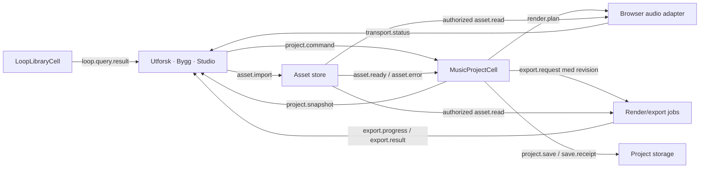

# Dataflyt — foreslått v1

Alle navn/kommandoer under er planlagt, ikke eksisterende keypaths. Datakontrakten ligger i `contract/music-project-v0.json`.

| Kant | Innhold og grense |
|---|---|
| project.command / project.snapshot | baseRevision + commandID + typed operation; snapshot bekrefter anvendt revisjon, ikke automatisk disksave |
| loop.query.result | kompatibel katalog med ressurs-/lisensmetadata; gir ikke tilgang alene |
| asset.import / ready / error | valider WAV/hash/metadata/rettigheter før referansen blir del av prosjektet |
| render.plan | frossen modell, sample-posisjoner, gain/mute og asset-hasher; ingen nettverksklokke for noter |
| asset.read | autorisert bytelevering, ingen åpne filstier; hash verifiseres før dekoding |
| transport.status | lokal playhead/playing/suspended/error; ikke lagre hvert avspillingssample i celler |
| export.request / progress / result | requester, prosjekt/revisjon, format, manifest, kontrollert resultat eller error |
| project.save / save.receipt | kvittert komplett og varig revisjon; feil når diskskriving ikke lykkes |

Lydmotoren og eksportplanen er egne adaptere. Bytte mellom visningene endrer bare hvilke kontroller som vises. Senere publiseringsadapter skal få en ferdig bounce ved uttrykkelig handling, ikke lytte til alle prosjektendringer.
