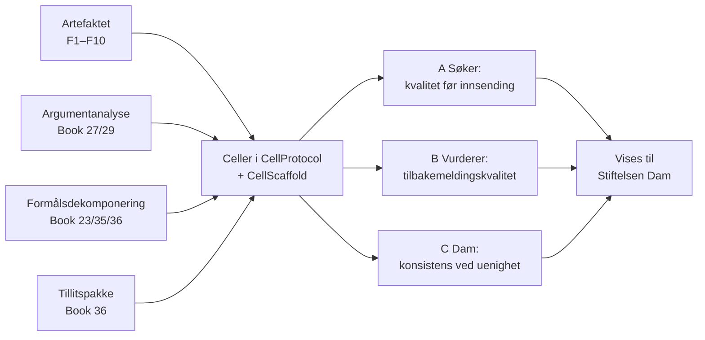

# Brief til ny tråd i Dam-prosjektet — levende dokument + argumentanalyse + formålsdekomponering som produkt

Skrevet av Losen 2026-09-17 i Cowork-tråden «Claude-as-a-person». Oppgavemappe: `Deliverables/PDD_dam-levende-dokument-og-soknadsvurdering_2026-09-17/` i CellProtocolDocuments.

## 0. Formålet med tråden (les først, mål hvert steg mot dette)

Tråden er ferdig når tre ting finnes:

1. **En produktbeskrivelse Kjetil kan vise Stiftelsen Dam.** Den sier hva produktet er, hvem det er for, hva det gjør i dag og hva som mangler, grunnet i HAVEN-kode og -dokumentasjon, og uten overpåstander.
2. **Steg til ferdig produkt.** Stegene er formålsdekomponert etter PDD (Book 35), med porter, eier per steg og en grafisk fremstilling. Det skal være tydelig hva hvert steg innebærer og hva Kjetil selv må gjøre.
3. **En godkjent G1** for å definere funksjonaliteten i CellProtocol og implementere den i CellScaffold. Ingen plan eller kode før G1. Ingen GUI-implementering før G1-GUI.

Et dokument om leveransen er ikke leveransen (`lesson.plan-instead-of-delivery`). Produktbeskrivelsen *er* her leveransen for steg 1. Implementeringen er leveransen etter G2.

## 1. Kjetils ord (ordrett)

> Funksjonaliteten i dette artefaktet må du definere i CellProtocol og implementere i CellScaffold. Vi skal kombinere dette med argumentanalyse og formålsdekomponering slik at vi kan pakke det som et produkt. Bruk det du har av rådgivere, dokumentasjon og implementasjon til å beskrive dette som et produkt og steg til å ha det som et ferdig produkt. Start en ny tråd i Damm prosjektet for dette. Vi skal vise dem akkurat dette.

Presisering i samme tråd:

> Det viste seg at det var med en m. Her er link: https://www.dam.no vi skal se om vi kan bruke vår funksjonalitet for å virdere kvaliteten i søknader.

«Dem» er altså **Stiftelsen Dam**. Bruksområdet er å **vurdere kvaliteten i søknader**.

## 2. «Dette artefaktet» — hva det faktisk gjorde

Artefaktet er Claude-dokumentet «Vedtekter for Norsk tårntitterforening (utkast)»: https://claude.ai/code/artifact/3615ce25-e770-43db-8b78-602b9cb477a7 (Claude Docs, doc-id `3615ce25-e770-43db-8b78-602b9cb477a7`). Det ble laget 2026-09-17. Funksjonene under er observert i bruk, ikke antatt:

| ID | Funksjon | Hvordan den viste seg |
|---|---|---|
| F1 | **Formål først** | Første seksjon, «Hva vedtektene skal oppnå», lister fem krav utkastet måles mot (registrerbar, ideell, enkel å drive, stabil, plass til leken), med kilder. |
| F2 | **Skjelett før innhold** | Dokumentet ble født med tittel, dato, forfatter og én *pending*-blokk per seksjon med hensikt. Deretter ble én seksjon fylt per kall mens brukeren så på. |
| F3 | **Kildegrunnet innhold** | Fakta ble hentet fra primærkilder (brreg.no, altinn.no) og sitert i dokumentet. Det som ikke kunne sjekkes, ble merket som åpent. |
| F4 | **Menneske og agent i samme dokument** | Revisjonsnummer (`rev`) per endring, vaktede endringer (hash per blokk) og lesing med `sinceRev`. Er det menneskets endring mot agentens, vinner mennesket. |
| F5 | **Ankrede kommentarer** | En kommentar festet til nøyaktig passasje («styreleder og to styremedlemmer») spør om en antakelse. Svar kan komme i tråden. |
| F6 | **Synk med ekstern agent** | Utkastet ble sendt til Lille Robot (Victorias agent) over HAVEN correspondence med seks nummererte spørsmål. Innspill skal føres inn i riktig paragraf og merkes med opphav. |
| F7 | **Oppfølging som fletter inn** | En planlagt oppfølging leser innboksen, fletter svar inn uten å overskrive menneskets endringer og oppdaterer synk-seksjonen. I HAVEN skal dette være hendelsesbasert, ikke polling (prinsipp 2026-09-12). |
| F8 | **Åpne spørsmål som sjekkliste** | Egen seksjon med avkrysningspunkter for uavklarte valg. |
| F9 | **Norm skilt fra forklaring** | Normativ tekst (paragrafene) er skilt fra kursive merknader som forklarer valg. |
| F10 | **Deling og eksport** | Dokumentet er privat til det deles, og kan eksporteres (f.eks. til PDF for Altinn). |

Kjetils prinsipp (2026-09): *hvordan HAVEN dekomponerer og analyserer skal ikke lekkes ut i tekst — metoden skal ligge i celler som utfører operasjonen; det er det som gjør det til et produkt.*

## 3. Stiftelsen Dam — hentet 2026-09-17 fra dam.no

Alt i denne seksjonen er `retrieved` fra sidene som er lenket. Sjekk på nytt før noe vises til Dam.

- Dam deler ut penger til helse- og forskningsprosjekter gjennom frivillige organisasjoner. Programmene er Forskning, Utvikling, Helse og Ekspress. Per 2026-09-17 viser forsiden 256 315 920 kr til 883 prosjekter i 2026. Kilde: [dam.no](https://www.dam.no). Man må søke gjennom en godkjent søkerorganisasjon. Kilde: [Kan jeg få støtte?](https://www.dam.no/kan-jeg-fa-stotte/)
- **Helse:** Løpende søknader og svar innen 45 dager. Beløp 40 000–400 000 kr. Tre fagutvalgsmedlemmer vurderer hver søknad uavhengig, og kriteriene vurderes på skala 1–7. Rangering skjer på median. Søknader med snitt over karaktergrensen for innvilgelse (KFI) innvilges fortløpende. Kilder: [Helse](https://www.dam.no/programmer/helse/), [Søknadsbehandling Helse](https://www.dam.no/programmer/helse/soknadsbehandling/)
- **Forskning:** To trinn, med skisse innen 15. februar og utvidet søknad innen 10. juni. 30 fagutvalgsmedlemmer fordelt på seks faggrupper, pluss tre brukerrepresentanter per søknad i runde 2a. Rangering etter median fra fagutvalg, deretter median fra brukerrepresentanter, deretter gjennomsnitt. Generalsekretæren beslutter uten å kjenne prosjektene. Kilde: [Søknadsbehandling Forskning](https://www.dam.no/programmer/forskning/soknadsbehandling/)
- **Kriterier** (Helse og Forskning): Soliditet, Virkning, Gjennomføring og Stiftelsens prioriteringer. Skala 1 «Dårlig» … 7 «Eksepsjonelt», og «beskrivelsen av karakterene skal legges til grunn … ikke tallet i seg selv». Utvalgsmedlemmene skal gi skriftlig tilbakemelding som søker får se uredigert. Den skal være kortfattet, tydelig og respektfull, knyttet til karakterskalaen og konkret om styrker og svakheter. Kilder: [Instruks fagutvalg Helse](https://www.dam.no/instruks-fagutvalg-helse/), [Instruks fagutvalg Forskning](https://www.dam.no/instruks-fagutvalg-forskning/)
- **Brukerrepresentanter** vurderer brukermedvirkning i tre faser (idé/prosjektdefinering, planlegging/gjennomføring, formidling/implementering), også på skala 1–7 og med skriftlig tilbakemelding. Kilde: [Instruks brukerrepresentanter](https://www.dam.no/instruks-brukerrepresentanter/)
- **Dams eget problem:** «De som vurderer søknadene, kan gjøre feil.» I omtrent 15–20 prosent av tilfellene er forskjellen mellom to vurderere av samme søknad svært stor, altså to karakterer eller mer. Tiltakene deres er flere uavhengige vurderinger, median i stedet for snitt og opplæring. Det finnes ingen klagemulighet. Kilde: [Feilvurderinger og uenighet](https://www.dam.no/feil/)
- **Karaktergrensen** er ikke fast. Den avhenger av antall søknader, omsøkt beløp og midler, og median har erstattet snitt fra 1.1.2024. Kilde: [Karaktergrense](https://www.dam.no/karaktergrense/)
- **Søketips nr. 10:** «Få noen til å lese søknaden». Tipsene ellers er å sjekke prosjektbiblioteket, lese utlysningen, involvere organisasjonen og deltakerne, beskrive behovet, mål og metode, gjennomføringsplan og realistisk budsjett. Kilde: [Søketips](https://www.dam.no/soketips/)
- **KI-regler — lastbærende.** Instruks fagutvalg Helse sier ordrett: «1. Det er ikke lov å bruke KI i selve vurderingen av søknadene. … 2. Det er ikke lov å laste opp søknadstekst i KI-verktøy. Av personvernhensyn er søknadstekstene beskyttet, og de skal aldri deles utenfor Damnett. 3. Det er lov å bruke KI til å forbedre egne tilbakemeldinger … så lenge du ikke legger inn selve søknadsteksten». Instruks fagutvalg Forskning nevnte ikke KI da den ble hentet 2026-09-17.

## 4. Hva dette betyr for produktet (hypoteser, ikke vedtak)

Dams KI-regler gjør at et produkt som «lar KI vurdere søknader» bryter reglene deres slik de står i dag. Tre snitt passer med reglene på ulike måter. Tråden skal utrede dem med rådgiverpanel og legge dem fram for Kjetil:

- **A. Søkersiden: kvalitetssjekk før innsending.** Søker og søkerorganisasjon eier teksten, så Dams regler for fagutvalget treffer ikke. Levende dokument (F1–F10) der Dams kriterier og skalabeskrivelser er formålstreet søknaden måles mot. Argumentanalyse av kjeden behov → mål → metode → plan → budsjett → virkning (Book 27/29). Rådgiverkommentarer ankres på passasjer. Dette gjør tips nr. 10 til en tjeneste.
- **B. Vurderersiden, innenfor dagens regel 3: tilbakemeldingskvalitet.** Vurdererens *eget* utkast til tilbakemelding sjekkes mot kriteriene og skalabeskrivelsene: er den knyttet til skalaen, konkret om styrker og svakheter, respektfull? Ingen søknadstekst går inn.
- **C. Dam som institusjon: konsistens der vurdererne er uenige.** Dette krever at Dam endrer egne regler. Analysen kjører i celler Dam kontrollerer, og en tillitspakke (Book 36) viser før kjøring hvilke modeller og Grants som brukes og verifiserer etterpå at pakken ble fulgt. Et felles argumentkart per søknad lar de tre vurdererne være uenige om de samme påstandene i de 15–20 prosentene. Produktet setter aldri karakter. Mennesket vurderer.

Må sjekkes mot offisielle kilder før noe lovet: GDPR (søknader kan inneholde helseopplysninger) og om søknadsvurdering hos en privat stiftelse faller inn under høyrisiko i EU AI Act. Bruk `haven-claim-review` på alt som skal vises til Dam. Vis aldri en ekte søknad, bruk en syntetisk søknad som er tydelig merket.

## 5. HAVEN-grunnlag (rask skanning 2026-09-17, stier relative til repoene, verifiser før bruk)

| Kilde | Relevans |
|---|---|
| `CellProtocolDocuments::Book/27_Text_Reliability_Analysis.md` + `Tools/TextReliability/text_reliability.py` | Påstander, argumentstruktur, kildegrunning og retorikk, uten å skrive om teksten eller finne på evidens. Kjernen i argumentanalysen. |
| `CellProtocolDocuments::Book/29_Claim_Argument_Model.md`; `CellProtocol::Sources/CellBase/PurposeAndInterest/ClaimDefinition.swift`, `ClaimComposition.swift`, `ClaimScheme.swift` | Implementert v0 runtime-modell for påstander og argumentgraf med polaritet, deterministisk evaluering og kobling til Goal. |
| `CellProtocolDocuments::Book/30_Panel_Task_Decomposition_Workflow.md` | Formål + påstandsstruktur for rådgiverpanel. «Ferdig» er en dokumentert evalueringstilstand. |
| `CellProtocolDocuments::Book/23_Purpose_Knowledge_Base.md`, `36_Purpose_Composition.md`; `CellScaffold::Sources/App/Support/PurposeDecomposition.swift`, `ExecutablePurposeGrounding.swift`; `cell:///ExecutablePurposeGrounding` | Formålstre, sammensetning (allOf/anyOf) og resolver `purpose.knowledge.resolve` / `purpose.context.pack`. |
| `CellProtocolDocuments::Book/35_Purpose_Driven_Development_Workflow.md` + `Tools/PurposePackages/purpose_dev.py` | Metoden selv, altså formålsdekomponering med porter. Skal bli celler. |
| `CellProtocolDocuments::Book/36_Agent_Trust_Package.md`; `CellScaffold::Sources/App/Cells/AgentTrustPackage/` | `cell:///AgentTrustPackage`: WP1–WP10 implementert lokalt (ikke deploy-attest). Viser hva en agentflåte har av Grants og modellrute før kjøring og etterprøver etterpå. Direkte svar på Dams personvernbegrunnelse. |
| `CellScaffold::Deliverables/PDD_radgiverpanel-og-persona_2026-09-05/`, memory `radgiverpanel_som_celle` | `cell:///AdvisorPanel`, hard sperre for motargument (K3), kvalitetsdisipliner K1–K9. |
| `CellProtocolDocuments::Book/33_Correspondence_First_Class.md` | Synk med ekstern agent (F6), med begrensede rettigheter. |
| `CellProtocolDocuments::Book/37_EntityData.md` | Hvem eier dataene: søker, organisasjon, Dam. |
| `CellProtocolDocuments::Deliverables/NLnet_Application_Advisory_Panel_2026-07-07.md`, `NLnet_Trust_Packet_Structure_2026-07-06.md` | Forarbeid: rådgiverpanel på en *søknad* (NLnet). |
| `CellProtocolDocuments::Deliverables/Walton_Scheme_Panel_Test_2026-07-11/`, `Text_Reliability_Argument_Map_Norwegian_Innovation_Policy_2026-06-22.md`, `Norwegian_Innovation_Policy_Measurable_Purpose*_2026-06-2*.md` | Argumentasjonsskjemaer og målbare formål testet på ekte tekster. |
| `CellScaffold`-celler som kan være byggesteiner: `cell:///DraftVersion`, `cell:///MarkdownRenderer`, `cell:///MermaidRenderer`, `cell:///AIAssistantThread`, `cell:///AIGateway`, `cell:///GraphStore`, `cell:///TrustPacket`, `cell:///ConsentReceipt`, `cell:///NotificationOutbox`, `TranscriptStoreCell` | Ikke undersøkt i dybden. Ingen celle for levende dokument med ankrede kommentarer, revisjoner og pending-seksjoner ble funnet i skanningen. Verifiser om noe finnes før noe nytt defineres. |

## 6. Oppdraget, steg for steg

1. **Les** denne briefen, `FORMAALSSPEC.md` i mappen (§0 er fylt), Book 27, 29, 30, 35 og 36 og lærdommene `purpose_dev.py lookup` skrev inn i §4.
2. **P1 — formålstre.** Rot: produktet for søknadskvalitet hos Dam. Grener: artefaktfunksjonene F1–F10 som celleformål, argumentanalyse, formålsdekomponering mot Dams kriterier, tillit og personvern, samt snittene A/B/C. Klassifiser mot Book 23 først. Hvert blad skal ha Goal og test. §2 avgrensning, §3 forventningskontrakt, §6 åpne spørsmål (maks de som endrer treet).
3. **Rådgiverpanel** etter Book 30 med minst én motsier (K3). Astra via `_losen-queue` (se memory `codex_astra_routes`), og uavhengig validering av konklusjonen med Fabel eller Astra før den legges fram (Kjetils formålsmetode 2026-09-12).
4. **Produktbeskrivelsen til Dam.** Hva det er, for hvem (A/B/C), hva som virker i dag (med kodebevis) og hva som ikke gjør det, tillit og personvern, og demo-scenario med syntetisk søknad. Kjør claim review.
5. **Steg til ferdig produkt** som graf (Mermaid eller bilde) pluss tabell: steg, formål, port, eier (Claude / Codex / Xcode / Kjetil), hva Kjetil gjør.
6. **G1** fra Kjetil. Deretter **G1-GUI** med rendrede bilder av flatene: dokument med formålsseksjon, ankret kommentar, argumentkart per kriterium, måling mot skalabeskrivelse, synk-status. Deretter **G2**. Først da kontrakter i CellProtocol (Book-kapittel + `*_contract_v0.json`) og celler i CellScaffold med tester.

Arbeidsregler: Kjetil skal aldri få skript å lime inn; maskinhandlinger går via `_losen-queue` eller device_bash. Git fra VM-en følger memory `git_from_cowork_device_bash`, og worktrees lages fra macOS. Stier i dokumenter er relative til repoet, i chat fulle. Ingen ekte søknadstekst lastes opp noe sted.

## 7. Hva Kjetil må gjøre

- Si G1 (og senere G1-GUI og G2) når spesifikasjonen treffer.
- Velge snitt (A, B, C eller kombinasjon) etter at panelet har lagt fram argumentene.
- Fortelle når og for hvem hos Dam dette skal vises, og om det finnes en kontaktperson. Dette er ukjent per 2026-09-17.

