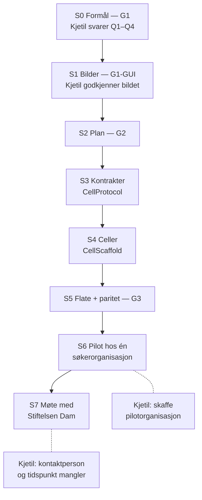

# Søknadskvalitet før innsending — produktbeskrivelse

Digipomps / HAVEN · Skrevet av Losen 2026-09-17 · Utkast til framlegg for Stiftelsen Dam · Ikke godkjent av Kjetil

> Alle tall og sitater om Dam er hentet fra dam.no 17.09.2026 og må sjekkes på nytt før framlegg.
> Ingenting i denne beskrivelsen er prøvd på en ekte søknad. Demoen bruker en tydelig merket syntetisk søknad.

## 1. Hva det er, i én setning

Et arbeidsrom for søkeren og søkerorganisasjonen der søknaden skrives mot Stiftelsen Dams egne kriterier, og der en deterministisk analyse peker på påstander uten kilde og setter ankrede kontrollpunkter i teksten — **uten at produktet setter karakter eller vurderer på Dams vegne.**

Produktet vurderer selvsagt tekst: det er hele poenget for søkeren. Det det aldri gjør, er å sette en karakter, anslå en karakter, rangere søknader eller gjøre noe av dette inne i Dams egen vurdering.

## 2. Problemet, i Dams egne tall

| Dams eget utsagn | Kilde (hentet 17.09.2026) |
|---|---|
| **Gjelder programmet Forskning:** omtrent 9 av 10 søknader avslås. Søkerne brukte **88 årsverk** på avslåtte søknader over fem år. Søknadene økte 45 % siden 2022; én frist ga 416 søknader. «Dagens modell er ikke bærekraftig», og Forskning innfører derfor en grense på antall søknader per organisasjon fra utlysningen i 2026. Tallene er ikke en baseline for Helse, og artikkelen er fra 2025 — ikke en effektmåling i dag. | [dam.no, 30.03.2025](https://www.dam.no/nyheter/dam-innforer-begrensninger-i-antall-soknader/) |
| I **15–20 %** av tilfellene er forskjellen mellom to vurderere av samme søknad to karakterer eller mer. Tiltakene er flere uavhengige vurderinger, median i stedet for snitt, og opplæring. Det finnes ingen klageordning. | [dam.no/feil](https://www.dam.no/feil/) |
| Karaktergrensen er ikke fast; den avhenger av antall søknader, omsøkt beløp og midler. | [dam.no/karaktergrense](https://www.dam.no/karaktergrense/) |
| Søketipsene ender med «Få noen til å lese gjennom søknaden din». | [dam.no/soketips](https://www.dam.no/soketips/) |

**Slik vi leser det:** Dams knapphet er vurderingskapasitet, ikke velvilje. Da er den mest verdifulle hjelpen ikke å gjøre flere søknader penere, men å gjøre **færre og mer treffsikre** søknader — og å gjøre den siste leseren tilgjengelig for de organisasjonene som ikke har en rådgiver.

Dette er også produktets viktigste selvkritikk: et verktøy som bare gjør det lettere å skrive gode søknader, kan gi Dam **flere** søknader å vurdere. Derfor er egnethetssjekken før skriving (flate 1) en del av produktet, ikke et tillegg.

## 3. Hva produktet gjør — tre flater

**Flate 1 — Passer prosjektet, og passer det nå?** Søkeren beskriver prosjektidéen, ikke søknadsteksten. Idéen dekomponeres mot programmets krav og de fire kriteriene (Soliditet, Virkning, Gjennomføring, Stiftelsens prioriteringer) og gir et begrunnet svar: *søk*, *styrk X først*, eller *dette hører i et annet program* — hver anbefaling med sitat fra Dams egen tekst og hentedato.

**Flate 2 — Søknaden som levende dokument.** Dokumentet fødes med en formålsseksjon («hva denne søknaden skal oppnå, målt mot Dams kriterier») og navngitte, tomme seksjoner. Mens søkeren skriver, viser analysen:
- påstander uten kilde i nærheten, og påstander med kilde som ikke er sjekket;
- kontrollpunkter langs kjeden behov → mål → metode → plan → budsjett → virkning, ankret i setningen de gjelder;
- retoriske trekk som kan erstatte belegg («det er derfor sikkert at …»).

Verktøyet avgjør ikke om argumentet holder. Dagens graf bygger på seksjonsrekkefølge og ordmønstre, ikke på slutninger; den peker på hvor et menneske bør se etter. Det skal sies slik i møtet, ikke pyntes på.

En invitert leser — en kollega, en rådgiver i søkerorganisasjonen, eller en agent — kommenterer **ankret på passasjen**. Menneskets endring vinner alltid over agentens. Dette er Dams eget søketips gjort tilgjengelig for organisasjoner uten rådgiverressurs. Merk: et medlem av Dams fagutvalg kan ikke være den leseren — instruksen sier at utvalgsmedlemmer ikke skal drive rådgivning av søkere.

En ting til om mottakeren: Dam skriver at «eventuelle lenker som søker legger inn i fritekstfelt er ikke en del av vurderingsgrunnlaget». Produktet skal derfor hjelpe søkeren å få begrunnelsen inn i de feltene som faktisk vurderes, ikke bare inn i dokumentet.

**Flate 3 — Hva ble sendt hvor.** Før en kjøring ser brukeren hvilke modeller og rettigheter som er i bruk og hva som eventuelt forlater maskinen; etterpå kan det etterprøves. Grunnanalysen kjører **uten språkmodell** (se §4), så standardvalget kan være at ingen tekst forlater brukerens egen flate.

Produktet viser aldri en karakter, en anslått karakter eller en rangering. Det er et krav i kontrakten, ikke en vennlig intensjon: en egen test feiler hvis en karakter dukker opp i utdata.

## 4. Hva som gjør dette forskjellig fra å spørre en chatbot

1. **Analysen er deterministisk.** Referanseverktøyet (`Tools/TextReliability/text_reliability.py`, 1363 linjer) henter ut påstander, kildestatus og argumentgraf med regler, ikke med en språkmodell, og det omskriver aldri teksten. Samme tekst gir samme resultat. En modell kan legges oppå som et valg — den er ikke forutsetningen.
2. **Kriteriene er modellert, ikke husket.** Dams fire kriterier og skalabeskrivelsene 1–7 blir formålsnoder med observerbare suksesskriterier, sitert med hentedato. Endrer Dam en formulering, endres pakken ett sted.
3. **Mennesket eier dokumentet.** Revisjoner, opphavsmerking per innspill, og regelen om at menneskets endring vinner, er del av datamodellen.
4. **Tillit er en flate, ikke en påstand.** Hva som kjørte, med hvilke rettigheter, og etterprøving i ettertid.

## 5. Hva som virker i dag, og hva som ikke gjør det

| Del | Status 17.09.2026 | Bevis |
|---|---|---|
| Deterministisk påstands- og kildeanalyse | **Kjører.** 17.09 på en syntetisk søknad: 14 påstandskandidater, 7 klynger, 13 uten kildeankring. Forbehold som må sies: «uten kilde» er et signal, ikke 13 påviste feil (en budsjettpost trenger ingen URL), og argumentgrafen er seksjonsrekkefølge, ikke slutninger | `Tools/TextReliability/text_reliability.py`; utdata i `Deliverables/PDD_dam-.../demo/` |
| Påstands- og argumentmodell i runtime (v0) | Finnes som kode med tester, men er ikke koblet til noen flate | `CellProtocol::Sources/CellBase/PurposeAndInterest/Claim*.swift` |
| Utkast og versjoner med innholdshash | Finnes som celle | `CellScaffold::.../ProjectOperations/DraftVersionCell.swift` |
| Formålsdekomponering og formålsresolver | Finnes; Dams kriterier er **ikke** modellert ennå | `CellScaffold::Sources/App/Support/PurposeDecomposition.swift` |
| Tillitspakke | Implementert lokalt (WP1–WP10). Kapitlet sier selv at dette **ikke** er attest for drift | `Book/36_Agent_Trust_Package.md` |
| Levende dokument: formålsseksjon, tomme seksjoner, ankrede kommentarer, menneske-vinner | **Ikke funnet** i søk 17.09 over Swift-kildene i CellScaffold og CellProtocol. Deler finnes å bygge på — kommentarlivssyklus i `WorkItemCell`, invitasjoner og versjonsbundne kommentarer i `MusicWorkspaceReviewCell`, utkast/versjoner i `DraftVersionCell` — men ingen gir tekstankre som overlever redigering | Astra 17.09 |
| Rådgiverpanel som celle | Paneldekomponering finnes (`PurposeDecomposition.swift:1417`), men ingen kjørende celle; panelet i dette arbeidet ble kjørt som agenter | Astra 17.09 |

Dette skal sies høyt i møtet. Demoen vi kan gi i dag er delvis kjørt i Claude; HAVEN-cellene er det vi ber om tid til å bygge.

## 6. Regler, personvern og det som må avklares

- **Dams instruks for fagutvalg Helse og Utvikling (endret 12.08.2026)**: KI er ikke tillatt i selve vurderingen; søknadstekst skal ikke lastes opp i KI-verktøy; KI kan brukes til å forbedre egne tilbakemeldinger. Produktet i §3 er **søkerens** verktøy og berører ikke disse reglene: søkeren eier sin egen tekst, og ingenting går inn i Dams vurdering.
- **Et mulig neste steg på vurdererens side** er å la vurdereren sjekke *sitt eget utkast til tilbakemelding* mot kriteriene og skalabeskrivelsene, med en sperre som varsler når teksten ser ut som sitat fra søknaden. Vi påstår ikke at dette er innenfor regel 3: å finne manglende faglige styrker eller koble et utkast til et kvalitetsnivå kan være å tilføre vurdering, og en sperre kan uansett ikke avgjøre om en formulering er kopiert. Dette legges fram som et spørsmål til Dam, ikke som et tilbud.
- **GDPR:** søknader i Helse kan inneholde helseopplysninger. På søkersiden er arbeidsantakelsen at søkerorganisasjonen er behandlingsansvarlig og Digipomps databehandler — en designantakelse som må bekreftes, ikke et avklart forhold, og «søker eier teksten» er ikke i seg selv et behandlingsgrunnlag for opplysninger om andre; produktet skal varsle når teksten ser ut til å inneholde helseopplysninger eller navn på enkeltpersoner. Overføring ut av EØS og valg av modell-leverandør må avklares før pilot.
- **EU AI Act:** vedlegg III punkt 5(a) gjelder offentlige myndigheter og aktører som handler på deres vegne, og ytelser til fysiske personer. At Dam er privat og at et menneske beslutter, avgjør ikke spørsmålet alene — forordningen omfatter også visse anbefalings- og vurderingssystemer. Dette må avklares for den konkrete bruken; vi konkluderer ikke.

## 7. Steg til ferdig produkt

Porter følger HAVENs formålsdrevne utvikling: **G1** formål godkjent, **G1-GUI** bilde godkjent, **G2** plan godkjent, **G3** akseptanse.

| Steg | Hva det innebærer | Port | Eier | Hva Kjetil selv må gjøre |
|---|---|---|---|---|
| S0 | Formålsspesifikasjonen (dette arbeidet) leses og svares på — særlig de fire åpne spørsmålene i §6 i `FORMAALSSPEC.md` | **G1** | Losen skriver, Kjetil godkjenner | Svare på Q1–Q4 og si «G1 godkjent» |
| S1 | Fire rendrede bilder: søknadsflaten (tom/fylt/funn), egnethetssjekken, vakten utløst, tillitspakken | **G1-GUI** | Losen lager, Kjetil godkjenner bildet | Se på bildene og si ja eller hva som er feil |
| S2 | Plan: arbeidspakker 1:1 mot bladformålene, hver med test og utfører | **G2** | Losen | Godkjenne planen (eller si «auto») |
| S3 | Kontrakt i CellProtocol: Book-kapittel + `*_contract_v0.json` + fixtures for dokumentcelle, kommentaranker, analyse, vakt | — | Losen + Astra (Codex) | Ingenting, utover å svare hvis noe er uklart |
| S4 | Celler i CellScaffold: levende dokument, ankrede kommentarer, analysecelle rundt det deterministiske verktøyet, personvern-/sitatvakt, Dams kriterier som formålspakke | — | Astra (Codex) bygger, Losen verifiserer | Kjøre Xcode-bygget hvis køen ikke får det grønt |
| S5 | Flate i Porthole/Binding + paritet mot de godkjente bildene | **G3** | Losen + Kjetil | Se demoen og si om den er som avtalt |
| S6 | Pilot med én søkerorganisasjon på syntetiske og deretter egne søknader. Måler: finner søkeren en svakhet hen ikke så selv? | — | Kjetil + organisasjonen | Skaffe én pilotorganisasjon |
| S7 | Møte med Stiftelsen Dam: vis flate 1–3, si hva som ikke er bygget, still pilotspørsmålet | — | Kjetil | Finne kontaktperson og tidspunkt |

## 8. Demo på ti minutter

| Min | Det de ser | Poenget |
|---|---|---|
| 0–3 | Flate 1 på en syntetisk prosjektidé: «styrk brukermedvirkning før du søker», med sitat fra Dams egen tekst | Færre og mer treffsikre søknader |
| 3–7 | Flate 2 på den syntetiske søknaden: ett nyttig funn (påstand uten kilde i Behov) **og ett falskt positivt** (budsjettposten som ikke trenger kilde), ankret kommentar fra en invitert leser, mennesket retter selv og begrunner | Dams søketips som tjeneste — og ærlighet om hva heuristikken ikke kan |
| 7–10 | Flate 3: hva som kjørte og hvor teksten var. Og setningen: dette er ikke bygget ferdig i HAVEN ennå | Tillit, og ærlighet om status |

Avslutt med ett spørsmål, ikke et tilbud: **hva vil det si for Dam at en søknad er bedre — færre, mer treffsikre, eller lettere å vurdere?**

## 9. Motprøving

Konklusjonen er motprøvd av Astra (Codex) 17.09.2026 med kodebelegg fil for fil: `ASTRA_VALIDERING.md` i samme mappe. Fire ting er endret i denne teksten som følge av det — argumentgrafen er nedjustert fra «finner brutte ledd» til «setter kontrollpunkter», Forskning-tallene er merket som Forskning, AI Act-setningen er fjernet, og GDPR-rollene står nå som designantakelse. Astras hovedinnvending står igjen som en åpen hypotese, og bør sies høyt i møtet: **det er ikke vist at færre søknader eller mindre samlet arbeid faktisk følger av verktøyet.** Pilotmålingen i S6 må derfor måle tid og frarådinger, ikke bare om søkeren fant en svakhet.
