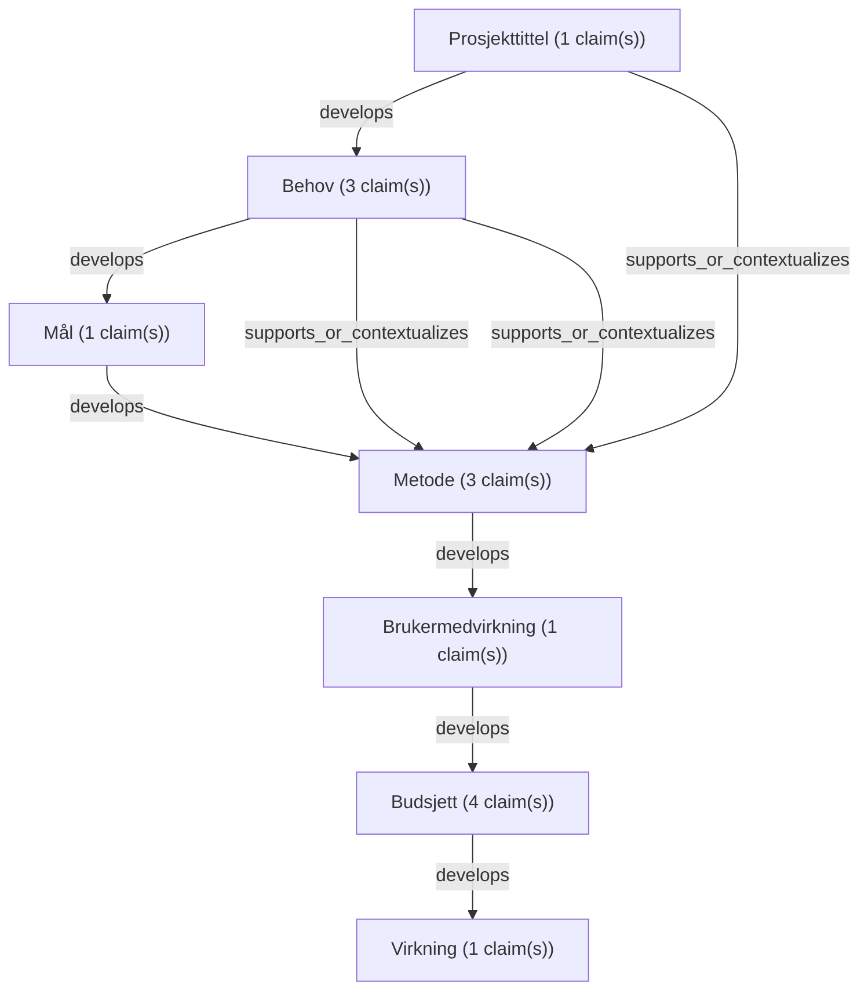

# Text Reliability Analysis Report

- Schema: `haven.text_reliability.analysis.v1`
- Analysis ID: `analysis-c5fc8344a14bf42d`
- Generated at: `2026-09-17T12:17:43Z`
- Source mode: `verifying`

## Inputs
- `text-file:syntetisk_soknad_v1.md:c58e9b28d494ee8b`: SYNTETISK søknad Turvenner (158 words)

## Markdown Structure
- Sections: `9`
- Tables: `0`

## Claims
- `claim-0001` `cluster-0001` `factual` `assertive` `source_missing`: "Turvenner: gåtrening for eldre med nedsatt syn i Innlandet"
- `claim-0002` `cluster-0002` `factual` `assertive` `source_missing`: "Mange eldre med nedsatt syn blir sittende inne."
- `claim-0003` `cluster-0002` `factual` `assertive` `source_missing`: "Ensomhet er et stort problem i Norge."
- `claim-0004` `cluster-0002` `factual` `assertive` `needs_external_source_audit`: "Ifølge en undersøkelse opplever 1 av 4 eldre ensomhet (https://www.example.org/undersokelse)."
- `claim-0005` `cluster-0003` `normative` `assertive` `source_missing`: "Prosjektet skal redusere ensomhet og bedre fysisk helse for eldre med nedsatt syn."
- `claim-0006` `cluster-0004` `factual` `assertive` `source_missing`: "Vi rekrutterer 40 frivillige turvenner som går ukentlige turer med deltakerne i 12 måneder."
- `claim-0007` `cluster-0004` `factual` `assertive` `source_missing`: "Frivillige får et kurs på to timer."
- `claim-0008` `cluster-0004` `causal` `assertive` `source_missing`: "Det er derfor sikkert at deltakerne vil få bedre helse."
- `claim-0009` `cluster-0005` `predictive` `assertive` `source_missing`: "Brukerne vil bli spurt om hva de synes etter prosjektet."
- `claim-0010` `cluster-0006` `statistical` `assertive` `source_missing`: "Prosjektleder 50 % stilling: 300 000 kr."
- `claim-0011` `cluster-0006` `statistical` `assertive` `source_missing`: "Kurs: 20 000 kr."
- `claim-0012` `cluster-0006` `statistical` `assertive` `source_missing`: "Reiser: 30 000 kr."
- `claim-0013` `cluster-0006` `statistical` `assertive` `source_missing`: "Totalt 350 000 kr."
- `claim-0014` `cluster-0007` `predictive` `moderated` `source_missing`: "Prosjektet vil gi store samfunnsøkonomiske gevinster og kan skaleres til hele landet."

## Claim Clusters
| Cluster | Title | Claims | Source audit statuses | Representative claims |
| --- | --- | ---: | --- | --- |
| `cluster-0001` | Prosjekttittel | 1 | source_missing:1 | claim-0001 |
| `cluster-0002` | Behov | 3 | source_missing:2, needs_external_source_audit:1 | claim-0002 / claim-0003 / claim-0004 |
| `cluster-0003` | Mål | 1 | source_missing:1 | claim-0005 |
| `cluster-0004` | Metode | 3 | source_missing:3 | claim-0006 / claim-0007 / claim-0008 |
| `cluster-0005` | Brukermedvirkning | 1 | source_missing:1 | claim-0009 |
| `cluster-0006` | Budsjett | 4 | source_missing:4 | claim-0010 / claim-0011 / claim-0012 |
| `cluster-0007` | Virkning | 1 | source_missing:1 | claim-0014 |

## Claim Source Matrix
| Claim | Cluster | Section | Type | Audit status | Evidence grade | Sources | Quote |
| --- | --- | --- | --- | --- | --- | --- | --- |
| `claim-0001` | `cluster-0001` | Prosjekttittel | factual | `source_missing` | no_source_anchor |  | Turvenner: gåtrening for eldre med nedsatt syn i Innlandet |
| `claim-0002` | `cluster-0002` | Behov | factual | `source_missing` | no_source_anchor |  | Mange eldre med nedsatt syn blir sittende inne. |
| `claim-0003` | `cluster-0002` | Behov | factual | `source_missing` | no_source_anchor |  | Ensomhet er et stort problem i Norge. |
| `claim-0004` | `cluster-0002` | Behov | factual | `needs_external_source_audit` | source_named_unverified | https://www.example.org/undersokelse | Ifølge en undersøkelse opplever 1 av 4 eldre ensomhet (https://www.example.org/undersokelse). |
| `claim-0005` | `cluster-0003` | Mål | normative | `source_missing` | no_source_anchor |  | Prosjektet skal redusere ensomhet og bedre fysisk helse for eldre med nedsatt syn. |
| `claim-0006` | `cluster-0004` | Metode | factual | `source_missing` | no_source_anchor |  | Vi rekrutterer 40 frivillige turvenner som går ukentlige turer med deltakerne i 12 måneder. |
| `claim-0007` | `cluster-0004` | Metode | factual | `source_missing` | no_source_anchor |  | Frivillige får et kurs på to timer. |
| `claim-0008` | `cluster-0004` | Metode | causal | `source_missing` | no_source_anchor |  | Det er derfor sikkert at deltakerne vil få bedre helse. |
| `claim-0009` | `cluster-0005` | Brukermedvirkning | predictive | `source_missing` | no_source_anchor |  | Brukerne vil bli spurt om hva de synes etter prosjektet. |
| `claim-0010` | `cluster-0006` | Budsjett | statistical | `source_missing` | no_source_anchor |  | Prosjektleder 50 % stilling: 300 000 kr. |
| `claim-0011` | `cluster-0006` | Budsjett | statistical | `source_missing` | no_source_anchor |  | Kurs: 20 000 kr. |
| `claim-0012` | `cluster-0006` | Budsjett | statistical | `source_missing` | no_source_anchor |  | Reiser: 30 000 kr. |
| `claim-0013` | `cluster-0006` | Budsjett | statistical | `source_missing` | no_source_anchor |  | Totalt 350 000 kr. |
| `claim-0014` | `cluster-0007` | Virkning | predictive | `source_missing` | no_source_anchor |  | Prosjektet vil gi store samfunnsøkonomiske gevinster og kan skaleres til hele landet. |

## Source Checks
- `claim-0001`: `source_missing` / `source_missing` - no_source_reference_found_near_claim
- `claim-0002`: `source_missing` / `source_missing` - no_source_reference_found_near_claim
- `claim-0003`: `source_missing` / `source_missing` - no_source_reference_found_near_claim
- `claim-0004`: `not_checkable` / `needs_external_source_audit` - local_v1_does_not_fetch_or_verify_sources
- `claim-0005`: `source_missing` / `source_missing` - no_source_reference_found_near_claim
- `claim-0006`: `source_missing` / `source_missing` - no_source_reference_found_near_claim
- `claim-0007`: `source_missing` / `source_missing` - no_source_reference_found_near_claim
- `claim-0008`: `source_missing` / `source_missing` - no_source_reference_found_near_claim
- `claim-0009`: `source_missing` / `source_missing` - no_source_reference_found_near_claim
- `claim-0010`: `source_missing` / `source_missing` - no_source_reference_found_near_claim
- `claim-0011`: `source_missing` / `source_missing` - no_source_reference_found_near_claim
- `claim-0012`: `source_missing` / `source_missing` - no_source_reference_found_near_claim
- `claim-0013`: `source_missing` / `source_missing` - no_source_reference_found_near_claim
- `claim-0014`: `source_missing` / `source_missing` - no_source_reference_found_near_claim

## Argument Graph
- Nodes: `7`
- Edges: `9`

## Quantitative Models
- No quantitative model inputs found.

## Rhetoric
- `authority_appeal`: "Ifølge en undersøkelse opplever 1 av 4 eldre ensomhet (https://www.example.org/undersokelse)."

## Reliability Dimensions
- `source_grounding`: `weak` - 13 claim(s) lack nearby source references.
- `logical_coherence`: `mixed` - Heuristic argument links found.
- `transparency`: `mixed` - The local tool exposes quote spans and source-status limitations.
- `rhetorical_pressure`: `low` - 0 rhetoric finding(s) may substitute for evidence.
- `uncertainty_handling`: `weak` - Unverified or missing source support remains.
- `fact_checkability`: `mixed` - Claims are sentence anchored; external verification is a separate step.

## Boundaries
- The local v1 tool does not verify external sources.
- Deep argument reconstruction requires model or human review.
- Quantitative productivity models are sizing models unless a source-auditor validates inputs and an empirical model validates attribution.
