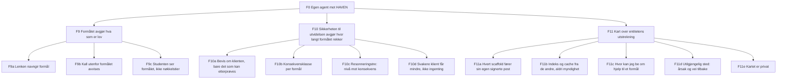

# FORMAALSSPEC iterasjon 2 (utkast) — hva som er lov, hvor sikker utvidelsen er, og kart over entiteten

Oppgavemappe: `PDD_egen-agent-mcp_2026-11-20` · Skrevet 2026-11-25 · **Venter på G1**
Bygger på iterasjon 1 (G1 2026-11-21, G2 2026-11-23, planbytte 1 2026-11-23). Ingenting i iterasjon 1 endres før dette er godkjent.

## 0. Intensjon (ordrett)

Kjetil, 2026-11-25 10:09:

> Vi bør også for avgrensingens skyld ha en formåls beskrivelse av hva som er lov. Vi bør ha med en vurdering om sikkerheten til utvidelsen i forhold til hva som skal være lov. Der kan vi bygge opp et resonerings formålstre. Det kan tillate at en bruker får tilgang til noe selv om ikke klienten er "defcon 6" sikker. For å holde oversikt over utstrekning av egen entitet må entitetsdataene inneholde et kart i form av en graf over utstrekning av entitieten og hvor det er mulig å spørre om hjelp til formåls oppnåelse i HAVEN scaffolds. Dette må være en distribuert database hvor entitetens tilstedeværelse er kartlagt i hver scaffold - privat selvfølgelig - men med nødvendig cachet eller indeksert data fra andre scaffolds entiteten er tilstede på slik at man kan vite hva man har hvor man er, vite hvor man skal lete for å finne mer og å avgjøre om tilganget til et scaffold av en eller annen grunn et umulig eller trenger workaround for å gjenopprette tilgangen. Dette bør kunne håndteres godt med formål. Implementer utestående og gjør en sikkerhetsrevisjon. Det er utrolig viktig at vi ikke introduserer sårbarheter og oppdager de vi eventuelt allerede har - og lukker dem.

Slik jeg leser det er det tre nye ting, pluss revisjonen (levert for seg i `SIKKERHETSREVISJON_2026-11-25.md`):

1. Avgrensningen i en lenke skal ikke bare være en liste av nøkkelstier. Den skal si **hvilket formål** tilgangen tjener, og formålet avgjør hva som er lov.
2. Hver utvidelse får en **sikkerhetsvurdering**. Hva den får lov til, følger av et resonnement som veier hvor sikker klienten er mot hvor mye som står på spill. En middels sikker klient skal kunne få noe, ikke ingenting.
3. Entitetsdataene får et **kart**: en privat graf over hvor entiteten finnes, hva som ligger hvor, hvor man kan be om hjelp til et formål, og om et sted er utilgjengelig og hvordan tilgangen kan gjenopprettes.

## 1. Formålstre (nye grener)

| purposeRef | Tittel | Forelder | Goal (outcome) | Verifier | Status |
|---|---|---|---|---|---|
| purpose://candidate.egen-agent-mcp.purpose-bounds | F9 Formålet avgjør hva som er lov | F0 | En avgrenset lenke sier hvilke formål agenten tjener. Tillatelsene i lenken er avledet av formålene, ikke omvendt. | test.egen-agent.purpose-bounds | candidate |
| purpose://candidate.egen-agent-mcp.link-names-purpose | F9a Lenken navngir formål | F9 | `approvedScopes` har minst én `scope.purpose:<purposeRef>`. Hver `scope.grant` må høre til et formål i en fast, signert tabell (`own-agent-purposes.v1.json`): formål → celletype, nøkkelstier, tillatelse, konsekvensklasse. En grant som ikke står under et navngitt formål, gir ingenting. | test.egen-agent.purpose-grant-table | candidate |
| purpose://candidate.egen-agent-mcp.outside-purpose-denied | F9b Kall utenfor formålet avvises | F9 | Et kall som er dekket av en nøkkelsti, men ikke av et formål i lenken, avvises med `purpose_not_allowed`. Loggen (F7) fører formålet for hvert kall. | test.egen-agent.purpose-negative | candidate |
| purpose://candidate.egen-agent-mcp.purpose-shown | F9c Studenten ser formålet | F9 | Forespørselen i «Egne agenter» viser formål i klart språk («Lese mine dokumenter», «Lagre utkast»), ikke nøkkelstier. Studenten kan krysse av færre formål enn agenten ba om. | bilde (G1-GUI), test.gui.parity | candidate |
| purpose://candidate.egen-agent-mcp.assurance | F10 Sikkerheten avgjør hvor langt formålet rekker | F0 | Hva en utvidelse får, er det minste av det formålet tillater og det sikkerheten til klienten tåler. | test.egen-agent.assurance | candidate |
| purpose://candidate.egen-agent-mcp.assurance-evidence | F10a Bevis om klienten | F10 | Hver lenke bærer bevis: hvor nøkkelen ligger (maskinvare, nøkkelring, fil), om godkjenningen skjedde med fersk passkey, klienttype, plattform. Bare bevis verten selv kan etterprøve teller. Det klienten sier om seg selv uten bevis, teller som laveste nivå. | test.egen-agent.assurance-evidence | candidate |
| purpose://candidate.egen-agent-mcp.consequence-class | F10b Konsekvensklasse per formål | F10 | Hvert formål i tabellen har en klasse K0–K4: K0 offentlig dokumentasjon; K1 egne data med lav følsomhet; K2 egne personlige data og skriving av utkast; K3 andres innhold og forskningsdata fra N3; K4 forvaltning av entiteten selv (lenker, nøkler, avtaler). K4 gis aldri til en avgrenset lenke. | test.egen-agent.consequence-table | candidate |
| purpose://candidate.egen-agent-mcp.reasoning-tree | F10c Resonneringstre | F10 | Avgjørelsen «nivå S mot klasse K» er et formålstre med påstander, støtte og motargumenter (claim-modellen, Book 29), lagret som data og vist for studenten: «Denne agenten har nøkkelen i en fil. Den får lese dokumentene dine, men ikke forskningsdata, fordi …». Samme tre gir samme utfall i Swift, Python og Go. | test.egen-agent.reasoning-parity | candidate |
| purpose://candidate.egen-agent-mcp.graded-access | F10d Svakere klient får mindre | F10 | En klient på lavt nivå får K0 og K1, ikke avvisning av alt. Avvisning av resten har kode `assurance_too_low` og sier hva som skal til. | test.egen-agent.graded | candidate |
| purpose://candidate.entitetskart.root | F11 Kart over entitetens utstrekning | purpose://self-determination.data | Entiteten vet hva den har der den er, hvor den skal lete etter mer, og hva som er utilgjengelig. | test.entitetskart.* | candidate |
| purpose://candidate.entitetskart.signed-presence | F11a Hvert scaffold fører sin egen post | F11 | Hvert scaffold der entiteten finnes, skriver én signert tilstedeværelsespost: hvilke identiteter og lenker (hele og avgrensede) den kjenner, hvilke røtter og celler som er materialisert, revisjon og tid. Scaffoldet er eneste forfatter av sin post, så to poster kan aldri være i konflikt. | test.entitetskart.presence-record | candidate |
| purpose://candidate.entitetskart.index-not-authority | F11b Indeks og cache, aldri myndighet | F11 | Hvert scaffold har en kopi av de andres poster med kilde, revisjon, hash og alder. Kartet svarer på «hvor», aldri på «får jeg lov»: tilgang avgjøres fortsatt bare av eierbevis, lenke og Agreement på stedet (Book 32 §6). | test.entitetskart.cache-no-authority | candidate |
| purpose://candidate.entitetskart.help-for-purpose | F11c Hvor kan jeg be om hjelp | F11 | For et formål svarer kartet hvilke scaffolds som har celler eller tjenester som kan hjelpe, og hva som kreves for å bruke dem. | test.entitetskart.help-lookup | candidate |
| purpose://candidate.entitetskart.reachability | F11d Utilgjengelig sted | F11 | Hvert sted har en tilstand: nåbart, ikke nåbart (med sist sett), lenke trukket, lenke utløpt, nøkkel tapt. For hver tilstand finnes et gjenopprettingsformål med steg («godkjenn på nytt fra en enhet som fortsatt er lenket»). | test.entitetskart.reachability | candidate |
| purpose://candidate.entitetskart.private | F11e Kartet er privat | F11 | Kartet ligger i entitetens egne data (`scaffoldPresence`), leses bare med eierbevis eller hel lenke, og gis aldri til en avgrenset lenke. Postene kopieres bare mellom entitetens egne scaffolds, kryptert til entitetens nøkler. | test.entitetskart.private | candidate |

## 2. Avgrensning og avhengigheter

- F9 og F10 er små tillegg til den avgrensede lenken som finnes i CellProtocol #114: to nye ordtyper i `approvedScopes` (`scope.purpose:`, `scope.assurance:`) og én tabell. De hører hjemme i denne PDD-en.
- F11 er større enn egne agenter. Det gjelder alle utvidelser (enheter, Safari, agenter) og bygger på roten `scaffoldPresence` i EntityData (Book 37 §2 og §7, der `scaffoldPresence.mounts` er et forslag, ikke avgjort). Jeg foreslår at F11 blir egen PDD, «Entitetskart», sammen med stegene fra analysen «Entitetsutvidelse i HAVEN» (flyttbar lenke, signert statusliste). Se spørsmål 4.
- F11b avhenger av at en hel lenke kan følge med til andre scaffolds (funn F1 i analysen). Uten det kan postene ikke kopieres sikkert mellom scaffolds.
- Ikke med: automatisk gjenoppretting av tilgang. Kartet sier hva som må gjøres; et menneske gjør det.

## 3. Forventningskontrakt — «Det du kommer til å se»

| Hva | Form | Hvor |
|---|---|---|
| Forespørselen «Koble til egen agent» viser formål og sikkerhetsnivå, med begrunnelsen i klart språk | bilde (ny G1-GUI) | `images/egen-agent-foresporsel-*-v2.png` |
| Tabellen formål → tillatelser → konsekvensklasse | fil | `contract/own-agent-purposes.v1.json` |
| Resonneringstreet som data, og samme utfall i tre språk | fil + test | `contract/assurance-reasoning.v1.json`, `TESTRESULT.md#assurance` |
| Kartet som flate i HAVEN: steder, hva som ligger der, tilstand, vei tilbake | bilde (G1-GUI i egen PDD) | egen PDD |

## 5. Avledede tester (nye)

| Test | Formål | Hva | Status |
|---|---|---|---|
| test.egen-agent.purpose-grant-table | F9a | Lenke med grant uten formål, eller med grant som ikke står i tabellen for formålet: ingen tilgang. | venter |
| test.egen-agent.purpose-negative | F9b | Kall dekket av nøkkelsti, men utenfor formålet: `purpose_not_allowed`. | venter |
| test.egen-agent.assurance-evidence | F10a | Selverklært nivå uten bevis regnes som laveste. Forfalsket bevis avvises. | venter |
| test.egen-agent.consequence-table | F10b | K4-formål i en avgrenset lenke gir ingenting, uansett nivå. | venter |
| test.egen-agent.graded | F10d | Laveste nivå: K0 og K1 slipper inn, K2 og K3 gir `assurance_too_low`. | venter |
| test.egen-agent.reasoning-parity | F10c | Samme tabell og tre i Swift, Python og Go gir samme utfall på fixtures. | venter |
| test.entitetskart.cache-no-authority | F11b | En kartpost som sier «du har tilgang» åpner ingenting. | venter |
| test.entitetskart.private | F11e | Avgrenset lenke får nei på `scaffoldPresence`. | venter |

## 6. Åpne spørsmål til Kjetil

1. **Nivåer.** Jeg foreslår fire nivåer for klienten: S0 ukjent eller selverklært; S1 nøkkel i fil med eiertilgang, godkjent med fersk passkey; S2 nøkkel i systemets nøkkelring; S3 nøkkel i maskinvare med bevis (Secure Enclave, TPM). Holder fire, og er rekkefølgen riktig?
2. **Standardtabell.** S0 får bare K0 (dokumentasjon). S1 får K0–K1 og K2 for lesing. S2 får K0–K2. S3 får K0–K3. K4 aldri. Er det riktig startpunkt?
3. **Hvem eier resonneringstreet?** Forslag: tabellen er standard i CellProtocol, og eieren av en celle kan stramme inn, aldri løsne, i cellens Agreement.
4. **Egen PDD for kartet (F11)?** Jeg anbefaler ja, slått sammen med «Entitetsutvidelse som virker» fra analysen.
5. **Skal en avgrenset agent få se noe av kartet?** Forslag: nei. Den får bare vite hvilke celler den selv har tilgang til.

## 7. Revisjonslogg

- 2026-11-25: Utkast til iterasjon 2 skrevet etter Kjetils melding 10:09. G1 spurt.
