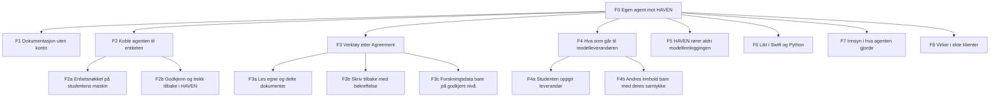

# Formålsspesifikasjon — Egen Claude og Codex mot HAVEN (MCP-adapter)

Oppgavemappe: `PDD_egen-agent-mcp_2026-11-20` · Opprettet 2026-11-20 · Iterasjon 1 (venter på G1)

> Regel: ingen plan før G1 er godkjent av Kjetil. For GUI: ingen implementering før G1-GUI (rendret bilde) er godkjent.
> Et dokument om leveransen teller aldri som leveransen.

## 0. Intensjon (ordrett) og brief-audit

Kjetil, 19.11.2026 (tråden «Kvalitetsteste Kallimachos med språkmodell»):

> Det er en opsjon vi har glemt å gå opp - brukerne og spesielt studentene bør kunne bruke sine Claude og Codex på sine egne maskiner. Forst litt på det

Kjetil, 21.11.2026 00:13 (Oslo), svar på to spørsmål i notatet `/mnt/project-files/masterhaven26/egen-claude-codex/NOTAT_egen-claude-og-codex_2026-11-19.md`
(1. «Skal jeg lage en PDD for en offentlig MCP-adapter i Swift og Python?» 2. «Skal regelen om at et personlig abonnement bare kan svare eieren inn i modellkilde-PDD-en nå?»):

> 1. ja 2. ja

Spørsmål 2 er gjort i `Deliverables/PDD_formal-velger-modellkilde_2026-11-16/` (iterasjon 4), ikke her. Denne mappen gjelder spørsmål 1.

| Påstand i intensjonen / antatt kapabilitet | Audit | Kilde |
|---|---|---|
| Anthropic tillater at en bruker logger inn i uendret Claude Code med eget abonnement; tredjeparter får ikke tilby Claude-innlogging, rute forespørsler gjennom brukernes abonnement eller håndtere tokens | retrieved (19.11, web) | https://code.claude.com/docs/en/legal-and-compliance |
| Codex følger med alle ChatGPT-planer (også Free og Go), med plangrenser | retrieved (19.11, web) | https://help.openai.com/en/articles/11369540 |
| OpenAIs regler for tredjepartsverktøy rundt Codex-innlogging | unavailable (siden omdirigerte til learn.chatgpt.com og ble ikke lest) | https://developers.openai.com/codex/auth |
| Claude Code og Codex kan bruke lokale MCP-servere over stdio | recalled (vanlig bruk; ikke målt med ekte klient i denne PDD-en) | — |
| En lesebasert dokumentasjons-MCP finnes, offentlig, ren Python, uten modellkall | retrieved; 19 av 19 tester grønne 20.11 i skyen (`python3 -m unittest discover Tools/HavenDocsMCP/tests`) | `Tools/HavenDocsMCP/README.md`, verktøy `haven_docs_list/search/read/resolve` |
| Opus 5.5 med HavenDocsMCP svarte brukbart på 21 av 21 studentspørsmål mot 11 av 21 for Kallimachos | recalled fra en annen tråd (én bedømmer, Claude vurderte Claude); ikke lest her | `/Users/kjetil/Build/Digipomps/HAVEN/MasterHAVEN26/kallimachos-kvalitet-2026-11-19/egne-agenter/NOTAT.md` |
| Python har en utgående, autentisert bridge-klient | retrieved | PyCellProtocol `README.md` («Outbound, use `WebSocketBridgeClient(url, identity, authenticate=True)`»), `src/cellprotocol/bridge.py:297` |
| Python-scaffoldet avviser innkommende Agreements | retrieved | PyCellProtocol `README.md` («Caller-supplied Agreements still fail closed …») — gjelder vertssiden, ikke en klient |
| Swift har bridge-transport i CellBase | retrieved (fil finnes, ikke lest i detalj) | CellProtocol `Sources/CellBase/Cells/CellResolver/CellResolverProtocol+LightweightBridgeTransport.swift` |
| HavenAgentD har en lokal MCP-server og kjører Claude Code- og Codex-jobber | retrieved | HavenAgentD `Docs/HavenAgentDMCPServerSurface.md`, `Docs/ClaudeCodeJobs.md`, `Docs/AgentJobs.md` |
| HavenAgentD er privat og bare for macOS | retrieved | GitHub-synlighet `private`; `README.md` («headless macOS agent package») |
| CellProtocol, PyCellProtocol, GoCellProtocol og CellProtocolDocuments er offentlige | retrieved (GitHub-liste 20.11) | — |
| Entitetsutvidelse (egen nøkkel godkjent av eieren) finnes i Swift | recalled; to feil lest i kode 19.11 (hash og manglende signatursjekk) | Binding `Cells/EntityScaffoldExtensionCell.swift`, minne `haven-safari-extension-pdd` |
| Staging-bridgehead tar imot en utvidet identitet fra en ekstern klient og sjekker Agreement for den | unavailable (ikke målt) | — |
| Tilgang til celler går bare via Agreement-vilkår, likt i Swift, Python og Go | retrieved (Kjetils regel 28.10) | minne `haven-access-via-agreement` |

## 1. Formålstre

Rot: studenten bruker sin egen Claude Code eller Codex, på sin egen maskin og med sitt eget abonnement, mot sin egen HAVEN-entitet. Agenten får aldri mer tilgang enn studenten har i HAVEN, og HAVEN rører aldri modellinnloggingen.

| purposeRef | Tittel | Forelder | Goal (outcome) | Verifier | Status |
|---|---|---|---|---|---|
| purpose://candidate.egen-agent-mcp.root | F0 Egen agent mot HAVEN | purpose://self-determination.data | Studenten stiller spørsmål i sin egen Claude Code eller Codex og får svar som bygger på HAVEN-dokumentasjonen og egne HAVEN-data, uten konto hos DiMy for modellen og uten at HAVEN ser innloggingen. Suksess: F1–F8 grønne. | test.egen-agent.e2e | candidate |
| purpose://candidate.egen-agent-mcp.docs-without-account | F1 Dokumentasjon uten konto | F0 | En student som har klonet CellProtocolDocuments får HavenDocsMCP koblet til Claude Code og Codex uten å skrive konfigurasjon selv (`.mcp.json`, `AGENTS.md`, `CLAUDE.md` i repoet), og norske spørsmål treffer (begrepsbroen fra CellScaffold #446 gjenbrukes). Suksess: ferske kloner viser verktøyene i begge klienter; norsk sett av studentspørsmål treffer minst like godt som engelsk. | test.egen-agent.docs-config, test.egen-agent.docs-norsk | candidate |
| purpose://candidate.egen-agent-mcp.connect-entity | F2 Koble agenten til entiteten | purpose://skeleton.owner-entity-access | Adapteren handler som en godkjent utvidelse av studentens eksisterende entitet, ikke som en ny bruker og ikke med studentens passord. | test.egen-agent.connect | candidate |
| purpose://candidate.egen-agent-mcp.device-key | F2a Enhetsnøkkel på studentens maskin | F2 | Adapteren lager sitt eget nøkkelpar (macOS: nøkkelringen; Linux og Windows: fil med eiertilgang 0600 eller systemets nøkkellager). Privatnøkkelen forlater aldri maskinen og vises aldri for agenten. Samme mekanisme som Safari-PDD-en (F1a). | test.egen-agent.device-key | candidate |
| purpose://candidate.egen-agent-mcp.approve-revoke | F2b Godkjenn og trekk tilbake i HAVEN | F2 | Studenten ser i HAVEN en forespørsel «Koble til egen agent» med navnet på maskinen, nøkkelens fingeravtrykk, oppgitt leverandør og hvilke celler den ber om. Godkjenning lager en entitetsutvidelse med utløpsdato. «Koble fra» virker fra neste kall. | test.egen-agent.approve, test.egen-agent.revoke | candidate |
| purpose://candidate.egen-agent-mcp.tools-by-agreement | F3 Verktøy etter Agreement | purpose://access.audit.privacy | Agenten ser bare verktøy for celler studentens entitet har et gyldig Agreement til. Hvert kall sjekkes på verten mot Agreement-vilkårene, ikke i adapteren. Agenten kan aldri gjøre noe studenten ikke kan i web-appen. | test.egen-agent.agreement-only, test.egen-agent.auth-negative | candidate |
| purpose://candidate.egen-agent-mcp.read-documents | F3a Les egne og delte dokumenter | F3 | Verktøy for å liste, søke i og lese egne dokumenter og dokumenter delt via invitasjon (PDD «Dele dokumenter»), med kilde (celle, dokument, versjon) i hvert svar. | test.egen-agent.read | candidate |
| purpose://candidate.egen-agent-mcp.write-back | F3b Skriv tilbake med bekreftelse | F3 | Agenten kan lagre et notat eller en analyse som et nytt utkast i studentens egen celle. Ingenting publiseres, deles eller slettes av agenten. Klienten viser bekreftelse før kallet (MCP-verktøyet er merket som skrivende). | test.egen-agent.write | candidate |
| purpose://candidate.egen-agent-mcp.research-data-level | F3c Forskningsdata bare på godkjent nivå | F3 | Forskningsdata gis bare på det N-nivået studentens Agreement tillater (PDD «Forskningsdata», N0–N4). Data med personopplysninger over det nivået kommer aldri ut av verktøyet, heller ikke som sammendrag. | test.egen-agent.research-level | candidate |
| purpose://candidate.egen-agent-mcp.provider-recipient | F4 Hva som går til modelleverandøren | purpose://self-determination.data.recipients | Alt et verktøy returnerer regnes som sendt til studentens modelleverandør. Det er bare lov når Agreement-vilkårene for dataene tillater den mottakeren. | test.egen-agent.recipient | candidate |
| purpose://candidate.egen-agent-mcp.declare-provider | F4a Studenten oppgir leverandør | F4 | Ved tilkobling oppgir studenten hvilken leverandør agenten sender til (Anthropic, OpenAI, lokal modell). Den står i utvidelsen og sjekkes mot vilkåret for mottakere og region på hver celle. | test.egen-agent.declare-provider | candidate |
| purpose://candidate.egen-agent-mcp.others-consent | F4b Andres innhold bare med deres samtykke | F4 | Meldinger, dokumenter eller svar som andre har skrevet, gis bare ut når deres Agreement tillater en ekstern mottaker av den typen. Det holder ikke at studenten selv har lesetilgang. Ellers svarer verktøyet med en kode og en forklaring. | test.egen-agent.others-consent | candidate |
| purpose://candidate.egen-agent-mcp.no-model-credentials | F5 HAVEN rører aldri modellinnloggingen (antiformål) | F0 | HAVEN og adapteren skal ikke be om, lese, lagre eller videresende Claude- eller ChatGPT-innlogging, OAuth-token eller API-nøkkel, og skal ikke tilby «Logg inn med Claude». Adapteren kaller aldri en språkmodell selv. | test.egen-agent.no-credentials | candidate (prohibited) |
| purpose://candidate.egen-agent-mcp.swift-python-parity | F6 Likt i Swift og Python | F0 | Samme verktøyliste, samme JSON inn og ut, samme avvisningskoder i Swift og Python, bevist med felles fixtures. Swift er førsteklasses. Go er utenfor iterasjon 1 (§6). | test.egen-agent.parity | candidate |
| purpose://candidate.egen-agent-mcp.visibility | F7 Innsyn i hva agenten gjorde | purpose://self-determination.data.verifiability | Studenten ser i HAVEN, under den tilkoblede agenten, hvert kall: tid, verktøy, celle, lest eller skrevet, avvist med kode. Loggen ligger hos studentens entitet. | test.egen-agent.log | candidate |
| purpose://candidate.egen-agent-mcp.real-clients | F8 Virker i ekte klienter | F0 | Oppsettet er prøvd med ekte Claude Code og ekte Codex CLI, på macOS og minst ett av Linux eller Windows, og med to eller tre studenter i en pilot. | test.egen-agent.real-clients, test.egen-agent.pilot | candidate |

## 2. Avgrensning og avhengigheter

Hva dette IKKE er:
- Ikke en modellkilde i HAVEN. Studentens agent svarer bare studenten selv, i sin egen klient. Den blir aldri et valg i modellisten for andre (regelen står i modellkilde-PDD-en, iterasjon 4).
- Ikke «Logg inn med Claude» eller OpenAIs registrerte innloggingsvei for apper.
- Ikke en åpen MCP-tjeneste på nettet. Adapteren kjører lokalt over stdio og kobler seg ut til HAVEN.
- Ikke HavenAgentD. Den forblir privat og for macOS. Adapteren kan låne mønstre og kode derfra, men skal ikke kreve den.
- Ikke Go i iterasjon 1, og ikke nye skrivetilganger utover «lagre utkast i egen celle».

| Kapabilitet | Kilde (fil) | Avgrensning | Må virke før test? / målt |
|---|---|---|---|
| HavenDocsMCP | `Tools/HavenDocsMCP/` | Bare dokumentasjon, ingen HAVEN-konto | Ja for F1. Målt 20.11: 19/19 tester. Ekte klienter ikke målt. |
| Python bridge-klient med opptaksutfordring | PyCellProtocol `src/cellprotocol/bridge.py`, `interop/channel.py` | Opptak beviser nøkkel, gir ingen celletilgang | Ja for F2/F3. Mot staging: ikke målt. |
| Swift bridge-transport | CellProtocol `CellResolverProtocol+LightweightBridgeTransport.swift` | Ikke lest i detalj; om CellBase bygger på Linux for en kommandolinjeklient er ikke målt | Ja for F6. Ikke målt. |
| Entitetsutvidelse (egen nøkkel godkjent av eier) | Binding `Cells/EntityScaffoldExtensionCell.swift` | To kjente feil (hash, signatursjekk) som Safari-PDD-en også trenger rettet | Ja for F2. Delt avhengighet med Safari-PDD iterasjon 2. |
| Staging-vertens Agreement-sjekk for en utvidet identitet over bridge | CellScaffold (privat) | Ikke målt | Ja for F3. Må måles før G2. |
| Dele dokumenter via invitasjon | PDD `PDD_dele-dokumenter_*` (G1 ventet 14.11) | Ikke implementert | Ja for F3a delte dokumenter. Egne dokumenter kan komme først. |
| Forskningsdata N0–N4 | PDD «Forskningsdata» (CPD #45) | G1 ventet | Ja for F3c. Uten den gir F3c ingen forskningsdata. |
| Vilkår for mottaker/region i Agreement | `LocalModels.md` i HavenAgentD beskriver det; om det finnes som condition-type i CellBase er ikke målt | Ikke målt | Ja for F4. |
| Begrepsbro norsk–engelsk | CellScaffold #446 (`commons_librarian_term_bridges.v1.json`) | Ligger i CellScaffold; kopi trengs i CPD | Ja for F1 norsk. |
| Claude Code og Codex CLI | studentens maskin | Krever studentens eget abonnement | Ja for F8. Claude Code var logget ut og Codex manglet på Macen 19.11. |

## 3. Forventningskontrakt — «Det du kommer til å se»

| Leveranse | Type | Hvor | Referanse | Godkjent |
|---|---|---|---|---|
| `.mcp.json`, `AGENTS.md`, `CLAUDE.md` og en kort veiledning for studenter | fil | CellProtocolDocuments rot og `MasterHAVEN26/` | `ACCEPT.md#docs-config` | nei |
| Skjermbilder av Claude Code og Codex som bruker HavenDocsMCP på et norsk spørsmål | bilde | `images/klient-claude-docs-v1.png`, `images/klient-codex-docs-v1.png` | — | nei |
| Flaten «Koble til egen agent» i HAVEN: forespørsel, godkjent, frakoblet, logg | bilde (G1-GUI, lages etter G1) | `images/egen-agent-foresporsel-{laptop,iphone}-v1.png`, `-godkjent-`, `-frakoblet-`, `-logg-` | skjelett i `skeleton/` | nei |
| Python-adapter (`pycell mcp`) og Swift-adapter (`haven-mcp`) | kjørende program | plassering etter §6.1 | `TESTRESULT.md#parity` | nei |
| Felles verktøykontrakt og fixtures | fil | `contract/egen-agent-mcp-tools.v1.json`, `contract/fixtures/` | `TESTRESULT.md#parity` | nei |
| Testutdata for avvisninger (uten Agreement, tilbaketrukket, andres innhold, forskningsnivå, feil leverandør) | testutdata | `TESTRESULT.md#auth-negative` | — | nei |
| Pilotrapport med to eller tre studenter | fil | `PILOT.md` | — | nei |

## 4. Tilknyttede formålspakker og lærdommer (auto fra purpose_dev.py lookup)

## Formålspakker som festes
- **pkg.std.everything-works** — Alt skal virke (standard kvalitetsport)
    - purpose://quality.build-and-regression: Alle berørte mål bygger og eksisterende tester passerer uten at tester er fjernet eller svekket.
        - test test.build [command]: Bygg alle berørte mål. → TESTRESULT.md#build
        - test test.regression [command]: Kjør hele eksisterende testmengde. → TESTRESULT.md#regression
    - purpose://quality.docs-in-same-change: Alle dokumenter som beskriver endret oppførsel er oppdatert og datert 'Last verified against code'.
        - test test.docs-updated [inspection]: Hver endret kontrakt/atferd har tilsvarende doc-diff. → ACCEPT.md#docs
    - purpose://quality.work-is-visible: Oppgavemappen har oppdatert STATUS.md med gate-tilstand, og et eventuelt planbytte er datert og begrunnet.
        - test test.status-current [inspection]: STATUS.md speiler faktisk tilstand. → ACCEPT.md#status
    - artefakt FORMAALSSPEC.md (port G1): Godkjent formålsspesifikasjon.
    - artefakt PLAN.md (port G2): Arbeidspakker 1:1 mot bladformål.
    - artefakt TESTRESULT.md (port G3): Utdata fra alle avledede tester.
    - artefakt ACCEPT.md (port G3): Forventning mot faktisk, per leveranse.
    - artefakt STATUS.md (port G3): Gate-tilstand og planbytter.

## Lærdommer du må lese før dekomponering
- **lesson.plan-instead-of-delivery** (2026-08-21, major): Kjetil ba om en leveranse flere ganger og fikk planer/dokumenter om leveransen i stedet.
    - forebygging: G1 godkjenner formål, ikke arbeid; etter G2 telles bare artefakter listet i §3 'Det du kommer til å se' som fremdrift. Et dokument om leveransen teller aldri som leveransen.
- **lesson.undocumented-plan-switch** (2026-08-24, major): Tre produktive døgn (22.–24.08) så tomme ut i alle statusdokumenter fordi planbyttet fra bølge 1–3 til deploy-seremonien aldri ble skrevet ned.
    - forebygging: STATUS.md i oppgavemappen oppdateres ved hvert planbytte med dato og hvorfor; sjekkes i test.status-current.
- **lesson.planned-documented-as-implemented** (2026-08-24, major): Book/05_Flows_Lifecycle.md beskrev sekvensnummer, signatur og replay som ikke finnes i structen.
    - forebygging: Docs-diff i samme endring, med 'Last verified against code'-dato; planlagt oppførsel merkes eksplisitt.
- **lesson.corr-approval-surfaces-timed-out** (2026-08-30, major): Corr-godkjenningen (Vegar) er utestet fordi flater/godkjenninger timet ut før testing rakk å skje.
    - forebygging: FORMAALSSPEC.md §2 lister avhengigheter som egne formål med verifier; pkg.std.everything-works og gui.surface-loads-in-time må være grønne før den egentlige testen kjøres.
- **lesson.test-corpus-is-not-shipped-corpus** (2026-09-05, major): Rot-probe-testen, lastetidstesten og finnbarhetsauditen var gronne i to uker mens Relasjoner-flaten var tom.
    - forebygging: Enhver flate-test skal bygge korpuset fra det som faktisk sendes ut (menykonfigurasjoner + navigasjonsdestinasjoner + verifiseringshjelperen), dedupliseres, og feile hvis korpuset er mindre enn appens egen meny.
- **lesson.tested-a-different-path-than-production** (2026-09-05, major): Rot-probene leste relations.state.* gjennom porthole.get og var gronne, mens rendereren aldri fikk de samme dataene.
    - forebygging: Naar en test skal si noe om hva brukeren ser, maa den bruke produksjonens egen kodevei - helst produksjonens egen funksjon med produksjonens egne inndata (SkeletonReachabilityAudit kaller condition.evaluate(root: nil, ...) nettopp derfor).
- **lesson.paste-command-instead-of-queue** (2026-09-07, major): Kjetil fikk et innlimingsskript for å starte Codex; flagget --full-auto finnes ikke på `codex exec`, og kjøringen feilet ved første linje.
    - forebygging: Før enhver Codex-kjøring fra Cowork: `ls HAVEN/_losen-queue/inbox running; tail logs/runner.log`, legg jobben som <id>.job + <id>.prompt.md. Aldri gi Kjetil kommandoer å lime inn. Gyldige `codex exec`-flagg: --sandbox, --skip-git-repo-check, -C.
- **lesson.baseline-count-from-report-not-run** (2026-09-07, minor): PLAN.md sa «48 tester grønne»; baseline-kjøringen viste 68 tester med 3 røde.
    - forebygging: WP0/S0 baseline er alltid en ekte kjøring før endring; PLAN oppgir testtall som «forventet ≈ N (fra <kilde, dato>)», og et rødt baseline stopper ikke arbeidet men registreres som eget avvik med årsak.
- **lesson.codex-sandbox-cannot-reach-docker** (2026-09-07, major): S10 (docker compose build/up) endte i `permission denied … docker.sock` i Codex-sandkassen; deploy-slicen ble blocked.
    - forebygging: Deploy-/image-steg planlegges aldri som Codex-slice; de registreres som HAVEN-Deploy-post med eier Kjetil (eller en dispatcher-adapter med eksplisitt docker-rettighet når arbeidskø-PDD-en er levert). Se HD-0012.
- **lesson.codex-workspace-write-cannot-build-cellscaffold** (2026-09-09, major): WP0-baselinen i køen ble blocked: `sandbox-exec: sandbox_apply: Operation not permitted`. Testkommandoen brukte 1 604 sekunder uten at én eneste test startet.
    - forebygging: Lange bygg og testkjøringer legges ikke som `workspace-write`-køjobb. De kjøres som detached skript startet via Codex med `danger-full-access` og python Popen(start_new_session=True), med logg i en montert mappe som Cowork kan polle — samme mønster som produserte den notariserte HavenAgentD-pakken 2026-09-08. Køjobber brukes til analyse, kontrakter, dokumentasjon og korte kommandoer.
- **lesson.baseline-measured-another-pdds-branch** (2026-09-09, major): WP0 målte `pdd/tillitspakke-agentflaate` med 181 skitne oppføringer, ikke et rent utgangspunkt for sin egen PDD. En regresjonsbaseline derfra sier ingenting om hva denne PDD-en endrer.
    - forebygging: WP0 måler en ren eksport av den revisjonen arbeidet skal gå ut fra (`git archive <rev> | tar -x -C <scratch>`), ikke det delte arbeidstreet. Er arbeidstreet opptatt av en annen PDD, er det en planopplysning som hører i STATUS, ikke noe implementeringen skal jobbe rundt.
- **lesson.worktree-created-from-vm-has-unusable-gitdir** (2026-09-09, major): WP1 ble blocked etter ett minutt: `fatal: not a git repository: /sessions/<sesjon>/mnt/CellScaffold/.git/worktrees/_wt-sad-20260909`, exit 128. Branch og HEAD kunne ikke bekreftes.
    - forebygging: Opprett worktrees fra macOS (Codex), ikke fra VM-en. Er det allerede gjort fra VM-en: skriv om begge pekerfilene til macOS-stien og verifiser `branch --show-current` + `rev-parse HEAD` **fra macOS** før noen jobb legges i køen. En jobb skal aldri være første stedet en sti blir prøvd.
- **lesson.cellbase-decodingerror-shadows-swift** (2026-09-09, minor): WP1s nye celle ga 50 kompileringsfeil: `type 'DecodingError' has no member 'dataCorruptedError'` og `cannot infer contextual base in reference to member 'registry'`, alle fra én linje.
    - forebygging: I App-modulen: skriv `Swift.DecodingError` når du vil ha standardbibliotekets. Gjelder generelt for typenavn CellBase også definerer — sjekk med `grep -rn "enum <Navn>" CellProtocol::Sources/CellBase` før du antar at et kjent Foundation-navn er Foundations.
- **lesson.valuetype-equality-false-for-objects** (2026-09-09, major): Fire av sju WP1-tester feilet på `XCTAssertEqual` mellom to `ValueType.object` som hadde identisk innhold. Feilmeldingen viste samme nøkler og verdier på begge sider, i ulik rekkefølge.
    - forebygging: Aldri assert på hele sammensatte `ValueType`-verdier. Sammenlign kanonisk JSON (`JSONEncoder` med `.sortedKeys`) eller pakk ut og sammenlign felt for felt. Skalarer (`.string`, `.integer`, `.bool`, `.null`) sammenlignes trygt. Merk: dette er et funn i CellBase, ikke bare en testregel — App-kildene destrukturerer riktignok før sammenligning, men en fremtidig `==` på hele verdier vil stille behandle like verdier som ulike. Ikke revidert utover App-kildene.
- **lesson.syntax-check-reported-as-delivered** (2026-09-09, major): WP1 ble rapportert som «kode og 7 tester levert, syntakssjekken bestod». Et faktisk bygg ga 50 kompileringsfeil, og testene feilet 4 av 7 da de først kunne kjøre.
    - forebygging: En implementeringsslice er ikke levert før et detached bygg med `danger-full-access` er kjørt mot arbeidstreet og både bygg og de nye testene er grønne. Legg byggejobben klar FØR slicen kjøres, og skriv i prompten at slicen skal rapportere «skrevet, ikke verifisert» — ikke «levert».
- **lesson.cellbase-internal-members-look-public** (2026-09-09, minor): WP2 stoppet på `'fullPermissionString' is inaccessible due to 'internal' protection level`. Medlemmet finnes og brukes i CellBase selv, så det så ut som et gyldig API.
    - forebygging: Sjekk tilgangsnivå og faktisk returverdi før du bruker et CellBase-medlem fra App: `grep -n "var <navn>" CellProtocol::Sources/CellBase/...`. Et medlem som brukes internt i CellBase er ikke automatisk en del av API-et, og navnelikhet betyr ikke verdilikhet.
- **lesson.new-cell-must-declare-its-provisioning-mode** (2026-09-09, major): To nye celler i CellScaffold ga tre nye regresjoner: `OrchestratorPersistenceTests testRequireExistingModeRejectsFreshStorageWithoutCreatingBootstrapCells` (opprettet en celle i require-existing-modus mot fersk lagring) og to `TopUpCheckoutTests` som teller celler i provision-only-modus (5 mot forventet 4).
    - forebygging: Enhver ny persistert celle i CellScaffold må eksplisitt svare på tre spørsmål før den registreres: (1) skal den opprettes i require-existing mot fersk lagring? Nei, med mindre den er kanonisk bootstrap. (2) Er den en av de kanoniske eager-bootstrap-cellene som provision-only skal lage? Nesten alltid nei — TopUpCheckoutTests teller dem eksplisitt. (3) Er den en Porthole-publisert flate? Bare da hører den i `reconcilePortholePublishedCellResolves`. Scaffold-intern tilstand registreres i egen funksjon, gated på policy OG provisionOnly, med gjenkjenning av eksisterende mapping.
- **lesson.branch-is-empty-after-eight-work-packages** (2026-09-09, major): Åtte arbeidspakker rapportert utført og verifisert, ACCEPT.md skrevet — men `git branch -v` viste at `pdd/scaffold-admin-delegering` fortsatt pekte på samme commit som `main` (`e1f3e22f`). All koden lå ucommittet i et worktree som bare finnes på én maskin. Ett tapt worktree = 2 750 linjer kode og test borte, med full dokumentasjon på at arbeidet var «levert».
    - forebygging: Skill «filene finnes» fra «branchen har dem». Sjekk `git rev-parse <branch>` mot `git rev-parse <base>` som del av hver verifikasjon som påstår at noe ligger på en branch; er de like, er branchen tom. Legg en commit-pakke inn i planen etter første grønne bygg, ikke etter siste arbeidspakke. Når worktreet bare kan leses fra macOS, kjør sjekken der — ikke hopp over den fordi verktøyet svarer feil.
- **lesson.local-main-is-not-main** (2026-09-11, major): WP0-baselinen var rød og ble meldt som «main bygger ikke». Det var feil. Den commiten baselinen ble målt mot, `ba14895`, lå bare på den LOKALE main-grenen og var aldri pushet; den avhang av CellBase-kode som heller ikke var pushet. origin/main lå fire commits lenger fram, pinnet CellProtocol til en revisjon som ER på CellProtocol sin main, og hadde grønn CI hele tiden. Et helt døgns arbeid ble bygget oppå den lokale commiten.
    - forebygging: Før du måler en baseline eller sier at main er rød: `git fetch origin main` og sammenlign. Er lokal main foran origin/main, er de commitene ikke main for andre — bygg aldri videre på dem. Se på CI for origin/main før du konkluderer. `swift package edit` skal aldri være på når noe måles eller meldes verifisert. Og den eneste sjekken som virkelig avgjør: klon fra GitHub til en tom katalog og bygg der. HavenAgentD::Scripts/preflight_before_landing.sh stiller alle fire spørsmålene.
- **lesson.a-new-red-test-needs-a-repeated-baseline** (2026-09-10, minor): Første fulle kjøring med nye endringer viste to røde i stedet for baselinens én, og den nye lå i en fil jeg hadde endret. Det så ut som en regresjon jeg hadde innført.
    - forebygging: Når en ny rød dukker opp: kjør basen på nytt, i et eget rent worktree, **flere ganger** (tre holder som regel), før du enten tar på deg feilen eller avfeier den. Skriv resultatet av gjentakelsen i TESTRESULT — «2 av 3 på ren base» er et svar, «den er nok flaky» er ikke. Det koster ti minutter og avgjør om du bruker natten på å jage din egen feil eller andres.
- **lesson.swift-test-exit-code-lies-in-havenagentd** (2026-09-10, minor): `swift test` i HavenAgentD avslutter med 1 selv når samtlige 212 tester passerer. Et skript som leser `$?` melder rødt på et helt grønt tre.
    - forebygging: Les resultatet fra linjen `Test run with N tests in M suites passed/failed`, ikke fra exitkoden, i alle skript og køjobber for dette repoet. Og fjern det tomme XCTest-målet, eller bygg det for riktig arkitektur, før noen setter opp CI her — ellers vil CI være rød uansett hva som gjøres.
- **lesson.pin-must-be-on-their-main** (2026-09-11, major): En revisjonspin i Package.swift pekte på en CellProtocol-revisjon som ikke lå på CellProtocol sin main. Koden bygde bare på den ene maskinen som hadde revisjonen liggende lokalt.
    - forebygging: Å pinne er riktig — det er det som gjør bygget reproduserbart. Kravet er at revisjonen er en forfar av avhengighetens egen main. Da er «bygg fra andres main» og «reproduserbart bygg» samme krav. HavenAgentD::Scripts/assert_dependencies_are_on_their_main.sh håndhever det, og CI kjører den. Lander du en klient før cellen den bruker er på den andres main, har du laget et repo som bare bygger hos deg.
- **lesson.a-red-baseline-is-a-question-not-an-answer** (2026-09-11, major): En rød baseline ble behandlet som en opplysning om prosjektet, og arbeidet gikk videre med et tiltak som gjorde den grønn. Tiltaket skjulte årsaken i stedet for å fjerne den.
    - forebygging: Svar på tre spørsmål før du gjør noe med en rød baseline: er utsjekket mitt likt origin? er CI grønn på origin/main? hvilken commit gjorde den rød, og hvem eier den? Først når svaret er «prosjektet er faktisk rødt» er det riktig å jobbe rundt det — og da som en egen, navngitt sak, ikke som en stille lokal omgåelse.
- **lesson.a-conditional-artifact-must-still-cost-something** (2026-09-18, minor): purpose_dev.py validate ble rød på PDD_entitetsdata-egen-kontroll fordi artefaktet 'skeleton/' manglet, selv om G1-GUI var godkjent på bilder Kjetil faktisk hadde sett. Pakken beskrev artefaktet som påkrevd «når Porthole-preview er brukt»; validatoren krevde det alltid.
    - forebygging: Et betinget krav oppfylles av et *annet krav*, aldri av et fravær. Feltet 'satisfiedByDeclaration' peker på en fil og en overskrift og krever minst ett punkt under den: enten viser du skjelett-JSON-en bildet er rendret fra, eller du skriver ned hva skjelettet ikke kan rendre. Begge tvinger frem spørsmålet «kan flaten dette?». Feilmeldingen navngir begge veier ut. Sjekket begge veier: rød uten erklæring, grønn med.
- **lesson.read-origin-main-before-writing-a-mechanism** (2026-09-22, major): Runde 1 av PDD_entitetsdata skrev en egen resolver for lenkede identiteter (EntityLinkAuthorizer, ny CellAuthorizationPath.linkedIdentity, ny hook pa GeneralCell). Da patchen ble lagt mot origin/main viste det seg at IdentityLinkRegistry og GeneralCell.authorizationEvidence allerede gjorde det samme, landet av en annen oppgave (purpose://candidate.entity-link.resolver-honours-link). Hele resolveren ble forkastet.
    - forebygging: Brief-audit skal si HVILKEN revisjon noe ble lest fra, og for et formal som skal endre en mekanisme skal kilden vaere origin/main (git show origin/main:<fil>), ikke utsjekket. Preflight-skriptet sjekker na at patchen passer mot origin/main i et eget worktree for noe legges pa. Og: for du skriver en mekanisme, grep pa main etter navnet pa det den skal gjore (her: sameEntity, linkedIdentity) - ikke bare etter typen du planlegger a lage.
- **lesson.method-lived-only-on-one-machine** (2026-09-24, major): Metoden selv — Book 35 (PDD-arbeidsflyten), Book 36, lærdomsregisteret med 50 lærdommer, formålspakkene, purpose_dev.py — lå bare i ett utsjekk på Kjetils Mac på grenen codex/docs-cleanup-20260810, aldri på main; derfor verken i HAVEN eller hos andre utviklere.
    - forebygging: Metodeartefakter landes som kode: PR til main og pin-oppdatering i HAVEN. Test: git cat-file -e origin/main:<fil> for hver metodefil.
- **lesson.downstream-pin-must-come-from-the-consumer** (2026-09-24, major): Nedstrøms-baselinen for CellScaffold var rød 22.09 («cellprotocol krever swift-crypto 4.5.2, dimymint krever 3.x») og ble rapportert som prosjektets blokkering. CellScaffold main pinnet DiMyMint af41630, som løser swift-crypto 4.x; skriptet hadde hardkodet en eldre revisjon (1718fda).
    - forebygging: Et nedstrøms-skript leser alle transitive pinner fra forbrukerens egen Package.swift/Package.resolved på origin/main ved kjøring, og logger dem. En rød avhengighetsoppløsning i et skript med hardkodede pinner er ikke et funn før pinnene er bekreftet mot forbrukerens resolved.
- **lesson.disposable-worktree-must-be-reset-before-checkout** (2026-09-24, minor): pdd-check/Binding ble stående på 72f6a6c9 i to kjøringer selv om skriptet ba om origin/main: «Your local changes to project.pbxproj would be overwritten by checkout». Baselinen målte feil Binding-revisjon uten å si fra.
    - forebygging: Engangs-worktrees resettes hardt (`git reset --hard` + fjern Package.resolved) før hver utsjekk, og skriptet skriver ut revisjonen den faktisk står på — en avvikende revisjon skal stoppe kjøringen, ikke logges forbi.
- **lesson.report-the-commit-you-pushed-not-the-one-you-planned** (2026-09-24, minor): TESTRESULT og PLAN sa «commit ebb0b7f». Branchen sto på e66b7f1 — commit.sh hadde laget en ny hash — og var ikke pushet. Push-skriptets EXPECT måtte rettes før det kunne kjøre.
    - forebygging: Etter hver commit/push: les `git rev-parse --short HEAD` og `git ls-remote --heads origin <branch>` og lim inn utdataene i STATUS/TESTRESULT. Sjekk også for remote-tracking ref før du sier «pushet» (lesson.branch-is-empty-after-eight-work-packages, samme familie).
- **lesson.lookup-again-when-a-surface-is-added** (2026-09-24, major): De nye seksjonene i «Utvid entiteten» (B10) var portet på synlighet med rot-scope, og listen med verktøyets forespørsel forsvant — samme feil som lesson.unresolvable-condition-is-invisible fra 05.09.
    - forebygging: For hver ny eller endret skjelettflate: kjør `purpose_dev.py lookup --tags skeleton gui` før utformingen, og `BindingTests/CellConfigurationVerifierXCTest/testNoLocalSurfaceHidesItsOwnWaysIn` + `testPersonalCopilotLocalSurfacesLoadWithoutReferenceFailures` før flaten vises eller committes.
- **lesson.screencapture-from-runner-can-fail** (2026-09-24, minor): `screencapture -l <vindu>` fra jobbløperen ga «could not create image from window» for HAVEN-vinduet, med samme vindus-ID som computer use så.
    - forebygging: Ta bilder av flater med computer use (eller be Kjetil), og ikke planlegg bevis som avhenger av `screencapture` fra løperen før det er målt at det virker den dagen.
- **lesson.pgrep-pattern-must-allow-arguments** (2026-09-25, minor): Byggejobben avsluttet ikke HAVEN, og `open` hentet bare fram det gamle bygget (startet 24.09 17:29) i stedet for å starte det nye.
    - forebygging: Bruk 'HAVEN( |$)' i mønsteret, og skriv ut prosessens starttid etter omstart og sammenlign den med byggetiden før noe vises fram.
- **lesson.computer-use-image-is-not-a-file** (2026-09-25, minor): Skjermbildene av den nye flaten kunne ikke sendes til Kjetil som fil; vinduet var i tillegg på et annet skrivebord og kunne ikke gjøres større i bakgrunnen.
    - forebygging: Planlegg bildebeviset med en vei som gir en fil (Kjetils eget skjermbilde, eller skjermopptakstilgang for løperen), og si det før arbeidet, ikke etter.
- **lesson.green-gate-must-read-the-last-summary-line** (2026-09-26, major): runde2.sh committet og pushet 399f6d2 med 4 røde tester. Porten grep'et «Executed … with 0 failures» i hele loggen og traff en grønn suites linje lenger opp; siste linje sa «1262 tests, with 2 tests skipped and 8 failures».
    - forebygging: En grønn-port leser bare den siste «Executed»-linjen (tail -1) og krever « 0 failures (0 unexpected)». Sammenligningen gjøres uten pipe (POSIX case), fordi `echo | grep -q` under pipefail kan gi rødt på grønt (SIGPIPE). Porten skriver ut nøyaktig hva den sammenlignet.
- **lesson.module-and-type-share-a-name-in-cellprotocol** (2026-09-26, minor): `CellApple.EntityAnchorCell` og `CellVapor.EntityAnchorCell` kompilerte ikke: «type 'CellApple' has no member 'EntityAnchorCell'». Begge modulene har en type med samme navn som modulen.
    - forebygging: Én fil per modul som importerer bare den ene og gir typen et unikt typealias (TestSupport/AppleEntityAnchorAlias.swift, VaporEntityAnchorAlias.swift). Testfilen importerer ingen av modulene direkte.
- **lesson.host-mutation-without-reading-the-coordination-file** (2026-10-02, major): 30.09 satte en Claude-tråd ut en gren-commit på staging og byttet invitasjonene, med Kjetils ja, men uten claim. En Codex-tråd hadde claim på samme container (HD-0141), staging var reservert for 2026.9.4, og deploykøen trodde i to døgn at staging kjørte forrige utgivelse.
    - forebygging: Før enhver vertsmutasjon: les `_losen-queue/KOORDINERING.md`, kjør `hd coord status`, ta egen claim på en HD-oppgave, og før utsettingen inn i køen etterpå. Test: jobbloggen for utsettingen viser `hd coord status` uten annen claim på samme tjeneste, og egen claim, før første kommando mot verten. Eierens ja til å sette ut erstatter ikke sjekken.
- **lesson.remembered-install-state-is-not-measured** (2026-10-02, minor): En plan sa at agenten på Macen var bygget fra en bestemt gren, og bygde grenvalg og et åpent spørsmål til eieren på det. Agenten var installert på nytt fra `main` av en annen tråd seks dager tidligere.
    - forebygging: Hva som er installert, måles før en plan bygger på det: dato og navn på binærene og sikkerhetskopiene i `bin/`, `launchctl print`, og om commiten er på `origin/main`. Test: påstandstabellen merker installasjonstilstand som hentet med måletidspunkt, aldri som husket.
- **lesson.own-committed-tests-changed-without-asking** (2026-10-03, major): Ti tester tråden selv hadde committet tidligere samme dag, ble endret uten å spørre: tretten endringer, og sju av dem snudde eller fjernet noe en test krevde godtatt.
    - forebygging: En committet test er eksisterende, uansett hvem som skrev den og når. Før hver commit leses testendringene rett fra git; en endring i en committet test er et spørsmål til eieren. Test: skriptet som lister testendringer fra git, viser ingen endring i en committet test uten en godkjenning ført i STATUS.md.
- **lesson.accept-written-from-memory-had-27-errors** (2026-10-03, major): Første utkast til ACCEPT.md og TESTRESULT.md hadde 27 feil da en uavhengig tråd holdt det mot bevisfilene; ett av dem var påstanden om at hver frosset utgave ble angrepet etter at den var satt ut.
    - forebygging: Tall, klokkeslett, commit-numre og sitater i ACCEPT.md og TESTRESULT.md fylles inn fra bevisfilene av kode, og en uavhengig tråd holder hver påstand mot bevisene før eieren får dokumentene. Test: rapporten fra kontrollen ligger blant bevisene, med en dom per påstand.
- **lesson.red-first-claimed-for-tests-that-were-not** (2026-10-04, minor): TESTRESULT.md sa at hver ny eller endret test var kjørt rød først. Tolv endringer i tester som alt fantes, og ti av de 24 nye i første runde, kom inn sammen med koden og var aldri kjørt røde.
    - forebygging: En påstand om alle tester føres per test: «rød først» listes med hvilke tester som fantes i den røde kjøringen, og hvilke som kom til etterpå. Test: antall tester i den røde og i den grønne kjøringen står i TESTRESULT.md, og differansen er forklart.
- **lesson.estimate-assumed-one-attack-round** (2026-10-04, minor): Planen sa «rundt tre og en halv time etter G1». Den siste utgaven var målt på nett 34 timer og 50 minutter etter.
    - forebygging: Et anslag for arbeid som skal angripes av en uavhengig tråd, oppgis per runde, og sier at antall runder er ukjent til første angrep er målt. Test: planen har tid per runde, ikke en sluttid.
- **lesson.full-path-rule-broken-in-short-references** (2026-10-05, major): Kjetil måtte for tredje gang si at filer skal stå med hele stien («Du må legge med hele banen til filer som dette: ACCEPT.md»): meldingene og spørsmålene ved G3 hadde bare filnavnet.
    - forebygging: Hver melding til eieren kontrolleres maskinelt før den sendes: et ord som ender på en filendelse og ikke begynner med en rot, stopper sendingen. Det gjelder hver gang en fil nevnes, også i spørsmål. Test: skriptet som kontrollerer meldinger, gir null funn på hver melding som ber om en port.
- **lesson.file-copied-to-the-mac-was-the-previous-version** (2026-10-05, major): En commit gikk ut med testen, men uten endringen den prøvde: filkopien fra skyøkten til Macen meldte «written», og fila på Macen var forrige utgave. To skript mistet dessuten kjørbar-biten på veien.
    - forebygging: Hver utgave som skal til Macen, legges under et nytt filnavn i utdatamappen. Sjekksummen på Macen sammenlignes med den i skyen i et eget steg, og neste steg (commit eller køjobb) startes ikke i samme kommando. Test: commit-jobben viser «git diff --cached --stat --summary» før commit, og lista over filer og moduser sammenlignes med det som skulle med.
- **lesson.pr-opened-without-reading-the-base-branch-ci** (2026-10-05, minor): PR #30 ble opprettet uten at CI-tilstanden på main var lest: løpet sto til tidsgrensen på 25 minutter av en grunn som hadde stått på main i seks dager, og den første lesningen av loggen, at det stoppet før PR-ens tester hadde startet, ble felt av den uavhengige kontrollen.
    - forebygging: Før en PR opprettes, listes løpene for basisgrenen; har hodet ikke noe grønt løp med samme testskript, rettes det først, eller rettelsen tas med. Før en årsak skrives ned for et rødt løp, leses avsnittet om CI i skillen, og siste linje i en logg kalles ikke stedet det stoppet. Test: skriptet som oppretter en PR, viser siste løp på basisgrenen og stopper når det er rødt.
- **lesson.status-message-sent-before-the-documents-were-checked** (2026-10-06, minor): Dokumentene og meldingen til eieren 06.10 om kvelden skrev slutninger som målinger («haven-deploy ville blitt kjørt med umask 077», «skallet ventet fem sekunder: målt»), gjenga kontrollenes merknader som «en feil» og «alle rettet», utelot ett av fire svar der en vakt ble beskrevet, og ga et klokkeslett for når en kjøring ville være ferdig, uten grunnlag. Meldingen var sendt et kvarter før kontrollen av dokumentene.
    - forebygging: Dokumenter, LES-MEG ved siden av et skript og meldingen til eieren kontrolleres mot kildene av en som ikke har skrevet dem, før meldingen sendes. Ved hver påstand står det om den er målt, lest eller sluttet, og et tidsanslag gis som et spenn med grunnlaget. Test: kontrollrapporten er eldre enn meldingen, og rettelser gjort etter kontrollen er merket som ukontrollert.
- **lesson.commit-file-built-on-a-stale-copy-and-the-check-got-the-same-copy** (2026-10-06, major): README.md i commiten `c5058f49` fikk 172 endrede linjer (104 ut, 68 inn) der rundt 50 nye var ventet: tekst fra tre tidligere commiter falt ut.
    - forebygging: Hver fil i en commit-pakke bygges på git-objektet i foreldercommiten, og skriptet som committer, krever ventet antall linjer inn og ut per fil og stopper ellers. Kontrolltråden får commiten og finner grunnlaget selv. Test: skriptet stopper når forskjellen mot forelderen ikke er den ventede.
- **lesson.brake-file-written-after-the-chain-had-passed-the-brake** (2026-10-06, minor): Bremsefilen ble lagt 13 sekunder etter at kjedeskriptet hadde passert bremsesjekken foran pushen, så en commit med en kjent feil ble pushet.
    - forebygging: Et tall et menneske må lese før neste steg som ikke kan angres, deler kjeden i to jobber, eller skriptet krever tallet selv. Test: kjeden stopper foran pushen når commitens linjetall avviker fra det ventede.
- **lesson.check-ran-before-the-last-numbers-and-did-not-read-the-message** (2026-10-06, minor): Kontrollen av akseptdokumentet ble gjort før de 27 siste kallene var målt, og meldingen til eieren var ikke med. En ny kontroll rett før sending fant åtte ting, blant annet at meldingen la en svakhet til angrepet alene der råsvarene fra nett viste det samme.
    - forebygging: Den siste uavhengige kontrollen kommer etter at siste tall er ført inn, regner tallene på nytt fra råfilene og leser meldingen eieren får. Test: kontrollrapporten er yngre enn siste bevisfil og eldre enn meldingen.
- **lesson.early-return-rule-changed-what-happens-when-the-lookup-is-down** (2026-10-06, minor): Et spørsmål med et ord fra ordlisten får henvisningen (HTTP 200) også når oppslaget ikke kan nås, der andre spørsmål får 503 eller 403. Det sto verken i spesifikasjonen eller i en test.
    - forebygging: For hver regel som svarer før en avhengighet spørres, sier spesifikasjonen hva som skjer når avhengigheten er nede, og en test holder det fast. Test: en test der avhengigheten er tatt bort, med ventet svar for begge grener.
- **lesson.way-back-was-called-a-way-back-after-dry-runs-only** (2026-10-06, minor): Veien tilbake fra utsettingen er tørrkjørt to ganger, men selve byttet tilbake er aldri kjørt, der spesifikasjonen krever en vei som virker også når siden er nede.
    - forebygging: En vei tilbake er vist når byttet er kjørt, for eksempel mot en egen container med samme image. Ellers står den som «ikke vist» i planen eieren godkjenner. Test: bevis for et gjennomført bytte, eller linjen «ikke vist» i planen.
- **lesson.order-of-steps-changed-to-keep-a-promised-time** (2026-10-06, minor): Utgaven ble satt ut før rettelsen av README.md var committet, mot planen, fordi kontrollen av rettelsen tok 28 minutter der 15 var ventet.
    - forebygging: Planen sier hvilke steg som kan bytte plass når noe tar lengre tid, og kontroller får en hard tidsgrense. Test: hvert planbytte har en linje i STATUS.md med hva som tapes.
- **lesson.correction-to-a-list-removed-words-it-already-caught** (2026-10-06, minor): To rettelser i ordlisten ga nye hull: et unntak som ble sammenlignet etter at ø var brettet til o, tok bort «nøtte», og en innsnevring tok bort «tolererer».
    - forebygging: Hver utgave av en liste kjøres mot alle tidligere eksempler, både ord som skal treffe og ord som ikke skal, og eksemplene ligger som fikstur. Test: en fikstur med ett eksempelord per oppføring og en liste med ord som ikke skal treffe.
- **lesson.rewritten-draft-got-new-errors-where-it-was-rewritten** (2026-10-06, minor): Seks utkast til spesifikasjonen ble lest i fem kontrollrunder som fant 110 ting til sammen. Hver runde fant feil i det som var skrevet om etter den forrige.
    - forebygging: Etter en omskriving kontrolleres det omskrevne på nytt, og eieren får vite når siste utgave ikke er kontrollert. Tall fylles inn av kode. Test: dokumentet sier hvilken utgave kontrollen leste.
- **lesson.known-pitfall-repeated-in-a-small-follow-up-without-lookup** (2026-10-06, minor): Testen for avvik 4 sammenlignet to like svarkonvolutter med `XCTAssertEqual` og var rød mot riktig kode. Den grønne kjøringen fanget det før commit.
    - forebygging: `lookup` kjøres for hvert steg som skriver kode eller tester, også små oppfølginger, og oppgaven til kontrolltråden ber den holde testen mot lærdommene for taggene. Test: commit-trinnet stopper uten grønt bevis for nettopp filene som committes.
- **lesson.full-path-rule-passed-the-checker-in-descriptions-and-file-cards** (2026-10-06, minor): Meldingen som ba om G3, gikk gjennom kontrollskriptet for hele banen, men fem filer ble sendt som kort uten bane i sendingen, og dokumenter ble nevnt med en beskrivelse («akseptdokumentet») før banen sto.
    - forebygging: Hver fil som leveres i samtalen, står med hele banen i meldingen som følger med, og en beskrivelse av en fil får banen ved første nevning. Test: antall leverte filer er lik antall baner i meldingen.
- **lesson.status-did-not-say-status-or-what-to-do** (2026-10-06, major): Eieren 06.10 om statusen han fikk: «Dette sier meg ingenting om hva status er eller hva jeg skal gjøre.» Han skrev selv formålet og spurte hva som gjensto for å få prøvd med de to mottakerne.
    - forebygging: En statusmelding åpner med hvor formålet står for dem det gjelder, så det eieren skal gjøre i nummererte punkter, så leddene som gjenstår. Arbeid på et sidespor kalles et sidespor. Test: kontrolløren får eierens ord fra §0 og svarer på om første avsnitt sier hva mottakerne har fått.
- **lesson.few-steps-was-counted-for-the-recipient-and-not-for-the-owner** (2026-10-07, minor): Utkastet til G1 talte tre håndgrep for mottakeren og skrev «én gang per person» for eieren («ett trykk» i spesifikasjonen bak). Bildet viste to Touch ID per person og en kode å sammenligne, og rekkefølgen på eierens steg sto feil. Kontrollen før framlegget fant det.
    - forebygging: Der «få håndgrep» er et formål, telles håndgrepene for hver part, eieren først, per person og per runde, fra bildene og i rekkefølgen de skjer. Et steg som følger av et forslag, merkes som forslag. Test: et opptak på en ren maskin der håndgrepene er telt.
- **lesson.a-second-safeguard-hid-that-the-first-had-no-test** (2026-10-06, major): Én av 145 innsatte feil, kalt nr. 100 i filnavnene for omkjøringen («fila legges tilbake mens haven-deploy kanskje går»), ble ikke fanget, og alle 133 testene var grønne med den.
    - forebygging: To vern foran samme handling får hver sin test der det andre ikke kan svare. En innsatt feil som ingen test fanger, leses i utskriften før den regnes som ufarlig. Test: for hvert vern finnes et tilfelle der bare det vernet står mellom skriptet og handlingen.
- **lesson.deadline-request-left-out-what-follows-when-it-passes** (2026-10-06, minor): Utkastet til meldingen etter byttet ba eieren godkjenne to forespørsler innen 24 timer, uten å si at invitasjonen da er brukt opp og at en ny trengs (etter kontrollørens lesning: nytt bytte og ny omstart av staging), og uten steget etter: hans godkjenning av mottakernes egne forespørsler. Kontrollen før sending fant det.
    - forebygging: En forespørsel med frist sier hva som skjer når fristen går ut, og nevner hvert senere steg som er eierens. Test: kontrolløren spør for hver frist i meldingen «hva følger hvis den ikke holdes?» og «hva er hans neste steg etter dette?».
- **lesson.question-used-the-repos-words-and-came-back-as-a-question** (2026-10-07, minor): To av fem nummererte punkter til eieren kom tilbake som spørsmål: «Hva gjør assistentidentiteten?» og «Hva mener du med at vedlegg kan gå til main? Vi skal ikke lagre vedlegg i git så forklar hva du mener.»
    - forebygging: Et spørsmål til eieren bruker hans ord og sier hva en ting gjør før det spør om den. Test: kontrolløren leser hvert spørsmål, slik det blir sendt, som en som ikke kjenner repoet, og sier hvilke ord som må forklares.
- **lesson.shared-swiftpm-cache-lost-its-ownership-marker** (2026-10-08, minor): Første bygg i et nytt CellProtocol-arbeidstre stoppet etter 4 s: haven-swiftpm.sh exit 64, «existing cache lacks the required ownership marker: …/T/haven-swiftpm-bounded/caches/90c10549…».
    - forebygging: Byggeskript for en PDD setter HAVEN_SWIFTPM_CACHE_KEY=<pdd-slug> (egen cache) i stedet for å reparere den delte; koster ett kaldt bygg (6 min for CellProtocol). Test: skriptet skriver cache-key i rapporten.
- **lesson.xctest-stdout-export-interleaves-with-its-own-log** (2026-10-08, minor): En test printet 49 kB JSON til stdout mellom markører for at byggeskriptet skulle klippe den ut; fila ble ugyldig ved byte 49156 — XCTests egen «Test Case '…' passed»-linje lå midt inne i JSON-en.
    - forebygging: En test som skal levere data til et skript, skriver til en fil (NSTemporaryDirectory()) og printer bare stien; skriptet validerer JSON før det kopierer. Og: /usr/local/bin/python3 på Kjetils Mac er en x86-binær («Bad CPU type in executable») under launchd — bruk /usr/bin/python3 eller node i skript.
- **lesson.shared-cellresolver-fixture-unique-names** (2026-10-12, minor): Integrasjon kunne treffe en tidligere emitter selv om nytt registerkall ikke kastet.
    - forebygging: Bruk unike registreringsnavn i sharedInstance-fixtures, og mål actual loadCell/flow mot den nye cellen.

## Book 23-noder som kan være forelder/gjenbruk (leksikalsk forslag, verifiser)

## 5. Avledede tester (samlet)

| testRef | Formål | Hvordan | Evidens | Status |
|---|---|---|---|---|
| test.build | purpose://quality.build-and-regression | `swift build` og `swift test` for Swift-adapteren; `python3 -m pytest` i PyCellProtocol; `python3 -m unittest discover Tools/HavenDocsMCP/tests`. | TESTRESULT.md#build | venter |
| test.regression | purpose://quality.build-and-regression | Hele eksisterende testmengde i berørte repo; antall før og etter. | TESTRESULT.md#regression | venter |
| test.docs-updated | purpose://quality.docs-in-same-change | Les diff; kryss av i ACCEPT.md. | ACCEPT.md#docs | venter |
| test.status-current | purpose://quality.work-is-visible | Sammenlign STATUS.md med filene i mappen. | ACCEPT.md#status | venter |
| test.egen-agent.e2e | F0 | På en maskin med ekte Claude Code: still et spørsmål som krever både dokumentasjon og et eget dokument på staging; svaret siterer begge. Samme med Codex. | TESTRESULT.md#e2e | venter |
| test.egen-agent.docs-config | F1 | Fersk klone av CellProtocolDocuments; start `claude` og `codex` i mappen; list MCP-verktøy. Forventet: de fire `haven_docs_*`-verktøyene uten manuell konfigurasjon. | TESTRESULT.md#docs-config | venter |
| test.egen-agent.docs-norsk | F1 | Kjør studentspørsmålene (`student-questions.v1.json`, 21 stk) på norsk og engelsk mot `haven_docs_search`; tell treff i topp 5. Forventet: norsk ≥ engelsk. | TESTRESULT.md#docs-norsk | venter |
| test.egen-agent.device-key | F2a | Inspeksjon av adapterens filer og MCP-meldinger: ingen privatnøkkel. Test: nøkkel lages i nøkkelring eller fil med 0600; signerer bare utfordringer fra bridge. | TESTRESULT.md#device-key | venter |
| test.egen-agent.connect | F2 | Mot staging: adapteren kobler til med enhetsnøkkel; uten godkjent utvidelse gir hvert verktøykall avvisning; etter godkjenning handler den som studentens entitet. | TESTRESULT.md#connect | venter |
| test.egen-agent.approve | F2b | Forespørselen vises i HAVEN med maskinnavn, fingeravtrykk, leverandør og celler; godkjenning lager utvidelse med utløp. Bilde mot G1-GUI. | ACCEPT.md#approve | venter |
| test.egen-agent.revoke | F2b | Koble fra i HAVEN; neste kall fra adapteren avvises med `extension_revoked`. Utløpt utvidelse avvises med `extension_expired`. | TESTRESULT.md#revoke | venter |
| test.egen-agent.agreement-only | F3 | Verktøylisten for en entitet uten Agreement til en celle inneholder ikke den cellen. Sjekken skjer på verten: et håndlaget kall direkte over bridge til en celle uten Agreement avvises. | TESTRESULT.md#agreement-only | venter |
| test.egen-agent.auth-negative | F3 | Matrise: uten Agreement, utløpt Agreement, tilbaketrukket utvidelse, gjentatt utfordring, feil nøkkel. Alle avvist med egen kode i Swift og Python. | TESTRESULT.md#auth-negative | venter |
| test.egen-agent.read | F3a | Les eget dokument og et delt dokument; svaret har celle, dokument-id og versjon. | TESTRESULT.md#read | venter |
| test.egen-agent.write | F3b | Lagre utkast; det ligger i studentens egen celle som utkast, ikke delt. Forsøk på å publisere, dele eller slette avvises. Verktøyet er merket skrivende i MCP (`readOnlyHint: false`, `destructiveHint: false`). | TESTRESULT.md#write | venter |
| test.egen-agent.research-level | F3c | Med Agreement på N1: forespørsel om N3-data avvises med `research_level_exceeded`; svaret inneholder ingen felt fra N3, heller ikke i feilteksten. | TESTRESULT.md#research-level | venter |
| test.egen-agent.recipient | F4 | En celle hvis vilkår ikke tillater mottakeren `anthropic` gir avvisning `recipient_not_allowed` for en agent som har oppgitt Anthropic, og svar for en agent som har oppgitt `local`. | TESTRESULT.md#recipient | venter |
| test.egen-agent.declare-provider | F4a | Leverandøren står i utvidelsen; endring krever ny godkjenning. | TESTRESULT.md#declare-provider | venter |
| test.egen-agent.others-consent | F4b | Felles chat med to deltakere der den ene ikke tillater ekstern mottaker: verktøyet gir bare studentens egne meldinger og sier at resten er holdt tilbake. | TESTRESULT.md#others-consent | venter |
| test.egen-agent.no-credentials | F5 | Kodesøk og inspeksjon: ingen kode i adapteren eller HAVEN leser `~/.claude`, `~/.codex`, Keychain-oppføringer for Claude/ChatGPT, `ANTHROPIC_API_KEY` eller `OPENAI_API_KEY`; ingen nettverkskall til api.anthropic.com eller api.openai.com fra adapteren (nettverkslogg under e2e). | TESTRESULT.md#no-credentials | venter |
| test.egen-agent.parity | F6 | Begge adaptere kjører de samme fixtures (`contract/fixtures/`) og gir byte-like svar etter kanonisk JSON. | TESTRESULT.md#parity | venter |
| test.egen-agent.log | F7 | Etter e2e: loggen i HAVEN viser hvert kall med tid, verktøy, celle og utfall, også avvisningene. | ACCEPT.md#log | venter |
| test.egen-agent.real-clients | F8 | Kjør docs-config, connect og e2e med ekte Claude Code og Codex CLI på macOS og på Linux eller Windows. Versjonene noteres. | TESTRESULT.md#real-clients | venter |
| test.egen-agent.pilot | F8 | To eller tre studenter følger veiledningen uten hjelp; tid, hvor de stoppet og hva de spurte om noteres. | PILOT.md | venter |

## 6. Åpne spørsmål til Kjetil

1. **Hvor skal adapterne bo?** Forslag: Python som `pycell mcp` i PyCellProtocol (bridge-klienten er der), Swift som produktet `haven-mcp` i CellProtocol (offentlig). Alternativ: et nytt offentlig repo, for eksempel `HavenAgentMCP`, som du må opprette.
2. **Skal Go med i iterasjon 1?** Forslag: nei. Swift og Python først, Go når kontrakten og fixtures står.
3. **Leverandør som vilkår:** Skal en celle uten uttrykt vilkår om mottaker tillate ekstern mottaker eller ikke? Forslag: ikke tillatt (strengest), slik modellkilde-PDD-en gjør med ukjent formål. Det betyr at eksisterende celler må få vilkåret før agenten ser dem.
4. **Skriving i iterasjon 1:** Er «lagre utkast i egen celle» nok, eller skal agenten også kunne legge inn i et delt prosjekt (med bekreftelse)? Forslag: bare egen celle.

## 7. Revisjonslogg

| Iterasjon | Dato | Hva endret seg | Hvem |
|---|---|---|---|
| 1 | 2026-11-21 | Første utkast fra Kjetils «ja» til notatet 19.11. Ni formål pluss rot, ett antiformål (F5). Bygger på HavenDocsMCP (F1), Safari-PDD-ens enhetsnøkkel og entitetsutvidelse (F2), og Agreement-regelen (F3–F4). | Claude |
