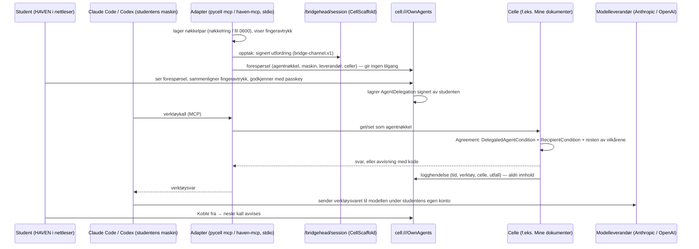

# Dataflyt — egen agent mot HAVEN

Det som aldri går gjennom HAVEN eller adapteren: studentens Claude- eller ChatGPT-innlogging, OAuth-token eller API-nøkkel. Adapteren kaller aldri en modell selv.

Det som aldri går ut av HAVEN til modelleverandøren: innhold i celler uten `RecipientCondition` som tillater leverandøren, andres innslag uten deres tillatelse, forskningsdata over delegeringens N-nivå, privatnøkler.
