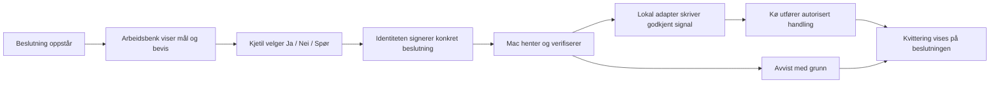
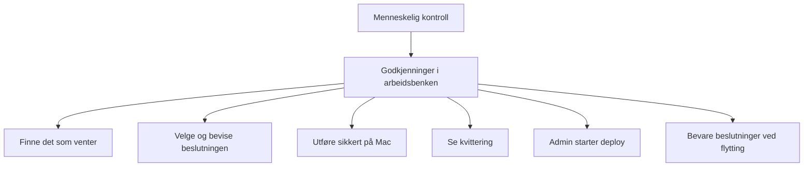

# b43 — Godkjenninger i Developer og Admin Workbench

Dato: 2026-10-07. Formålsspesifikasjon til G1. Last verified against code: 2026-10-07.
Leser: Codex i denne økten. Dette er kildeanalyse og foreslått oppførsel; ingen implementering eller live-verifikasjon. Linjene gjelder arbeidskopiene som ble lest. Stier er relative til HAVEN-roten, med repoet først.

## Kildesvar før formålstreet

### 1. Beslutninger og signaler i dag

«Hvem klikker» nedenfor er foreslått myndighetsfordeling, ikke en eksisterende Workbench-rettighet. Kjetil er beslutningstaker for PDD-portene. En utviklerrolle alene skal ikke gi andre rett til å godkjenne på hans vegne.

| Beslutning | Fil/signal og leser i dag | Hvem må kunne klikke |
|---|---|---|
| Merge PR #60/#61 og tag 2026.9.5 | `HAVEN-Deploy/_handoff/GRUNNMUR/MERGE-JA-2026.9.5.md`; skript `HAVEN-Deploy/_handoff/GRUNNMUR/wp-cp-merge-tag-2026.9.5.sh:10` sjekker første linjes prefiks `JA 2026.9.5 `. Merge/tag utføres av dette særskilte skriptet; tag/push ved linje 39–40. Dette er ikke en generell beslutningsprotokoll, og ja-sjekken binder ikke hele linjen til en kontrollert SHA. | Kjetil i Developer; særskilt rett til merge/tag, ikke generell skrivetilgang til kortet. |
| PROD-JA | `HAVEN-Deploy/_handoff/RELEASE/PROD-JA-<release>.md`; `HAVEN-Deploy/_handoff/RELEASE/wp-rel-deploy.sh:153–154` krever nøyaktig `JA <release> <sha>`. Linje 151–157 krever staging-kvittering for samme SHA og kontrollerer staging-revisjon. `wp-rel-prod.sh:6` delegerer til deploy-skriptet. | Kjetil med operator-bevis i Admin for start av prod. Samtykke og start må skilles dersom samtykke leveres først. |
| Start staging | `HAVEN-Deploy/_handoff/RELEASE/wp-rel-deploy.sh:146–157` har prod-spesifikk ja-vakt; ingen tilsvarende staging-ja-vakt i dette avsnittet. Skriptjobb må startes lokalt. | Operator i Admin, etter HD-0167. |
| G1 / G1-GUI / G2 / G3 | Oppgavens `STATUS.md`; `CellProtocolDocuments/Tools/PurposePackages/purpose_dev.py:175–184` leser portlinjer; linje 233–264 kontrollerer artefakter og rekkefølge. Validatoren er ikke selv en jobbstarter. Hvilke individuelle køjobber som leser hver port: vet ikke, ikke fullstendig kartlagt. | Kjetil i Developer; se spesifikasjon, bilde, plan eller akseptanse før Ja. G3 for deploy erstatter ikke operator-start. |
| A/B og andre spesifikasjonsvalg | Valgene er dokumenttekst og svar fra Kjetil; ingen generell maskinleser påvist. Eksempel finnes i `HAVEN-Deploy/_handoff/STATUS/seed/workitems-20261007.json:4`: A/B og fem spørsmål, neste handling er tekst. | Kjetil i Developer; eksplisitte alternativer, ikke tolking av et generelt Ja. |
| Slipp jobb fra hold | Lokal omdøping/fjerning av hold-suffiks. `_losen-queue/runner.sh:138` og `:211` legger jobber som `.job.hold`; `:240` tar bare `*.job`. Dette er filnavnsignal, ikke verifisert beslutning. Andre typer hold-filer: vet ikke om alle har samme semantikk. | Utvikler med jobbmyndighet; admin hvis frigivelsen starter deploy. |
| Forkast / kø på nytt i hd | Task-JSON og hendelser. `HAVEN-Deploy/tools/hdlib/cli.py:56–112` håndhever statusoverganger; retry fra HANDOFF_REQUIRED til PREPARING/READY krever note ved linje 71–72. `HAVEN-Deploy/tools/hdlib/status.py:71–125` avleder kø/forkastet/utført. `:167` skriver projeksjon. `cli.py:719–722` tilbyr status --write. `index/status.json` er en lesemodell, ikke et ja-signal eller en dispatcher. | Utvikler for arbeidsjobber; operator for deploy. «Forkast» trenger definert overgang per task-type; ingen generell forkast/requeue-knapp påvist. |

Det finnes minst to lokale kømodeller: filjobbene i `_losen-queue` og task/event-modellen i hd. Å endre et WorkItem-statusfelt er ikke dokumentert som en handling i noen av dem.

### 2. Fra staging til Mac, og bevis på hvem som klikket

HD-0023 er strengere enn bare «ikke kjør shell på server»: `HAVEN-Deploy/queue/events/20260909T095644Z-claude-ev_9cb1e636ee0f7d36.json:7` sier at statusprojeksjon, workbench-feed og menylinje ikke skal være del av server-deploy, HavenAgentD eller HAVEN-appen, og at omgjøring krever ny begrunnelse fra Kjetil. Den gamle task-tittelen i `HAVEN-Deploy/queue/tasks/HD-0023.json:44` beskriver det trukne forslaget. Den er ikke godkjenning. Kjetils nye ønske gir grunnlag for å spesifisere beslutninger i staging, men avgjør ikke alene om hele den gamle lokale feeden skal flyttes dit. Se spørsmål Q1.

| Alternativ | Det som faktisk finnes | For | Imot / mangler | Kryptografisk bevis |
|---|---|---|---|---|
| a. Mac poller hendelser, eventuelt abonnerer over bro/HTTP | `WorkItemCell.swift:719–722` har read-granted feed; `:823–826` har **set** eventsSince med rw--, ikke HTTP GET. `:1971–1978` delegerer replay. `WorkMutationSync.swift:44–79` har 500 hendelser; `:112–162` har restartToken og requiresResync. Stiene her er under `CellScaffold/Sources/App/Cells/WorkItems/`. | Mest direkte gjenbruk av WorkItem-data. Mac kan lese og skrive kvittering uten server-shell. | Lokal adapter, autentisert rute, grants, varig cursor og resync mangler som påvist kjede. Feed er bare siste 100 aktivitets-/kommentarposter (`WorkItemCell.swift:2034–2058`), og er ikke en varig innboks. Bro er ikke automatisk HTTP. `CellScaffold/Sources/App/Controllers/VaporBridgehead.swift:15` sier at den gamle web-ruten er fjernet. Staging-til-Mac med ikke-eier og rollebevis er ikke målt. Kjetils signeringsrett skal ikke gis til polling-agenten. | `actorRef` er revisjonsspor, ikke en signatur over beslutningen. Transportbevis alene er ikke varig beslutningsbevis. Kombiner med c. |
| b. GitHub Issue/kommentar | `CellScaffold/Sources/App/Cells/WorkItems/GitHubWorkSyncCell.swift:327–347` lagrer outbound-record; `:418–419` sier «no network» / «queues only, no external write». | Eksisterende repo-kobling og payload-kø; mulig å bruke gh på Mac. | Faktisk eksport til GitHub, kommentarformat, leser, deduplisering og kvittering må bygges. Ikke en ferdig GitHub-bro. Ekstra ekstern kopi av beslutninger og avhengighet til GitHub. | GitHub-avsender er ikke et VC-bevis fra Kjetils HAVEN-identitet. Signert vedlegg fra c kan beholdes, men kontoen alene er utilstrekkelig. |
| c. Signert beslutningsdokument (VCClaim) | `CellProtocol/Sources/CellBase/VerifiableCredentials/VCClaim.swift:273–287` har public generateProof; `:183–258` verifiserer; `:319–326` lager sortert usignert JSON. Konstruktørene ved `:83–120` signerer ikke automatisk. | Varig bevis over konkret handling og mål; transport kan byttes. Lokal verifikasjon før gamle filer skrives. | Ny beslutningskontrakt, klientens signeringsvei, tillitsbinding til Kjetil, rollevalidering og konsumregister må finnes. Det er ikke påvist at Workbench kan be Kjetils vault signere dette i dag. Wire-rundtur må testes; en vanlig serverutstedt claim beviser serverens utsagn, ikke Kjetils klikk. | **Ja, dersom Kjetils faktiske identitet signerer beslutningsinnholdet**, og køen verifiserer signatur, tillit, domene, rolle og mål. Rollebevis skal ha godkjent rolleutsteder; en selvutstedt operator-claim gir ingen rett. |
| d. Korrespondanse | `HavenAgentD/Sources/HavenCorrespondenceMCP/CorrespondenceMCPService.swift:83–147` har list/read/send/ack. `CellProtocol/Sources/CellBase/Cells/Correspondence/CorrespondenceEnvelope.swift:54–55` beskriver signert innhold; `:251–258` kontrollerer sender/innholdssignatur. | Meldingsprimitive, innboks og kvittering finnes; kan bære signert beslutning. | Ingen kobling fra Workbench-klikk til lokal filadapter er påvist. Profil-/motpartsbinding, avtaler, godkjenninger og driftsavhengigheter må kontrolleres. Mottatt tekst skal aldri tolkes som shell eller rettighet. Ingen korrespondanse er lest eller sendt i denne økten. | Konvolutten kan bevise sender og innhold; beslutningsmyndighet og engangsbruk krever fortsatt kontrakt. Agent-signert melding er ikke automatisk Kjetil-signert beslutning. |

**Anbefalt retning:** a som transport og c som beslutningsbevis. Start med polling av en autorisert beslutningsmodell; abonnement er senere optimalisering. d er reserve hvis signerings-/transportmålingen viser at det gir en kortere, allerede fungerende vei. b gir minst direkte gjenbruk og påfører en ekstra eksportadapter.

Foreslått beslutningsinnhold: decisionID, WorkItem-ID, beslutningstype, Ja/Nei, målrepo/PR/release/SHA, miljø, hash av dokumentet/bildet som ble vurdert, versjon av forslag, signerens domeneidentitet, tidspunkt, utløp, engangsnonce og referanse til rollebevis. Detaljert wire-skjema tilhører arbeid etter G1. Mac verifiserer nøyaktige bytes etter encode/decode, gjeldende rolle/revokering og uendret mål før effekt. Assignee-tekst og authorRef gir aldri autoritet.

Mac-adapteren oversetter bare godkjente typer til faste lokale mål; den mottar ikke vilkårlig sti eller skript fra server. Den skriver atomisk, binder SHA/dokumenthash, validerer PDD-artefakter og lagrer varig konsum før/med kontrollert effekt. Retry etter krasj må avstemme faktisk Git-/deploy-resultat; «én gang» kan ikke loves bare ved å huske eventID. Kvittering har decisionID, jobb-ID, faktisk UTC-tid, mål og bevis eller avvisningsgrunn. Eksisterende prefiksbasert merge-ja er for svakt alene; adapteren må kontrollere godkjent PR-head og tag-mål ved utførelse.

### 3. Hva arbeidsbenken har og mangler

`CellScaffold/Sources/App/Cells/WorkItems/WorkItemCell.swift:14` har kind decision; `:331–332` har assignee/assignees. `:755–778` tilbyr setStatus, addEvidence og addComment med tilgangskontroll. `:1583–1618` lagrer kommentar og requester-aktivitet, men tillater authorRef i payload: kommentarfeltet er ikke bevis på signerende principal. `:1833–1860` filtrerer kind/status/project/label/search, **ikke en egen assignee-filterparameter**. En dedikert «Til beslutning» må derfor få en eksplisitt, autorisert projeksjon eller tilsvarende filtrering.

Board finnes: `CellScaffold/Sources/App/Cells/ConfigurationCatalog/ConfigurationCatalogCell.swift:8854` har drop-handling; `:9003–9054` viser kortets tittel, sammendrag, type, status, neste handling, doneWhen og status-/prioritetshandlinger; `:9063–9094` viser kommentarer, evidens og aktivitet. Dette er statusstyring, ikke Ja/Nei med sikker beslutningssemantikk. addComment finnes som cellehandling; de leste Board-detaljene viser kommentarer, men ingen Spør-komponering der. Andre UI-innganger er ikke fullstendig lest.

Manglende påvist kjede: «Til beslutning» med kind decision + assignee kjetil + ready; skille mellom utvikler/admin; Ja/Nei/Spør; signeringsseremoni; uendret-mål-sjekk; ventende/avvist/utført tilstand; strukturert køkvittering og lenke til resultat. blocked vises som ventende forutsetning med deaktivert Ja. «Ja registrert» må aldri bli «tag satt» før bevis foreligger. Ukjent/offline viser «venter på Mac», ikke suksess.

Frøfilen `HAVEN-Deploy/_handoff/STATUS/seed/workitems-20261007.json:2–5` viser allerede in-progress for merge/tag, ready for G3 og A/B, blocked for prod. Opplysningen om at alle beslutningsposter står ready er derfor **contradicted** i den leste filen. At 26 poster faktisk er lagret i kjørende staging: vet ikke; frøfil er ikke live-bevis.

### 4. Admin-knapper og HD-0167

`CellScaffold/Sources/ScaffoldKit/AdminDeploymentSupervisorCell.swift:59–68` har planDeployment/setDrainMode; `:111–169` returnerer plan_ready med tom sideEffects ved linje 168. `:207–224` erklærer grensen mot Docker/socket/shell. `CellScaffold/Sources/App/Cells/Admin/AdminWorkspaceConfigurationFactory.swift:123–136` sier at den portable flaten ikke tilbyr deploy og at gjennomføring skjer eksternt. Supervisor er dermed et gjenbrukbart rolle-/readiness-/planmønster, ikke køstarter.

Rolleinnmelding finnes i `CellScaffold/Sources/ScaffoldKit/AdminRoleEnrollmentCell.swift:65–129`: credential valideres, subject kobles til requester, rolle kontrolleres og proof lagres. Supervisor bruker operator-rolle (`AdminDeploymentSupervisorCell.swift:37,249`). Et annet godkjenningsmønster finnes i `CellScaffold/Sources/App/Cells/Admin/AdminFundingQueueCell.swift:61–64,144–224` (approveRequest, ikke bare approve), med operator-condition ved linje 39. Dette er et mønster; finansiering inngår ikke i oppgaven.

Foreslått pakke to: «Start staging-utsetting av <release>» og «Start prod-utsetting av <release>» i Admin, med vist SHA, miljø, readiness og sist verifiserte resultat. Klikk krever gyldig operator-credential og en signatur over akkurat start-handlingen. Lokal adapter skriver PROD-JA-ekvivalent først ved autorisert start, og starter bare riktig wp-rel-script via lokal kø. Server har ikke deployverktøy eller shell. Prod krever staging-bevis for samme image/SHA; AI og utviklerrolle kan foreslå, men ikke gi eller bruke operator-ja.

`HAVEN-Deploy/queue/tasks/HD-0167.json:25` er ønsket oppførsel, ikke implementeringsbevis. Kjetils oppgitte 05.10-presisering om Developer frem til deploy/Admin for start styrer forslaget her.

### 5. Flytting fra staging til prod

Import finnes: `CellScaffold/Sources/App/Cells/WorkItems/WorkItemCell.swift:1253–1335` har seedBulk, upsert=true og replace=false som standard. Samme ID oppdateres; eksisterende createdBy/createdAt beholdes ved linje 1277–1280. `:2127` bruker innsendt ID eller genererer ny. `:2154–2161` leser evidens/proveniens/createdBy, men setter tidsfelter til importtid. Kommentarer og full aktivitetshistorikk leses ikke fra payload i denne konstruksjonen. Upsert erstatter record, det er ikke historikkmerge. `CellScaffold/Sources/App/Support/WorkbenchSeedSupport.swift:67–113` orkestrerer seed av WorkItem og portfolio; `ProjectPortfolioCell.swift:695–703` har addRelease/updateRelease.

Lesing av items finnes (`WorkItemCell.swift:687–690` returnerer alle poster med r----tilgang). Dedikert tapfri eksport/import av beslutning, signatur, konsum og kvittering er **ikke påvist**. Vet ikke om en eksisterende eksportadapter utenfor leste filer dekker dette.

Foreslått flytting: bevar stabile WorkItem-/decision-ID-er, original kilde/miljø og signerte bytes. Kopier visningsdata og kvitteringer; ikke kjør ferdige beslutninger på nytt. Globale konsum-ID-er må avstemmes på Mac, som fortsatt er én utførende myndighet. Miljøbundet staging-start gjelder aldri prod-start. Konflikt på samme ID/forslagsversjon skal gi avviksrapport og stoppe overskriving av nyere prod-data. seedBulk(upsert, replace=false) er nyttig for grunnposter, men ikke tilstrekkelig til tapfri beslutningsmigrering.

## 0. Intensjon og audit

Kjetils ord, ordrett fra oppgaven:

> «Det jeg skal svare ja til bør være i utvikler og admin arbeidsbenkene.» … «Ja til Merge PR #60 og #61, og tag `2026.9.5` Dette er ting jeg bare vil klikke ok på i arbeidsbenkene.»

> «Developer Workbench skal administrere løpet frem til deploy; start av deploy (staging og prod) avgjøres av tilgang — bare noen med admin-tilgang skal kunne starte, så knappen skal i utgangspunktet ligge i Admin Workbench.»

| Påstand / antakelse | Audit | Grunnlag |
|---|---|---|
| Lokale scripts leser merge-/prod-ja | retrieved | Kildesvar 1; ikke generell signert godkjenning. |
| WorkItem har decision, seed, kommentarer og replay | retrieved | Kildesvar 2–3. |
| Alle seed-beslutninger er ready | contradicted | Seed linje 2–5. |
| 26 poster er synlige i staging | unavailable | Ingen live-måling utført. |
| GitHub-cellen publiserer Issue | contradicted hvis antatt | Kildesvar 2b: intern kø, ingen ekstern write. |
| Supervisor starter utsetting | contradicted hvis antatt | Kildesvar 4: plan og readiness. |
| VCClaim kan signeres/verifiseres | retrieved | Kildesvar 2c. Workbench-klikk og vault-rute: unavailable. |
| Korrespondanse har meldings-/signaturprimitive | retrieved | Kildesvar 2d; komplett beslutningskjede: unavailable. |
| seedBulk gir tapfri flytting | contradicted hvis antatt | Kildesvar 5. |

Avgrenset leseliste: de navngitte kildefilene i kildesvar 1–5, PDD-mal, purpose_dev.py, relevante treff i purpose-kunnskapsbasen og lookup-pakker/lærdommer; identitets-, Agreement- og resolverkapitlene samt SECURITY.md ble lest for relevante kontraktgrenser. Store filer ble lest i angitte funksjoner/avsnitt, ikke i sin helhet. Ikke lest: alle køjobber, alle HD-events, alle UI-innganger, transport-/vault-implementasjonen gjennom hele kjeden, alle tester eller deployet kildeversjon. Ingen tester eller nettkall mot staging/prod er kjørt. Ingen påstand om live funksjon hviler på dokumentstatus alene.

## 1. Formålstre med observerbare mål

Klassifisering: `purpose://human-agency` og `purpose://project-work.project-portfolio` finnes i `CellProtocolDocuments/Book/haven_purpose_knowledge_base_v0.json:71,542`. Nye blad er kandidater, ikke endringer av kanon. Roten nedenfor er et oppgavespesifikt barn av human-agency; portefølje er en støttende kobling.

| purposeRef | Forelder | Outcome og suksessignal | Verifier |
|---|---|---|---|
| purpose://candidate.workbench-approvals.control | purpose://human-agency | Kjetil kan avgjøre konkret arbeid og se faktisk resultat uten å skrive ja-filer eller formidle via chat. | Samlet demonstrasjon T1–T6. |
| purpose://candidate.workbench-approvals.find | control | Til beslutning viser alle autoriserte ready-poster for kjetil, riktig type/miljø/mål og bevis; blocked kan sees men ikke godkjennes. | T1: syntetisk matrise og innlogget staging. |
| purpose://candidate.workbench-approvals.decide | control | Ja/Nei bindes til vist versjon og signerende identitet; Spør lagrer kommentar uten å starte noe. Uautorisert/endret/utløpt avvises. | T2: signatur-rundtur og negative prøver. |
| purpose://candidate.workbench-approvals.execute | control | Mac bruker en verifisert beslutning til riktig lokal merge/tag/G3-handling; dobbeltlevering og retry gir ikke en ny ukontrollert effekt. | T3: isolert repo/oppgavemappe og restart-/krasjprøver. |
| purpose://candidate.workbench-approvals.receipt | control | Ja registrert, venter, utført og avvist vises særskilt med faktisk UTC-tid og bevis; ingen falsk suksess. | T4: kø nede, avvisning, suksess og nettbrudd. |
| purpose://candidate.workbench-approvals.admin-start | control | Bare operator kan starte staging/prod via Admin; samme SHA som godkjent og verifisert staging kreves for prod. | T5: ikke-eier/utvikler/operator/revokert-matrise. Pakke to. |
| purpose://candidate.workbench-approvals.move | control | Flytting bevarer ID, signert proveniens og kvittering uten gjentatt handling eller overskriving av nyere data. | T6: staging→prod import to ganger og konflikt. |

## 2. Avgrensning og avhengigheter

Denne økten leverer bare formålsspesifikasjon og status til G1. Ingen kode, commit, push, køjobb, statusfrø-endring eller ekstern publisering. Mermaid er et forklaringsdiagram, ikke G1-GUI-bilde. Formålstreet publiseres ikke til ekstern database siden oppgaven begrenser skriving til oppgavemappen. G1-GUI kommer før implementering; G2-plan skrives etter G1.

| Avhengighet før bygg / akseptanse | Dagens grunnlag og begrensning | Verifier / måling |
|---|---|---|
| Innlogget Workbench leser riktige private poster | Cellehandlinger finnes; staging ikke målt. | Mål faktisk antall/ID-er og tilganger i innlogget økt før G2; ingen produksjonsgaranti nå. |
| Ikke-eier når WorkItem med egen identitet over godkjent rute | eventsSince er grant-styrt set; komplett rute ikke påvist. | Én ekte end-to-end lesing, replay og kvitteringswrite; avvis uten grant. Ikke målt. |
| Kjetils vault signerer eksakt beslutning | VCClaim-primitive finnes; browser/vault-kobling ukjent. | Wire-rundtur med separat signer og verifier; nøkkel blir i vault. Ikke målt. |
| Rollemyndighet er gyldig i riktig domene | AdminRoleEnrollment-mønster finnes; staging/Mac-tillit ukjent. | Godkjent utsteder, subject, domene, expiry/revocation ved effekt. Ikke målt. |
| Lokal kø og faste adaptermål | runner og ja-lesere finnes; ingen Workbench-adapter. | Isolert fixture og kontrollert kjøring mot disponibelt repo. Ikke målt. |
| HD-0023-grensen | Historisk event er eksplisitt; nytt omfang trenger Kjetils avklaring. | Q1; ingen lokal full-feed/server-dispatcher innføres som skjult forutsetning. |
| Staging-bevis og deployment-kvittering | Eksisterende prod-script kontrollerer samme SHA. | Pakke to bruker faktisk scriptkontrakt og avviser feil SHA. Ikke målt. |
| Migreringsgrunnlag | seedBulk er import, ikke tapfri historikk. | T6 før prod-flytting, inkludert signatur og konsumregister. Ikke målt. |

## 3. Forventningskontrakt — det Kjetil får og senere skal se

| Leveranse | Type / hvor | Hva den innebærer | Godkjent |
|---|---|---|---|
| Denne spesifikasjonen | Fil: `CellProtocolDocuments/Deliverables/PDD_godkjenninger-i-arbeidsbenken_2026-10-07/FORMAALSSPEC.md` | Fem kildebaserte svar, formål og valg. | G1 venter. |
| Portstatus | Fil: samme oppgavemappe, `STATUS.md` | Ingen port markeres godkjent uten Kjetils ord. | Ikke portgodkjenning. |
| Til beslutning, tom/fylt/feil/venter | Fremtidig Developer-flate; bilder under `images/` før bygg | Kort viser konsekvens, mål, bevis, Ja/Nei/Spør og kvittering. | G1-GUI venter; ingen bilder laget. |
| Signert avgjørelse og lokal effekt | Fremtidig fungerende kjede, T2–T4-bevis i `TESTRESULT.md` og `ACCEPT.md` | Kjetil klikker; Mac validerer; resultat dokumenteres. PROD-samtykke starter ikke deploy i pakke én. | G2/G3 venter. |
| Admin-startknapper | Fremtidig Admin-flate og egne `images/`-referanser | Staging/prod-start med operator-bevis og faktisk kvittering. | Pakke to; ikke del av én-dagsløftet. |
| Bevarte poster i prod | Fremtidig migreringsrapport og T6-bevis | IDs/signatur/kvittering bevares; gamle klikk utføres ikke på nytt. | Før prod-flytting. |

En tekstlig beskrivelse av en flate er ikke et godkjent bilde eller en levert flate.

## 4. Formålspakker og lærdommer

Lookup kjørt 2026-10-07 med tags approval/workbench/security/release og surfaces web/bridge. Tilknytning: pkg.std.everything-works, pkg.std.gui-surface og pkg.std.cell-combination. Bygg/full regresjon/docs/status, bilde/paritet/lastetid/reachability og eksplisitt dataflyt/kapabiliteter er krav til senere bygg. Denne leseleveransen har ikke bygg- eller GUI-resultater.

Relevant forebygging fra lookup:

- lesson.planned-documented-as-implemented: «planlagt oppførsel merkes eksplisitt». Alle nye knapper/adaptere over er forslag.
- lesson.bridge-inferred-architecture-from-one-use: «Erklær hver kapabilitet oppgaven bygger på ... med kilde og Avgrensning». Se alternativtabell og avhengigheter.
- lesson.text-ux-is-not-design: «Rendret bilde ... godkjennes før implementering». G1-GUI venter.
- lesson.tested-a-different-path-than-production: brukerens test skal bruke produksjonens egen kodevei. T1/T2/T5 bruker reell ikke-eier og egne bevis, ingen owner-substitusjon.
- lesson.corr-approval-surfaces-timed-out: avhengigheter og lastetid må verifiseres før funksjonen erklæres ferdig.
- lesson.plan-instead-of-delivery: G1 er godkjenning av formålet; dette dokumentet er ikke leveranse av godkjenningsfunksjonen.

## 5. Avledede tester (spesifisert, ikke kjørt)

| Test | Formål / hvordan | Fremtidig evidens | Status |
|---|---|---|---|
| T1 Finnbarhet | Kombiner decision/andre typer, kjetil/annen assignee, ready/blocked/done, utvikler/admin og to miljøer. Sammenlign forventede ID-er med innlogget flate; alle handlingsknapper må være reachable. | TESTRESULT.md#find og screenshots | venter |
| T2 Beslutningsbevis | Signer Ja og Nei fra faktisk vault, encode/send/decode/verify/store/reload. Endre SHA, dokumenthash, valg, domene, signer, nonce og utløp; alle avvises. Spør endrer ingen ja-fil. Agent/authorRef/assignee kan ikke signere som Kjetil. | TESTRESULT.md#proof | venter |
| T3 Lokal effekt | Merge/tag på disponibelt repo og G3 på disponibel oppgave. Manglende artefakt, ny PR-head, eksisterende tag med annet mål, ukjent script/sti avvises. Lever samme beslutning to ganger; krasj før/etter effekt og restart; avstem faktisk resultat. PROD-samtykke alene starter ingen køjobb. | TESTRESULT.md#execution | venter |
| T4 Kvittering | Mac offline, feed-window overskredet, server-/Mac-restart, avvist script og vellykket effekt. Full resync uten replay av konsumert beslutning; tidsstempel og bevis samsvarer med faktisk kjøring. Falsk «utført» fra kommentar avvises. | TESTRESULT.md#receipt | venter |
| T5 Admin-start | Egen operator og egen ikke-eier/utvikler uten operator. Manglende, feil utsteder, feil subject/domene, utløpt/revokert rolle avvises ved effekt. Staging/prod og endret SHA er ulike startbeslutninger. | TESTRESULT.md#admin | venter, pakke to |
| T6 Flytting | Importer samme staging-utvalg to ganger, inklusive signert beslutning og kvittering; behold ID-er/bytes, ingen ny effekt. Nyere prod-record og miljøbundet beslutning gir eksplisitt konflikt/avvisning. | TESTRESULT.md#migration | venter |
| Standard kvalitet | Bygg berørte mål, full eksisterende regresjon, docs i samme endring, status aktuell; dataflyt holdes mot kontrakter. | TESTRESULT.md#build/#regression og ACCEPT.md#docs | venter etter G2 |
| Standard GUI | Godkjent tom/fylt/feil/venter-bilde, side-om-side faktisk, tre lastinger ≤5 s og action-reachability. | images/, TESTRESULT.md#load-time/#reachability og ACCEPT.md#parity | venter etter G1 |

## 6. Åpne spørsmål til Kjetil (maks fem)

| ID | Valget står mellom | Anbefaling og konsekvens |
|---|---|---|
| Q1 | Kun beslutninger med kvittering i staging; lokal hd-status/feed beholdes lokalt **eller** flytte hele lokal statusprojeksjon/feed til server. | Kun beslutninger/kvitteringer. Bekreft at dette presiserer HD-0023 for det nye behovet; full-feed krever særskilt omgjøring med begrunnelse. |
| Q2 | a+c (WorkItem-transport + signert beslutning) **eller** d+c (korrespondanse + signert beslutning). | a+c, betinget av målt signerings-/ikke-eier-rute før G2. Hvis den ikke virker, vis målingen og nytt valg; ikke bytt stille. |
| Q3 | PROD-JA i første pakke er bare samtykke, mens Admin-start kommer i pakke to **eller** utsett også PROD-JA til pakke to. | Bare samtykke, synlig «godkjent, venter på admin-start». Ingen kompatibel PROD-JA-fil som et allerede ventende script kan bruke til å starte prod automatisk; materialiser først ved start. |
| Q4 | Pakke én krever Ja/Nei og Spør som eksisterende kommentarhandling **eller** en egen Spør-dialog før første levering. | Ja/Nei samt enkel kommentar for Spør; spesialdialog kan vente. Kommentar skal aldri tolkes som godkjenning. |
| Q5 | PR #60/#61 er ett eksplisitt godkjent sett med bundne heads og tag-mål **eller** separate merge-ja og eget tag-ja. | Separate handlinger når tag-målet ikke er kjent ved merge-ja. Et samlet sett kan brukes bare hvis målreglen og revisjonene er uttrykkelig vist og godkjent. |

Et generelt G1-ja godkjenner formål og avgrensning, ikke utførelse av merge/tag/deploy, og besvarer ikke automatisk Q1–Q5. Ingen porter registreres fra en antatt eller tolket anbefaling.

### Første pakke — foreslått mål for én arbeidsdag

Beslutningsliste i Developer, Ja/Nei, enkel Spør-kommentar, Kjetil-signert beslutning, lokal validering og kvittering for merge/tag/G3 samt registrering av PROD-samtykke. Ingen Admin-startknapper. Bruk WorkItem og VCClaim-primitive; ikke bygg en generell utviklerkø på serveren. G1-GUI og G2 må foreligge før kode.

Én dag er **et ambisjonsnivå, ikke et kildebevist tidsestimat**. Det forutsetter at første måling viser fungerende ikke-eier-rute og klient/vault-signering, og at bilder/valg godkjennes før bygg. Hvis signering eller transport ikke virker, er pakken ikke leverbar innen dette omfanget uten mer arbeid; stopp ved målingen og legg fram konkret avvik. En usignert statusknapp oppfyller ikke pakken. Pakke to gir operator-start av staging/prod. Tapfri flytting må være verifisert før beslutningene tas i prod.

### Hva Kjetil skal gjøre

| Når | Det Kjetil selv gjør | Betydning |
|---|---|---|
| Nå, G1 | Les denne filen, godkjenn/endre formål og svar Q1–Q5 med valgene. | Tillater videre spesifikasjon/design; ingen effekt på PR, tag eller deploy. |
| Før bygg | Se bilder av tom, fylt, venter og feiltilstand og godkjenn G1-GUI; godkjenn deretter konkret G2-plan. | Avtaler det han faktisk skal se og arbeidets grenser. |
| I ferdig Developer | Åpne Til beslutning, les mål og bevis; klikk Ja eller Nei, eller legg inn spørsmål. | Identiteten signerer et konkret valg; Ja er ikke «utført». Ingen Terminal/ja-fil/chatformidling. |
| Etter klikk | Se kvitteringen på samme post. Ved «avvist» les grunnen; korrigert mål krever ny beslutning. | Ingen stilltiende gjentakelse eller utvidet samtykke. |
| I pakke to, Admin | Med operator-bevis: klikk Start staging eller Start prod for vist release/SHA. | Starter nøyaktig autorisert utsetting via lokal kø; prod bruker verifisert staging-image. |
| Ved G3 | Sammenlign avtalt oppførsel/bilder med testbevis og faktisk flate, og gi eget G3-ja. | Akseptanse av funksjonen, ikke generelt framtidig deploy-samtykke. |

## 7. Revisjonslogg og kontroll

| Iterasjon | Dato | Endring | Hvem |
|---|---|---|---|
| 1 | 2026-10-07 | Kildebasert G1-utkast; skilte intern GitHub-kø fra ekstern write, plan fra deploy, rollebevis fra klikk-signatur, import fra tapfri flytting og PROD-samtykke fra admin-start. | Codex |

Kontroll: oppgavemappens port-/artefaktsjekk (`validate_taskdir`) ga ingen feil. Full `purpose_dev.py validate` returnerte fem feil i det eksisterende lærdomsregisteret: referanser til purpose://candidate.testflyt-verktoycelle.haven-lenke-begge-veier mangler. Disse er ikke rettet utenfor oppdragets skrivegrense.

Kildehenvisninger kontrollert av forfatter mot leste utdrag; ingen uavhengig kontrolltråd er kjørt. Siste utgave er ikke uavhengig kontrollert. Live-avhengigheter står som ikke målt. Læringsvurdering: funnene hører foreløpig til denne oppgavens beslutningsgrunnlag; ingen skill-/ledger-endring utføres fordi oppdraget bare tillater filer i denne mappen. Eventuell varig læringsfangst må autoriseres i et senere oppdrag som tillater skriving utenfor mappen.

STATUS: LEVERT
