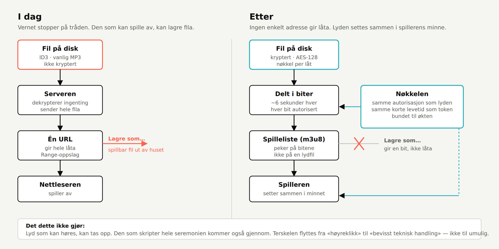
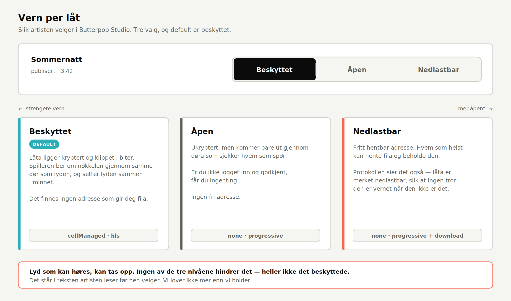

# PLAN — innholdsvern lyd

Oppgavemappe: `PDD_innholdsvern-lyd-20260909_2026-09-10` · G2-utkast 2026-09-17



## Hva vi gjør, i vanlige ord

**I dag** ligger låtene som vanlige MP3-filer på disk. Serveren sender hele fila på
én adresse. Den som kan spille av, kan lagre den.

**Etter** ligger låta kryptert, klippet i biter på noen sekunder. Spilleren henter en
spilleliste som peker på bitene, ber om nøkkelen gjennom samme dør som lyden, og
setter lyden sammen i minnet. Det finnes ingen adresse som gir deg låta.

**Det flytter terskelen fra «høyreklikk» til «bevisst teknisk handling».** Ikke til
umulig — lyd som kan høres kan tas opp, og den som skripter hele seremonien kommer
gjennom. Det er avtalt, og det skal stå i teksten artisten leser.

## Rekkefølgen, og hvorfor

AP1 kan gå ut alene i morgen. AP2–AP5 er kjeden som må henge sammen. AP6 er det du
ser. AP7 er generalprøven. AP8–AP9 er bevisene.

| # | Arbeidspakke | Hva det innebærer, konkret | Hvem | Formål |
|---|---|---|---|---|
| **AP1** | Manifestet slutter å lyve | `storeLocalAsset` setter i dag `ciphertextSHA256` = `plaintextSHA256` = samme hash, selv når ingenting er kryptert. Vi fjerner feltet når det ikke finnes ciphertext. **Liten, uavhengig, kan deployes for seg.** | Losen | `…navnene-lyver-ikke` |
| **AP2** | Krypter når låta lagres | Publiseringsløypa kaller `storeLocalAsset` uten `encryptionPolicy`, så den faller til `none`. Vi gjør kryptering til det som skjer når vernnivået er «beskyttet» — og default er beskyttet. | Losen | `…klartekst-forlater-aldri-serveren` |
| **AP3** | Klipp låta i biter og server dem | Ny rute som gir spillelista (`.m3u8`) og bitene. Formen finnes i modellen fra før (`MusicHLSVariant`), men ingen rute serverer den i dag. | Losen | `…klartekst-forlater-aldri-serveren` |
| **AP4** | Nøkkelen får sin egen dør | Eget endepunkt som gir dekrypteringsnøkkelen, bak nøyaktig samme autorisasjon og samme korte levetid som lyden. Uten gyldig token: ingen nøkkel. | Losen | `…noekkelen-foelger-samme-autorisasjon` |
| **AP5** | Spilleren lærer det nye formatet | Safari spiller dette av seg selv. Chrome og Firefox trenger et lite bibliotek (`hls.js`). Binding bruker AVFoundation. **Se avgjørelse D1 under.** | Losen | `…virker-likt-i-web-og-binding` |
| **AP6** | To valg i Studio | En bryter per låt: **beskyttet** eller **åpent**, med en setning under hver som sier hva den faktisk gir. Default beskyttet. Bildet skal godkjennes av deg før koden skrives. | Losen → **du godkjenner bildet** | `…to-nivaaer-ikke-flere` |
| **AP7** | Flytt de 16 som ligger der | Krypter og pakk om alle publiserte låter mens tjenesten går. Dette er generalprøven på løypa de nye lossless-filene skal gjennom. Originalene beholdes til det er verifisert. | Losen → **du verifiserer at de spiller** | `…gamle-laater-blir-beskyttet` |
| **AP8** | Prøv å stjele låta | Testen som spiller av som en vanlig lytter, fanger alt ruta gir, skriver det til fil og kjører `ffprobe` — som skal **feile**. Testen går gjennom HTTP-ruta en klient faktisk bruker, ikke gjennom cellen. | Losen | `…klartekst-forlater-aldri-serveren`, `…testet-paa-produksjonsstien` |
| **AP9** | Les korrekturen på løftet | Gjennomgang av all tekst om vern: ingen «umulig», ingen «sikret» uten forbehold. Opptaksmuligheten nevnes der artisten velger. | Losen → **du leser og sier ja** | `…lofte-uten-overslag` |

## Hva du faktisk skal gjøre

1. ~~Avgjøre D2~~ — gjort 2026-09-24: lesning A.
2. **Godkjenne bildet av vernvalgene** (`images/vern-valg-v1.png`) før AP6 kodes.
3. ~~Svare på D1~~ — gjort 2026-09-24: ja til `hls.js`.
4. **Verifisere at låtene spiller** etter AP7, i nettleser og i Binding. Det er du som
   vet hvordan de skal høres ut.
5. **Lese vernteksten** i AP9 og si om den lover for mye.

Resten gjør jeg. Du skal ikke lime inn skript.

## Avgjort 2026-09-24

**D2 = lesning A.** Tre nivåer: `beskyttet` (kryptert HLS) · `åpen` (ukryptert,
men bak den autoriserte døra, ingen fri adresse) · `nedlastbar` (fri adresse,
merket `.download`). Default er beskyttet.

**D1 = ja.** `hls.js` inn i webspilleren.

Begge er låst inn i AP2–AP6 under. Resten av dette avsnittet står som
begrunnelsen, ikke som et åpent spørsmål.

### Bildet som venter på G1-GUI



Dette er AP6 slik det skal se ut: én bryter per låt, tre posisjoner, og under
hver et par setninger som sier hva valget faktisk gir. Default er beskyttet.
Den røde noten nederst er løftet vårt — den skal også stå i flaten, ikke bare i
denne planen.

Si ja til bildet, så skriver jeg AP6.

## D2 — tre vernnivåer, ikke to

Du korrigerte meg: fritt hentbar URL trenger sitt eget nivå, og må markeres
nedlastbar i protokollen. Protokollen har allerede ordet — `MusicDeliveryMode`
har `.download`. Det skal ikke lages noe nytt.

**Men jeg er i tvil om hvilke tre**, og de to lesningene gir forskjellig GUI og
forskjellig datamodell. Full begrunnelse står i `STATUS.md`. Kort:

| | Lesning A (min anbefaling) | Lesning B |
|---|---|---|
| 1 | beskyttet — kryptert | beskyttet — kryptert |
| 2 | **åpen** — ukryptert, men fortsatt bak døra | fritt hentbar URL, merket nedlastbar |
| 3 | **nedlastbar** — fri adresse, merket `.download` | helt åpen fil, i tillegg `store`-grant |

I B er 2 og 3 teknisk like; forskjellen er bare hva avtalen sier — og avtale er
allerede en egen akse. Da er det ikke et vernnivå. I A er alle tre faktisk
forskjellige i hva som skjer med lyden.

**Funn du bør vite uansett:** i dag er `[.progressive, .download]` default i
`MusicAssetManifest.asObject()`. Grunnlinja i modellen er altså *nedlastbar*.
Butterpop setter `[.progressive]` eksplisitt, så de publiserte låtene er ikke
merket nedlastbare, men default er motsatt av det du har bedt om. Snus i AP2.

## D1 — avgjørelsen jeg trenger fra deg

**Skal `hls.js` inn i webspilleren?**

Safari og iOS spiller segmentert, kryptert HLS uten hjelp. Chrome og Firefox gjør det
ikke — de trenger et bibliotek på ~150 kB.

| Valg | Hva du får | Hva det koster |
|---|---|---|
| **Ta inn `hls.js`** | Vernet virker i alle nettlesere | Én ekstern avhengighet i spilleren, ~150 kB, må vedlikeholdes |
| **Bare Safari først** | Ingen ny avhengighet | Chrome-lyttere må falle tilbake til dagens ubeskyttede levering — altså: vernet gjelder ikke der folk flest er |

Jeg anbefaler å ta inn `hls.js`. Alternativet gir et vern som ser ut til å virke og
ikke gjør det for flertallet, og det er verre enn å vente.

## Rekkefølge og avhengigheter

```
AP1 ──────────────────────────────────► kan deployes alene

AP2 ──► AP3 ──► AP4 ──► AP5 ──► AP7 ──► AP8
                                 ▲
AP6 (bilde godkjent) ────────────┘

AP9 ──────────────────────────────────► før noe sies utad
```

## Hva som ikke er med

- EME/DRM (FairPlay, Widevine). Krever lisensserver og deployment-pakke fra Apple.
- Vannmerking.
- Den analoge veien. Akseptert.
