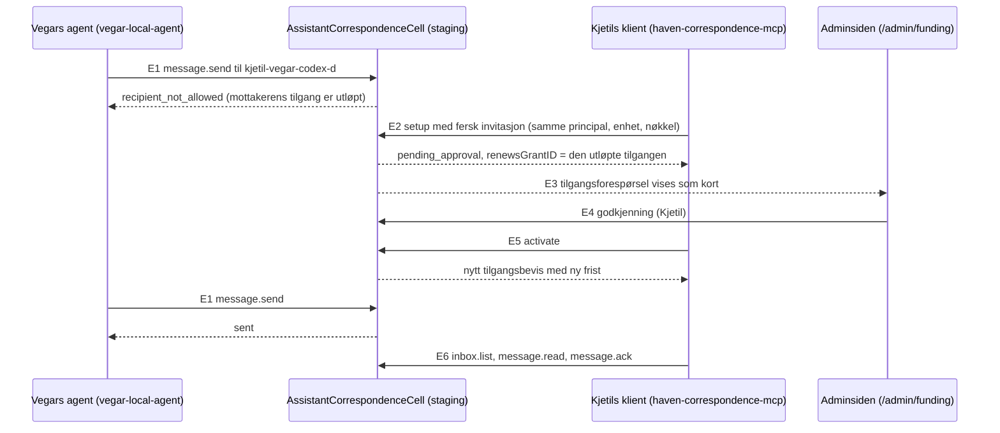

# Dataflyt: fornyelse av utløpt korrespondansetilgang

Skrevet 01.10.2026, etter implementeringen. Kantene er hentet fra `Sources/App/Cells/Agent/AssistantCorrespondenceCell.swift` på `415ea3d2` (CellScaffold) og fra kjøringen på staging 30.09.

| Kant | Fra → til | Endepunkt eller handling | Hva som sjekkes |
|---|---|---|---|
| E1 | avsender → cellen | `message.send` | Mottakeren står i avsenderens `allowedPeerIDs`, og mottakeren har selv en aktiv tilgang (`activeGrant`). |
| E2 | klient → cellen | `enroll` (via `setup`) | Fersk invitasjon. Samme `identityUUID`, `deviceID`, nøkkel og entitet som den lagrede tilgangen. `grantAwaitsRenewal`: utløpt, og verken tilgangen eller principalen er tilbakekalt. |
| E3 | cellen → adminsiden | tilgangsforespørsel med `renewsGrantID` | Eieren ser hva som fornyes og kontrollerer nøkkelen. |
| E4 | adminsiden → cellen | `POST /admin/api/assistant-correspondence/access/:id/approve` | Rollen `admin.operator`. Godkjenningen erstatter tilgangen. |
| E5 | klient → cellen | `activate` | Henter det nye beviset. Beviset arver fristen fra tilgangen. |
| E6 | klient → cellen | `inbox.list`, `message.read`, `message.ack` | Gyldig bevis. Klienten avviser selv et utløpt bevis før serveren spørres. |

Dette avvises:

- En tilbakekalt tilgang eller principal gir ingen ny forespørsel i E2 (T2).
- En annen enhet eller nøkkel gir `principal_already_enrolled` (T3).
- En aktiv tilgang går den gamle veien og får et bevis med samme frist. Det er derfor fornyelse før fristen ikke virker i dag (ACCEPT, avvik 1).
