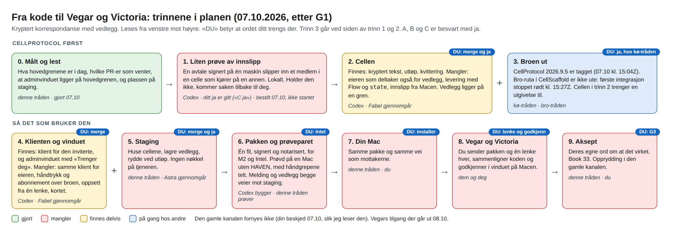

# PLAN — kryptert korrespondanse med vedlegg, ut til Vegar og Victoria

PDD `kryptert-korrespondanse-med-vedlegg-ut`. Oppgavemappe: `CellProtocolDocuments/Deliverables/PDD_kryptert-korrespondanse-med-vedlegg-ut_2026-10-06/`. Skrevet 07.10.2026 av korrespondanse-tråden (Claude-tråden i prosjektet «HavenAgentD»). **Forslag til G2. Ikke godkjent.**

Kjetil godkjente formålene og bildene 07.10.2026: «1. G1 godkjent» og «4. Bildene er godkjent.» Det han godkjente, er de sju punktene i `FORMAALSSPEC.md` iterasjon 3 (md5 `f8dda73b080848153d3bf8f9d97cf9a0`) og de to bildene. Standardvalgene S1–S10 der er ikke godkjent med det. En kopi av iterasjon 3 ligger som `FORMAALSSPEC.godkjent-G1-iterasjon3.md`. Stier i dette dokumentet er fra HAVEN-mappen, og filnavn uten sti ligger i oppgavemappen.

Samme dag svarte han på tre spørsmål: «A ja, B ja, C ja Vegar har en m2 og victoria en intel». Det står under «Avgjort 07.10».

## Kort

- **Status:** Vegar og Victoria har ikke fått noe nytt, og ingen ny installerer er bygget. Den gamle kanalen fornyes ikke (Kjetils punkt 5 den 07.10, slik korrespondanse-tråden leser det).
- **Rekkefølgen** står i figuren `figur/leddene-v4.png` og i tabellen «Trinnene». CellProtocol først: cellen går inn der og ut i en utgivelse før klienten bygges på den og før staging settes ut. Staging kan skrives mot et lokalt bygg imens.
- **Det første du får se** er svaret på en liten prøve hos Codex (trinn 1): holder det at en avtale signert på én maskin slipper inn et medlem i en celle som kjører på en annen. Prøven er bestilt 07.10 kl. 15:10Z og var ikke startet da dette ble skrevet. Holder den ikke, kommer saken tilbake til deg før noe annet bygges.
- **Tid:** jeg har ikke et tall jeg kan stå for før trinn 1 er gjort. Se «Tid».

## Det du må gjøre

Nå:

1. Si fra i dag hvis lesningen av punkt 5 er feil. Slik jeg leser det, sendes ikke fornyelsen av den gamle kanalen. Da er Vegar uten kanal fra 08.10, og Victoria er det alt, til den nye er ute, og jeg har ingen dato. Det snur valget ditt 06.10 («Forny, jeg bytter selv») og punkt 7 i det du godkjente i dag.
2. Godkjenne denne planen (G2), eller si hva som skal endres.
3. Si hvilke macOS-versjoner Vegar og Victoria har. Det trengs før pakken bygges, ikke i dag.

Senere, i denne rekkefølgen. Hvert punkt er ett ord eller én handling:

4. «Merge» for PR-en med cellen i CellProtocol (trinn 2), og ja når kø-tråden spør om utgivelsen.
5. «Merge» for PR-en med klienten og vinduet i HavenAgentD (trinn 4), og avgjøre de to PR-ene som står der fra før: #28 (Codex, en kladd) og #30 (planlagte jobber, fra denne tråden). Hovedgrenen der må være grønn før pakken bygges. 05.10 var den ikke det, og da het det at #28 retter testskriptet som hindrer det. Det er ikke målt i dag.
6. «Merge» for PR-en i CellScaffold (trinn 5), og ja til utsetting til staging når kø-tråden sier det er plass.
7. Avgjøre hvordan Intel-delen av pakken skal prøves (trinn 6). Forslag kommer før pakken bygges.
8. Godkjenne pakketeksten (`handoff/TIL-VEGAR.md` og `handoff/TIL-VICTORIA.md`).
9. Installere pakken på din egen Mac, og svare «Tillat alltid» når macOS spør om nøkkelringen.
10. Per person, først for én prøveidentitet og så for Vegar og Victoria: lage lenken, sende pakken og lenken, sammenligne koden, godkjenne. Fire håndgrep per person. To av dem krever Touch ID eller passord. For prøveidentiteten også: avslå én forespørsel, fornye én gang og trekke tilgangen én gang.
11. Si hvilken installerpakke og hvilken budsjettfil som skal sendes som vedlegg, og hvem som skal ha budsjettet.
12. Ja eller nei til endringsforslaget til Book 33.
13. Si når de gamle tilgangene og den gamle invitasjonslista på staging kan fjernes.
14. G3 når Vegar og Victoria har bekreftet.

Det er fjorten punkter. Punkt 4 til 6 er minst tre «merge», minst to ja og de to PR-ene fra før. Kan noen av dem slås sammen, gjør jeg det.

## Det du godkjenner med G2

- Rekkefølgen i «Trinnene», og hvem som skriver og gjennomgår hva.
- At bolkene åpnes i den rekkefølgen, og at ingen annen bolk åpnes før bolk 1 holder.
- Den lokale formålsprøven slik den er beskrevet under «Det som kommer i tillegg til bladformålene».
- At en annen modell leser når Fabel ikke er tilgjengelig, og at det da står hvilken. Unntaket er gjennomgangen før «merge» av koden for vedlegg, se «Avgjort 07.10».
- Endringene i tabellen «Endringer etter G1».
- Når jeg kommer tilbake til deg uten at du har spurt (står under «Trinnene»).

G2 godkjenner ikke noe «merge», ingen utsetting, ikke pakketeksten og ikke endringer i Book 33. De får hvert sitt ord fra deg.

## Avgjort 07.10

Kjetil, ordrett: «A ja, B ja, C ja Vegar har en m2 og victoria en intel». Spørsmålene står ordrett i `panel/SVAR-TIL-KJETIL-20261007-1426Z.md`.

| Spørsmål | Svar | Følge i planen |
|---|---|---|
| A. Venter assistentidentiteten til etter første pakke? | Ja | Den bygges ikke nå. Pakketeksten sier at det ikke kan etterprøves kryptografisk hvem som står bak en agent. Book 33 §10 punkt 5 krever at en delegert assistentidentitet er vist før en pakke sendes ut. «A ja» er ordet hans om å sende første pakke uten. Avviket føres i endringsforslaget til Book 33 (punkt 12) |
| B. Kan koden for vedlegg slås sammen med hovedgrenen før Vegar og Victoria har prøvd, når funksjonsprøvene, en uavhengig gjennomgang (Fabel) og en lokal formålsprøve med to prøveidentiteter er grønne? | Ja | Én pakke, med vedlegg. Selve sammenslåingen får eget «merge» fra ham. Spørsmålet nevnte Fabel ved navn: er Fabel ikke tilgjengelig da, sier jeg det, og han avgjør om en annen modell holder |
| C. Kan Codex starte første ledd før planen er godkjent? | Ja | Bolk 1 er åpnet og bestilt hos kø-tråden 07.10 kl. 15:10Z |
| Macene | Vegar har en M2, Victoria en Intel-Mac | Pakken må virke på begge prosessortyper, og Intel-delen må prøves. macOS-versjonene er ikke oppgitt |

## Ord som brukes

| Ord | Betyr her |
|---|---|
| hovedgrenen (`main`) | Hovedlinja i koden i et repo. En pakke bygges bare fra den. |
| gren, PR, merge | En gren er en sidelinje. En PR er et forslag om å ta grenen inn på hovedgrenen. Merge er å gjøre det. |
| utgivelse, tag | En navngitt revisjon av CellProtocol, for eksempel `2026.9.5`. Andre repo peker på en utgivelse («pinn»). |
| broen | Forbindelsen en klient bruker for å nå en celle på en tjener, med bevist identitet (CellProtocol PR #53). |
| staging | Prøvetjeneren, `staging.haven.digipomps.org`. |
| relasjonscelle | Én celle per relasjon: du og Vegar, du og Victoria. I koden `CorrespondenceCell`. |
| kontrakt | En avtale signert av cellens eier, som gir én identitet bestemte rettigheter i cellen. |
| Codex, Astra | Codex skriver kode. Astra er Codex i rollen som gjennomleser. |
| Fabel | En uavhengig Claude-leser. Er Fabel ikke tilgjengelig, brukes en annen modell, og det står hvilken. |
| kø-tråden, bro-tråden | To andre tråder. Kø-tråden eier køen på Macen og rekkefølgen for utgivelser og utsetting. Bro-tråden har broen i CellScaffold. |
| bolk 1–6 | Arbeidet slik det er delt i `handoff/README.md`. Bolkene er ikke standardvalgene S1–S10 i spesifikasjonen, og ikke S6-dokumentet. |

## Trinnene

| Trinn | Hva | Hvem | Venter på | Du ser | Ditt ord |
|---|---|---|---|---|---|
| 0 | Måling og lesing av det planen bygger på | Korrespondanse-tråden | Gjort 07.10 | Tabellen «Målt 07.10» under | — |
| 1 | Prøve, lokalt, i CellProtocol: en avtale signert på én maskin slipper inn et medlem i en celle som kjører på en annen (bolk 1) | Codex | At kø-tråden legger jobben inn (bestilt 07.10 kl. 15:10Z) | «Holder» eller «holder ikke», med rapporten `handoff/BOLK-1-RAPPORT.md` | Gitt («C ja») |
| 2 | Cellen i CellProtocol: eieren som deltaker også for vedlegg, innslipp, fornyelse og tilbakekall signert på eierens maskin, levering med Flow og `state`, og koden for vedlegg oppå ny hovedgren (bolk 2). Prøvd lokalt mot funksjon og formål før PR | Codex skriver; Fabel gjennomgår | Trinn 1 holder; G2 | PR-en, rapporten fra gjennomgangen, og utskriften fra den lokale formålsprøven | «Merge»; ja til utgivelsen |
| 3 | Broen ut: CellProtocol `2026.9.5` (tagget 07.10 kl. 15:04Z), og bro-ruta i CellScaffold | Kø-tråden; bro-tråden | Bro-ruta i CellScaffold. Kø-trådens første integrasjon (`2026.9.7`) stoppet 07.10 kl. 15:27Z: den avgrensede porten var rød, og ingen kandidat finnes. Om ruta bærer korrespondansens abonnement, er ikke prøvd | Kø-trådens melding | Ja til utsetting. Kø-tråden spør; det er ikke blant de fjorten punktene her |
| 4 | Klienten og vinduet i HavenAgentD: samme klient for eier og invitert, håndtrykk og abonnement over broen, oppsett fra én lenke med kode, og kortet under «Trenger deg» med lenke, godkjenning, fornyelse og tilbakekall (bolk 3). Først en liten prøve av abonnement over broen | Codex skriver; Fabel gjennomgår | Trinn 2 gitt ut; G2 | Skjermbilde av kortet ved siden av det godkjente bildet | «Merge» |
| 5 | Staging i CellScaffold: huse relasjonscellene, lagre vedlegg, rydde ved utløp, ingen nøkkel på tjeneren (bolk 4) | Korrespondanse-tråden skriver; Astra gjennomgår | G2, og trinn 1 som holder. Kan skrives mot et lokalt bygg av trinn 2. Settes ut etter trinn 2 og 3 | Utskrift fra staging av en celle etter en prøvemelding | «Merge»; ja til utsetting |
| 6 | Pakken (bolk 5), og prøveparet mot staging med programmet fra pakken: melding og vedlegg begge veier (bolk 6). Pakken prøvd på en Mac uten HAVEN, med håndgrepene telt, og på Intel | Codex bygger; korrespondanse-tråden prøver | Trinn 4 og 5; grønn hovedgren i HavenAgentD (PR #28 og #30 avgjort); macOS-versjonene; en måte å prøve Intel på | `TESTRESULT.md`, pakken, og opptaket fra den rene Macen | Hvordan Intel prøves |
| 7 | Din Mac over på den nye klienten. Du godkjenner en prøveidentitet i vinduet | Korrespondanse-tråden; du installerer og godkjenner | Grønt trinn 6 | En melding sendt med den nye klienten fra din Mac | Du installerer; Touch ID |
| 8 | Vegar og Victoria | Dem og deg | Trinn 7; godkjent pakketekst | Deres egne ord om at melding, installerpakke og budsjett kom fram | Lenke, kode, godkjenn |
| 9 | Aksept (G3), endringsforslaget til Book 33, og opprydding i den gamle kanalen | Korrespondanse-tråden | Trinn 8 | `ACCEPT.md` | Ja eller nei til Book 33; ordet om de gamle tilgangene; G3 |

Trinn 3 går ved siden av trinn 1 og 2. Trinn 5 kan skrives mens trinn 2 til 4 pågår.

I trinn 6 eies prøvecellen av en prøveidentitet med en prøvenøkkel, og ingen Touch ID trengs der. At din egen godkjenning krever Touch ID eller passord, prøves i trinn 7. Hvordan en prøvenøkkel kan brukes uten å åpne en vei rundt låsen for ekte identiteter, er en del av bolk 3.

**Når jeg kommer tilbake til deg uten at du har spurt:** trinn 1 holder ikke; en gjennomgang finner noe som endrer et av de sju punktene eller bildene du godkjente; abonnement over broen virker ikke fra klienten; eller en avhengighet hos en annen tråd står stille. Ellers får du beskjed når et trinn er ferdig og når ordet ditt trengs.

## Arbeidspakker, én per bladformål

Radene er hentet fra `FORMAALSSPEC.md` §1 med kode. Testene er de i §5 der. De som endres, står i «Endringer etter G1». «Bevis» viser til raden i §3 der, eller til ankeret i `TESTRESULT.md` og `ACCEPT.md`.

| AP | Formål | Trinn | Bolk | Hvem | Test | Bevis | Venter på |
|---|---|---|---|---|---|---|---|
| AP-A1 | A1: Eieren og den inviterte skriver til hverandre i én relasjonscelle, med samme klient, tekst og vedlegg begge veier (`to-parter-i-en-celle`) | 2, 4, 6 | 2, 3, 6 | Codex skriver; Fabel gjennomgår | T-A1 | §3 rad 5 og 7 | bolk 1 holder |
| AP-A2 | A2: Staging huser én relasjonscelle per godkjent relasjon, og cellen tar bare imot konvolutter (`staging-huser-konvolutter`) | 5, 6 | 4, 6 | Korrespondanse-tråden skriver; Astra gjennomgår | T-A2 | §3 rad 6 | bolk 2 gitt ut; bro-ruta på staging |
| AP-A3 | A3: Tjeneren har ingen nøkkel som åpner en konvolutt eller slipper inn et medlem, og kan ikke koble en identitet til en person ut fra det den lagrer (`tjeneren-er-ikke-mottaker`) | 1, 2, 4, 5 | 1, 2, 3, 4 | Codex (cellen og klienten); korrespondanse-tråden (staging) | T-A3 | §3 rad 6 | bolk 1 holder |
| AP-A4 | A4: En godkjent identitet får cellens adresse, medlemmenes offentlige nøkler og en avtale signert av eieren, med nøyaktig de handlingene den skal ha (`smal-avtale-ved-innmelding`) | 2, 4, 6 | 2, 3, 6 | Codex skriver; Fabel gjennomgår | T-A4 | `TESTRESULT.md#avtale` | bolk 1 holder |
| AP-A5 | A5: Meldingene går over den autentiserte broen, og ingen annen vei (`over-autentisert-bro`) | 3, 4, 6 | 3, 6 | Bro-tråden og kø-tråden (ruta); Codex (klientens håndtrykk); korrespondanse-tråden prøver | T-A5 | §3 rad 7 | bro-ruta på staging (`2026.9.7`); om den dekker HD-0166, er ikke avklart |
| AP-A6 | A6: Når en melding utløper, forsvinner hele konvolutten, også ytterdelen, uten at noen må lese innboksen først (`utloep-fjerner-alt`) | 5, 6 | 4, 6 | Korrespondanse-tråden skriver; Astra gjennomgår | T-A6 | `TESTRESULT.md#utloep` | bolk 2 gitt ut |
| AP-A7 | A7: Ny post kommer til mottakerens klient uten at noen spør, og historikken kan hentes (`levering-uten-spoerring`) | 2, 4, 6 | 2, 3, 6 | Codex skriver; Fabel gjennomgår | T-A7 | `TESTRESULT.md#levering` | bolk 1 holder; abonnement over broen prøvd (først i trinn 4) |
| AP-B1 | B1: Vedleggskoden er gjennomgått av Astra og ligger på `main` i CellProtocol og HavenAgentD, og eieren kan sende vedlegg som den inviterte *Endres: gjennomgås av Fabel, se «Endringer etter G1».* (`vedlegg-paa-main`) | 2, 4 | 2, 3 | Codex skriver; Fabel gjennomgår; Kjetil sier «merge» | T-B1 | §3 rad 5 | bolk 1 holder |
| AP-B2 | B2: Staging lagrer avsenders krypterte vedlegg i en undercelle avsenderen eier, og rydder ved utløp og tilbakekall (`staging-baerer-vedlegg`) | 5, 6 | 4, 6 | Korrespondanse-tråden skriver; Astra gjennomgår | T-B2 | §3 rad 7 | B1; plass på staging (målt) |
| AP-B3 | B3: Installerpakken når Vegar og Victoria, og budsjettet når den du velger, som vedlegg (`installerpakke-og-budsjett`) | 8 | 6 | Vegar, Victoria og Kjetil | T-B3 | §3 rad 12 | trinn 7; Kjetil sier hvilke filer |
| AP-C1 | C1: Mottakeren installerer én signert pakke og gjør høyst to håndgrep til (`mottaker-en-pakke-ett-haandgrep`) | 4, 6 | 3, 5 | Codex bygger oppsettet og pakken; korrespondanse-tråden prøver | T-C1 | §3 rad 2, 8 og 9 | bolk 3 på hovedgrenen; signering og notarisering; Intel prøvd |
| AP-C2 | C2: Kjetil slipper inn én person på Macen sin, og ser at forespørselen er fra rett person (`en-godkjenning-per-person`) | 4, 7 | 3, 6 | Codex skriver; Fabel gjennomgår | T-C2 | §3 rad 1 | bolk 2 gitt ut |
| AP-C3 | C3: Å invitere en ny person, og å fornye en tilgang, krever ingen drift (`tilgang-uten-driftsrunder`) | 2, 4, 5 | 2, 3, 4 | Codex (cellen og klienten); korrespondanse-tråden (staging) | T-C3 | §3 rad 10 | bolk 1 holder |
| AP-C4 | C4: Kjetils egen Mac bruker samme pakke og samme vei som mottakerne (`kjetils-mac-samme-pakke`) | 7 | 6 | Korrespondanse-tråden; Kjetil installerer | T-C4 | §3 rad 11 | grønt prøvepar (trinn 6) |
| AP-C5 | C5: Begge mottakerne er over, og de gamle tilgangene deres er trukket (`overgangen-fullfoert`) | 9 | 6 | Korrespondanse-tråden; Kjetils ord | T-C5 | §3 rad 13 | trinn 8 |
| AP-D1 | D1: Skal ikke: den gamle kanalen brytes før begge mottakerne er over (`gammel-kanal-staar`) | — | — | Korrespondanse-tråden | T-D1 | §3 rad 13 | faller bort hvis lesningen av Kjetils punkt 5 står |
| AP-D2 | D2: Skal ikke: gamle meldinger flyttes inn i de nye cellene, eller den nye klienten faller tilbake til klartekst (`ingen-klartekst`) | 6 | 6 | Korrespondanse-tråden prøver | T-D2 | `TESTRESULT.md#ingen-klartekst` | trinn 5 |
| AP-D3 | D3: Skal ikke: en agent sender i Kjetils navn, eller slipper inn noen, uten hans ja (`ingen-agent-uten-ja`) | 1, 2, 4, 6, 7 | 1, 2, 3, 6 | Codex; korrespondanse-tråden prøver | T-D3 | `ACCEPT.md#agent` | bolk 1, også punkt 6 i oppdraget |
| AP-D4 | D4: Skal ikke: nøkler, engangskoder eller meldingstekst havner i logger, utskrifter eller bevis (`ingen-verdi-i-logg`) | 6, 7, 8 | 6 | Korrespondanse-tråden | T-D4 | `TESTRESULT.md#ingen-verdier` | — |

AP-D1 og siste del av AP-C5 gjelder den gamle kanalen. De står som i spesifikasjonen til Kjetil har bekreftet eller rettet lesningen av punkt 5. Se «Endringer etter G1».

Ingen arbeidspakke starter før bolken den hører til, er åpnet i `handoff/README.md`.

### Det som kommer i tillegg til bladformålene

- **Lokal formålsprøve før hovedgrenen (trinn 2).** Kjetils regel fra 18.09: nye kapabiliteter prøves mot funksjon og formål før de går til hovedgrenen i CellProtocol. Prøven: tre adskilte sammenhenger på én maskin. Én har eierens nøkler, én huser cellen uten nøkler, og én er den inviterte. Eieren slipper inn den inviterte, tekst og vedlegg går begge veier, ny post kommer uten spørring, og tilfellene som skal avvises, blir avvist. Utskriften legges i `evidence/`.
- **Liten prøve av abonnement over broen (først i trinn 4).** Om et abonnement over broen virker fra en klient utenfor Binding, er ikke prøvd (A22 i `FORMAALSSPEC.md` §0).
- **Intel (trinn 6).** Victoria har en Intel-Mac. Kjetil 05.10: «Bygg en ny universal installerer om det trengs - men DET MÅ VIRKE! - før jeg sender dem en ny installerer». Pakken bygges for begge prosessortyper, og Intel-delen prøves før den sendes. En annen tråd skrev 06.10 at et program ga «Bad CPU type» på Kjetils Mac; korrespondanse-tråden leser det som at Rosetta mangler der, og har ikke målt det. Hvordan Intel-delen prøves, legges fram som forslag før pakken bygges.
- **Pakketeksten og endringsforslaget til Book 33** (rad 3 og 4 i `FORMAALSSPEC.md` §3) skrives av korrespondanse-tråden under trinn 5 og 6.
- **Sikkerhetskopi av korrespondansetilstanden på staging** før første utsetting (rad 9 i `FORMAALSSPEC.md` §2). Tas av den som setter ut.
- **Grenene med koden for vedlegg skyves til GitHub først i trinn 2.** 06.10 lå de bare lokalt på Macen (A6 i `FORMAALSSPEC.md` §0). Kø-tråden er spurt 07.10 om de kan skyves alt nå.

## Dataflyt og kontrakt

- `dataflow.md`: hvem som sender hva til hvem, og hvem som kan lese det. Tolv kanter. For hver står det om den finnes i koden eller er planlagt, og hvilken rettighet i avtalen den bruker.
- `contract/relasjonscelle-avtale.json`: rettighetene i avtalene (fire for tekst, ti for vedlegg, sju som bare eieren har), kontraktformatet og reglene for innslipp, lest i koden 07.10.
- `handoff/README.md`: bolk 1 til 6, og hvilke som er åpnet. `handoff/BOLK-1-OPPDRAG.md`: oppdraget til Codex for trinn 1.

## Målt 07.10

Lest av to jobber som ikke endrer noe: `b41` (git og GitHub, kl. 14:35Z, `HAVEN-Deploy/_handoff/KORR-UT/maal/G2-GRUNNLAG-20261007.md`) og `b42` (staging, kl. 14:35Z, `HAVEN-Deploy/_handoff/KORR-UT/maal/PLASS-STAGING-20261007.md`). Det som er lest senere, står med klokkeslett.

| Hva | Målt | Følge |
|---|---|---|
| CellProtocol, hovedgrenen | Kl. 14:35Z: `1ec56d5`, lik på GitHub, med PR #53 (broen) merget 05.10 og ingen endring under `GeneralCell`, `Agreement`, `Correspondence` og `Bridging` siden 06.10. Kl. 15:04Z, lest i utdataene fra kø-trådens jobb `c31`: PR #60 og #61 er merget, og hovedgrenen er `68069b6` | Lesingen av innslippet 06.10 og 07.10 er gjort på eldre revisjoner, den siste på grenen med koden for vedlegg. Etter kø-trådens innlegg om PR #60 lar den `ensureRuntimeReady()` kaste når et oppsett er avslått. Bolk 1 leser på nytt på hovedgrenen |
| CellProtocol `2026.9.5` | Fantes ikke kl. 14:35Z. Tagget kl. 15:04Z på `68069b6`, på Kjetils ja kl. 14:40Z (kø-trådens innlegg kl. 15:09Z) | Første halvdel av trinn 3 er gjort |
| Broen har en kommando for abonnement | `case feed` i `Sources/CellBase/Cells/Bridging/BridgeCommand.swift` på hovedgrenen (kl. 14:35Z) | Grunnlag for A7. Ikke prøvd fra klienten |
| Koden for vedlegg | Ikke på hovedgrenen i CellProtocol | B1. Kjetil har sagt ja til at den kan slås sammen etter gjennomgang (svar B) |
| HavenAgentD, hovedgrenen | `ea558ba` (29.09), lik på GitHub. PR #28 er åpen og en kladd. PR #30 er åpen. Ingen av dem har konflikt med hovedgrenen | Punkt 5 i «Det du må gjøre» |
| HavenAgentD peker på CellProtocol | Revisjonen `5609a9ad`, uten versjonsnavn i `Package.resolved` | Klienten må over på utgivelsen fra trinn 2 |
| Adminvinduet med «Trenger deg» | Ligger på hovedgrenen i HavenAgentD: `Sources/HavenAgentMenu/AdminWindow.swift`. Den eneste fjerngrenen med «menylinje» i navnet, `pdd/agent-menylinje-og-varsler-v2`, er 28 bak og 0 foran hovedgrenen | Retter rad 10 i `FORMAALSSPEC.md` §2, som sa at vinduet lå på en gren. Om vinduet kan bære kortet, er ikke lest |
| Pakkeskriptene | `Packaging/build_pkg.sh`, `Packaging/notarize_pkg.sh` og `Scripts/assert_dependencies_are_on_their_main.sh` finnes på hovedgrenen i HavenAgentD | Trinn 6. Om en pakke lar seg bygge i dag, er ikke prøvd |
| Klienten på hovedgrenen | Ingen treff på ordet «feed» i `Sources/HavenCorrespondenceMCP` | Som A22: klienten bruker bare `get` og `set` |
| CellScaffold, hovedgrenen | `381094bb`, lik på GitHub. Taggen `2026.9.6` peker på den (lest av korrespondanse-tråden i tagg-objektet i den lokale klonen kl. 13:49Z; ikke i `b41`). Peker på CellProtocol `2026.9.4` (`81601a6`) | Staging må over på utgivelsen fra trinn 2 |
| Bro-ruta i CellScaffold | Fila `Sources/App/Controllers/VaporBridgehead.swift` finnes på hovedgrenen. Bro-trådens gren `codex/bridge-consumer-auth-20261005` finnes på GitHub. Kø-trådens integrasjon av den (`2026.9.7`, jobben `b44`) stoppet kl. 15:27Z: 6 av 418 tester i den avgrensede porten feilet, og grenen er ikke merget inn (lest i `_losen-queue/KOORDINERING.md` kl. 15:29Z) | Rad 2 i `FORMAALSSPEC.md` §2 sa 06.10 at den autentiserte ruta ikke var påbegynt. Kø-tråden svarte korrespondanse-tråden samme sted: kandidaten registrerer en offentlig bro med autentisering, den person-spesifikke ruta er ikke registrert, og abonnement for korrespondansen er ikke prøvd og må måles etter utsetting |
| Relasjonsceller i CellScaffold | Seks filer på hovedgrenen har treff på «CorrespondenceCell». Søket skiller ikke navnet fra `AssistantCorrespondenceCell` | At alle treffene er den gamle cellen, er en slutning. A4 i `FORMAALSSPEC.md` §0 sa 06.10, på en eldre revisjon, at ingen relasjonscelle huses |
| Samtidig arbeid i samme fil | Kø-trådens jobb `a35` retter rekkefølgen for avvisning i `get` og `set` i `GeneralCell.swift`, på grenen `fix/reject-foreign-owner-key-before-readiness`, med ny tag (`2026.9.6` av CellProtocol) på Kjetils ja (lest i køens `running/` kl. 15:07Z og i kø-trådens innlegg kl. 15:09Z) | Bolk 1 leser samme fil på sin egen gren og skal ikke merges. Bolk 2 bygger på hovedgrenen slik den er da |
| Plass på staging | Tre filsystemer med 49, 101 og 47 GB ledig. Appens data ligger under `/mnt/disk1/app/` og er 32 MB | Grensen i standardvalg S6 (avvis under 10 GB ledig) kan holdes. Hvilket filsystem `/mnt/disk1` ligger på, er ikke lest |

Ikke målt i dag: om hovedgrenen i HavenAgentD er grønn i CI (A16 i `FORMAALSSPEC.md` §0: ikke grønn, hentet 05.10); om en pakke lar seg signere og notarisere (HD-0107 var åpen); om Rosetta finnes på Kjetils Mac; og om vedleggene kommer med i sikkerhetskopien av staging, som rad 12 i `FORMAALSSPEC.md` §2 sa skulle måles i planen. Det siste måles før trinn 5 settes ut.

## Endringer etter G1

Disse rettes i `FORMAALSSPEC.md` i én omgang etter G2 (iterasjon 4). Den godkjente iterasjon 3 blir liggende urørt som `FORMAALSSPEC.godkjent-G1-iterasjon3.md`.

| Sted | Sto | Skal stå | Grunn |
|---|---|---|---|
| «Kort sagt» punkt 7, D1 med T-D1, siste del av C5 og T-C5, C4 og T-C4 («T-D1 er grønn etterpå»), §2 rad 13, §3 rad 13, og i §3b: «Følge for den gamle kanalen», punkt 1, punkt 6 og punkt 10 | Den gamle kanalen står til begge er over, prøves før og etter hver utsetting, og fornyelsen sendes | Den gamle kanalen fornyes ikke for Vegar og Victoria, og prøves ikke i dette arbeidet. Den står urørt på staging til Kjetil sier noe annet | Kjetil 07.10: «Jeg synes det ikke er noe poeng å teste den gamle versjonen. Få ut den nye.» Lesningen er korrespondanse-trådens. Han er bedt om å si fra hvis den er feil, og har verken rettet eller bekreftet den |
| §6 spørsmål 2 og 3, §2 («Ikke delegering»), og B1 | Åpne spørsmål | Avgjort: A ja og B ja | Kjetil 07.10 |
| §2 rad 14, A15 i §0, C1 og T-C1, og «spurt om i meldingene om fornyelsen 07.10» i §3b og §6 | Macene til Vegar og Victoria er ukjente, og spurt om i meldingene om fornyelsen | Vegar har en M2, Victoria en Intel-Mac. macOS-versjonene er ikke oppgitt. Intel må prøves | Kjetil 07.10. Meldingene om fornyelsen sendes ikke |
| §2 rad 1, A12 og A23 i §0, og §3b ledd 3 | `2026.9.5` venter på Kjetils ja | `2026.9.5` er tagget 07.10 kl. 15:04Z | Kø-trådens innlegg kl. 15:09Z |
| §2 rad 10, «Dette finnes» i «Kort sagt», og «Det jeg ikke vet» i §6 | Adminvinduet ligger på en gren som ikke er på hovedgrenen | Adminvinduet ligger på hovedgrenen i HavenAgentD. Om det kan bære kortet, er ikke lest | Målt 07.10 kl. 14:35Z |
| §2 rad 12, og «ledig plass» i §6 | Plassen på staging er ikke målt | Målt 07.10: 47 til 101 GB ledig | Målt 07.10 kl. 14:35Z |
| A4 i §0 | Lest på en eldre revisjon av CellScaffold | Hovedgrenen er `381094bb` | Målt 07.10 kl. 14:35Z |
| §3b ledd 1 og ledd 6 | Ledd 1 venter på G1. Staging venter på G1 og G2 | Ledd 1 er åpnet («C ja»). Staging venter på G2 og på at trinn 1 holder | Kjetil 07.10; og ellers bygges noe før prøven er gjort |
| B1 (formålsteksten), T-B1 og standardvalg S10 | Gjennomgått av Astra | Gjennomgått av Fabel | Codex skriver koden, og Astra er Codex. Kolonnen «Hvem» og `G1-KORT.md` sa alt Fabel |
| §3 rad 5 | Rapporten fra Astras gjennomgang | Rapporten fra Fabels gjennomgang av det Codex skriver, og fra Astras gjennomgang av staging-delen | Samme grunn |
| §6 spørsmål 4, valg 2 i «Avgjort siden iterasjon 2», «Kort sagt» punkt 5, målet i C2, og «Godkjent» i §3 rad 1 og 2 | Koden på seks sifre er et forslag, og bildene er ikke godkjent | Koden er med, og bildene er godkjent 07.10 | Kjetil godkjente bildene, som viser koden. At det også er et ja til koden, er korrespondanse-trådens lesning, og den er sagt til ham |
| §3b «Tid» | «Nytt anslag kommer med planen» | Planen har ikke et anslag. Det kommer etter trinn 1 | Se «Tid» |

## Det jeg ikke vet, og når det blir kjent

| Hva | Blir kjent |
|---|---|
| Om en avtale signert utenfor cellens prosess kan slippe inn et medlem, og hva som binder en slik avtale til én celle | Trinn 1 |
| Om eierens to bruk av nøkler kan skilles med en lås: slippe inn med Touch ID, og lese og sende gjennom agenten uten. Formål D3 sier at et forsøk fra agentens prosess blir avvist | Trinn 1, punkt 6 i oppdraget |
| Hvordan den som ber om tilgang, beviser nøkkelen sin over broen | Trinn 1, punkt 4 i oppdraget |
| Om et abonnement over broen virker fra en klient utenfor Binding | Først i trinn 4 |
| Om adminvinduet på hovedgrenen kan bære kortet | Leses før bolk 3 skrives |
| Om bro-ruta bærer det korrespondansen trenger (HD-0166), også abonnement | Kø-tråden svarte 07.10: ikke prøvd, må måles etter utsetting. Integrasjonen stoppet rødt kl. 15:27Z |
| Om hovedgrenen i HavenAgentD er grønn, og hva som skal til for PR #28, som er en kladd | Leses før trinn 4 |
| Hva som brukes som «en Mac uten HAVEN», og hvordan Intel-delen prøves | Forslag fra korrespondanse-tråden før trinn 6 |
| Hvilke macOS-versjoner Vegar og Victoria har | Kjetil er spurt 07.10 |
| Når kø-tråden legger inn bolk 1 | Kø-tråden har ikke kvittert |
| Hvor mange runder gjennomgangene tar | Underveis |

## Tid

Jeg kan ikke love en dato. Spesifikasjonen sa at et nytt anslag skulle komme med planen. Det gjør det ikke: etter trinn 1 gir jeg et spenn, med hva det hviler på.

Det som tar kalendertid, og som ikke er arbeidstimer:

- Ordet ditt: minst tre «merge», minst to ja til utgivelse og utsetting, og godkjenningene per person.
- Gjennomgangene. I dette prosjektet har hver gjennomgang funnet feil, og en rettelse er ny tekst som også må leses.
- Broen ligger hos andre tråder, og første forsøk på å integrere bro-ruta stoppet rødt i dag. Kø-tråden eier rekkefølgen for utgivelser og for Codex-jobbene.
- Fabel er, etter trådens egen logg, ikke tilgjengelig før 08.10 kl. 10:00Z. Til da leses det av en annen modell, og det står hvilken.
- Svarene fra Vegar og Victoria.

Anslaget fra iterasjon 2 (fem til ni uker etter hverandre, tre til fem i to løp) gjaldt en annen modell og er ikke kontrollert. Jeg bruker det ikke.

## Kontroll

- Det Codex skriver, gjennomgås av Fabel. Det korrespondanse-tråden skriver, gjennomgås av Astra. Rapportene legges i `panel/` og `evidence/`.
- Hver melding til Kjetil, og dokumentene den viser til, leses mot kildene av en som ikke skrev dem, før den sendes.
- Tall, tider og revisjoner i `TESTRESULT.md` og `ACCEPT.md` fylles inn av kode fra bevisfilene.
- Ingen port settes uten Kjetils ord. `STATUS.md` fører ordene hans ordrett.
- Et utkast til denne planen ble lest mot kildene av en uavhengig leser (Claude Opus) 07.10 kl. 14:47–14:59Z: «Ja, etter rettelsene 1–9 under.» Rapporten ligger i `panel/KONTROLL-G2-PLAN.md`. Rettelsene ble tatt inn, sammen med Kjetils svar på A, B og C, Intel og taggen `2026.9.5`. En annen uavhengig leser (Claude Opus) leste så planen og meldingen som legger den fram, kl. 15:20–15:29Z: «Ja, etter rettelsene MÅ 1–6.» Rapporten ligger i `panel/KONTROLL-G2-PLAN-2.md`. Rettelsene derfra, og det som er ført inn om kø-trådens integrasjon som stoppet kl. 15:27Z, er ikke lest på nytt.
