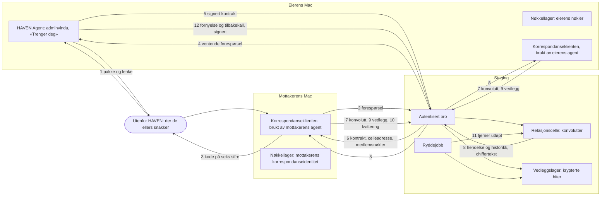

# Dataflyt: kryptert korrespondanse med vedlegg

G2-artefakt for PDD `kryptert-korrespondanse-med-vedlegg-ut`, 07.10.2026. Viser hvem som sender hva til hvem i den første pakken, hvem som kan lese det, og hvilken rettighet i avtalen hver kant bruker. Kant 1 til 6, 8, 11 og 12 er planlagt og ikke bygget. Formen på kant 2, 4, 5, 6 og 12 avgjøres etter prøven i bolk 1 (`handoff/BOLK-1-OPPDRAG.md`). Kant 7 og 10 finnes i koden på `main` for den inviterte, og kant 9 på grenen med koden for vedlegg.

Alt som går til og fra staging, går over den autentiserte broen (formål A5).

| Nr. | Fra | Til | Hva | Form | Hvem kan lese det | Rettighet i avtalen | Status |
|---|---|---|---|---|---|---|---|
| 1 | Eieren | Mottakeren, utenfor HAVEN | Installerpakken og en invitasjonslenke | Signert og notarisert pakke. Lenken gjelder i sju dager og kan brukes én gang | Den som får tak i den. Lenken alene slipper ingen inn: eieren godkjenner på Macen, og koden (kant 3) viser hvem som ber | Ingen: utenfor cellen | planlagt |
| 2 | Mottakerens klient | Staging, over broen | Forespørsel om å bli med: mottakerens offentlige korrespondanseidentitet og bevis for nøkkelen | Klartekst, offentlige nøkler | Staging ser identitetsnummer og offentlige nøkler, ikke navn | Ingen: den som ber, har ingen avtale ennå | planlagt |
| 3 | Mottakeren | Eieren, utenfor HAVEN | Koden på seks sifre, regnet ut av mottakerens nøkkel | Tall | Den som ser den. Koden er ikke hemmelig: den binder forespørselen til nøkkelen | Ingen: utenfor cellen | planlagt (godkjent med bildene 07.10) |
| 4 | Staging | Eierens Mac | Forespørselen som venter | Klartekst, offentlige nøkler | Eierens Mac viser navnet eieren selv ga lenken. Navnet ligger bare på Macen | Eierens egne (se `contract/relasjonscelle-avtale.json`, `owner_v0`); formen er ikke avgjort | planlagt |
| 5 | Eierens Mac | Staging | Kontrakt signert med eierens nøkkel, etter Touch ID eller passord | Signert, ikke hemmelig | Staging kan kontrollere signaturen, men skal ikke kunne lage den | Eierens egne; formen er ikke avgjort | planlagt, prøves i bolk 1 |
| 6 | Staging | Mottakerens klient | Kontrakten, cellens adresse og medlemmenes offentlige nøkler | Signert, ikke hemmelig | Mottakerens klient kontrollerer kontrakten mot eierens nøkkel fra lenken | Ingen før kontrakten er lagt fram | planlagt |
| 7 | Avsenderens klient | Relasjonscellen | Konvolutt: kryptert innerdel (emne, innhold, beskrivelse av vedlegg) og ytterdel (avsenderens identitetsnummer, tid, utløp, størrelse, og nummeret på avtalen når meldingen har vedlegg) | Innerdelen er kryptert til nøyaktig de to medlemmene | Staging ser ytterdelen. Bare de to medlemmene åpner innerdelen | `sendMessage` | finnes på `main` for den inviterte som avsender, prøvd med transport i samme prosess; ikke for eieren som avsender (A9), ikke med håndtrykket etter bro-PR-en (A12), og ikke mot staging (A4). Feltet for vedlegg finnes på grenen med koden for vedlegg |
| 8 | Relasjonscellen | Klienter som abonnerer | Ny konvolutt uten spørring (Flow), og de siste konvoluttene med `get state` | Chiffertekst og ytterdata | Som kant 7. En identitet uten avtale får ingenting | Planlagt rettighet for levering; i dag `inbox` og `readMessage` på forespørsel | planlagt (A7). I dag sender cellen fem hendelser uten innhold, avtalen til den inviterte gir ikke rett til å abonnere, og cellen har ingen `state` med historikk (A19) |
| 9 | Avsenderens klient | Vedleggslageret | Vedlegget som kopi | Krypterte biter, i en undercelle avsenderen eier | Staging ser at vedlegget finnes, og hvor stort det er. Bare mottakeren åpner fila | De ti under `attachments.` | finnes på grenen med koden for vedlegg for den inviterte som avsender; ikke for eieren |
| 10 | Mottakerens klient | Relasjonscellen | Kvittering for at en melding er lest | Ytterdata | Staging ser at meldingen er kvittert | `ackMessage` | finnes på `main`, med samme forbehold som kant 7 |
| 11 | Ryddejobben | Relasjonscellen og vedleggslageret | Fjerner utløpte konvolutter, også ytterdelen, og utløpte eller tilbakekalte vedlegg | — | — | Ingen: en jobb på tjeneren | planlagt (A6, B2). I dag fjernes en utløpt melding først ved neste kall |
| 12 | Eierens Mac | Staging | Fornyelse og tilbakekall av en tilgang | Signert av eieren | Som kant 5 | Eierens egne; formen er ikke avgjort | planlagt (C3) |

## Det staging skal lagre og se

Dette er målet i formål A3. Det er ikke vist før prøveparet har gått mot staging (T-A2 og T-A3).

- Lagrer: medlemmenes identitetsnumre og offentlige nøkler, medlemslistas versjon, konvolutter (kryptert innerdel og ytterdel), krypterte vedleggsbiter, kvitteringer, og signerte kontrakter.
- Ser i tillegg: når noe sendes, hvor stort det er, og at en melding har vedlegg.
- Lagrer ikke og ser ikke: innhold, emne, navn, profilnavn, maskinnavn, entitetsreferanse, og ingen privat nøkkel. Staging skal ikke ha noen nøkkel som åpner en konvolutt eller slipper inn et medlem.

## Det som ikke går over staging

- Pakken, lenken og koden går i kanalen eieren og mottakeren ellers bruker.
- Navnet eieren gir en lenke, ligger bare på eierens Mac.
- Eierens nøkler og mottakerens nøkler forlater ikke hver sin Mac.

## Det dataflyten ikke verner mot

Det samme som `FORMAALSSPEC.md` §2 sier: en drift som med vilje kjører endret kode eller bytter nøkler under innmeldingen, og at det synes når og hvor mye som sendes. Hvem som står bak en agent, kan ikke etterprøves kryptografisk i første pakke: assistentidentiteten venter (Kjetil 07.10, svar A).
