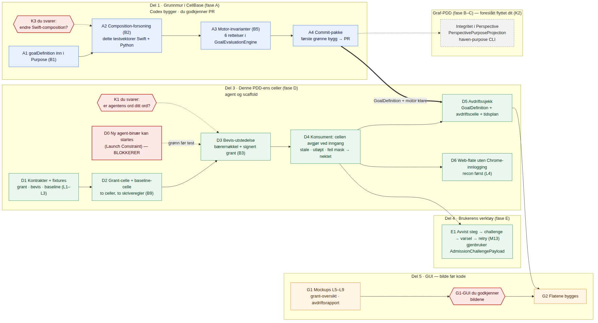

# PLAN — `PDD_mcp-tilgangsbevis` (utkast til G2)

2026-09-13/14 · Losen · **Venter på G2.** Bygger på `BESLUTNINGER.md` iterasjon 2 (B1–B9, begge rådgiverne) og `FORMAALSSPEC.md` (G1 godkjent 12.09).

## Slik leser du planen

- **Røde sekskanter i bildet er deg.** Tre steder trenger planen et ord fra deg (K1, K3, G1-GUI); ett sted (D0) trenger den at en blokkering løses.
- **Blå bokser er CellBase** (Codex bygger på Mac-en, du godkjenner PR). **Grønne er agenten og scaffold.** **Oransje er GUI** — der er regelen bilde før kode.
- Hver arbeidspakke under har fire linjer: *hva det betyr* (i klartekst), *hvem gjør det*, *hva du gjør*, *bevis* (testen som må være grønn). Testnavnene peker til FORMAALSSPEC §5.
- Rekkefølgen er Del 1 → Del 3 → Del 4/5. Del 1 kan starte i dag; Del 3 kan skrive kontrakter i dag, men ikke *kjøre* noe før D0 er løst.
- **Hva som *ikke* er med:** fase B–C (bro, projeksjon, CLI) — foreslått lagt i graf-PDD-en (K2); fase F (metoden i celler) — egen PDD senere; port-cellen (B4) — senere.

---

## Del 1 · Grunnmur i CellBase (fase A)

### A1 — `goalDefinition` inn i `Purpose` · *første pakke, du pekte på den som kjernen*
- **Hva det betyr.** Et formål kan bære sitt eget mål i JSON-en. Gamle formål uten mål virker som før. Et mål som tilhører et annet formål nektes ved lasting. Samtidig rettes to småfeil som i dag gjør mål «evig pågående» (`fromPerspectiveFields`, ukjent predikat).
- **Hvem.** Codex, i `CellProtocol` (branch `pdd/goal-definition-in-purpose`), detached bygg. Losen skriver handoffen (`handoff/A1-goaldefinition.prompt.md`, klar).
- **Hva du gjør.** Si «G2» (eller «kjør A1»). Så godkjenner du PR-en når den er grønn.
- **Bevis.** `test.a1.roundtrip` (Purpose med goalDefinition → JSON → Purpose, likt), `test.a1.legacy-decodes` (JSON uten feltet → `nil`), `test.a1.mismatch-throws` (fremmed `purposeRef` → dekodingsfeil), `test.a1.unknown-predicate-is-unknown` (motoren gir `unknown`, ikke `active`). Utdata → `TESTRESULT.md#a1`.
- **Formål.** `purpose://candidate.mcp-tilgangsbevis.root` (forutsetning for alle blader: mål skal kunne uttrykkes i arkitekturen).

### A2 — Composition-forsoning
- **Hva det betyr.** Swift og Python skal svare det samme på «er denne samlingen av formål oppfylt?». I dag svarer de ulikt på seks konkrete tilfeller (B2). Python har riktig oppførsel; Swift porteres til den, og begge kjører samme testfil (`contract/composition-vectors.json`).
- **Hvem.** Losen skriver vektorene (fra `PERSPECTIVENODE_KONSEKVENS.md` §3.1). Codex endrer `PurposeComposition.swift` og de fem testene; Codex kobler Python-testen til samme vektorfil.
- **Hva du gjør.** Svar på **K3** (ja/nei til å endre eksisterende Swift-oppførsel) før den starter.
- **Bevis.** `test.a2.vectors-swift` og `test.a2.vectors-python` — alle vektorer grønne på begge sider → `TESTRESULT.md#composition`.
- **Formål.** §1.7 (formålssammensetning); antiformålene i §1.6 avhenger av den.

### A3 — Motor-invarianter i `GoalEvaluationEngine`
- **Hva det betyr.** Seks hull i motoren lukkes så et mål aldri kan se «rolig» ut uten grunn: udeklarert kilde, tom kildeliste, duplikat kilde, `missing` med verdi, ukjent predikat, og ferskhet som beregnes i stedet for påstås (B5). De fem eksisterende testene forblir grønne.
- **Hvem.** Codex, `CellProtocol`.
- **Hva du gjør.** Ingenting.
- **Bevis.** `test.a3.no-false-calm` (seks negative tilfeller → `unknown`/`blocked`, aldri `satisfied`), pluss regresjon → `TESTRESULT.md#engine`.
- **Formål.** `…never-reports-calm-when-unread`, `…drift-report-is-per-source`.

### A4 — Commit-pakke
- **Hva det betyr.** Etter første grønne bygg: commit, push, PR — før mer arbeid. Lærdommen `branch-is-empty-after-eight-work-packages` er grunnen.
- **Hvem.** Codex.
- **Hva du gjør.** Godkjenne/merge PR.
- **Bevis.** `git rev-parse <branch> != git rev-parse origin/main`, CI grønn → `TESTRESULT.md#build`, `#regression`.

---

## Del 3 · Denne PDD-ens celler (fase D)

### D0 — Ny agent-binær kan startes · **BLOKKERER alt som skal kjøres i Del 3**
- **Hva det betyr.** macOS dreper nye agent-binærer (`Launch Constraint Violation`). Før det er løst kan ingen ny agentkode testes på maskinen din.
- **Hvem.** Codex (handoff finnes: `HavenAgentD::Docs/Handoff_Agentbinaer_Launch_Constraint_20260911.md`). Kan trenge deg til signering/notarisering.
- **Hva du gjør.** Svare Codex hvis den ber om signeringsidentitet.
- **Bevis.** Ny binær installert, `/health` svarer fra den nye → `TESTRESULT.md#agent-binary`.

### D1 — Kontrakter og fixtures (L1–L3)
- **Hva det betyr.** Tre skjemaer skrives ned før kode: hva et *grant* er (celle, datareferanse, operasjon, tidstak — aldri rolle, aldri rot-keypath), hva *beviset* bærer (bærerens nøkkel, grantene, utløp, grant-digest, nonce, utsteder), og hva *baselinen* er (slik grant-settet skal være). 3 positive og 5 negative eksempler per skjema.
- **Hvem.** Losen. Kan gjøres i dag.
- **Hva du gjør.** Lese de tre skjemaene (én side hver) og si om noe er feil.
- **Bevis.** `test.grant.contract-fixtures`, `test.cell.contract-fixtures` → `TESTRESULT.md#contract`.
- **Formål.** `…grants-are-keypath-and-operation`, `…proof-binds-grant-digest`, `…baseline-is-declared-and-readable`.

### D2 — Grant-celle og baseline-celle i agenten
- **Hva det betyr.** To nye celler i HavenAgentD. Grant-cellen eies av deg og leses av utstedelsen; bare din operatørnøkkel kan utvide et grant. Baseline-cellen kan bare skrives av din operatørnøkkel — aldri av agenten, aldri av et bevis (B9). Begge svarer på de tre provisjoneringsspørsmålene (`lesson.new-cell-must-declare-its-provisioning-mode`).
- **Hvem.** Codex, `HavenAgentD` (`Sources/HavenAgentCells/`).
- **Hva du gjør.** Ingenting før test; ved test: utvide ett grant med din nøkkel (én handling i menylinjen/verktøyet).
- **Bevis.** `test.grant.auth-negative` (feil requester → `deniedNoGrant`, ikke tom liste), `test.grant.proof-cannot-widen-itself`, `test.grant.provisioning-mode-declared` → `TESTRESULT.md#auth`, `ACCEPT.md#provisioning`.
- **Formål.** `…grant-cell-is-owned`, `…grant-change-requires-kjetil`, `…baseline-is-declared-and-readable`.

### D3 — Bevis-utstedelse
- **Hva det betyr.** Et nytt MCP-verktøy `agent.access.issue_proof`: Claude/Codex sender inn sin *offentlige* nøkkel og hva de vil ha; agenten leser grant-cellen **nå**, utsteder en `Contract.signed(agreement:issuer:subject:domain:)` til den nøkkelen (B3, `CellProtocol/Sources/CellBase/Agreement/Contract.swift:74`) med utløp ≤ 15 min, eksakt målcelle og digest av grant-settet, og legger en rad i utfordringsinnboksen så du ser at en nøkkel ble lånt ut. **Utstederen må være cellens eier** — derfor K1 før denne kan starte.
- **Hvem.** Codex, `HavenAgentD` (`HavenAgentDMCP` + runtime). Avhenger av **K1** (hvilken identitet signerer) og **D0**.
- **Hva du gjør.** Svare K1. Se raden i innboksen ved test.
- **Bevis.** `test.issue.reads-live-grants`, `test.issue.digest-on-artifact` (dekod beviset, regn digesten om — les bytene), `test.issue.expiry-ceiling`, `test.issue.visible-to-kjetil` → `TESTRESULT.md#issue`, `ACCEPT.md#visible`.
- **Formål.** gren 2 (fire blader).

### D4 — Konsumenten: cellen avgjør ved inngang
- **Hva det betyr.** En celle du eier (i scaffold) får et bevis presentert av en bærer med egen nøkkel; kontrakten installeres gjennom cellens autoriserte forløp (`GeneralCell.swift:2048`: eier = utsteder, requester = mottaker, domene, mal, betingelser, nøkkelkontroll) og cellen går grant-veien (`Agreement`/`Grant`, eksakt keypath) — aldri eierveien. Utløpt, gammel grant-digest, feil operasjon, feil datareferanse, ukjent formål, utilgjengelig revokasjonsstatus → nektet. `debugBypass` er av. **Tillatt bruk kvitteres eksplisitt** — sikkerhetsloggen registrerer i dag bare avslag (`GeneralCell.swift:1997`), så «revisjonsloggen navngir bæreren» må bygges. Én tilbaketrekking dreper alle utestående bevis.
- **Hvem.** Codex, `CellProtocol`/`CellScaffold`. Tre hull fra Astra må lukkes samtidig: `Identity.granted` sammenligner ikke rettighetsmasken; `try?`-fallback til bredere rotlesing; `CellProtocolClient` forbi preflight (D5 i FORMAALSSPEC).
- **Hva du gjør.** Ingenting.
- **Bevis.** `test.consume.auth-negative`, `test.consume.stale-proof-denied`, `test.never-widens.subset` (`⊆`-testen), `test.audit.names-the-proof`, `test.revoke.kills-all` → `TESTRESULT.md#auth`, `#audit`, `#revoke`, `#never-widens`.
- **Formål.** gren 3 blad 1–2, gren 4, antiformål 1–2.

### D5 — Avdriftssjekken
- **Hva det betyr.** Ett kontinuerlig `GoalDefinition` med én evidenskilde per celle i baselinen; en avdriftscelle leser grant-cellen og baseline-cellen, sender én observasjon per kilde (`denied`/`error` når den ikke fikk lest), regner diffen og sender `unchanged`/`widened`/`narrowed`. Kjøres på tidsplan av `ScheduledEventService`. Rapporten viser én rad per kilde ved siden av målstatusen. Sjekken retter aldri selv.
- **Hvem.** Codex, `HavenAgentD`. Avhenger av A1 og A3.
- **Hva du gjør.** Velge hvor rapporten skal dukke opp (FORMAALSSPEC Q3 — forslaget står: ukentlig i innboksen + straks ved utvidelse).
- **Bevis.** `test.drift.baseline-readable-agent-down`, `test.drift.runs-on-schedule`, `test.drift.no-false-calm` (alle fem feilutfall, lest fra GoalEvaluation-artefaktet), `test.drift.report-content`, `test.drift.read-only` → `TESTRESULT.md#drift`.
- **Formål.** gren 5 (fem blader), antiformål 3.

### D6 — Web-flaten uten Chrome-innlogging
- **Hva det betyr.** Først rekognosering: har web-flaten i det hele tatt en vei inn for en kaller uten sesjonscookie (L4)? Så: flaten godtar beviset gjennom D4-veien.
- **Hvem.** Codex (recon som køjobb, så implementering).
- **Hva du gjør.** Ingenting — det er hele poenget.
- **Bevis.** `test.consume.web-no-session` + skjermbilde → `ACCEPT.md#web-no-session`.
- **Formål.** `…web-surface-without-chrome-login`.

---

## Del 4 · Brukerens verktøy (fase E)

### E1 — Avvist steg → challenge → varsel → retry
- **Hva det betyr.** Når en celle avviser et steg i en keypath-traversering, skal avslaget bevares (ikke falle til bredere lesing), løftes til en challenge av samme type som tilkoblingsforløpet allerede bruker (`AdmissionChallengePayload`), vises i varslingssenteret med `handleAt`, og — når du oppfyller vilkåret i varselet eller åpner verktøyet — skal *samme snevre forespørsel* prøves igjen.
- **Hvem.** Losen skriver kontrakten `contract/cell-operation-challenge.md` først; Codex implementerer i `CellProtocol` (`GeneralCell`) og `HavenAgentD` (innboks + varsel).
- **Hva du gjør.** Prøve det: én traversering uten grant → ett varsel → svare i varselet → se at det gikk.
- **Bevis.** `test.consume.challenge-resolvable` → `TESTRESULT.md#challenge`.
- **Formål.** `…challenge-is-resolvable-from-notification`, `…each-cell-decides-at-traversal`.

---

## Del 5 · GUI — bilde før kode

### G1 — Mockups L5–L9
- **Hva det betyr.** Fem bilder: grant-oversikt tom / fylt; avdriftsrapport ren / avdrift funnet / kilde uleselig. Mockups (ikke Porthole-preview — agenten har ingen Porthole-vert), merket som det i `images/README.md`.
- **Hvem.** Losen.
- **Hva du gjør.** Se på bildene og si «G1-GUI godkjent» — eller hva som er galt.
- **Bevis.** `test.gui.reference-image-exists` → `images/`.

### G2 — Flatene bygges
- Etter G1-GUI. Paritet (`test.gui.parity`) som egen slice med kjørende agent + Binding/Porthole via bridge.

---

## Porter og prosess
- **G2** settes når du sier det. Merk: `purpose_dev.py validate` nekter G2 før G1-GUI på oppgaver med GUI-flate. Forslag: **del oppgaven** — Del 1 og D1 (kontrakter) går på ditt ord nå; Del 3–5 får G2 etter G1-GUI. Da står ikke grunnmuren og venter på fem bilder.
- Portene skrives i STATUS.md av Losen etter ditt ord, med henvisning til setningen (B4). Aldri «signert».

## Arbeidspakker mot bladformål (for `validate`)

| WP | purposeRef(s) | Utfører | Tester | Artefakter |
|---|---|---|---|---|
| A1 | root (forutsetning) | Codex | a1.* | PR i CellProtocol, TESTRESULT#a1 |
| A2 | §1.7, §1.6 | Losen + Codex | a2.vectors-* | contract/composition-vectors.json |
| A3 | never-reports-calm-when-unread, drift-report-is-per-source | Codex | a3.no-false-calm | PR |
| A4 | quality.build-and-regression | Codex | build, regression | PR |
| D0 | (avhengighet D7) | Codex/Kjetil | agent-binary | — |
| D1 | grants-are-keypath-and-operation, proof-binds-grant-digest, baseline-is-declared-and-readable | Losen | grant.contract-fixtures | contract/*.schema.json + fixtures (L1–L3) |
| D2 | grant-cell-is-owned, grant-change-requires-kjetil, baseline-is-declared-and-readable | Codex | grant.auth-negative, grant.proof-cannot-widen-itself, grant.provisioning-mode-declared | celler i HavenAgentD |
| D3 | issuance-reads-live-cell, proof-binds-grant-digest, proof-expiry-is-short, issuance-is-visible | Codex | issue.* | MCP-verktøy, L11 |
| D4 | each-cell-decides-at-traversal, consumer-checks-expiry-and-digest, audit-names-the-proof, revocation-is-one-act, never-widens, never-survives-narrowing | Codex | consume.auth-negative, consume.stale-proof-denied, never-widens.subset, audit.names-the-proof, revoke.kills-all | L12, L13, L15, L16 |
| D5 | baseline-is-declared-and-readable, drift-check-runs-unasked, drift-report-is-per-source, drift-report-names-act-and-place, drift-check-proposes-never-acts, never-reports-calm-when-unread | Codex | drift.* | L7–L9 (data), L10 |
| D6 | web-surface-without-chrome-login | Codex | consume.web-no-session | L4, L14 |
| E1 | challenge-is-resolvable-from-notification | Losen + Codex | consume.challenge-resolvable | contract/cell-operation-challenge.md |
| G1 | gui.expectation-agreed-before-build | Losen | gui.reference-image-exists | images/*-v1.png |
| G2 | gui.parity-with-approved-image, gui.ways-in-are-reachable | Codex | gui.parity, skeleton.* | ACCEPT#parity |

## Dataflyt {#dataflow}
`dataflow.md` skrives ved G2 (kanter: utstedelse → bærer → konsument → revisjon → avdrift, hver mot en kontrakt i `contract/`).
