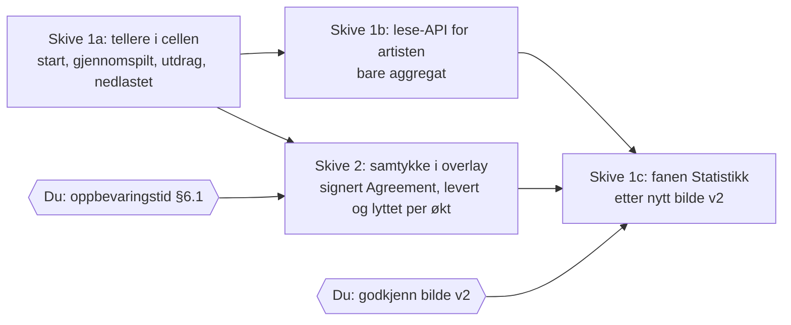

# PLAN — musikkstatistikk (G2)

Skrevet 2026-09-24 kveld av Losen, etter at Kjetil sa «Jeg vil fortsatt ha musikk statistikk. Også fra ikke innlogget bruk» og «Bruk hva du trenger bare fiks det - du administrerer». G1 og G1-GUI godkjent 2026-09-08. Planen sto uskrevet fra 08.09 til 24.09 (Losens feil).

## Hva vi gjør, i vanlige ord

Tallene kommer i to skiver. **Skive 1** begynner å telle i natt, for alle lyttere, uten å lagre noe om noen. **Skive 2** er sporet med samtykke (innloggede som sier ja, med levert/lyttet per økt), og trenger ett svar fra deg først (oppbevaringstid).

| # | purposeRef | Hva det innebærer | Hvem | Test (§5) | Ute i natt? |
|---|---|---|---|---|---|
| 1a | `…anonym-telles-uten-spor` | En teller per publisert låt øker når avspilling startes (`/butterpop/api/tracks/:id/play`, `buy-play`), og en egen når utdrag startes (`preview`). Telles der tokenet utstedes, én gang per trykk — ikke per byte-lesning. Cellen lagrer bare `{trackID: {starts, previews, completions, downloads, since}}` — ingen identitet, cookie, token, IP eller tidsstempel per hendelse. | Codex | `test.anonym.ingen-spor`, `test.anonym.teller` | ja |
| 1a | `…anonym-gjennomspilling-uten-pii` | Spilleren sender én hendelse når lyden når slutten (`ended`) til en ny rute `POST /butterpop/api/tracks/:id/played-through`; serveren øker `completions`. Ruta krever samme avspillingsforespørsel-sjekk som `play` og er ratebegrenset, men kan pumpes opp av et skript. | Codex | `test.anonym.gjennomspilling` | ja |
| 1a | `…nedlasting-er-overfoering` | Lesing av nedlastingsressursen øker `downloads`, aldri lyttetallene. (Butterpop har nedlasting av i dag, så tallet er 0 inntil en låt blir nedlastbar etter innholdsvern D2.) | Codex | `test.nedlasting.teller-for-seg` | ja |
| 1b | `…artisten-ser-bare-fordelinger` | Lese-API for workspace-eieren/medlemmer med lesetilgang: per låt `starts`, `previews`, `completions` (merket `verified:false`), `downloads`, `since`. Ingen identitetsfelt. | Codex | `test.artist.bare-aggregat` | ja |
| 1c | `…anonyme-tall-er-usikrede`, `…blind-flekk-vises` | Fanen «Statistikk» i Studio. Bildene fra 08.09 viser samtykke-sporet med tellerne som nevner. Nå skal anonyme tall også vises, merket usikret der tallet står. Det endrer bildet → **nytt bilde v2 til godkjenning** før fanen bygges. | Losen lager bildet → **du godkjenner** | `test.gui.parity` | nei, etter bildet |
| 2 | `…innlogget-krever-aktivt-ja`, `…samtykket-er-en-signert-avtale`, `…levert-maales-paa-server`, `…lyttet-rapporteres-av-spilleren`, `…lytteren-ser-og-kan-trekke` | Samtykke i overlay som egen signert Agreement; per økt levert byte-dekning og lyttet tid; lytteren ser og sletter egne rader. | Codex/Losen | `test.samtykke.*`, `test.levert.*`, `test.lyttet.*` | nei, trenger §6.1 |

## Det du skal gjøre

1. **Oppbevaringstid for rader om innloggede som har samtykket (§6.1).** Forslag: rådata 90 dager, deretter bare aggregat. Si ja eller et annet tall. Gjelder bare skive 2.
2. **Godkjenne bilde v2 av fanen** (kommer i morgenrapporten), der anonyme tall står med merkingen «usikret».

## Grenser for skive 1

- Ingen rad om lytteren. Testen dumper cellens tilstand etter en avspilling og leter etter enhver verdi fra forespørselen (cookie, token, identitet, IP) → skal ikke finnes.
- Ingen avledet «avspillinger»-sum som blander start og gjennomspilling (`…to-tall-blandes-aldri`).
- Ingen endring i det lytteren ser. Spilleren sender én ekstra forespørsel ved slutt; feiler den, merker ikke lytteren noe.
- Tellerne er persistente og overlever omstart (samme lagring som resten av musikkcellene).
- Private mikser telles ikke (§2).

## Rekkefølge til prod

Skive 1a+1b på egen gren → CI → merge → image → staging → prod, i samme kjede som resten (HAVEN-Deploy/_handoff/MUSIKKSTAT/). Skive 1c etter at bildet er godkjent. Skive 2 etter §6.1.
