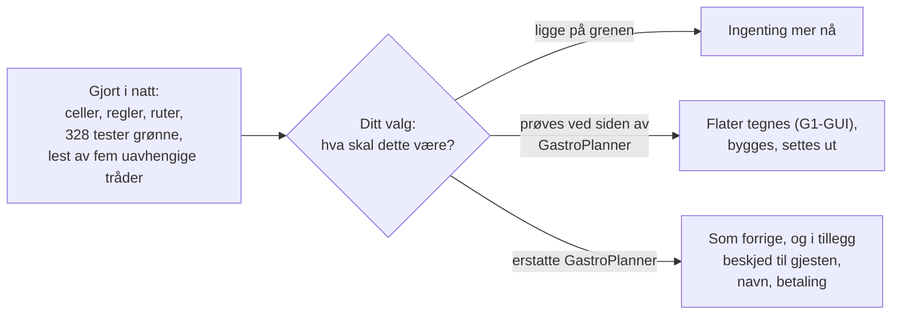

# PLAN — palazzo bordbestilling

Skrevet 7. oktober 2026 av Losen, og rettet samme natt etter den uavhengige kontrollen. G2 er ikke gitt. Planen har to deler: det som er gjort i natt, og det som gjenstår. Bare den andre delen ber om noe av deg. Stier er relative til HAVEN-roten.

## Kort

I natt er cellene, reglene og rutene for husets egen bordbestilling skrevet og testet, på en egen gren. Fem uavhengige tråder har lest det; feilene de fant som brøt det cellen selv lover, er rettet i en andre commit. Det du må ta stilling til, er hva dette skal være for Palazzo (spørsmål 1 i `FORMAALSSPEC.md` §6). Alt som gjenstår, henger på det svaret.

## Del 1: Det som er gjort

Arbeidspakkene følger bladformålene. Alle er utført av Losen, bygget og testet på Mac-en gjennom køen (bane d). «Vist rød» betyr at minst én test for formålet er sett feile med en feil satt inn med vilje; `TESTRESULT.md#roed` sier hvilke tester som er vist røde og hvilke 18 som ikke er det.

| Pakke | Formål | Hva som er skrevet | Testen som holder det | Tilstand |
|---|---|---|---|---|
| AP1 | B1 Bordplan | Planen som verdi, kontrollen som navngir hver feil, `booking.plan`, `booking.plan.set`, `booking.area.set`. Etter kontrollen: planen kan ikke krympe et bord noen holder, og et område planen ikke nevner, står som før | `test.b1.*` | grønn; rettingene vist røde |
| AP2 | B2 Seteplan | Seteplaner med ukedager, starttider, varighet og tak | `test.b2.*` | grønn; ikke vist rød |
| AP3 | B3 Ledighet | Bordvalget og `booking.availability`. Etter kontrollen: opptatte bord regnes over midnatt | `test.b3.*` | grønn, vist rød |
| AP4 | B4 Bestille, endre, avbestille | `booking.create`, `booking.change`, `booking.cancel`, `booking.mark`. Etter kontrollen: ny bekreftelse når gjesten endrer, huset beholder eller peker ut bord, gjesten kan endre antall utenom seteplanen | `test.b4.*` | grønn, vist rød |
| AP5 | B5 Walk-in | `booking.walkin` | `test.b5.*` | grønn, vist rød |
| AP6 | B6 Venteliste | `waitlistIfFull`, kandidatene etter en avbestilling, `booking.promote`. Etter kontrollen: venteliste også når taket er nådd, og en tid som har begynt, kan ikke tas fra ventelisten | `test.b6.*` | grønn, vist rød |
| AP7 | B7 Dagen | `booking.overview`. Etter kontrollen: bordlisten viser bordtider som kom over midnatt | `test.b7.*` | grønn; ikke vist rød |
| AP8 | B8 Ingen gjestedata | Typen uten felt for gjesten, avviste felt meldes, husets logg. Etter kontrollen: kanalen er sju faste ord | `test.b8.*` | grønn, vist rød |
| AP9 | B9 Gjesten selv | `booking.request`, `booking.mine`, posten i gjestens entitet, grensen på tre. Etter kontrollen: gjesten ser at huset har pekeren | `test.b9.*` | grønn, vist rød |
| AP10 | B10 Kelneren | Kelnerflaten teller egne bestillinger og slår opp referansen der først. Etter kontrollen: et avslag regnes ikke som «ingen egne» | `test.b10.*` | grønn, vist rød |
| AP11 | B11 Tilgang | Hvem som når hvilken nøkkelsti | `test.cell.auth-negative`, `test.b11.*` | grønn, vist rød |
| AP12 | B12 Egne tall | Radene skrives til regnearket `house_bookings` | `test.b12.*` | grønn, vist rød |

Rekkefølgen var: reglene og testene av dem først (uten celle), så cellen og rutene, så testene gjennom rutene, så grensen per gjest, så første commit. Etter den uavhengige kontrollen: rettingene i to runder, og andre commit. Hele testmengden er kjørt åtte ganger med nye tester. Seks kjøringer var smalere med vilje: tre for å se nye tester grønne eller røde alene, og tre for å vise rettingene røde (`TESTRESULT.md`, oversikten).

## Del 2: Det som gjenstår, og hva hvert punkt krever av deg

| Nr. | Hva | Hva det innebærer | Hva du må gjøre |
|---|---|---|---|
| 1 | Bestemme hva dette skal være | Avgjør om noe av resten skal gjøres | Svare på spørsmål 1 i `FORMAALSSPEC.md` §6 |
| 2 | Si ja eller nei til formålene (G1) | Sier du nei til et formål, endres eller fjernes koden for det på grenen | Lese §1–§3 i `FORMAALSSPEC.md` |
| 3 | Linux-bygget | Grenen pushes som `pdd/…`, CI bygger og tester den, og et image publiseres uten å settes ut. Rundt 35 minutter i CI | Si ja eller nei (spørsmål 5) |
| 4 | Flatene: gjestens bestillingsside og husets bordbok | Tegnes ferdig med alle tilstander (tom, fylt, feil), godkjennes av deg på bildet (G1-GUI), og bygges så. Skjelettformatet har ikke kalender- eller bordelementer; flatene blir HTML-sider som de offentlige flatene i dag, eller det må nye elementtyper til | Se på skissene i `images/` og si om retningen er riktig (spørsmål 4) |
| 5 | Navn på en bestilling huset fører | Ett felt til i det huset lagrer, og en endring i testen som i dag holder feltene fast | Svare på spørsmål 2 |
| 6 | Beskjed til gjesten | En kanal må velges og kobles til; adressen må ha en eier | Svare på spørsmål 3 |
| 7 | Gjestens egen post ved endring og avbestilling | En endring i entitetscellen, eller en ny post per hendelse | Svare på spørsmål 6 |
| 8 | Ventelisten som kø | I dag er listen et råd til huset. Skal et ledig bord holdes av til den som står først, må reglene endres, og gjesten må kunne få beskjed (punkt 6) | Svare på spørsmål 7 |
| 9 | Kanalene | Sju faste ord er valgt av Losen: `nett`, `telefon`, `e-post`, `oppmøte`, `intern`, `annet`, `walk-in` | Si fra om listen skal være en annen |
| 10 | Sette ut | Vanlig vei: push, CI, vert. Ikke før 1–3 er avgjort | Si fra når |

Ingen av punktene 3–10 gjøres uten ditt ord.

## Dataflyt {#dataflow}

Hver kant i `dataflow.md` og nøkkelstien som bærer den:

| Kant | Nøkkelsti | Kontrakt |
|---|---|---|
| Rute → `PalazzoBooking` | `booking.*`, `insight.bookings.upcoming` | `contract/README.md` |
| `PalazzoBooking` → husets `PalazzoSheet` | `replaceSheet` i prosessen, som eieren | `PalazzoScaffold/Sources/App/Cells/PalazzoSheetCell.swift` |
| `PalazzoBooking` → `PalazzoHouse` | `house.ledger.append`, som huset | `PalazzoScaffold/Sources/App/Cells/PalazzoHouseCell.swift` |
| `PalazzoBooking` → `PalazzoAccessContracts` | `directoryCellUUID` i prosessen, som huset | `PalazzoScaffold/Sources/App/Cells/PalazzoAccessContractCell.swift` |
| `PalazzoBooking` → `PalazzoHouse` (ansattlisten) | `isOnStaff` i prosessen, som huset | samme |
| Rute → gjestens `PalazzoEntity` | `entity.record`, som gjesten | `PalazzoScaffold/Sources/App/Cells/PalazzoEntityCell.swift` |
| `PalazzoStaffShell` → `PalazzoBooking` | `booking.lookup`, `insight.bookings.upcoming`, som huset, for en ansatt på husets liste | `contract/README.md` |

## Veien tilbake

Grenen er ikke pushet og ikke satt ut. Å forkaste arbeidet er å slette arbeidstreet `_worktrees/palazzoscaffold-bordbestilling` og grenen `losen/palazzo-bordbestilling-20261007` på Mac-en. Ingenting annet er berørt. Å forkaste bare rettingene er å sette grenen tilbake til `7976bb15`; da er de tre alvorlige feilene tilbake.
