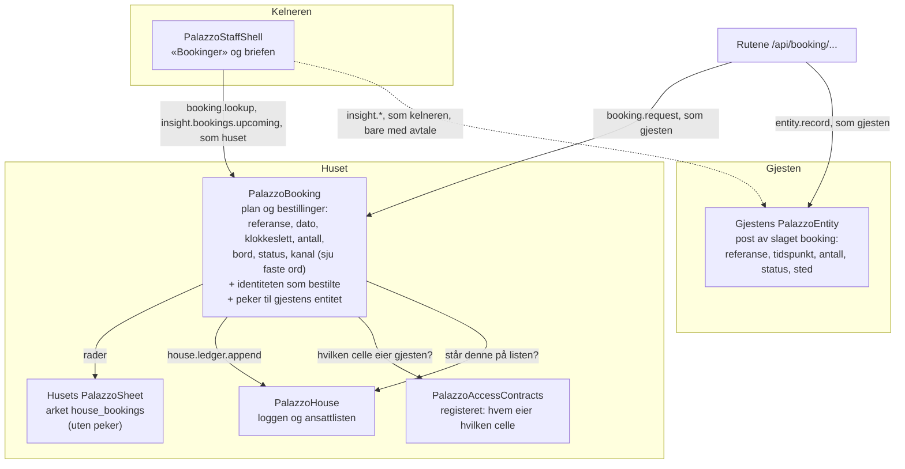

# Dataflyt — husets egen bordbestilling

Skrevet 7. oktober 2026 av Losen, fra koden på commit `7eb404f1`, og rettet etter den uavhengige kontrollen. Stier er relative til HAVEN-roten.

## Kantene

| Fra | Til | Hva går over | Hvem handler | Når |
|---|---|---|---|---|
| Ruten `POST /api/booking/request` | `PalazzoBooking` | Dato, klokkeslett, antall, og om gjesten vil stå på venteliste. Andre felt leses ikke | Gjesten | Gjesten bestiller |
| `PalazzoBooking` | `PalazzoAccessContracts` | Spørsmålet: hvilken entitetscelle eier denne identiteten? | Huset | Gjesten bestiller |
| `PalazzoBooking` | Husets `PalazzoSheet` | Alle bestillingene som rader: referanse, dato, klokkeslett, antall, status, bord, seteplan, kanal, opprettet | Huset | Etter hver endring. Kommer to endringer samtidig, kan arket bli stående ett skritt bak til neste |
| `PalazzoBooking` | `PalazzoHouse` | Én linje i loggen: hvem det gjelder, hva slags, og et sammendrag med referansen | Huset | En bestilling gjesten har gjort selv, lages, endres, avbestilles eller får bord fra ventelisten, enten gjesten eller huset gjør det. Ankommet, ferdig og ikke møtt føres ikke |
| Ruten `POST /api/booking/request` | Gjestens `PalazzoEntity` | Posten: referanse, tidspunkt, antall, tilstand og sted | Gjesten | Etter at bestillingen er laget. Ikke ved endring eller avbestilling, og ikke når bestillingen gjøres gjennom den generelle celleruten |
| `PalazzoStaffShell` | `PalazzoBooking` | Spørsmålet om kommende bestillinger, og oppslag av én referanse | Huset, for en ansatt som står på husets liste | Kelnerflaten åpnes, eller kelneren henter en brief |
| `PalazzoStaffShell` | Gjestens `PalazzoEntity` | Spørsmål på de fem nøkkelstiene briefen bruker | Kelneren selv | Briefen hentes. Uten avtale fra gjesten kommer ingenting tilbake |

## Det som ikke går noe sted

- Navn, telefon, e-post, notat og allergi fra en forespørsel. De leses ikke, og de lagres ikke. Fri tekst i `channel` avvises: kanalen er ett av sju faste ord.
- Pekeren til gjestens entitet. Den står i `PalazzoBooking` og kommer bare ut til huset og ansatte på husets liste: i `booking.lookup`, og i svaret når huset selv endrer, avbestiller, fører eller gir bord. Den står ikke i regnearket, ikke i `insight.bookings.upcoming`, ikke i dagsoversikten, og ikke i noe svar til gjesten. Gjesten ser at huset har den: `linkedToYourEntity` i `booking.mine`.
- Identiteten som bestilte. Den forlater aldri cellen, bortsett fra som den det gjelder i husets logg.
- Noe som helst til GastroPlanner, eller fra GastroPlanner hit. Importen har sitt eget ark (`bookings`).
