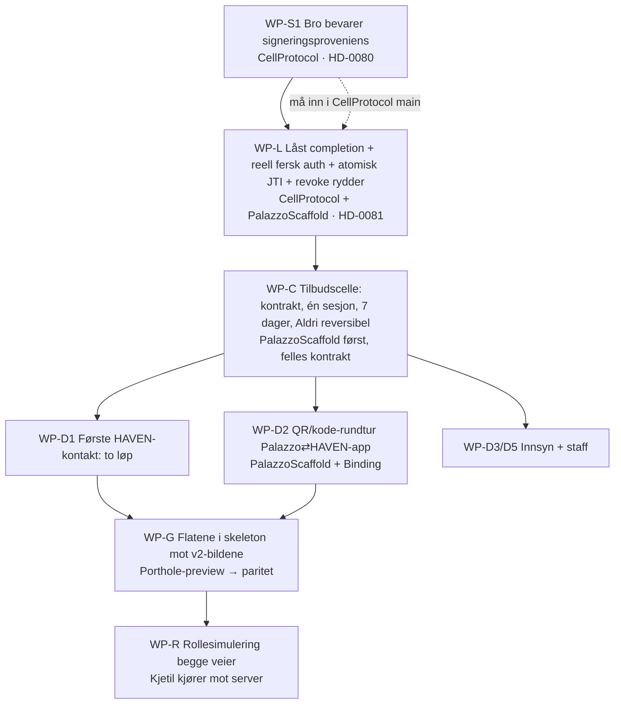

# PLAN — Entity-utvidelse begge veier, og å fange når koble/utvide skal tilbys

G1 og G1-GUI godkjent 2026-09-14. **G2 venter på Kjetils ord.** Arbeidspakker 1:1 mot bladformål i FORMAALSSPEC §1, i avhengighetsrekkefølge. Anslagene er Astras ([usikker]); de overlapper. Stier er relative til repoet.

## Slik henger det sammen

| WP | Bladformål | Utfører | Test | Hva det innebærer | Kjetils del | Status |
|---|---|---|---|---|---|---|
| WP-S1 | …proof (krav 1) | Codex (CellProtocol) | test.bridge-provenance | `VaporBridgeTransport` skal ikke feste lokal vault til en presentert deskriptor; ekstern signeringsproveniens bevares (mønster: `AdminAuthenticatedVaporBridgeTransport` returnerer alltid `BridgeIdentityVault`). Egen HD-0080. | Godkjenne at CellProtocol endres (egen gren, PR) | levert 5fa0b96e718c418e2a2e306fd6b4f809231bc093, ikke pushet |
| WP-L | …proof (krav 2–5), …proof.no-silent-merge | Codex (CellProtocol + PalazzoScaffold) | test.replay, test.fresh-auth, test.custodial-compromise, test.cell.auth-negative | Completion låser betrodd issuer, eksakt anker, request-hash, fingerprints, serveropprettet engangsutfordring; `freshAuthPerformedAt` erstattes av et bevis fra enhetens autentisering; JTI-bruk atomisk; revoke stopper avledet `*`-policy. Egen HD-0081. | Samme | venter |
| WP-C | …cell, …detect.offer-once | Codex (PalazzoScaffold; kontrakt i `contract/`) | test.offer-once, test.never-is-reversible, test.cell.contract-fixtures | Ny persistert celle (navn foreslås `PalazzoLinkOffer`) med minimumstilstand: aktiv tilbudssesjon (atomisk reservasjon), utsatt-til, aldri, kvittering. Felles kontraktsformat så HAVEN-siden kan instansiere samme type senere. | Navn og plassering (PalazzoScaffold nå, CellProtocol når HAVEN-siden trenger den) | venter |
| WP-D1 | …detect.D1 (a/b) | Codex (PalazzoScaffold + CellScaffold/Porthole) | test.D1 | Ved verifisert fjern requester uten Palazzo-mapping: D1a opprett domenebundet entitet for nøkkelen; D1b tilby lenking av kjent gjest. Sjekk må skje før resolveren oppretter celle. | — | venter |
| WP-D2 | …detect.D2 | Codex (PalazzoScaffold) + Codex/Xcode (Binding) | test.D2 | Kortlivet engangssesjon i gjestens autentiserte kontekst; QR med rendezvous + utfordring (ingen persondata), kortkode som reserve; HAVEN-appen skanner, viser motpart, signerer request lokalt etter Face ID; Palazzo binder til riktig gjest, godkjenner som custodian; HAVEN lagrer kvittering. | Teste i Binding på egen telefon | venter |
| WP-D3/D5 | …detect.D3, …detect.D5 | Codex (PalazzoScaffold) | test.D3, test.D5 | D3: tilbud til gjesten separat fra innsynssvaret når `access.request` treffer en gjest med lenkbar identitet. D5: ved `PalazzoHouse.house.staff.set` fra HAVEN-identitet → tilby lenking av `staff:<id>` uten automatisk rollearv. | — | venter |
| WP-G | …experience.* | Codex (skeleton-fabrikker) + Kjetil (paritet) | test.gui.parity, test.one-tap, test.understandable | Sheet etter samtykkemønsteret med v2-tekstene; ekspander som konfigurasjonsbytte hvis skeleton mangler element; Porthole-preview via PDD porthole-fjernt-scaffold. | Se bildene side om side og si G3 | venter |
| WP-R | root | Kjetil (kjører) + Losen (roller) | test.link-both-ways | Roller `gjest`/`annen-gjest` får lenkeformål; kjøres mot kjørende server (WP10 i rollesimulerings-PDD-en). | Starte server, kjøre `run_roles.py` | venter |
| WP-T | …proof (dokument) | Losen + Fabel/Astra (uavhengig) | inspection | `handoff/TRUSSELMODELL_bevis.md`: bevis vs. Vipps med kildeverifisert sammenligningsprofil. | Lese og si om (a) er oppnådd | venter |

Rekkefølge: WP-S1 → WP-L → WP-C → (WP-D1, WP-D2, WP-D3/D5 parallelt) → WP-G → WP-R; WP-T løper ved siden av fra WP-L. D4 (to enheter) er ikke i planen.

## Hva Kjetil selv skal gjøre
1. Si G2 (eller justere §6-anbefalingene først).
2. Godkjenne at WP-S1/WP-L endrer CellProtocol (egen gren + PR; ikke i Palazzo-jobbene).
3. Når WP-D2 er levert: teste QR-rundturen i Binding på egen telefon.
4. Når WP-G er levert: se flatene mot v2-bildene og si G3.
