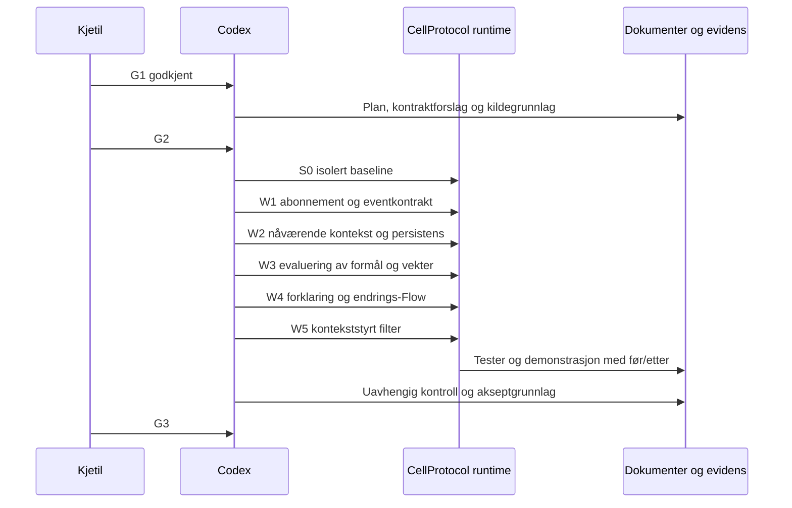

# Plan — Perspective reagerer på konteksteventer

2026-10-09: planforslag. G2 godkjent 2026-10-12 med «plan godkjent; arbeidspakker 1:1 mot bladformål». W1–W5 er nå implementert og testet; se TESTRESULT.md og ACCEPT.md. Det tekniske planinnholdet nedenfor bevarer G2-grunnlaget.

## Dette skal du gjøre

| Når | Hva | Hvorfor |
|---|---|---|
| Utført | G2 godkjent 2026-10-12 | Godkjent gjennomføring av G1 |
| Etter testene | Vurdere demonstrert oppførsel mot G1 ved G3 | Kontrollere at eventene gir riktige formålsendringer |

Ingen manuell sensorinstallasjon eller telefonbetjening er nødvendig for denne første leveransen.

## Løp og ansvar

## Kildegrunnlag og nåværende begrensninger

Codex leste GoalEvaluationEngine.swift i sin helhet, og utsnitt av GoalEvaluationCell.swift, CellViewModel.swift, GeneralCell.swift, Perspective.swift og PerspectiveCell.swift. Filnavnsøk fant ikke SemanticLocationCell eller SemanticTimeCell i CellProtocol/Sources eller CellScaffold/Sources. Treff i Binding-arbeidskopier er kontrakt-/testreferanser, ikke bevis på sensorceller.

Alle stier nedenfor er relative til HAVEN-roten.

- CellProtocol/Sources/CellBase/PurposeAndInterest/GoalEvaluationEngine.swift støtter all, any og contains-label, men en manglende deklarert kilde gir unknown før predikatet vurderes. Derfor sendes eksplisitt tom label-liste fra kjent kilde; manglende kilde kan ikke likestilles med fravær.
- CellProtocol/Sources/CellApple/Cells/Porthole/Utility Views/CellViewModel.swift laster konfigurasjon gjennom resolver og abonnerer på rootCell.flow. Filtrering foran dette innløpet kan testes uten å flytte formålslogikk inn i visningen.
- CellProtocol/Sources/CellBase/Cells/GeneralCell/GeneralCell.swift har label-aware topic-handler og autorisert attach/absorbFlow. Default videresending må ikke føre kontroll-eventer inn i nyhetslisten.
- CellProtocol/Sources/CellBase/FeedItem/FlowElement.swift har id, topic og origin, men origin alene autentiserer ikke kilden.

Ved G2-utkast var runtime-rekkevidden ikke målt. S0 er nå målt: 30 baseline-tester grønne. Faktisk abonnement og resolver-lastet root.flow er verifisert; resultatene står i TESTRESULT.md.

Arbeidstreet ved inspeksjon inneholdt andre endringer, blant annet i Skeleton/list-filer. Disse skal bevares. Utgangspunktet er en ren eksport av CellProtocol HEAD 253b4afe11af8b58bfcc433d9b7dc7393c761e24, eller et eget kontrollert arbeidstre med dette utgangspunktet. Avvik fra dette dokumenteres før implementering. Ingen commit eller publisering inngår i G2.

## Foreslåtte designvalg

1. Kildecellene sender semantisk snapshot ved hver signifikante endring. Snapshot beskriver aktive labels hos akkurat den kilden; overgangstype viser ankomst, avreise, konfigurasjonsendring eller initialtilstand. Stedets område, tidsvindu og fysisk/digital gjenkjenning eies av kildecellen.
2. Perspective vedlikeholder state per konfigurert abonnementskilde. Ved tilkobling gjøres en autorisert snapshot-lesing med samme revisjonskontrakt som Flow. Abonner før lesing; samordne gjennom én serialisert behandlingsgate slik at nyeste revisjon vinner. Ved omstart kan en fersk autorisert snapshot-lesing bekrefte samme lagrede revisjon igjen; et gjentatt Flow-event alene regnes ikke som ny bekreftelse.
3. Revisjonen er monotont stigende og varig per kilde. Hendelses-id fanger repetisjon; samme revisjon med forskjellige data er kontraktfeil. Reinstallert kilde krever eksplisitt ny kildebinding, ikke automatisk tillit til nullstilt teller.
4. Bruk GoalDefinition/GoalPredicate/GoalEvaluationEngine for regler der eksisterende semantikk passer. Engine får én validert observasjon per sourceID. Utløp gjøres eksplisitt stale. Ingen endring i den felles engine planlegges nå.
5. Manuelt angitte formål og vekter er grunnlaget. Kontekstregler gir et separat aktivt bidrag; effektive vekter beregnes deterministisk. En aktiv regel kan sette høyere eller lavere effektiv vekt, også 0 for å deaktivere et formål. Ved flere aktive regler for samme formål vinner eksplisitt høyest regelprioritet, deretter stabil regel-id i leksikalsk rekkefølge ved lik prioritet. Den vinnende regelens vekt erstatter grunnvekten midlertidig. Når ingen regel gjelder, gjenopprettes grunnlaget. Formål med effektiv vekt 0 utelates fra det aktive settet; formålsdefinisjonen beholdes. Dette er et forslag som G2 skal avklare, ikke eksisterende oppførsel.
6. Ukjent/utløpt evidens gir ingen aktivt kontekstbidrag. Manuelle formål beholdes. Dette gjør ikke taushet fra en kilde til «utenfor hjemme».
7. Perspective emitterer beslutnings-/endringsdata; en egen ContextFlowFilterCell absorberer Perspective og innholdsstrømmen. Filterets regler konfigureres av eier og innsnevrer bare allerede autorisert innhold. Kontroll-eventer konsumeres. Content Flow går videre når aktiv filterpolicy tillater det. Et eksplisitt grunnfilter gjelder ved ukjent state og omstart.

## Arbeidspakker

Utfører er Codex for alle arbeidspakker. Kjetil har bare portene over. Kodefilnavn for nye typer er forslag fram til implementering; alle legges i CellProtocol, med kontrakt/evidens i denne oppgavemappen.

| Pakke | purposeRef / mål | Endring og leveranse | Test og evidens |
|---|---|---|---|
| S0 | purpose://quality.build-and-regression | Isolert kildeutgangspunkt; faktiske baseline-tester og liten eksisterende abonnement-probe; kartlegg lagring og filterinnløp. Ved uløst forutsetning justeres planen før videre arbeid. | TESTRESULT.md#baseline og #dependencies |
| W1 | purpose://candidate.perspective-context-events.input | Context event-codec i CellBase, kilderegister og Flow-topic i PerspectiveCell. Kontrollerbar testcelle leverer samme kontrakt. Eksplisitte get/set- og Explore-kontrakter. | test.context.subscription; schema/negative fixtures; TESTRESULT.md#subscription |
| W2 | purpose://candidate.perspective-context-events.state | Serialisert snapshot/revisjonsbehandling; avreise, utløp, avkobling og omstart; lagre konfigurasjon/revisjoner uten å stole på gamle aktive sensorobservasjoner etter restart. Ny snapshot bekrefter aktuelle labels. | test.context.state, persistensfeil og fersk decode; TESTRESULT.md#state |
| W3 | purpose://candidate.perspective-context-events.evaluate | Regler bruker sammensatte label-vilkår; manuelle og kontekstbaserte vekter holdes adskilt; prioritert regel kan øke, senke eller deaktivere et formål, og grunnlaget gjenopprettes når regelen avsluttes. Eksisterende formålslesing/matching viser effektivt sett. | test.context.purposes; eksisterende Perspective-tester; TESTRESULT.md#purposes |
| W4 | purpose://candidate.perspective-context-events.explain | Lesbar kontekst, aktiv regel og kildegrunnlag; Flow ved faktisk state-/formålsendring, ingen duplikat-effekt eller løkke. Ingen rå koordinater nødvendig i eventet. | test.context.explanation; TESTRESULT.md#explanation |
| W5 | purpose://candidate.perspective-context-events.filter | ContextFlowFilterCell med autorisert konfigurasjon, Perspective-kontrollkilde og innholdskilde. Koble filteret foran resolver-lastet root-Flow brukt av Porthole. Verifiser initializer/factory før eventuell registrering. | test.context.filter via faktisk loadCell/flow-path; TESTRESULT.md#filter |
| V | purpose://quality.build-and-regression, purpose://quality.docs-in-same-change | Fokuserte nye tester, eksisterende berørte tester og bred regresjon; Explore-audit; kontrakt og dataflyt avstemt mot faktisk kode; uavhengig kontroll etter siste rettelse. | TESTRESULT.md og ACCEPT.md |

## Testutførelse

Bruk scripts/haven-swiftpm.sh fra valgt CellProtocol-arbeidstre med egen HAVEN_SWIFTPM_CACHE_KEY=perspective-context-events. Baseline: testfilter for GoalEvaluationEngineTests, GoalEvaluationCellTests og Perspective-relaterte tester. Etter endring: Context/Perspective/Filter-tester og deretter berørte CellBase-/CellApple-tester og bred pakke-regresjon. Ingen eksisterende tester fjernes eller svekkes. Konkret testfilter og exit-status lagres sammen med revisjonen; ingen antatte testtall.

Explore-audit kjøres fra CellProtocolDocuments/Tools/Explore/explore_contract_audit.py med --repo-root satt til valgt arbeidstre. Kontraktvalidatoren i oppgavens checks/ lages og kjøres mot både gyldige og ugyldige fixtures. Dette er planlagte verktøy/fixtures, ikke allerede kjørte kontroller.

Persistens må testes ved faktisk lagring og fersk innlasting; vellykket in-memory Codable-rundtur alene teller ikke. Lagre-feil gir ikke kvittering om varig oppdatering. I filtertesten observeres strømmen på root-Flow-innløpet Porthole bruker; dette beviser innholdslevering til innløpet, ikke skjermrendring eller telefonens sensorer.

## Stopp og avvik

- Ved behov for endret protokoll-, resolver- eller tilgangssemantikk stoppes den arbeidspakken for ny avklaring.
- Baseline-feil registreres med evidens og avgrenses; de skjules ikke ved testendringer.
- Eksisterende testendringer krever Kjetils avklaring, også tester laget tidligere i oppgaven.
- Ukjent persistens-/initialsnapshot-/filteravhengighet må løses eller meldes før den berørte leveransen hevdes ferdig.
- G2 gir ikke deploy, publisering, sensorintegrasjon eller godkjent GUI. G3 presenteres først med observerbar test-/demonstrasjonsevidens.

Den globale PDD-validatoren stopper på fem eksisterende ugyldige lesson-referanser i kunnskapsgrunnlaget. Disse er ikke reparert i denne oppgaven og gir ikke grønn valideringsstatus.

## Kontroll før overlevering

En uavhengig Codex-agent med arvet modell leste plan/spec/dataflyt/kontrakt read-only. Den fant tvetydighet om transition ved snapshot, gjenbekreftelse etter restart og at max-vekter ikke kunne senke manuelle formål. Alle tre er korrigert i denne utgaven. Kontrolløren målte ikke runtime eller sensorer.

Samtidige aktive filterregler kombineres som snitt av tillatte elementer, alltid innenfor grunnfilteret. Ingen aktiv regel kan utvide grunnfilteret. Kontroll-/beslutningsstrømmen er separat fra innholdsfiltreringen, slik at kildeeventer ikke filtrerer bort sin egen mulighet til å endre policy.
