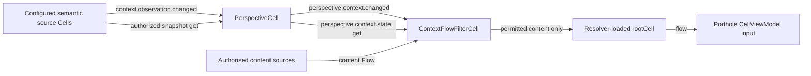

# Implemented candidate dataflow

Last verified against code: 2026-10-12. Phone/sensor producers are not implemented.

Source bindings use context:sourceID labels; Perspective consumes their observation
events and evaluates current state. The filter binds Perspective separately as
filter:perspective, consumes control events, and intersects content constraints on
filter:content:index subscriptions. Snapshot reads happen after subscriptions, with
revision checks. Existing source and content admission remain required.

The runtime integration test uses CellResolver.loadCell and root.flow, the same
entrypoints read in CellViewModel. It does not render or certify a screen.
