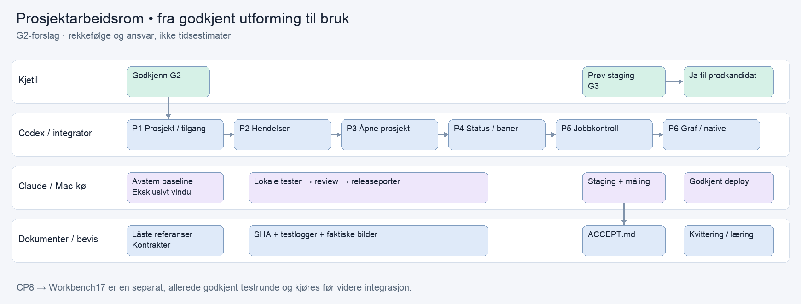

# Prosjektarbeidsrom — gjennomføringsplan til G2

2026-10-12. **Forslag; G2 er ikke godkjent, ny prosjektkode er ikke implementert.** G1 og G1-GUI er godkjent. De ti godkjente referansebildene og HTML-kandidaten er frosset i evidence/design-manifest.json; godkjenningsord og hash står i evidence/g1-gui-approval-20261012.json. Originalspecen beholdes uendret som godkjenningsgrunnlag; dens ventetekst gjelder tidspunktet for framlegget.

## Dette skal du gjøre

| Når | Hva | Hvorfor |
|---|---|---|
| Nå | Godkjenne G2 for denne planen, eller peke på endringer | Gir klarsignal til å implementere prosjektflaten og de manglende jobb-/grafkontraktene |
| Når fungerende staging-flate og avstemte skjermbilder foreligger | Prøve eget prosjekt, åpne en jobb og fokusere en relasjon; gi G3 | Bekrefter at arbeidsrommet fungerer med din autoriserte kontekst |
| Etter release- og stagingkontroll | Ta stilling til konkret prodkandidat i Admin Workbench | Eksisterende prod-hold gjelder til eksplisitt ja |

Den separate lokale CellProtocol-testen er allerede godkjent. Retensjonsvalget for hjelpechatens private samtaler er fortsatt en separat åpen beslutning og blokkerer ikke prosjektlesing.

## Første brukbare del

Åpne arbeidsrom skal gå rett til riktig prosjektdashboard med status, oppgaver og relasjoner. Opprettingsskjemaet får en tydelig egen inngang, «Opprett nytt prosjekt». «Legg til i prosjektet» viser eksisterende mottaker. Navigasjon oppretter ingen prosjektpost.

Deretter kobles jobbkommandoer til faktisk varig kvittering og avstemt status. Inntil utføreren er verifisert viser flaten hvorfor en handling ikke er tilgjengelig. Hele leveransen regnes ikke som operativ før de godkjente handlingene virker.

Gjennomføringsvalg rangeres etter riktig prosjekt/tilgang, sann status/handlinger og godkjent visuell paritet. Eksisterende celler, executorpolicy og Skeleton Visualization gjenbrukes og utvides. HTML-kandidaten er designreferanse, ikke en ny separat produktapp.

## Leste avhengigheter

SOURCE_AUDIT.md dokumenterer tidligere CellScaffold-lesing og nettleserobservasjon. DEPENDENCY_READ_20261012.md navngir denne rundens uavhengige leser og kildeområder.

- CellScaffold 9ff06f84: inngangen laster Portfolio; select oppdaterer felles persistert selectedProjectID og viser ikke et dashboard. Leseråpning trenger eksplisitt autorisert prosjektkontekst. WorkItem-prosjektfilter bruker tekst, ikke stabil ID.
- AgentD ee26eb8/a4f2db3: MCP submit og lokal executorpolicy finnes. AgentJobsCell/AgentRun er observasjon. Per-jobb cancel, prosjektbundet fjernkommando og sekvensert Flow-levering er ikke etablert i de leste stiene. Innregistrert job.json er uforanderlig.
- CellProtocol b4100f57 og grafutdrag i 793e60e: native network viser linjer/sirkler og klikk. Fokusovergang, kantretning/-etiketter og tastatur må implementeres. Native purposeTree er ikke funnet; denne leveransen bruker det godkjente nettverket med listealternativ.
- Binding origin/main 8ce634f6 og kandidat 2c5e2d5d: test virkelig BindingSkeletonView og versjonen som landes, ikke bare CellApples renderer.

Dette er kildefunn, ikke bevis på installert AgentD eller native runtime. Før implementeringsbaseline identifiseres faktisk daemon/build og integrasjonsrevisjoner sammen med køeier. Samtidig AgentD-arbeid avstemmes før kode; ingen konkurrerende implementering.

## Seks arbeidspakker — én per bladformål

### P1 — prosjektkontekst og tilgang

purposeRef: purpose://candidate.project-workspace.view-isolation.
Utfører: Codex; uavhengig kilde-/sikkerhetskontroll; Claude-køeier for bygg. Avhenger av avstemt kildebaseline og eksisterende resolver/AccessGrant.

Innfør eksplisitt portfolioUUID + projectID + viewInstanceID/mountID ved åpning. Leseråpning skriver ikke felles selectedProjectID. Valgt node/tab er lokal per visning. Autoriser hver kilde, kant og telling før projeksjon; revokering fjerner tidligere private data. Formål/prosjektnavn gir ingen rettigheter.

Områder: WorkbenchAccessGrant, Porthole session/component context, ProjectWorkspace-projeksjon. Legacy select bevares for andre konsumenter.

Tester: test.project.isolation og test.cell.auth-negative. To faner og to monteringer, to requestere, like prosjektnavn med ulike ID-er, byttet portfolioUUID, ukjent formål og tilbakekalt grant. Kontroller private etiketter, antall og søkeresultater.

Leveranse: runtime-kontekstkontrakt, negative tester, TESTRESULT.md#isolation.

### P2 — snapshot og hendelser

purposeRef: purpose://candidate.project-workspace.event-freshness.
Utfører: Codex, avstemt med AgentD-eier og hjelpechat W1; køeier for tester. Avhenger av P1.

Lag prosjektprojeksjon med snapshot, egen sekvens/cursor, kildeversjoner og synlig completeness/freshness. Gjenbruk kildenes Flow og daemonens filhendelser. Ingen periodisk fullscan som hovedmekanisme. Ved gap/reconnect gjør klienten én autorisert catch-up/snapshot-avstemming. Kilder uten replay får ny snapshot og synlig resync; separate strømmer har separate cursors.

Journal-/receipt-primitiver fra hjelpechat W1 brukes først etter bevist CP-grense og avstemt release. Varig command/outbox er ikke kvittering for utført jobb. Manglende grafpatch gir delvis graf og kontrollert reparasjon.

Tester: test.project.events med duplikater, rekkefølgefeil, gap, gammel snapshot, restart, offline og revokering under abonnement. Én kildemutasjon skal nå to autoriserte klienter uten reload eller fullscan-timer. Privat/felles payload og cursor testes separat.

Leveranse: versjonert eventkontrakt, replay/avstemming, TESTRESULT.md#events.

### P3 — åpne riktig arbeidsrom

purposeRef: purpose://project-work.project-portfolio.
Utfører: Codex; køeier for tester; Kjetil ved G3. Avhenger av P1/P2.

Begge Åpne-innganger går rett til samme dashboard. Tilbake bruker entydig konfigurasjons-ID og returkontekst; refresh beholder autorisert prosjekt. Oppretting og legg-til er ulike kommandoer med synlig mottaker. Bruk ekte katalogkonfigurasjon og Skeleton i testene, ikke erstatningen Text("Portfolio").

Tester: test.project.open. Kontroller tittel/ID/destination, uendret antall prosjektposter, leser/redaktør, tilbake og refresh. Tre lastetidsmålinger ≤5 s i avtalte staging-miljøet. Utilgjengelig prosjekt gir forståelig feil uten fallback til første prosjekt.

Leveranse: åpnerute, lys/mørk shell, integrasjonstester, TESTRESULT.md#open.

### P4 — status, oppgaver og arbeidsflytbaner

purposeRef: purpose://project-work.current-status-and-outstanding.
Utfører: Codex; køeier for verifikasjon. Avhenger av P1/P2/P3.

Vis prosjektstatus/helse/prioritet/fokus/milepæler, oppgaver, ideer, baner og neste beslutning i godkjent layout. Prosjekt↔work item/jobb bruker sourceCellUUID + objectID og stabil prosjekt-ID. Navnelikhet er søkestøtte, aldri automatisk migrering eller tilgang. Uavstemte gamle koblinger vises som uavklarte; ingen stille repopulering.

Legg til oppretter valgt objekttype i riktig prosjekt. Lag oppgave fra idé beholder idé og eksplisitt avledningsrelasjon. Ukjent antall er ukjent; offline viser sist bekreftede status. Tom autorisert liste skilles fra utilgjengelig kilde.

Tester: test.project.status, tom/feil/leser, avstem objekter/tall mot samme kildeversjon. To like prosjektnavn blandes ikke. Reachability og kontrast i begge temaer.

Leveranse: dashboardprojeksjon/statusflater, TESTRESULT.md#status.

### P5 — jobb fra bestilling til resultat

purposeRef: purpose://digital-work.coordinate.
Utfører: Codex i avstemte CS/AgentD-trær; AgentD-eier som integrator; Claude-køeier for testjobb.
Avhenger av P1/P2/P4 og verifisert executor. Hjelpechat W7 deler samme kommandoport.

Lag autentisert Workbench-kommandoport med stabil prosjektbinding, requester/grant, commandID, forventet versjon, utfører, arbeidsrot og avgrenset oppdrag. Lokal daemonpolicy sjekkes i tillegg ved innlegging og før start. Paired operator i et snapshot gir ikke fjernbrukeren jobbkontroll.

Gjenbruk submit for ny bestilling. Implementer start av registrert jobb og per-jobb kansellering der det mangler. Endre redigerer utkast før registrering; innregistrert ventende jobb erstattes først etter sikker kansellering. Job.json skrives ikke om. Samtidig start gir synlig konflikt.

Kansellering vises først som forespurt; bekreftet stopp krever terminal kvittering fra utfører. Stopp kun valgt jobb/prosessgruppe, aldri hele JobCompletionService. Ferdig jobb kan få ny bestilling med ny ID, ikke startes om under gammel ID.

Tester: test.project.jobs: queued/running/completed, dobbelklikk, mistet svar/idempotent retry, restart, start/endre/cancel-race, avslag og revokering. Ufarlig syntetisk jobb med nabojobber viser at kun valgt jobb stopper. Ingen ekte merge-/deploykommandoer som test.

Leveranse: jobbdetaljflate, kontrollport, daemonoperasjoner og kvitteringer, TESTRESULT.md#jobs.

### P6 — relasjonsgraf med fokus

purposeRef: purpose://candidate.project-workspace.relation-focus.
Utfører: Codex i CS/CP/Binding; uavhengig renderer/paritetskontroll; køeier for native test.
Avhenger av P1/P2/P4; jobbnoder får P5s faktiske tilstand.

Bind Visualization network til autoriserte typede kildehenvisninger. Utvid versjonert spec, web og native for etiketter, kantretning, valgt fokus, historie og koordinert overgang. Noder/kanter beveger seg i samme koordinatsystem; kanter må ikke ligne ekstra relasjoner gjennom en mellomliggende node.

Fokus åpner riktig idé/oppgave/prosjekt/jobb/repo/entitet. Liste/søk gir samme innhold og handlinger. Tastatur, Enter og fokusindikator er likeverdige med klikk. Redusert bevegelse gir umiddelbart skifte. Mobil har synlig prosjektvelger/scope og liste først. 420 ms er designreferanse; mellomrammer kontrolleres.

Tester: test.project.graph, test.gui.parity og reachability. Factory→fixture kanonisk byte-paritet, web og virkelig BindingSkeletonView. Nytt snapshot skal oppdatere graf uten lokal handling. Native nettverksgraf implementeres; nytt native purposeTree inngår ikke implisitt.

Leveranse: graf/liste/detalj i begge temaer, 390/1512 px opptak, TESTRESULT.md#graph.

## Kontrakt og dataflyt

contract/project-workspace-v1.json er et planlagt kontraktutkast, ikke støttet runtime-API. dataflow.md mapper kantene til kontrakt og tilgang. Etter implementering eksporteres faktisk Explore-kontrakt og fixtures; disse skal stemme med produktkode og Porthole/Binding-actionpayloads. Ingen kommando bruker felles sist-valgte prosjekt som skjult standard.

## Verifikasjon, landing og stopp

1. Avstem HEAD og kjør koordinert baseline før hver berørt kodebase endres. Oppgi målte tester; planen har ingen oppdiktede baselinetall. Rødt stopper testkjeden, også transportfeil. Ingen automatisk omkjøring uten Kjetils ord.
2. Kjør måltestene og påkrevde berørte regresjonsporter. Ingen committed test, heller ikke egen, endres uten godkjenning. Kjør ci/check-value-literals.sh før push; ingen store heterogene Swift-literaler over 20 felter.
3. Swift kun via bounded/isolated runner, Xcode via scripts/xcode-check.sh. To jobber, ≥40 GiB og ≥5% etter reserve, én tung kjede. Ingen ad-hoc scratch eller manuell hel-cacherens.
4. Review og lokale bevis bindes til eksakt SHA/manifest før PR. Ingen push som starter betalt CI uten grønn lokal port og avstemming med køeier. CP release før consumerpin; ingen lokale avhengigheter i committet Package.resolved. Avstem release med AgentD/Binding-eier.
5. Staging via Admin/deploykø. Verifiser health/build, virkelig konfigurasjon, bruker/prosjekt og alle avledede tester. Syntetiske testdata; ingen private samtaler i Git. Egen kjetil2-prosjektkontekst er eieravgrenset.
6. ACCEPT.md speiler alle åtte leveranser i godkjent §3, faktisk screenshot ved siden av referansen. Meningsbærende avvik fra HTML-design rettes eller godkjennes. Ukjørte native/GUI-tester står blokkert, aldri grønt.
7. Uavhengig sluttkontroll av evidens og beskjed før G3. Prod trenger Kjetils særskilte ja til kandidaten; enhver hostclaim stopper deploy. Ny retensjon eller bredere agenttilgang godkjennes ikke implisitt.

Ingen tidsfrist loves: AgentD-integrasjon og native renderer er reelle arbeidspakker. Prosjektåpning kan vises som mellomleveranse på staging når dens egne porter er grønne, med gjenstående jobb-/grafdeler tydelig navngitt.

## Capacity clarification 2026-10-13

Kjetil: «Det er 5 %-regelen som gjelder på Macen. Avstem med Claude-køen, få kjørt de godkjente testene og fortsett med prosjektflaten ved grønt. Ingen CI eller deploy.»

The five-percent rule applies to the Mac, with the existing 40 GiB floor and 10 GiB reserve. This supersedes older ten-percent text; original plan is retained under evidence/policy-5-percent-20261013/PLAN.before.md. No extra test attempt, source change, CI or deploy is authorized by this amendment.
