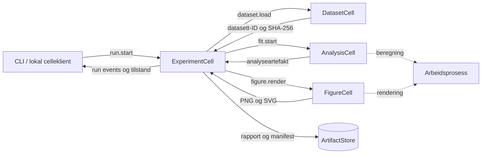

> Godkjent av Kjetil 2026-11-07. WP1 er implementert med CellBridge-tillegget i WP1_ADDENDUM.md; se TESTRESULT_WP1.md. Opprinnelig plan og senere arbeidspakker følger under.

# Plan — Python-forskningsscaffold

Dato: 2026-11-06. Status: **planforslag; ingen produktkode implementert eller runtime-test kjørt**.
Oppdraget er å lage planen. Arbeidspakkene nedenfor beskriver en senere implementering.

## 1. Formål og første leveranse

En forsker skal kunne gi scaffoldet et lite datasett og få en kontrollerbar pakke med analyse, figur og metodebeskrivelse. Den samme operasjonen skal være tilgjengelig gjennom CellProtocol, slik at andre celler kan bruke resultatet.

Foreslått prosjekt: `PyResearchScaffold/` ved siden av `PyCellProtocol/` under HAVEN-roten. Det er ikke opprettet. Python-pakken foreslås kalt `research_scaffold`; CLI `pyresearch`. Den bygger på eksisterende `cellprotocol` og `cellprotocol_scaffold`, med egne forskningsceller og livssyklusstyring. NumPy, SciPy og Matplotlib er beregningsavhengigheter. CSV + JSON er tilstrekkelig for første versjon; pandas, Arrow, notebooks og GPU-støtte kan komme når et konkret behov er målt.

**Første akseptanseflate er lokal CLI og lokale, eide celler.** Ingen HTTP/WebSocket-lytter startes i første leveranse. Valget gjør den komplette forskningsflyten uavhengig av dagens uferdige autentiserte bridge-tilgang. Fjernbruk fra Swift/Binding er en egen etterfølgende milepæl med autentisering og reell interoperabilitetstest; lokal demonstrasjon skal ikke kalles fjernintegrasjon.

## 2. Én konkret forskningsflyt

Eksempelet er en **syntetisk instrumentkalibrering**, tydelig merket som demonstrasjonsdata. Spørsmålet er: Hvordan varierer responsen y (mV) med referansesignalet x (V), og hvor store er residualene rundt en rett linje?

1. Last en medfølgende UTF-8 CSV med `sample_id,x_V,y_mV` og tilhørende datasettbeskrivelse.
2. Valider struktur, enheter og tall; frys de eksakte innbytes og beregn SHA-256.
3. Tilpass `y = intercept + slope*x` med `scipy.stats.linregress`.
4. Lag en figur med datapunkter og tilpasset linje øverst, residualer og nullinje nederst.
5. Skriv analyseresultat og en lesbar rapport med datakilde, metode, begrensninger og proveniens.
6. Kontroller hele resultatpakken med en uavhengig verifikasjonskommando; kjør samme input på nytt og sammenlign faglige resultater innen avtalt toleranse.

Planlagt brukeropplevelse etter installasjon (kommandoene finnes **ikke** ennå):

```sh
pyresearch demo --output ./runs
pyresearch verify ./runs/<run-id>
```

Eget datasett, etter at eksempelet er grønt:

```sh
pyresearch run --dataset ./input.csv --metadata ./dataset.json --method linear-regression --output ./runs
```

CLI skal importere lokale filer til et kontrollert inntaksområde før den kaller cellene; den skal ikke gå direkte til SciPy og omgå CellProtocol. En kjøring gir fremdrift og én lenke/sti til rapporten. Exit 0 betyr at alle obligatoriske artefakter er ferdig skrevet og kontrollert. Kontrollkommandoen starter ingen analyse.

### Datasett og uavhengig fasit

Frys 11 rader med x = 0,1,…,10 og y = 1 + 2x + 0,1e, der
`e = [1,-1,1,-1,1,-2,1,-1,1,-1,1]`.
Dette er en deterministisk testkonstruksjon, ikke et utvalg fra en normalfordelt populasjon.

Siden sum(e)=0 og sum(xe)=0 er forventet stigning 2 mV/V og konstantledd 1 mV. Residualkvadratsummen er 0,14 mV²; Sxx=110 V²; frihetsgrader=9. Fasit beregnes med eksakte rasjonale tall i testene, uavhengig av SciPy. Figur og rapport skal bruke de faktiske analyseresultatene, aldri innskrevne fasittall.

Analysen leverer n, stigning, konstantledd, R², residualer, residualkvadratsum, standardfeil og 95 % konfidensintervaller for koeffisientene. Intervallene beregnes som estimat ± t(0,975,n−2)*standardfeil. Rapporten forklarer forutsetningene: lineær modell, uavhengige feil, konstant varians, normalfordelte feil for de små-utvalgsbaserte intervallene og neglisjerbar usikkerhet i x. På den syntetiske fiksturen demonstrerer intervallene beregningen; de dokumenterer ikke empirisk dekning. Ingen kausal eller generaliserende konklusjon og ingen automatisk «vitenskapelig signifikant»-tekst.

CSV-policy v1: komma, punktum som desimaltegn, entydige sample_id, eksakte kolonnenavn, eksplisitte enheter V/mV, minst 3 rader og minst 2 distinkte x. Manglende felt, NaN/Inf, duplikate ID-er, konstante x, konstante y og ukjente kolonner avvises med rad/kolonne og stabil feilkode. Ingen stille dropping, imputering, enhetskonvertering eller utliggerfiltrering. Foreslått grense: 1 MiB og 10 000 rader; overskridelse avvises før beregning. Konstante y avvises i denne demonstrasjonen fordi rapporten krever et definert R²; det er en eksplisitt produktavgrensning, ikke en begrensning i lineær regresjon generelt.

## 3. Arkitektur og ansvar



| Del | Ansvar og planlagt kontrakt |
|---|---|
| DatasetCell | Frosset CSV + metadata, valideringsrapport, datasett-ID og innholdshash. |
| AnalysisCell | Navngitt, versjonert metode `linear-regression/v1`; analyseresultat og residualer fra arbeidsprosess. |
| FigureCell | Figur fra frosset analyseartefakt og datasett, med etiketter, enheter, metode og run-ID. |
| ExperimentCell | Orkestrering, jobbstatus, avbrytelse, rapport og atomisk sluttføring av manifest. |
| ResearchRuntime | Registry/resolver, lokal eieridentitet, jobb-supervisor, livssyklus og abonnenter. |
| ArtifactStore | Begrenset filområde, immutable artefakter, relative referanser, SHA-256 og størrelse. |

Bruk `GeneralCell` som base der livssyklus, hendelser og validering trenger eksplisitt kontroll. `FunctionCell` og dekoratorene kan brukes for små adaptere, men oppretter ikke automatisk full Explore-kontrakt eller en jobb-supervisor. Registrer egne input-/output-skjema og metadata uten å kjøre analysen ved introspeksjon. `type_for_key` skal aldri falle tilbake til en beregnende handler for disse cellene.

Alle klientkall og orkestreringskall går via resolver med den lokale, bevisførende eieridentiteten. Arbeidsprosessen mottar bare serialiserbare jobbinndata og artefakter, aldri vault eller privatnøkler. Alle deljobber får eksplisitt runId; supervisoren lagrer runId→jobId-koblingen før oppstart. Det finnes ingen global «aktiv kjøring» som avgjør figurmerking, cancellation eller resultateierskap. Intern prosesskommunikasjon er en implementasjonsdetalj i beregningsjobben; den offentlige hendelsesflaten er CellProtocol Flow.

### Kildekontrollerte begrensninger som må adresseres

`SOURCE_AUDIT.md` dokumenterer filene og kildehashene. Dette er kildeinspeksjon, ikke kjøringsbevis.

- `GeneralCell.get/set` holder cellelåsen mens handleren avventes. Handlere skal kun validere, registrere en jobb og returnere; CPU-arbeid utføres utenfor låsen i arbeidsprosess.
- Standard `flow` leser fra én delt kø. Forskningsruntime må ha eksplisitt distribusjon til hver abonnent, med begrensede køer og gjenopptak via lagrede hendelser. Det skal testes med to samtidige abonnenter.
- Baseklassen tillater lagring på ukjent keypath for autorisert eier. Forskningscellene må ha en lukket operasjonsliste og avvise ukjente keypaths før fallback-lagring.
- Explore har eksplisitt kontraktregistrering, men typedekning kan falle tilbake til `get`. Forskningscellenes introspeksjon må være sideeffektfri og testet.
- Default scaffold lager en in-memory vault. V1 bruker en lokal prosesseier; den lover ikke vedvarende identitet eller gjenopptatt autorisert fjernsesjon etter restart. Filer verifiseres under lokal OS-tilgang. Fremtidig delt tjeneste krever egen vedvarende vault-/eierskapskontrakt.
- Dokumentasjon og bridge-kode avviser oppgradering av en wire-identitet til eier. Manglende fjernbevis skal aldri omgås ved å gjøre forskningscellene eierløse.

Først løses forskningsspesifikke behov i `PyResearchScaffold`. Endringer i delt PyCellProtocol-kjerne krever separat begrunnelse og eksisterende kontrakt-/paritetstester; denne planen forutsetter ingen slik kjerneendring.

## 4. Kjøring, hendelser og feil

Tilstander: `queued → running → completed | failed | cancelled | interrupted`.
`stage` viser `dataset | analysis | figure | report`. Et numerisk analyseresultat bevares som et ufullstendig delresultat hvis figuren feiler, mens hele kjøringen blir `failed`.

Hvert akseptert startkall har `requestId`, `runId` og en kanonisk request-hash. Samme requestId + samme input gir samme runId uten ny jobb; samme requestId + annen input gir konflikt. Denne koblingen lagres atomisk før startkvitteringen. Ny requestId med identisk input betyr eksplisitt ny kjøring, ikke skjult cachegjenbruk.

Foreslått innledende driftsprofil: én aktiv arbeidsprosess, maksimalt 4 ventende jobber, 60 sekunders frist per beregning/rendering. Avbrytelse stanser og høster arbeidsprosessen; `cancelled` publiseres først når den faktisk er avsluttet. Konkurranse mellom fullføring og avbrytelse avgjøres én gang under supervisorens tilstandslås. Ingen vilkårlig Python, shell eller pickle lastes fra cellens inndata. Prosessdeling er ikke en sikkerhetssandkasse; grensen her er betrodde, faste metoder og begrenset input.

Vanlige stadiehendelser lagres først, deretter sendes de som FlowElement med et applikasjonsinnhold av formen `{runId, sequence, stage, status, artifactIds, error}`. `sequence` gjelder én kjøring; det er ikke en ny garanti i CellProtocols generelle FlowElement. Kvitteringer og resultater oppstår fra faktisk lagret tilstand. Unntaket som krever en commit-grense er `completed`: den hendelsen blir ikke observerbar før ferdigpakken er atomisk publisert og verifiserbar, som beskrevet i §5.

Klienten abonnerer før start, gjør én tilstands-/historikkavlesning ved oppstart eller reconnect og dedupliserer sekvensnumre. Ingen periodisk statuspolling. Ved overfylt abonnentkø kobles abonnenten av med `resync_required`; gjenopptak krever ett eksplisitt historikkoppslag. Progresjon er avgrenset til stadieskift i v1.

Ved restart markeres lagrede `queued/running`-kjøringer `interrupted`; ingen automatisk gjentakelse av sideeffekter. Ferdige pakker skal fortsatt kunne verifiseres. Hendelseshistorikk er ikke et løfte om å rekonstruere vilkårlig Cell-state eller bitidentisk gjenberegning.

Stabile feil: `INVALID_DATASET`, `UNSUPPORTED_METHOD`, `INVALID_KEYPATH`, `ACCESS_DENIED`, `QUEUE_FULL`, `TIMEOUT`, `CANCELLED`, `ARTIFACT_WRITE_FAILED`, `INTEGRITY_MISMATCH`, `REQUEST_CONFLICT`. Feil skal ikke gi delvis rapport merket som ferdig. Utdataområde som ikke kan skrives til og simulert diskfull inngår i testene.

## 5. Resultatpakke og etterprøvbarhet

Planlagt struktur under en ny, unik run-mappe:

```text
runs/<run-id>/
  input/dataset.csv
  input/dataset.json
  analysis.json
  residuals.csv
  figure.png
  figure.svg
  report.html
  report.md
  environment.json
  events.jsonl
  manifest.json
```

Rapporten viser datasettets opphav: `synthetic-demo` gjelder bare den medfølgende fiksturen. Ved egne datasett kreves brukeroppgitt kildebeskrivelse og innsamlings-/behandlingsinformasjon i metadata; ubekreftede opplysninger merkes brukeroppgitt og manglende dokumentasjon merkes ukjent. Deretter vises antall rader, enheter, validering, modell og forutsetninger, estimater og usikkerhet, figuren, begrensninger og reproduksjonsoppskrift. HTML er statisk, uten eksterne ressurser; brukerfelt escapes. Markdown henviser til den lokale figuren. Tall og tabeller genereres fra `analysis.json`.

Manifestet har `schemaVersion`, run-/request-ID, inputhash, metode og metodeversjon, parametere, numerisk dtype, kilderevisjon og dirty-status, eksakt PyCellProtocol-revisjon, låsfilhash, Python/pakkeversjoner, OS/arkitektur, backend/BLAS-info, start/slutt, status og artefaktliste `{id, relativePath, mediaType, bytes, sha256}`. Metadatafilen og rå CSV inngår begge i inputidentiteten. Ingen hemmeligheter eller maskinspesifikke absolutte stier eksporteres.

Artefaktene skrives i en midlertidig run-mappe på samme filsystem; terminal hendelse klargjøres bare i staging, hendelsesfil og øvrige artefakter sluttføres og manifestet kontrolleres før ferdigmappen publiseres atomisk. Først etter publisering kan `completed` leses via state/result eller sendes på Flow. Manifestet i ferdigmappen er autoritativt for fullføringsstatus; en sekundær jobbindeks kan rekonstrueres fra det. Ved krasj før publisering markeres kjøringen interrupted uten completed-hendelse; ved krasj etter rename men før indeksoppdatering/utsending rekonstrueres completed fra en verifisert ferdigpakke, og samme terminalsekvens gjenbrukes. En korrupt ferdigpakke gir INTEGRITY_MISMATCH, aldri completed. Tester injiserer feil på begge sider av rename og før ekstern utsending. Manifestet hasher ikke seg selv; kontrollen krever en fast liste obligatoriske filer og avviser manglende/ekstra obligatoriske referanser, feil status og ukjente skjema. Dette oppdager korrupsjon/inkonsistens, ikke en angriper som kan omskrive hele pakken og alle hashene; digital attestasjon ligger utenfor v1.

`verify` kontrollerer skjema, obligatoriske artefakter, stiinneslutning, størrelser, hasher, run-ID-koblinger og at rapportens tall samsvarer med analysen. Symlinker og stier som går ut av run-mappen avvises. `rerun` skal i en senere kommandooppskrift bruke de frosne innfilene, metoden og det låste miljøet og skrive en ny run-mappe; ingen overskriving.

Akseptanse for gjentatt numerikk i samme låste miljø: `rtol=1e-10`, `atol=1e-12` for denne avgrensede fiksturen. Toleransene er et forslag som kontrolleres på målplattformene før de låses. Identiske inputbytes og metadata krever identisk inputhash. Run-ID, tid og hendelses-ID vil variere. PNG/SVG trenger ikke identiske filbytes mellom maskiner; innhold, enheter og lesbarhet kontrolleres, og pixel-sammenligning brukes bare i frosset renderingsmiljø. Kryssplattformreproduserbarhet er ikke vist før den er målt.

## 6. Arbeidspakker og gjennomføringsrekkefølge

Alle estimater er grove arbeidsanslag, ikke målte byggetider eller kalenderløfter. Utfører er Codex for hver pakke; Kjetil vurderer leveransen. Ingen underagenter eller bakgrunnsjobber er bestilt gjennom planen.

| WP / bladformål | Arbeid og konkret leveranse | Avhengighet | Test/evidens | Anslag |
|---|---|---|---|---|
| WP1 / F1 kontrollert runtime | Pin PyCellProtocol, mål baseline, opprett pakken, lokal resolver/owner, lukkede kontrakter, jobbsupervisor, persistente run-poster, avbrytelse og Flow-distribusjon. | Ingen; avklar kilde-/dependency-baseline først. | T1/T6/T7; `evidence/runtime.txt` | 2–3 dager |
| WP2 / F2 kjente inndata | Frossen kalibreringsfikstur, metadata, DatasetCell og streng validering. | WP1 | T2; `evidence/dataset.txt` | 0,5–1 dag |
| WP3 / F3 kontrollerbar analyse | AnalysisCell, SciPy-adapter, uavhengig rasjonal fasit, residualer og usikkerhet. | WP2 | T3; `evidence/analysis.txt` | 1–1,5 dager |
| WP4 / F4 lesbar figur | FigureCell, Agg, PNG/SVG, enheter og residualpanel; visuelt referansebilde før ferdig implementasjon av figurutformingen. | WP3; figurreferanse vurderes før den låses. | T4; `evidence/figure/` | 0,5–1 dag |
| WP5 / F5 dokumentert kjøring | ExperimentCell, CLI, statisk rapport, manifest/ArtifactStore, verify og gjenkjøringsoppskrift. | WP1–WP4 | T5/T8; `evidence/end-to-end.txt` | 1,5–2 dager |
| WP6 / F6 verifisert leveranse | Ren installasjon, samlet feilmatrise, regresjon, målplattformbevis, dokumentasjon og akseptansesammenstilling. | WP1–WP5 | T1–T8 + standardpakketester; `TESTRESULT.md`, `ACCEPT.md` | 1–1,5 dager |

Sum: omtrent 6,5–10 arbeidsdager for lokal førsteversjon, med én utfører. Største usikkerhet er supervisor/flow/gjenoppretting; WP1 er derfor en tidlig milepæl. Hvis nødvendig scope vokser, oppdateres estimatet og planen med konkret gap, ikke en stilltiende reduksjon av akseptansen. Autentisert fjernbruk er ikke inkludert i estimatet.

Foreslåtte målplattformer: macOS arm64 først og Linux x86_64 som andre verifikasjon. Python-minimum og eksakte NumPy/SciPy/Matplotlib-versjoner velges etter en resolver-/hjultest i WP1; upstream PyCellProtocol angir Python >=3.11, men det alene beviser ikke forskningspakkens versjonsmatrise. Lockfil og installerbar wheel skal være leveranser, ikke flytende `latest`.

## 7. Avledede tester og ferdigkriterier

Testene er planlagt og **ikke kjørt**. Testkommandoene skal implementeres i forskningsrepoet; de finnes ikke i dag.

| ID | Verifikasjon | Konkret passkrav |
|---|---|---|
| T1 | `python -m pytest tests/test_contracts.py tests/test_access.py` | Alle deklarerte operasjoner treffer handler; ukjent keypath, feil eier og serialisert/falsk eier nektes; Explore kjører ingen beregning. Ukjent request-purpose avvises hvis feltet sendes; purpose gir aldri tilgang. |
| T2 | `python -m pytest tests/test_dataset.py` | Positiv fikstur lastes med 11 rader og kjent hash; hver beskrevet feilklasse avvises uten start av analyse. |
| T3 | `python -m pytest tests/test_analysis.py` | Stigning 2, intercept 1, SSE 0,14 og standardfeil fra uavhengig algebra; 95 %-intervaller mot en fryst referanse for df=9; residualer knyttet til sample_id; toleranser eksplisitte. |
| T4 | `python -m pytest tests/test_figure.py` + bildeinspeksjon | PNG/SVG er lesbare, 11 datapunkter, korrekt linje og residualer, akser/enheter/tittel/run-ID; ingen avkuttede etiketter ved avtalt eksportstørrelse. |
| T5 | `python -m pytest tests/test_artifacts.py tests/test_reproducibility.py` | verify godtar komplett pakke og avviser endret/manglende fil, feil status og path traversal; gjenkjøring gir samme faglige tall innen toleranse; rapport og manifest stemmer med analyse. |
| T6 | `python -m pytest tests/test_jobs.py` | Én aktiv jobb, køgrense, tidsfrist, reell prosessavslutning ved cancel, idempotens/konflikt og avbrutt jobb etter restart; krasj før/etter atomisk publisering med korrekt completed-status; feil i rendering beholder delanalyse uten completed-status. |
| T7 | `python -m pytest tests/test_flow.py` | To samtidige abonnenter mottar samme ordnede stadieskift; langsom abonnent gir kontrollert resync; reconnect-historikk uten tap/duplisert anvendelse; ingen polling. |
| T8 | `python -m pytest tests/test_end_to_end.py` + CLI i rent miljø | Begge CLI-kall i §2 lykkes gjennom virkelige lokale celler/resolver og arbeidsprosess; alle obligatoriske filer finnes og verify returnerer 0; skrivefeil gir tydelig ikke-null exit. |

WP1 måler eksisterende `PyCellProtocol`-tester med `python -m pytest` i et isolert miljø før pin fastsettes; baseline er **ikke kjørt her**. WP6 kjører hele forskningspakkens testsuite og PyCellProtocol-regresjonen. Målplattformlogger, eksakte versjoner, testantall og eventuelle feil lagres; «ingen nye feil» og «grønn suite» rapporteres separat.

Standardpakker: `test.build` = bygg wheel og installer i rent miljø; `test.regression` = suite før/etter; `test.docs-updated`/`test.status-current` = dokument- og statusinspeksjon; `test.cell.contract-fixtures`/`test.cell.auth-negative` = T1; `test.cell.stub-scan` = handlerinspeksjon uten tom suksess; `test.cells.dataflow-matches-contracts`/`test.cells.capability-audit` = kontrakt/kildeavstemming; `test.handoff.dry-run` = senere implementeringsskript beskriver handlinger uten mutasjon. Dette er en eksplisitt testmapping, ikke rapporterte testresultater.

## 8. Etter førsteversjonen

Neste milepæl for bruk fra andre scaffolds er: vedvarende vault, autentisert og replay-beskyttet bridge-sesjon, presise rettigheter for datasett/kjøring/artefakter, trygg artefaktoverføring og én faktisk Swift→Python→Swift-test. Den må ha eget omfang og bevis før fjernbruk omtales som levert. Deretter kan faktiske forskningsbehov begrunne flere metoder, større dataformater, Jupyter-integrasjon og UI.

## 9. Kilder og beslutningsstatus

- Lokal kildeinspeksjon: `SOURCE_AUDIT.md`, med eksplisitt lest/ikke lest og SHA-256.
- SciPy linregress, lest 2026-11-06: https://docs.scipy.org/doc/scipy/reference/generated/scipy.stats.linregress.html — koeffisienter, standardfeil og t-baserte intervaller.
- Matplotlib backends, lest 2026-11-06: https://matplotlib.org/stable/users/explain/backends.html — headless rendering/filutdata.

Syntetisk kalibrering, lokal CLI først, prosjekt-/cellenavn, begrensninger og estimater er forslag fra Codex. Brukeren har bestilt planen; dette registreres ikke som godkjenning av implementering eller som G1/G2/G3. Se `STATUS.md`.
