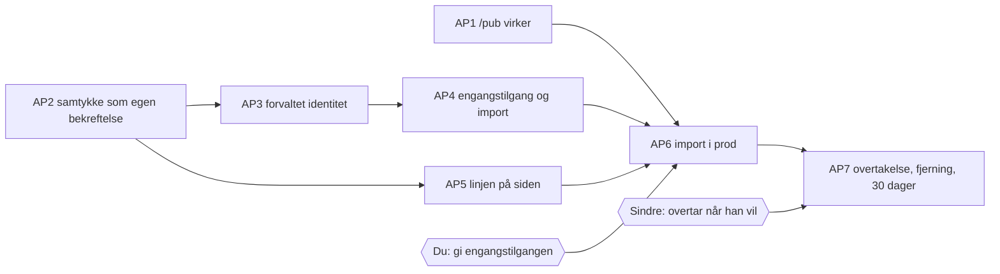

# PLAN — Sindres verk inn før han har bruker (G2)

G1 og G1-GUI godkjent av Kjetil 2026-09-25 («G1 og G1-GUI ok»). Valgene i FORMAALSSPEC §6: egen identitet for Sindre som Digipomps forvalter, én linje på siden til han bekrefter, avpublisering etter 30 dager, engangstilgang fra scaffold-administrator (én import, én kunstner, 24 timer).

## Hva som skjer, i vanlige ord

1. Katalogen `/pub` slutter å gi feil (den gir 500 i prod i dag).
2. Et verk kan publiseres på to måter: kunstneren bekrefter selv at han eier rettighetene (som i dag), **eller** det finnes et skrevet samtykke fra kunstneren. Den andre måten merkes, og siden viser linjen.
3. Du gir en engangstilgang som administrator: «importer for Sindre Hustveit, samtykke gitt muntlig til Kjetil 24.09». Den kan brukes én gang, i 24 timer.
4. Importen lager Sindres egen identitet (forvaltet av Digipomps), siden hans, utstillingene og verkene med bildene. Kjøres den to ganger, blir det ikke dobbelt.
5. Når Sindre får bruker, åpner han en overtakelseslenke, bekrefter rettighetene, og alt blir hans. Linjen forsvinner.
6. Bekreftes det ikke innen 30 dager, vises ingenting lenger. Du eller Sindre kan også fjerne alt med én handling.

| # | Formål | Hva det innebærer | Hvem | Test | Hva du gjør |
|---|---|---|---|---|---|
| AP1 | `…katalogen-virker` | Finn hvorfor `publicDirectory` mangler på cellen katalogruta bruker (`KeyValueErrors.notFound`), rett det, test at `/pub` svarer 200 med publiserte sider | Codex | `test.pub.katalog-200` + prod-curl etter utrulling | ingenting |
| AP2 | `…samtykke-registrert`, `…ingen-falsk-rettighetspåstand` | Ny bekreftelsestype på verk: `consent` med hvem ga, til hvem, når, hva det dekker. `publishWork` godtar enten dagens `rightsOwnershipAttested` fra kunstneren selv, eller et gyldig samtykke. Et verk med samtykke har aldri `rightsOwnershipAttested=true` | Codex | `test.verk.samtykke-er-ikke-eierbekreftelse`, `test.verk.publisering-krever-en-av-to` | ingenting |
| AP3 | `…forvaltet-identitet` | Scaffolden lager en identitet for en navngitt kunstner, merket «forvaltet av Digipomps». Side og verk eies av den. Administratoren kan ikke skrive til innholdet etter importen | Codex | `test.forvaltet.eier-er-kunstneridentiteten`, `test.forvaltet.admin-kan-ikke-endre` | ingenting |
| AP4 | `…engangs-import`, `…import-idempotent` | Engangstilgang som en mandat-type i `ScaffoldMandateCell` (finnes: `mandate.issue`), med kunstner-slug, samtykketekst, 24 t og én bruk. Importen leser seed-fila og bildene og bruker de vanlige nøkkelstiene (`createSite`, `createExhibition`, `createWork`, `uploadPreview`, `publishWork`, `setShowWorks`). **Trenger mandatflaten ny GUI for dette, lager jeg bilde til deg før koden skrives** | Codex, Losen sjekker | `test.engangs.en-gang`, `…utloept`, `…feil-slug`, `test.import.to-ganger-ingen-duplikater` | ingenting (til AP6) |
| AP5 | `…ikke-bekreftet-synlig` | `PublicationHTML` viser linjen «Lagt inn av Digipomps med kunstnerens samtykke. Ikke bekreftet av kunstneren ennå.» når siden har verk med samtykke; ellers ikke. Skal se ut som bildet | Codex | `test.gui.parity` mot `images/verk-forvaltet-v1.png` og `verk-bekreftet-v1.png` | ingenting |
| AP6 | `…root` | Rulle ut (staging → prod). Du gir engangstilgangen; Losen kjører importen; siden sjekkes mot bildet | Losen | prod: `/pub/sindre-hustveit/verk` 200 og ser ut som bildet | **gi engangstilgangen** (ett klikk eller én bekreftelse, avhengig av AP4) |
| AP7 | `…overtakelse`, `…kan-fjernes`, `…utloep` | Overtakelseslenke (engangs) som Sindre åpner innlogget: bekrefter rettighetene, innholdet flyttes til hans identitet, linjen forsvinner. «Fjern alt» for kunstner og administrator. 30-dagersfristen vurderes når siden leses (ingen timer som går): utløpt og ikke bekreftet → vises ikke | Codex | `test.overtakelse`, `test.fjern-alt`, `test.utloep-30-dager` | send lenken til Sindre når han har bruker |

## Rekkefølge og utrulling

AP1 kan gå ut alene. AP2–AP5 og AP7 går i én PR (samme celler), etter grønn CI og lokal test. AP6 etter utrulling. Samme kjede som i natt: merge → image (ca. 2 t 30) → staging (lånes og legges tilbake) → prod.

## Hva som ikke er med

Hanna Roloffs side. Salg og pris. En generell importrett for administratorer.
