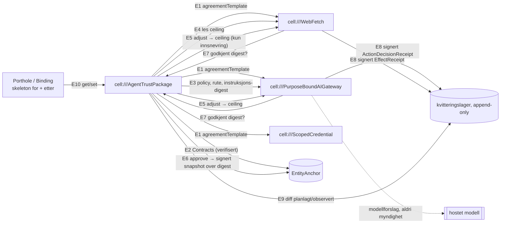

# Dataflyt — AgentTrustPackage

Kant-tabellen med kontraktreferanser står i `PLAN.md#dataflow`. Ingen kant går fra modellen til noen celle: modellen leverer tekst til AIGateway, og alt AIGateway gjør videre er begrenset av Grants/ceilings som pakken viser.
