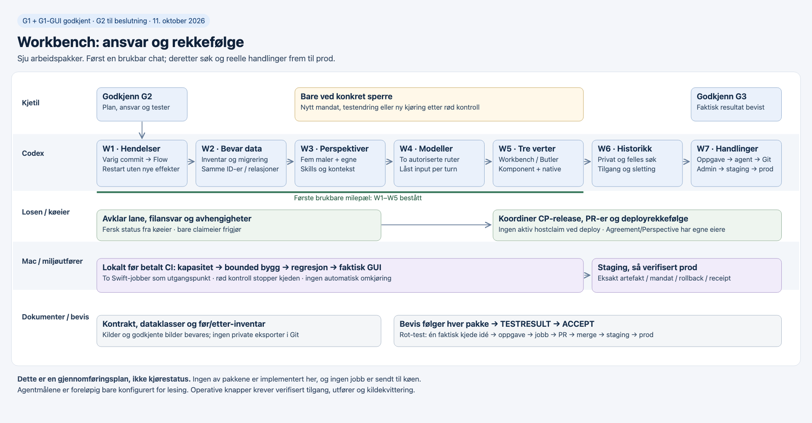

# Gjennomføringsplan — Workbench fra samtale til dokumentert utføring

2026-10-11 · G2-forslag v1 · G1 og G1-GUI godkjent. **Ingen av arbeidspakkene er implementert i denne oppgaven.**

## Dette skal du gjøre

| Når | Hva | Hvorfor |
|---|---|---|
| Nå | Godkjenn G2 for denne planen, eller angi en konkret endring. | Dette bestemmer rekkefølge, ansvar og tester for de sju godkjente bladformålene. |
| Bare når en faktisk sperre oppstår | Avgjør endring av en allerede committet test, ny kjøring etter en rød kontroll, eller et manglende mandat som arbeidet faktisk trenger. | Gjeldende stoppregler gjelder. Eksisterende godkjenninger brukes innenfor sitt omfang; ingen rutinemessig ny godkjenning. |
| Ved ferdig funksjonsprøve | Se forventning mot faktisk resultat og godkjenn G3. | Kjørende flater, faktisk modellbruk, historikk og utførerkvitteringer skal være demonstrert. Produksjonsordre bruker gjeldende, konkret miljømandat. |

**Første brukbare milepæl:** varig samtale, fem perspektiver og egne pakker, to autoriserte modellruter og riktig tekst i alle tre verter (W1–W5). Deretter søk med tilgangskontroll (W6) og alle reelle arbeids- og releasehandlinger (W7). Hele kjeden til prod er sluttmålet; en avskrudd knapp teller ikke som ferdig handling. Delmilepæler gir tidligere bruk, men erstatter ikke samlet akseptanse.

## Startgrunnlag og begrensninger

- De 54 godkjente GUI-bildene beholdes uendret. `evidence/g1-gui-approval.json` binder godkjenningen til manifestet. Ny faktisk UI sammenliknes med dem.
- Oppdatert kildegrunnlag og lesebegrensning står i `evidence/g2-source-refresh.md`. Kildekode er ikke live-bevis. CellScaffold main har gått videre uten endringer i de særskilt sammenliknede Helper-, WorkItems-, PersonalCopilot- og rendererområdene.
- Nåværende AgentD-mål tillater bare `state/query`; `remoteAccessVerified=false`. Første dataoperasjon trenger verifisert mål, eier og faktisk tilgang. Ingen ny modellkjøring, arbeidsordre eller deploy er startet her.
- Agreement #314 er fortsatt utkast. Perspective/Flow er en egen oppgave før implementering. Gjenbruk av disse avklares med eierne før overlappende filer endres. Eksplisitt perspektivvalg bygges uten å vente på automatisk kontekstbytte; automatikk kobles til den eksisterende Perspective-leveransen og testes før hele omfanget lukkes.
- De primære checkoutene inneholder andres arbeid. Produktendringer skjer etter G2 i rene, forvaltede worktrees fra verifisert main, med grenprefiks `codex/`. Ingen bred staging av eksisterende mapper.
- Målt ledig Mac-plass var omtrent 89 GiB på et 926 GiB filsystem. Dette er ingen byggetillatelse: den prosjekterte kapasitetstesten krever både 40 GiB og 10 prosent. Bygg er avhengig av at den faktiske testen passerer. Vertens kapasitet og aktive claims må måles på nytt før vertarbeid.
- Denne planen velger kontrakter, tester og avhengigheter. Ingen dato for ferdig prod loves før kapasitet, faktisk brukerforbindelse og utførerne er bekreftet.

## Arbeidspakker, én per bladformål

Prefiks for `purposeRef`: `purpose://candidate.workbench-perspective-chat.`. Utfører betyr ansvar for å levere; en fremtidig køjobb er ikke allerede innsendt.

| ID / formål | Avhenger av | Utfører | Det brukeren får | Primær avledet test |
|---|---|---|---|---|
| W1 · `events` | G2 | Codex; godkjent Mac-kø for bygg | Varige, sammenhengende hendelser og ærlig status etter avbrudd | test.events |
| W2 · `continuity` | W1; før første ny dataskriving | Codex, med eiers eksisterende datamandat | Eksisterende sett, meldinger og arbeidsrelasjoner bevart | test.continuity |
| W3 · `perspectives` | W1, W2 | Codex; koordinert med Perspective- og Agreement-eier | Fem ferdige perspektiver, egne pakker og versjonsvalg | test.perspectives |
| W4 · `models` | W1, W2, W3 | Codex; eksisterende AIGateway-utfører | Valgt, autorisert modell med synlig mottaker og faktisk rute | test.models |
| W5 · `embedding` | W1–W4; delt bridge-kontrakt ved behov | Codex i CellScaffold/CellProtocol/Binding | Samme samtale i Workbench, Butler og komponent; lokale utkast | test.embedding |
| W6 · `history` | W1–W5 | Codex; eksisterende Entity/Chronicle-lagring | Tilgangsstyrt tekst- og formålssøk og eksplisitt deling | test.history |
| W7 · `actions` | W1–W6; autoriserte utførere | Codex; Losen eier køkoordinering; miljøets utfører gjør effekten | Oppgave → agent → Git → Admin-deploy med reelle kvitteringer | test.actions |

Rekkefølgen er bevisst sekvensiell som utgangspunkt. Lesing og dokumentarbeid kan skje under venting; overlappende kode- eller deployarbeid starter ikke uten at fil- og køeierskap er avklart. `plan.json` inneholder fullstendige refs og test-/artefaktkoblinger. Rotformålets `test.end-to-end` er samlet sluttkontroll, ikke en åttende arbeidspakke.

### W1 — Hendelser og varig tilstand

**purposeRef:** `purpose://candidate.workbench-perspective-chat.events`.

Utvid eksisterende Helper/Chat-komposisjon med en eksplisitt session, stabil commandID, forventet revisjon, immutable turn og varig effektforsøk. Bruk cellenes Meddle/Explore og Flow. Avklar først den konkrete Entity-lagringens transaksjonsgrense med en crash-prøve. Enten lagres tilstand og hendelseslogg i én atomisk grense, eller én autoritativ journal styrer gjenoppbygging og en varig outbox. En løs dobbeltskriving som kan gi «lagret» med tapt historikk er ikke tillatt.

Publiser Flow først etter varig commit; Chronicle/søkeprojeksjon kvitteres separat hvis den er asynkron. Vis «historikk venter» ved etterslep. Abonnement etableres før snapshot, innkommende hendelser buffers, og revisjon/cursor avstemmes. Gap hentes via avgrenset eventsSince; hvis historikken er kompaktert hentes nytt snapshot. Replay bruker en ren reduksjon uten eksterne kall. Reconnect-polling blir ikke hovedmekanismen.

**Tester:** `test.events`, kontraktfixturer og negative tilgangstester. Faktisk Flow ved melding, perspektiv, modellresultat, forslag, kvittering og feil. Duplikat, gammel revisjon, gap, snapshot-race, crash før/etter commit/outbox, og forfalsket emitter. Samme commandID/annen payload avvises. Replay gir samme tilstand og null nye modell-/jobb-/Git-/deploykall.

**Leveransebevis til §3:** domenekontrakt og Explore, journal-/snapshot-fixturer, målt restart/Flow-spor i `TESTRESULT.md#events`, dokumentert lagringsgrense og begrensninger. Alle produktbevis gjenstår.

### W2 — Bevar eksisterende arbeid før nye skriverier

**purposeRef:** `purpose://candidate.workbench-perspective-chat.continuity`.

Bekreft faktisk requester og kjetil2-mål først. Lag et tilgangsbeskyttet før-inventar og gjenopprettbar eksport gjennom godkjent eiergrensesnitt. Ikke legg privat tekst eller rå eksport i Git. Registrer objekt-ID-er, revisjoner, antall, relasjoner og kontrollsummer i en sanitert kvittering. Kartlegg versjonerte Helper-sett og det bevarte meldingsvinduet; allerede slettet tekst får eksplisitt mangler-markering. Behold prosjekt- og WorkItem-ID-er samt idé-TTL/avhengigheter.

Migrering har dry-run som standard, deterministisk gammel→ny-ID-kart, ett varig checkpoint per kilde og schemaVersion. Ingen sletting eller destruktiv tilbakeskriving. Gjenopptak etter avbrudd skal oppdage fullført import, ikke duplisere samtaler/oppgaver. Gammel leser beholdes til kompatibilitet og tilbakeføring er prøvd. Før etterfølgende ny skriving må før/etter-kvitteringen stemme. Import av øvrige historiske dokumenter/tråder er eget kildeinventar med proveniens; denne migreringen hevder ikke å ha rekonstruert alle tidligere chatter.

**Tester:** `test.continuity`, import av private/delte pakker, resterende 30-meldingsvindu, tomt/ufullstendig datasett, revokasjon under migrering, avbrudd og identisk kjøring på nytt. Gjenopprett et avgrenset testdatasett fra eksport og kontroller relasjoner. Prøv eiers faktiske gjenåpning; syntetiske data alene er utilstrekkelig.

**Leveransebevis til §3:** sanitert migreringsrapport, mapping/checkpoint og gjenopprettingskvittering i `TESTRESULT.md#continuity`; privat eksport ligger kun i valgt, tilgangsstyrt lagring og refereres med ugjennomsiktig ID.

### W3 — Perspektiver, skills og kontekst

**purposeRef:** `purpose://candidate.workbench-perspective-chat.perspectives`.

Gjenbruk versjonerte Helper-sett. Utvid pakken med formålsrefs, instruksjoner, versjonerte skills, eksplisitte kontekstkilder og begrensninger. Lever fem maler: idéutvikling, CellConfiguration/Skeleton, formålstrær, Agreement og idé→prod; brukeren kan kopiere/lage eget. Ukjent skill-/kontekstref vises som feil, ikke tomt vellykket sett. Vis resolved revisjon/hash og tillatt kontekst før modellkall. Pakken gir ingen nye rettigheter. Ny versjon endrer ikke aktive turns eller godkjente forslag i skjul.

Valg av perspektiv gjelder sessionens bekreftede tilstand og sjekker forventet revisjon. Utkast er per montering. To samtidige endringer viser revisjonskonflikt. Privat lagring og deling av en bestemt versjon er separate operasjoner. Skill-tekst fra repoer eller historikk behandles som kontekst, ikke som autoritet til å omgå mandatet.

Automatisk kontekstrelevant forslag/valg gjenbruker Perspective-trådens eierkonfigurerte regler, og får årsaksref og forklaring. Hvis avhengigheten ikke leverer, er akkurat automatikkdelen blokkert; den markeres ikke implementert og dupliseres ikke. Agreement-malen kan forklare og foreslå; nye grants/signering må bestå den faktiske avtaleprøven.

**Tester:** `test.perspectives` for alle fem maler, egendefinert pakke, reload, versjonsbytte, to eiere, ulovlige refs, revokasjon, konflikt og uendret tilgang. Koble og prøv automatikk med den faktiske Perspective-leveransen uten eventsløyfe eller effekteskalering.

**Leveransebevis til §3:** versjonert pakkeskjema/Explore, standardpakker, pakkeredigerer, faktiske skjermbilder og `TESTRESULT.md#perspectives`.

### W4 — Modellvalg med målbar datagrense

**purposeRef:** `purpose://candidate.workbench-perspective-chat.models`.

Bruk AIGateway sine ruter og formålsbundne invokasjon. Vis bare relevante ruter med presis tilgjengelighetsgrunn; valgt route/provider/model og godkjent inputmanifest fryses per turn. En servervalidert binding må omfatte requester, domene, formål, dataklasser, budsjett og mottaker. Bruk Entity/Cell-eide credentialreferanser; skill retten til å bruke en rute fra å lese/rotere nøkkelen. Ingen nøkkel i prompt, logg eller kildekode og ingen miljøvariabel som skjult fallback.

To tilgjengelige autoriserte ruter skal demonstreres; planens eksempler binder ikke brukeren til to nye abonnementer. Hvis bare én faktisk finnes, er modelltesten blokkert med navngitt mangel. Hvert svar dokumenterer faktisk provider/model/route og inputmanifest. Bytte av modell eller perspektiv berører neste turn; et sent svar beholder original binding og merkes. Avbryt gir dokumentert best effort fra utføreren, ikke en påstand om at eksternt arbeid aldri skjedde. Manglende kvote, avslag, frakobling og ukjent utfall vises uten skjult ekstern fallback.

**Tester:** `test.models`, autorisert/revoked rute, kvotegrense, endret mottaker/kontekst, avbrudd/sent svar, restart ved ukjent utfall og faktisk modellkvittering fra to ruter. Kostnadstak kontrolleres før forsøket med det eksisterende mandatet.

**Leveransebevis til §3:** modellvelger og invokasjonsadapter, privat inputmanifest med sanitert receipt, faktiske svar og `TESTRESULT.md#models`.

### W5 — Én komponent og tre verter

**purposeRef:** `purpose://candidate.workbench-perspective-chat.embedding`.

Bygg de godkjente CellConfiguration-/Skeleton-flatene med eksisterende renderer og Workbench-tema. Lag en full koblingstabell for kandidat-keypaths i `images/action-inventory.json`. I W5 implementeres og prøves chat, pakker, modellvalg og vertsnavigasjon. Historikk-/effekthandlingene får foreløpig en deklarert binding og presis utilgjengelighetsgrunn; de aktiveres og får faktisk Explore-/GUI-aksept i W6 og W7. W5 krever ikke ferdige W6/W7-domener. Ingen kandidatknapp teller som ferdig bare fordi den kan klikkes. Bevar den tydelige forskjellen mellom Developer og Admin.

Lukk det påviste inputgapet: Porthole har flush på vanlig toppnivå, men monterte handlinger returnerer før den flushen. Child-rendereren videresender ikke alle felt-/payloadhooks i det leste snapshotet. Den nye kontrakten binder siste rå feltverdi og feltsekvens til riktig mount/session ved Send og Lagre; den samme feltkontrakten brukes for Søk når W6 leverer det. Verten sender en komplett, validert kommando uten å stole på en forsinket debounce. Domenelaget sjekker både utkast-/pakke- og sessionrevisjon. Ikke bruk global «aktiv samtale» som ruting.

Faktiske lokale typer er `ScaffoldKit.ComponentActionMount` og `ComponentActionContext`; det eldre navnet `SkeletonComponentActionContext` i spekken er en planreferanse, ikke bevis på main. Native har `SkeletonNativeActionRequest/Scope`. Del nødvendig mount-kontrakt på riktig eksisterende protokollnivå, med separate metadata utenfor brukerpayload, og integrer i den delte Bridge. Nåværende webadapter avviser fjernkilder med mount: dette må løses og verifiseres for native↔server. Ingen egen REST-/WebSocket-omvei.

En dedikert native monteringshandler må ikke fange vanlige URL-knapper. Bevar GET uten payload versus SET med eksplisitt null. Kildens nil fra SET betyr ukjent utfall; nåværende adapter som normaliserer det til `ok:true/result:null` kan ikke brukes som effektkvittering. Fiks den berørte adaptergrensen med regresjonsbevis, uten å endre globale Meddle-semantikker på gjetning. Manglende/ugyldig metadata, proof eller bridge-støtte skal avvises.

**Tester:** `test.embedding` i Porthole og faktisk Binding/native. Samme session i tre verter deler bekreftet modell/perspektiv/historikk, to sessions isoleres, mount A/B har ulike utkast. Skriv→Send/Lagre uten Enter, rask klikk/debounce, null/get, write-then-nil, avmontering/reconnect/revisjonsrace og ekte NSWindow-klikk på to monteringer pluss en umontert URL. Bruk faktisk requester gjennom lokal og remote Bridge; test eier og nektet requester.

**Leveransebevis til §3:** portabel komponent, vertsbindinger, prøvd Explore/action-mapping for W1–W5 og deklarert binding for W6/W7, lys/mørk/smal/bred skjermbilder, sammenlikning med godkjente bilder, lastetid ≤5 s ved tre reelle målinger og `TESTRESULT.md#embedding`. Første bruksmilepæl åpnes bare når W1–W5 er bevist.

### W6 — Privat og felles historikk

**purposeRef:** `purpose://candidate.workbench-perspective-chat.history`.

Gjenbruk Entity/Chronicle som varig historikk der den konkrete kontrakten er verifisert; legg nødvendig søkeprojeksjon bak samme requester-/publikumsgrense. Journalen fra W1 er autoritativ ved replay. Deling lager en egen, minimal prosjektoppføring fra valgt innhold med mottakere og kilde; endrer ikke tidligere private turns til felles. Formålslikhet styrer rangering, aldri tilgang.

Filtrer autorisert corpus før snippets, count og rangering. Kontroller rettighet igjen ved åpning, modellbruk og cachetreff. Indeks, embedding, cache og sletting følger payloadens klasse og publikum. Utledede indekser er gjenoppbyggbare og får ikke forlenge beholdning. Kilderevokasjon ugyldiggjør tilgangen umiddelbart; vis etterslep i fysisk opprydding ærlig. En separat delt oppføring følger sitt eksplisitte publikum og slettepolicy; ingen antakelse om at en løsnet lenke automatisk kan trekke tilbake en allerede gitt kopi.

`contract/retention.json` skiller mellom privat chat/kontekst, privat pakke, minimal prosjektkvittering og utledet indeks. Bruk eksisterende eksplisitt policy per klasse, ikke en ny oppfunnet standardperiode. En klasse uten avklart policy blokkerer ny vedvarende innsamling i den klassen til eierens valg er registrert. Planen innfører ingen automatisk sletting av arbeidskvitteringer eller migreringskilder. Idé-TTL og avhengighetsvern gjelder fortsatt idéen.

**Tester:** Aktiver historikkens kandidat-actions fra koblingstabellen og prøv faktisk skriv→Søk uten Enter i alle tre verter, med paritet og reachable actions. `test.history` med to personer og ett prosjekt; tekst og formål, snippets/counts/cache/embeddings/modellinput før/etter tilbakekalling. Appendfeil/restart skal oppdages; søk viser indeksetterslep, ikke falsk «ingen historikk». Test retention/purge på payload og alle avledninger uten at en replay gjenoppretter slettet tekst.

**Leveransebevis til §3:** privat/delt historikkflate og query-kontrakt, tilgangs- og retentionmatrise, sanitert revokasjons-/restartbevis i `TESTRESULT.md#history`.

### W7 — Reelle handlinger til og med prod

**purposeRef:** `purpose://candidate.workbench-perspective-chat.actions`.

Lever alle radene i `SURFACE_ACTIONS.md` gjennom autoriserte eksisterende domeneoperasjoner. Gjør konkrete adaptergap til arbeid: AgentRun-projeksjon er ikke jobbutfører, og GitHubWorkSync sin import er ikke repo-lesing eller PR-merge. Før submit må AgentD-mål og faktiske grants være verifisert. «Utfør prompt» er eksplisitt enten modellturn eller agentjobb. Claude, Codex og andre klienter vises bare som kjørbare når en installert, autorisert executor kan kvittere for akkurat den jobben; appnavn alene er ikke executorstøtte.

En forhåndsvisning binder workItem/prosjekt, executor, workspace/repo/ref, tillatte operasjoner/filer, miljø, formål, budsjett og proposalhash. Knappen bruker eksisterende gyldig mandat og revaliderer ved dispatch. Manglende mandat gir konkret sperre. Godkjent proposal reserveres varig før await. Tap av submit-svar blir ukjent utfall; slå opp samme commandID/attemptID hos utføreren før ny effekt. Registrering, køet, startet, ferdig, merge og deploy er ulike statuser.

Repo-lesing bruker verifisert prosjektbinding og avgrensede paths/ref. Merge krever eksakt PR/head/base, lokale og påkrevde remote checks, review og gjeldende grant; endret head/base ugyldiggjør tilbudet. Faktisk GitHub-receipt dokumenterer merge-SHA. Modelltekst og loggimport kan aldri sette «merged» eller «deployed». Nødvendige nye effektceller følger vanlig Explore/resolver, uten vilkårlig shell fra modellen.

Admin mottar den verifiserte releasen med immutable digest og miljøordre. Losen har kørekkefølge og claim-eierskap; miljøets autoriserte utfører bygger/deployer. Deploy bruker eksisterende kanal, backup, rollback-kandidat og reell funksjonsprøve. Det finnes ingen generisk undo for merge/deploy. Delvise utfall har eksplisitt status og oppfølging. Board, portefølje, Studio, formål, Agreement, kø, historie og tre chatverter prøves via den samme handlingskontrakten.

**Tester:** Aktiver effekthandlingene fra koblingstabellen og dokumenter full runtime-/GUI-/Explore-aksept per flate og vert. `test.actions` positiv og separat negativ prøve for hver flaterad, dobbeltklikk, revoked grant, endret PR-head/base, ukjent submitutfall, avbrudd/restart og ingen doble effekter. Registrer evidence per rad. Deretter `test.end-to-end` gjennom én faktisk autorisert idé → oppgave → agentjobb → PR → review/merge → staging → prod via Admin, med ID-er og kvitteringer gjenåpnet etter restart. Automatisk Perspective-integrasjon, alle executoradapters og faktisk prod må være bevist før hele oppgaven erklæres ferdig.

**Leveransebevis til §3:** operative actions, utførerkontrakter, action-matrisens kildekvitteringer, PR-/releasekoblinger og `TESTRESULT.md#actions` / `#end-to-end`; `ACCEPT.md` sammenholder alle §3-radene med kjørende resultat.

## Dataflow

Detaljert diagram og kant→kontrakt er i `dataflow.md`; maskinlesbar skisse i `contract/workbench-v1.json`. Kontraktene er **foreslått**, ikke nye verifiserte API-er. W1/W5 oppdaterer dem mot implementert Explore/wire og Golden fixtures; endring av godkjent brukeroppførsel krever en datert planendring.

Sentrale grenser: (1) hostmetadata er ruting, ikke autoritet, (2) modellen gir forslag, (3) ansvarlig celle autoriserer, (4) varig commit før Flow, (5) executor kvitterer for effekt, (6) bare tillatt projeksjon kan bli felles eller gå til valgt modell. Ingen ny global event-bus.

## Lokal verifikasjon før CI

Før første bygg: frisk køstatus og navngitt lane/claim fra køeier, rent kildegrunnlag, baseline-SHA, eksakt CP-versjon, manifest over forventede endrede filer og kapasitet på utførermaskinen. Ingen antakelse om at et gammelt koordinasjonsnotat betyr ledig kø. To Swift-jobber som utgangspunkt.

| Kontroll | Utføring etter G2 | Godt nok først når |
|---|---|---|
| Planstruktur | `python3 checks/validate_plan.py` | Sju blader dekket nøyaktig én gang, DAG, alle §5-tester og artefakter koblet. Dette er dokumentkontroll. |
| Kontraktfixturer | `python3 checks/validate_contract.py` | Planens eksempler er konsistente. I implementering erstattes/suppleres dette med reell encode/decode/Explore- og lagringstest; dokumentkontroll alene passerer ikke `test.cell.contract-fixtures`. |
| Literal- og diffkontroll | `bash ci/check-value-literals.sh`, `git diff --check`, forventet filliste og omfang | Ingen ny >20-literal eller ukjent fil. Baselinegjeld i berørte filer reduseres. |
| Bounded Swift | `scripts/check_build_capacity.sh`, deretter `scripts/run_swift_bounded.sh build` og `scripts/run_swift_bounded.sh test` i aktuell ren repo | Full bygg-/regresjonslogg, exitstatus og testantall før/etter. Ingen direkte swift-kommando eller ad hoc scratch-path. |
| Native / reachability | Repoets `scripts/xcode-check.sh` med avtalt workspace/scheme; i Binding også `-only-testing:BindingTests/CellConfigurationVerifierXCTest/testNoLocalSurfaceHidesItsOwnWaysIn` | Faktisk mål og argumenter først kontrollert mot skriptets help/kilde; faktisk UI og reachable actions. Kommandoene er en plan, ikke en kjørelogg. |
| Web | Berørte Node-tester, bl.a. component-source-action og ny mount/drafttest, deretter faktisk Porthole | Ekte typed→Send/Save/Search og tre målinger, ikke fixture-klikk alene. |
| Tilgang / historie / utfører | §5 og W1–W7, med separate negative requester-prøver | Alle effekter og datagrenser bevist i riktig miljø med faktiske receipts. Ukjørt er `blocked`. |
| Før push / CI | Uavhengig review av diff og samlet lokal evidens; eksakt testet SHA og manifest; køeier avstemt | Lokale relevante kontroller og full regresjon grønne. Først da betalt CI. Ny kode krever nytt passende bevis. |

Alle standardtester fra §5 eies også av arbeidspakkene i `plan.json`: build/regression, docs/status, GUI-referanser/paritet/lastetid, reachability/actions, kontraktfixturer, auth-negative/stub-scan og dataflow/capabilityaudit. Celle-replay/auth-tester skrives i nye testfiler så langt mulig. Ingen eksisterende test svekkes eller endres uten den særskilte avklaringen nedenfor.

`TESTRESULT.md` får ett avsnitt per testref med kilde-SHA, kommando/miljø, faktiske utdata og pass/fail/blocked. Testresultater blir skrevet når testen er kjørt; denne planen lager ingen grønne produktresultater. Globale PDD-registerfeil er separate dokumentfeil og står fortsatt åpne i evidensen.

## PR-er, pakkeversjoner, utrulling og tilbakeføring

1. W1–W7 gir avgrensede reviewbare PR-er når avhengighetene tillater det; docs og tester følger koden. Knytt workItem, purpose, command/job og testbevis til hver PR. Alle PR-er opprettet her festes til denne Codex-chatten. Ingen direkte landing fra en gammel eller uren checkout.
2. Delte mount-/bridgeendringer i CellProtocol verifiseres først mot publisert baseline og lokal kandidat på både Swift-server og native. Land CP via avtalt kø, publiser immutable release og oppdater nøyaktig versjon i konsumentenes `Package.swift` og `Package.resolved` i egne PR-er. Nåværende CellScaffold-pin er `2026.9.7`; neste nummer bestemmes av releaseeier, ikke av planen. Lokal override er aldri releasebevis.
3. Hvis de avhengige PR-ene ikke er merged, bruk eksplisitte kandidatrevisjoner kun i lokal integrasjon. Ikke skriv en upublisert versjon til main. Kontroller macOS/Linux og native konsumenter før pin-PR-ene merges. Betalt remote CI kommer etter lokale bevis.
4. Bygg én identifiserbar releasekandidat med SHA/digest og migreringsversjon. Deploy til staging via Admin/kø, prøv eierens faktiske flyt samt annen requester, restart, historikk og alle nye knapper. Ingen påstand om deploy fra Git-status alene.
5. Før prod: stagingbevis, gjeldende konkret produksjonsmandat, ingen hostclaims, verifisert kapasitet, backup, kompatibilitet og kjent tidligere digest. Bruk samme testede artefakt der miljøet tillater det. Utfør faktisk produksjonsfunksjonsprøve og lagre release-/deployreceipt. G3 gjelder når alle forventningsrader er bevist; et gjennomført testmiljøløp erstatter ikke prod.
6. Første migrering er additiv. Slå av nye innganger ved regresjon, bevar journal/data og stans ny dispatch. Gå tilbake til forrige binær bare når nedoverkompatibel lesing er bevist. Ikke rull database tilbake over nyere brukerdata; bruk testet fremoverrettet korreksjon ved inkompatibilitet. Et uklart effektutfall undersøkes mot samme forsøks-ID før restart. Konkrete rollbackkommandoer og gjenoppretting testes og registreres før berørt deploy.

## Stoppregler og videre arbeid under sperrer

- G2 er ikke registrert ennå; produktimplementering venter. G1-GUI er allerede godkjent og spørres ikke om igjen.
- **Enhver endring av en allerede committet test**, også vår egen fra samme dag, krever Kjetils avklaring først. Nye testfiler kan legges til innenfor G2. Et påvist hull i en eksisterende test beskrives konkret før eventuell endring.
- **En rød kontroll stopper den berørte kjøre-/leveransekjeden**, også HTTP-kode 000. Dokumenter første feil. Ikke kjør kontrollen på nytt uten Kjetils ord. Uavhengig lesing, feilanalyse og konkret rettelsesforslag kan fortsette; ikke omgå kontrollen via en annen kommando.
- **Enhver claim på verten stopper deploy**, uansett tjeneste. Bare claimeieren frigjør. Ikke tøm andres kø eller ta over lane i stillhet.
- Kapasitetsgrensen omgås ikke. Kun tidligere autorisert, verifisert regenererbart innhold kan ryddes gjennom gjeldende guards; ikke manuelt slette cacher/bygg eller private kilder.
- Manglende reell utfører, scope/proof, dataklassepolicy eller kvittering blokkerer den berørte funksjonen. Et bredere mandat, signering eller ny datamottaker kan ikke utledes av perspektivvalg eller G2. Bruk tidligere gyldig autorisasjon der den allerede dekker effekten.
- Ny global protokollsemantikk, destruktiv migrering eller vesentlig endring av det godkjente GUI-/formålsomfanget tas tilbake med konkret diff og ny begrunnelse. Inkrementell implementering innenfor denne planen krever ikke en ny port for hver fil.

## Artefakter og overlevering

- `plan.json`: sju bladpakker, avhengigheter, alle avledede tester og §3-bevis.
- `dataflow.md`, `contract/workbench-v1.json`, `contract/fixtures.json`, `contract/retention.json`: foreslåtte grenser, eksempeldata og policykrav.
- `handoff/README.md`: forberedelse til køeier og utfører. **Ikke innsendt eller kvittert av køen.** Ingen kjørbar deployordre inngår i G2-dokumentet.
- `checks/`: avgrensede dokumentkontroller og bevisfiler. Ikke produkt- eller sikkerhetssertifisering.
- `images/plan-g2-v1.html`, `.png` og `evidence/plan-image.json`: diagrammet for denne planen, separat fra godkjent produkt-GUI.
- `G2_INDEPENDENT_REVIEW.md`: uavhengig kontroll før planen legges frem. Manglende kontroll skal fremgå eksplisitt inntil den er utført.
