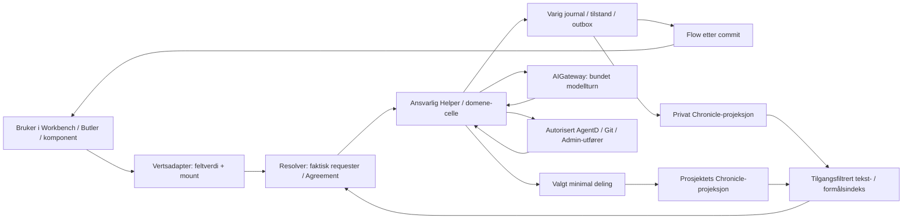

# Dataflyt — forslag før implementering

2026-10-11. Disse kantene er planlagte integrasjoner. Kildegrunnlaget viser noen byggesteiner; det beviser ikke den sammensatte kjeden. Ingen ny global event-bus eller egen chattransport.

Mermaid er en oversikt. Pilene tilbake fra Gateway/utførere går gjennom validering og korrelasjon i ansvarlig celle; rå modelltekst får aldri utgi seg for dispatch-/releasekvittering. Indekssøk kontrolleres ved inngang og på nytt ved resultatbruk.

## Kant → kontrakt og adgang

| Kant | Kontrakt i contract/workbench-v1.json | Ansvarlig grense | Bevis / arbeidspakke |
|---|---|---|---|
| Vert → sessioncelle | command + mountContext | Resolver får faktisk requester. Mount binder instans/session, aldri identitet eller grant. Tillatt rå feltverdi fanges atomisk ved knapp. | to mounts, raw text, stale revision, GET/null/ukjent SET; W1/W5 |
| Lokal/native vert → fjerncelle | samme command + separat transportmetadata | Eksisterende Bridge må kunne bevare source/mount; ellers avslag. Ingen fallback til default-vault-eier. | godkjent og nektet remote requester, uendret payload/metadata; W5 |
| Celle → lagring | event + commitReceipt + outbox | Autoritativ commit før «lagret». Konkret transaksjon/journal bevises; ingen antatt Chronicle-atomicitet. | crash før/etter commit og varsel; W1 |
| Lagring → Flow → klient | eventNotification + snapshotCursor | Flow-envelope-emitter kontrolleres mot løst kildecelle og mål, ikke en tillitsfull JSON-streng. Payload skjermes før publisering. | dup/gap/snapshot-race/reconnect; W1/W5 |
| Klient → snapshot/eventsSince | query + snapshotCursor | Samme owner/project/purpose/Agreement-scope som data. Retention-gap gir eksplisitt snapshotkrav. | fremmed requester, tilbakekalling, gap; W1/W6 |
| Pakke/kontekst → turn | packageRevision + turnBinding | Kun autoriserte, versjonerte refs. Låst manifest/provider/datagrense/budsjett. Pakke er ikke capability. | fem maler/custom og revokasjon; W3/W4 |
| Celle → Gateway → svar | turnBinding + invocationReceipt | Gateway kontrollerer formål, mottaker, kvote og credential-use; actual route/model korreleres. | to faktiske ruter, avslag/late svar/nofallback; W4 |
| Forslag → utfører → receipt | actionProposal + effectAttempt + effectReceipt | Ny kontroll ved dispatch, varig reservasjon, eksakt repo/head/miljø. Kildeutfører eier status. | doubleclick/revoked/stale/unknown/restart; W7 |
| Privat kilde → delt oppføring | shareProjection | Eksplisitt valgt publikum og payload, egen ID/policy. Ikke privat råprompt som standard. | to personer, ingen utilsiktet deling; W3/W6 |
| Historikk → indeks → søkeresultat | query + historyResult | Tillatt corpus før rangering/count/snippet. Samme grense for embeddings/cache/modellinput. | revokasjon/purge/projeksjonsetterslep; W6 |
| V0 lagring → V1 journal | migrationReceipt | Dry-run, owner-scope, deterministisk ID-map og checkpoint. Ikke rekonstruer ukjent fortid. | restart/idempotens/eksportgjenoppretting; W2 |
| Releasekandidat → Admin → miljø | releaseIntent + effectReceipt | Køeier, miljømandat, checks, claims, kapasitet, backup, digest og funksjonsprøve. | faktisk staging/prod og restartutlesing; W7/root |

## Ordre, lagring og varsel

1. Verten validerer montasjebinding og fanger siste utkast ved brukerhandlingen; serveren stoler ikke på klientens requesterfelt.
2. Resolver/domenegrense sjekker autentisert requester, handling, objekt, miljø, relevant Agreement og forventet revisjon. CommandID-hash sjekkes før ny effekt; samme ID/annen kommando avvises.
3. Autoritativ journal lagrer tilstandsendring og utgående hendelse sammen, eller én journalpost er autoritet for begge. W1 må dokumentere faktisk valgt implementering og crashbevis før godkjent «lagret».
4. Flow distribuerer bare bekreftede hendelser innenfor publikummet. Historikk-/søkeprojeksjon melder egen cursor; etterslep er synlig.
5. En sideeffekt krever en separat varig attempt og dispatch. Replay reduserer tilstand; det kaller aldri denne dispatchveien.
6. Ukjent utfall fryser automatisk resend. Les eksisterende attempt/ekstern ID; manglende støtte for oppslag er en konkret adapterbegrensning, ikke grunn til en ny jobb.

## Session, turn og mount

Session eier bekreftet perspektiv/modell/historikk. Mount har unik instanceID, definisjonsrevisjon og utkast/feltsekvens; to mounts av samme session deler ikke kladd. Binding kontrolleres ved dispatch. Et pågående turn har immutable pakkerevisjon, modell og inputmanifest selv om session endres. Reconnect henter bekreftet tilstand uten å distribuere private lokale utkast. Ingen statisk global «aktiv ID» brukes til handlinger.

## Retention og sletting

Se `contract/retention.json`. Eksisterende eksplisitt policy hentes før ny vedvarende innsamling, allerede i W1/W2; W6 legger søk og avledninger under den samme policyen. Ingen hardkodet ny periode, ingen automatisk migreringskildesletting og ingen gjenoppliving av slettet tekst gjennom journalreplay. En auditreferanse skal følge sin egen begrunnede policy og må ikke gjemme en kopi av råpayloaden.
