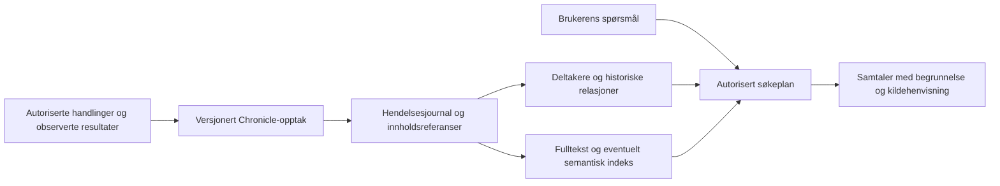

# Replay, celle-TTL, karantene, deinit og Chronicle — 2026-09-29

Kildebasert gjennomgang av lokale arbeidskopier. Beslutningseier: Kjetil.
Dette er en statusrapport og et arkitekturforslag, ikke en implementasjon eller produksjonsgodkjenning.

## Konklusjon

**OBSERVED:** Vi har reell kode for TTL, abonnementslivsløp, lokal flow-replay,
signerte entitetsjournaler og flere Chronicle-produsenter. Binding har både
personlig chat-opptak og relasjonshendelser. **NOT_FOUND_UNDER_CHECKS:** En samlet
Chronicle-tjeneste med effektivt, historisk relasjonssøk som kan finne «chatten
med to fra firma X» ble ikke funnet. [E01–E19]

**PROPOSED:** Bygg Chronicle som eierens varige hendelsesarkiv med en versjonert
opptakskontrakt, separate innholdsobjekter og gjenoppbyggbare søkeprojeksjoner.
Bruk strukturerte deltaker- og relasjonskoblinger til presise kriterier, fulltekst
til ord og tema, og eventuelt embeddings til semantisk rangering. Ikke la ett
stort entitets-JSON eller én embedding være hele hukommelsen.

De viktigste funnene før videre utbygging:

1. **OBSERVED:** `persistAndUnload` sjekker ikke returverdien fra
   `persistCellIfPossible` før den kaster resolverens referanse. Lagringsfeil
   hindrer dermed ikke eviction i denne banen. [E05]
2. **OBSERVED:** Ny relasjonsvalidering er koblet inn i Apple EntityAnchor, men
   ikke i den tilsvarende Vapor-banen. Plattformene har ulik kontrakthåndheving. [E16]
3. **OBSERVED:** Den nyere TTL-maskinen har timing wheel, lease/fencing og
   tombstones, men resolverintegrasjonen er shadow-modus. Den eldre sweep-banen
   avgjør faktisk eviction og sletting. [E04–E06]
4. **INFERRED:** Dagens fulle journalvalidering/replay og omskriving av både
   journal og entitet gir voksende arbeid per lagring. Dette er uegnet som
   ubegrenset Chronicle-arkiv uten endret lagringskontrakt; ytelsen er ikke målt. [E11]
5. **OBSERVED:** Chat-turner, relasjonshendelser og konferanseposter har forskjellige
   former. Relasjonshendelsen har ingen eksplisitt samtalereferanse eller
   deltakerliste; personlig chat har `threadID`, men ikke den historiske
   organisasjonskoblingen som eksempelspørsmålet krever. [E13–E17]

## Formål, mål og avgrensning

| Formål | Observerbart mål | Resultat |
|---|---|---|
| `purpose://source.methodology.current` | Gi alle fem etterspurte områder status med kode-/testankre. | Oppfylt for det avgrensede søket. |
| `purpose://digital-work.coordinate` | Skille eksisterende byggeklosser, integrasjonshull og foreslått Chronicle-retning. | Oppfylt; forslagene er ikke vedtatt. |
| Valideringsfasett `purpose://test.acceptance` | Angi hva som må bevises for eksempelspørringen og livsløpet. | Akseptansekriterier beskrevet; ingen tester kjørt. |

Merkelapper: **OBSERVED** = lest i kilden; **INFERRED** = begrunnet utledning;
**PROPOSED** = nytt forslag; **NOT_FOUND_UNDER_CHECKS** = ikke funnet innen
beskrevet søk; **UNKNOWN** = utilstrekkelig bevis. Testkode er ikke en grønn
testkjøring. Historiske testreferater er ikke verifikasjon av dagens arbeidskopi.

Rapporten bruker repoanalyseferdighetens bevisdisiplin. Omfanget er tilpasset
Kjetils uttrykkelige bestilling om flere repoer og vurdering av verktøy:
søskenrepoer er lest, og eksterne teknologipåstander er kontrollert i offisiell
dokumentasjon. Ingen panelrunde eller agentdelegering er utført.

### Lokalt kildegrunnlag

| Repo | Lokal branch / HEAD ved start | Dekning |
|---|---|---|
| CellProtocol | `pdd/tillitspakke-agentflaate` / `561d34a` | Hovedkilde: Swift resolver/lifecycle, flow, journal, Apple/Vapor-anker, sikkerhet og testkode. Arbeidskopien har endringer. |
| CellScaffold | `codex/entitetsutvidelse-20260929` / `942965ca` | Bootstrap, TTL-registreringer, Chronicle-produsenter, graf-, SQLite-, transcript- og RAG-kode. Arbeidskopien har endringer. |
| Binding | `codex/havenagentd-sentinel-remote-intent-icon-20260804` / `775fc93d` | PersonalChatChronicle, relasjonslager, chat-integrasjon og dokumenterte/testede kontrakter. Arbeidskopien har endringer. |
| CellProtocolDocuments | `codex/entitetsutvidelse-20260928` / `c802984` | Book og relevante leveranser. Arbeidskopien har endringer. |
| GoCellProtocol | `main` / `2f717dc` | Avgrenset replay-/livsløpssøk og lesing av `runtime.go`. |
| RustCellProtocol | `main` / `2bbdfe6` | Avgrenset replay-/livsløpssøk og lesing av `src/runtime.rs`. |
| PyCellProtocol | `main` / `5a6e19f` | Avgrenset søk og EntityAnchor-struktur. |
| HavenAgentD | `main` / `ba14895` | Søk etter Chronicle-/relasjonshendelseskobling i `Sources`; ikke en full daemon-audit. |
| DiMyDevRAG | `main` / `2d6e3ad` | Avgrenset søk etter relevante søkemotorbyggeklosser. Ingen antakelse om kjørt tjeneste. |

Søkt med `rg`/`rg --files`: `chronicle`, `replay`, `ttl`, `lifecycle`,
`quarantine`, `deinit`, deretter konkrete identifikatorer som
`RuntimeReplayPolicy`, `recordInteraction`, `EntityAuthorityJournalDocument`,
`lifecyclePolicy`, `FlowEnvelopeSigner`, `fts5` og `embedding`.
Søk etter `chronicle.search`, `chronicle.query` og `ChronicleCell` ga ingen treff
i de undersøkte kildekatalogene. Genererte bygg, avhengigheter, private
runtime-lagre, importerte adressebøker, arkiver og alternative worktrees er
ikke gjennomgått. Kallimachos-katalogen ga ingen Git-HEAD i inventaret og er
ikke vurdert som et eget versjonert runtime-repo.

Ingen fetch, bygg, avhengighetsoppløsning, tester, nettverkskall til drift,
private datalesninger eller kodeendringer. Remote branch-status og deploy er
**UNKNOWN**. Rapportens linjer gjelder arbeidskopiene under gjennomgangen;
andre oppgaver kan senere flytte dem.

## Status per område

| Område | Status i undersøkt kode | Grense |
|---|---|---|
| Lokal flow-replay | **OBSERVED: implementert, tester finnes.** `FlowCacheCell` har avgrenset prosesslokal buffer og sammenhengende overgang fra replay til live. [E01] | Ephemeral; ingen varig historikk ved prosessrestart. |
| Signert flowgrunnlag | **OBSERVED: implementert, tester finnes.** `FlowEnvelope`, hashing, signer/verifier og proveniens. [E02] | Ingen generell recorder/replay-motor eller produksjonskobling av signer/verifier funnet i undersøkte `Sources`. |
| Entitets-replay | **OBSERVED: implementert, tester finnes.** Hash-kjedet authority-journal, signerte receipts, idempotens/CAS, replay og replika-kontrakter. [E11–E12] | Gjenoppbygger journalførte entitetsmutasjoner. Beviser ikke alle eksterne handlinger eller en komplett tidslinje av hele entiteten. |
| Celle-TTL | **OBSERVED: implementert, tester finnes og konkrete scaffold-registreringer bruker den.** Minne- og persisted-TTL er separate. [E03–E07] | Policy må angis; ingen universell automatisk TTL for alle celler. Persisted-utløp varsler som standard. |
| Ny deterministisk TTL-motor | **OBSERVED: implementert komponent med tester; shadow-integrasjon.** Monotone ticks, timing wheel, CAS, leases/fencing, tombstone/grace. [E04, E06] | Ikke den autoritative fysiske slettebanen i resolveren; standard state/lease-lagre er i minne. |
| Karantene | **OBSERVED: implementert bridge-beskyttelse med tester.** Midlertidig blokkering, signeringsrate-limit og reautentisering. [E08] | Ikke funnet en generell cellekarantene med stop/drain, bevissnapshot, restart og godkjent gjeninntreden. |
| Deinit/opprydding | **OBSERVED: konkret ressursopprydding og tester.** Abonnementer, task-cancellation og enkelte transports/databasers close. [E09–E10] | Eviction fjerner én referanse; ARC kjører deinit først når alle sterke referanser er borte. Deinit er ingen durable commit-kvittering. |
| Chronicle-opptak | **OBSERVED: delvis implementert.** Personlige chat-turner, relasjonshendelser og flere konferansehandlinger. [E13–E17] | Fragmenterte produsenter/skjemaer, begrenset dekning, ingen automatisk Chronicle-sletting i PersonalChat-policyen. |
| Chronicle-gjenfinning | **NOT_FOUND_UNDER_CHECKS: samlet historisk søk mangler i undersøkte kilder.** | Per-relasjonshistorikk og grafbyggeklosser finnes, men ikke en verifisert kjede for eksempelspørsmålet. [E15, E18–E19] |

### Replay: hva kan faktisk gjenskapes?

**OBSERVED:** `DefaultRuntimeReplayPolicy` velger snapshot/event-log eller
blokkerer på tombstone, delete eller oppgitt sekvenshull. Den leser ikke selv en
logg, kontrollerer ikke at en logg eksisterer, og utfører ikke replay. Når ingen
snapshot finnes og ingen gap er oppgitt, returnerer den `replayFromEventLog`.
Ingen kall til denne policyen utenfor definisjonen ble funnet i undersøkte
produksjonskilder. [E04]

**OBSERVED:** EntityAuthority-replay er mer konkret: den validerer journalkjeden
og anvender lagrede keypath-mutasjoner. Ankrene verifiserer receipts før bruk.
Tester dekker manipulering, stale revisjon, mutation-ID-konflikt, avbrutt
snapshot-skriving og replika som ikke får kvittere uten lagring/read-back.
Binding-chat bruker `requiredReplicaAcks: 0`; dette er lokal authority-commit,
ikke bevis på distribuert varighet. [E11–E13]

**INFERRED:** Full historisk Entity-rekonstruksjon krever også et kjent
utgangspunkt og dekning av legacy-skriv som ikke ligger i authority-journalen.
Ankeret tillater en gren med `commitRequest == nil` som skriver snapshot uten
journalpost. Vi kan derfor ikke omtale journalen som komplett opptak av enhver
endring i dagens entitet. [E11]

**OBSERVED:** Go kopierer og sekvenskontrollerer en flowhistorikk i minne; Rust
anvender `state.set` mot snapshot/minnelager. Python har Chronicle-rot og
entitetsmutasjoner, men tilsvarende komplett Chronicle-/TTL-kontrakt ble ikke
funnet. Dette er ulik funksjonsdekning, ikke påvist replay-paritet. [E23]

**PROPOSED:** Skill eksplisitt mellom flow-buffer, state-replay, brukerhistorikk
og sikkerhetens anti-replay. Rekonstruksjon må være fri for utgående effekter:
den skal ikke sende en chat, invitere noen eller foreta et eksternt kjøp på nytt.
En loggført hendelse må angi om handlingen ble forsøkt, godtatt, utført eller
kvittert hos mottaker.

### TTL og deinit: integrasjonsarbeid gjenstår

**OBSERVED:** `ResolverLifecycleTracker` bruker `Date`, `lastAccessAt` og et
dictionariesweep. Dette er inaktivitetsbasert levetid, ikke en ufravikelig
slettefrist regnet fra opprettelse. Resolverens oppslag/touch fornyer levetid;
det er ikke påvist at all aktivitet gjennom en allerede beholdt cellereferanse
gjør det. `GeneralCell.ttl = 7776000` finnes, men har ingen videre bruk i de
undersøkte GeneralCell/resolver-filene. Det tallet beviser ikke 90 dagers
håndhevet levetid. [E03, E05]

**OBSERVED:** CellScaffold registrerer blant annet AssistantCorrespondence med
30 minutters minne-TTL og 120 dagers persisted-TTL, ContactEndpoint med 15
minutter/7 dager og ContactRegistry med 30 minutter/30 dager. Disse bruker
`persistAndUnload`, men velger ikke automatisk sletting ved persisted-utløp.
Testkoden dekker varsling, forlengelse, gjenlasting med samme UUID og eksplisitt
slettepolicy. [E07]

**OBSERVED / INFERRED:** Ved `persistAndUnload` ignoreres `Bool` fra
lagringshjelperen, og `memoryEvicted` publiseres likevel. Det finnes dermed en
konkret vei hvor snapshot ikke er bekreftet før referansen fjernes. Dette er en
kodeobservasjon, ikke en kjørt feilinjeksjon eller påstand om allerede tapt
brukerdata. [E05]

**OBSERVED:** `GeneralCell.deinit` er hovedsakelig logging, mens
`FlowSubscriptionResources.deinit` invaliderer levering og kansellerer
ressursene. Tre integrasjonstester bruker svake referanser og kontroll av
upstream-kansellering, også med blokkert mottaker og suspendert intercept.
Dette er reelt arbeid som allerede er gjort. [E09]

**PROPOSED:** Definer en eksplisitt, ventbar avslutning: stans nye oppdrag,
fullfør eller registrer uavklarte oppdrag, bekreft nødvendig lagring, avslutt
abonnementer og slipp referanser. Bruk deinit til siste ressursfrigjøring.
TTL-feil må beholde gjenopprettbar state og gi retry/varsel fremfor å hevde
vellykket lagring. Test at aktivitet, pågående arbeid og sterke referanser
håndteres før «unloaded» kan brukes som bevis på faktisk ressursfrigjøring.

### Karantene er foreløpig hovedsakelig sikkerhetsvern rundt bridge

**OBSERVED:** `CellSecurityContainmentController` holder karantener i minne med
utløp. Bibliotekets standardpolicy er `monitorOnly`; CellScaffold velger
`localProtection` utenfor testmiljø. Bridge sjekker karantene før relevante
operasjoner, og en test dekker avvisning før vault-signering. Dette er mer enn
bare observabilitet, men er ikke generell isolering av enhver celle. [E08]

**PROPOSED:** Avklar en egen cellekarantenekontrakt før vi bruker ordet bredt:
hvilke nye kall blokkeres, hva skjer med pågående oppgaver, hva oppbevares som
bevis, hvem kan oppheve karantenen, og hva gjelder etter restart? Karantene bør
kunne stoppe skadelige effekter uten samtidig å slette historikken som forklarer
hendelsen. Importert/usikkert materiale kan oppbevares i et autorisert
karanteneområde, men skal ikke inn i vanlig Chronicle-søk som et bekreftet faktum.

## Hva vi allerede har gjort med Chronicle

**OBSERVED:** Binding har `BindingPersonalChatHistoryPolicy` med `off`,
`metadata` og `full`; standard er `off`. Metadata lagrer blant annet turn/thread,
formål og kildecelle. Full-modus lagrer prompt og svar. Skrivingen bruker stabil
mutation-ID og signert authority-receipt; forskjellig innhold med samme ID
avvises. UI/testkode og en implementasjonsrapport fra juli finnes. Rapporten
oppgir historiske grønne tester; de er ikke gjentatt her. [E13–E14]

**OBSERVED:** `EntityRelationInteractionEvent` beskriver blant annet
`invite.*`, `message.*`, `chat.started`, `nearby.met`, `vc.*` og `note.added`.
Den har relasjon, tid, kanal, retning, policy, eventuell oppsummering og
kildereferanser. Binding skriver hendelsen og relasjonens oppsummering i ett
authority-batch. Relasjonslogging har en egen bryter med standard `metadata`;
det er ikke samme policy som personlig chat. At en enum-verdi finnes betyr
ikke at alle kanalene produserer den. [E15]

**NOT_FOUND_UNDER_CHECKS:** Kall som skriver disse relasjonshendelsene fra
HavenAgentD, EntityRadar og CellScaffold-kildene ble ikke funnet med
`recordInteraction`, `relation-interaction`, `relation-event-`, `nearby.met`.
August-dokumentasjonen oppgir også manglende korrespondanse-/nearby-kobling.
Søkefunnet beviser ikke fravær i uundersøkte worktrees eller drift. [E15]

**OBSERVED:** Konferanseflyten skriver egne Chronicle-poster. Eksempelvis har
ConnectionHub en tekstlig post med ID, tittel, body og createdAt. Det er
nyttig historikk, men ikke samme skjema som Binding-turner eller
relasjonshendelser. [E17]

**OBSERVED:** En undersøkt Binding-flyt kaller `recordRelationInteraction` med
`chat.started` etter `createInvite`, uten å kontrollere suksessstatus i det
returnerte resultatet på dette kallstedet; loggingen videresender heller ingen
chatreferanse. **INFERRED:** Opptakskontrakten må skille intensjon fra bekreftet
handling for å unngå at søket senere beskriver en mislykket oppstart som en
gjennomført samtale. [E18]

**OBSERVED:** ChatCell har en lokal historikkgrense (default 200), og eldre
meldinger fjernes fra denne listen ved overskridelse. En levende ChatCell kan
derfor ikke alene være langtidsarkivet. Book 37 har fortsatt utskilling av
Chronicle i en egen celle som åpent spørsmål. [E19, E24]

## Foreslått lagring og opptak

Hele denne delen er **PROPOSED**. Ingen nye skjemaer, endpoints eller indekser
beskrevet her er implementert i denne gjennomgangen.

### Tre lag med forskjellige oppgaver

Den logiske kilden er autoriserte hendelser med versjonert fold-/mergekontrakt.
SQL-tabeller, graf, oppsummeringer og embeddings er avledet fra dem og bærer
kilde-ID og revisjon. Lokal commit og replika-ack må fortsatt skilles.

Et første hendelsesskjema bør minst kunne bære:

| Feltgruppe | Innhold / begrunnelse |
|---|---|
| Identitet | `eventID`, `entityRef`, domene, kildecelle, `sourceEventID`, schema-/producer-versjon. Deduplisering må gjelde retry av samme handling. |
| Handling og resultat | Hendelsestype, `attempted/accepted/completed/failed/unknown`, objekt-/artefaktreferanse og eventuell effektkvittering. |
| Sammenheng | Stabil `conversationRef`, eventuell `episodeID`, correlation/causation og foreldre-/revisjonsreferanser. |
| Deltakelse | Relasjon-/entitetsreferanser, roller, og join/leave eller observasjonsintervall. Invitasjon er forskjellig fra faktisk deltakelse. |
| Tid | `occurredAt` med eventuell usikkerhet, `recordedAt`, og logisk orden/revisjon. Veggklokke er søkemetadata, ikke eneste konfliktavgjørelse. |
| Relasjonsbevis | Firma-/gruppe-/prosjektreferanser, gyldighetsintervall, kilde og status som observert, erklært eller antatt. |
| Innhold | Valgfrie krypterte payload-referanser og kildebasert sammendrag etter eierpolicy; metadata-modus må ikke få skjult fulltekst via embedding. |
| Myndighet og levetid | Authority-/Grant-/purpose-ref, opptakspolicyversjon, retention, slettestatus, hash/receipt og kildeversjon. |

Start med semantiske hendelser: samtale opprettet, faktisk deltaker inn/ut,
melding sendt/mottatt/kvittert, samtaleepisode avsluttet, relevant relasjon
endret og artefakt produsert. Ikke journalfør hvert token, hvert UI-klikk og
hver statuspoll. En ekstern effekt og opptaket trenger en eksplisitt
transaksjons-/outbox-kontrakt: samme lokale transaksjon der mulig, ellers
vedvarende intent/resultat og idempotent gjenopptak. Et krasj mellom effekt og
opptak skal gi «uavklart», ikke automatisk ny utsending eller oppdiktet suksess.

### Fysisk lagring

Anbefalt første retning er en separat eieravgrenset Chronicle-celle med SQLite
som lokal motor. La EntityAnchor peke til celle/partisjon og kjent head/schema,
med en begrenset kompatibilitetsvisning for eldre `chronicle`-lesere. Ikke endre
dagens rot direkte til en referanse uten migrasjon av produsenter og lesere.

Lagre én rad per hendelse, relasjonskant og deltakerkobling. Oppbevar store
transkripter/vedlegg separat med krypterte referanser; ikke kopier dem inn i både
snapshot, journal, graf og promptkontekst. Journal og lokale prosjektorer bør
ha en atomisk transaksjonsgrense, eller vedvarende projector-cursor/outbox som
beviser at indeksen kan ta igjen manglende hendelser. Bruk cursor-pagination.

Aktuelle indekser: unik `(owner, source, sourceEventID)`, `(owner, conversation,
logicalSequence)`, `(owner, kind, occurredAt)`, deltakelse etter `(owner,
participant, episode)`, og relasjon etter `(owner, target, relationType,
validFrom)`. Evaluer intervalldelen i kandidatsettet; ikke anta at én B-tree
løser enhver tidsintervallspørring. Mål queryplan og skrivekost før flere indekser.
SQLite dokumenterer både sammensatte og dekkende indekser. [W2]

Verifiserte checkpoints kan avgrense restart/replay. Komprimer avsluttede
segmenter og payloads, ikke et stort dokument som må dekomprimeres for hver
søking. Komprimering/kompaktering må bevare policy, konflikter, proveniens og
replika-/backup-sikkerhet. En checksum alene beviser ikke at hele historikken
er komplett. SQLite WAL er lokal transaksjonsjournal, ikke HAVEN-replikasjon;
WAL forutsetter samme vert og støtter ikke nettverksfilsystem som delt database.
Repliker autoriserte operasjoner, ikke en åpen WAL-databasefil. [W3]

Illustrativt størrelsesbudsjett, ikke måling: 1 million hendelser à 1 KiB er
omtrent 0,95 GiB før databaseoverhead, indekser, replikaer og vedlegg. Fulltekst,
signaturer og dupliserte payloads må telles separat. Embeddings bør eventuelt
lages per meningsfull episode/tekstblokk, ikke per token eller enhver mikrohendelse.

### Samspill mellom levetider

| Levetid | Foreslått virkning |
|---|---|
| Cellens minne-TTL | Frigjør runtime-ressurser etter bekreftet flush; historikken bevares etter sin policy. |
| Chronicle-hendelsens retention | Bestemmer hvor lenge bestemte hendelsesdata kan beholdes. |
| Payload-retention | Tekst/lyd/vedlegg kan utløpe før tillatte metadata, men bare etter egen policy. |
| Avledet indeks/cache | Kan slettes og gjenoppbygges fra data som fortsatt er autorisert og beholdt. |
| Karantene | Stopp/avgrens tilgang og effekter med separat vurdering av bevaring og gjeninntreden. |
| Tombstone/grace | Hindrer gjenoppstandelse gjennom eldre replikaer; fysisk sletting følger erklært kontrakt. |

Sletting må omfatte journalpayload, tekstindeks, embeddings, sammendrag,
replica-cache og backup-policy. En tombstone alene sletter ikke persondata
som fortsatt ligger i gamle journalposter. Separat payload-kryptering og
autorisert nøkkeldestruksjon kan være ett virkemiddel, men krever kontroll med
alle nøkkelkopier. Replay etter lovlig sletting skal respektere slettingen;
eksakt historisk innhold kan da være utilgjengelig og må beskrives slik.

FTS5 har egne slettingshensyn: vanlige slettemarkører kan etterlate søkeord i
indeksen. Kontroller FTS5 `secure-delete`, SQLite `secure_delete` og
versjonskompatibilitet; dette er ikke alene et løfte om sletting av alle
backuper. [W1]

## Slik bør eksempelspørsmålet besvares

**PROPOSED:** «Finn chatten jeg hadde med to stk fra firma X» oversettes til en
avgrenset og lesbar søkeplan:

1. Slå opp firma X eller den angitte relasjonen blant autoriserte entiteter og
   aliaser. Behold flere kandidater hvis navnet er tvetydig.
2. Finn personer med dokumentert tilknytning. Skill tilknytning da samtalen
   fant sted fra tilknytning i dag. Ukjent historikk er ukjent, ikke bekreftet.
3. Finn samtaleepisoder der brukeren og to **forskjellige personer** faktisk
   deltok. To identiteter eller enheter for samme person skal ikke telles som
   to mennesker uten kontrollert entitetskobling.
4. Test om de to deltok i samme samtaleepisode og relevant tidsintervall.
   En chatkanal med skiftende medlemmer er ikke i seg selv en slik episode.
   «To fra X» betyr normalt to motparter fra X, ikke nødvendigvis bare tre
   personer totalt. Eksakt/omtrentlig antall kan beholdes som søkealternativ.
5. Ranger kandidater etter eksplisitte relasjoner, eventuell sted-/prosjekt-
   kontekst og tekstlige/semantiske spor. Årstid eller tema kan supplere et
   ufullstendig minne. Avslappede treff må merkes og ikke blandes med eksakte.
6. Returner samtalereferanse, kort kontekst og en etterprøvbar begrunnelse:
   «Disse to deltakerne var knyttet til X på dette tidspunktet; dette er
   kildepostene.» Vis at bare metadata finnes hvis samtaleteksten er slettet.

Dette kan fungere **uten at brukeren husker navn eller dato**, og uten
fulltekstopptak når deltakelse og relasjoner er tilstrekkelig registrert.
Hvis brukeren bare husker «den diskusjonen om en vanskelig overlevering», kan
semantisk søk gi nytte, men det krever tillatt tekst/sammendrag og bevis for
treffet. En LLM kan tolke spørsmålet og formulere resultatet; den skal ikke
avgjøre at to mennesker jobbet i samme firma uten kildegrunnlag.

Autorisasjon må avgrense kandidatsettet før tekst, søketreff, antall eller
snippets gis til modell/bruker. En leserett til chattekst gir ikke nødvendigvis
rett til annen privat relasjonsinformasjon. Avledede sammenstillinger må ha
sin egen tydelige formåls-/tilgangsgrense. Innhold fra historiske chatter er
data, ikke instruksjoner til søkeagenten.

## Verktøy vi kan bygge videre på

| Byggekloss | Observert i repo | Foreslått bruk / nødvendig tillegg |
|---|---|---|
| Authority-journal og replica-store | [E11–E12] | Bevar ID, CAS, signatur, receipt og restart-kontrakter; gi Chronicle effektiv append/checkpoint-lagring. Ikke anta at eksisterende lokal receipt beviser quorum. |
| RelationEntityStore og relasjonsmodell | [E15–E16] | Gjenbruk eierpolicy, eventtyper og referanser; legg til samtale-/episodekobling og historiske firma-/grupperelasjoner i versjonert skjema. |
| ChatCell-deltakere og invitasjonsstatus | [E19] | Produser deltakelseshendelser og koble chat til Chronicle; ikke bruk invitasjoner som bevis på deltakelse. |
| GraphStoreCell | Eieravgrenset property-graph for kunnskap, Vault og Workbench. [E20] | Kandidat til gjenoppbyggbar relasjonsprojeksjon; Chronicle-temporalsemantikk og indeksert spørrebane må legges til/verifiseres. |
| SQLiteEntityGraphStorage | SQLite-noder, kanter, proofs og hendelser; eksisterende fra-/til-indekser. Typene er aliaser for `CellAccessGraph*`. [E21] | Gjenbruk lagringserfaring/API-mønster; ikke forveksle adgangsgrafen med en ferdig generell historisk person-/firmagraf. `appendEvent` gjør upsert ved samme ID, så immutabilitet krever egen kontrakt. |
| CellSQLiteDatabase / SQLCipher-støtte | Krypterings- og nøkkelproviderkode finnes; plaintext er også et valg/default i undersøkt config. [E22] | Verifiser aktiv byggprofil og nøkkelforvaring på hver plattform. Kryptering ved lagring erstatter ikke resolverens tilgangskontroll. SQLCipher krypterer også WAL-sider. [W4] |
| TranscriptStoreCell | Retention, release, sweep/dry-run, innholdshash og eksplisitt policy. [E25] | Gjenbruk kontraktmønstre for payload-livsløp. Cellen er ikke i seg selv et komplett Chronicle-arkiv. |
| RAGGatewayCell / RAGGatewayClient | Query, citations, corpus, katalog-publish/reindex og eksternt upstream-API. [E26] | Gjenbruk adaptere og kildevisning når privat Chronicle-støtte faktisk finnes i tjenesten. Gatewayen beviser ingen bestemt lokal vector-/hybridmotor. |
| SQLite FTS5 | Ekstern, offisiell funksjonalitet; ingen Chronicle-FTS-kobling funnet. [W1] | Fulltekst med BM25/snippets. Unicode-/alias-/norsktester må inngå; Porter er beregnet for engelsk. Bekreft FTS5 i de faktiske Apple/Linux/SQLCipher-byggene. |
| Embeddings/reranking | Ingen ferdig Chronicle-kobling funnet i søket. | Valgfri senere projeksjon, lokalt der det passer. Bevar modellversjon, kilde-ID, policy og sletting. Mål gevinst utover struktur + fulltekst først. |

## Anbefalt rekkefølge og beviskrav

Alle trinn under er **PROPOSED**, ikke nye oppgaver som er startet.

1. **Lukk livsløpshull:** lagringskvittering før eviction, Apple/Vapor-paritet,
   dokumentert aktivitet/touch og eksplisitt shutdown. Avklar om timing wheel
   skal ta over autoritet og hvilke durable state-/lease-adaptere det krever.
2. **Definer opptakskontrakten:** stabil samtale/episode, deltakere, relasjoner,
   tid og faktiske resultater. Velg de første produsentene og publiser komplett,
   verdi-fri Explore-kontrakt for append/query/get/export/delete.
3. **Bygg den smale brukerreisen:** syntetiske samtaler med to personer fra
   firma X, uten kjente navn/dato i søket. Først strukturert søk og forklart treff.
4. **Mål SQLite-lagring og fulltekst:** 10k, 100k og 1m syntetiske hendelser,
   realistiske relasjonsgrader og payload-størrelser. Mål append p50/p95,
   query p50/p95, restart/rebuild, peak RAM, disk og skriveforsterkning.
   Ingen ytelsesmål er oppnådd eller målt i denne rapporten.
5. **Utvid bare etter effektmåling:** semantisk søk, flere opptakskanaler,
   historiske aliaser, replikasjon og fler-enhetsgjenfinning.

Akseptansepakken bør minst omfatte:

- Riktig samtale blant distraktorer; firmaets navn står ikke i chatteksten.
- Samme person med to identiteter; to ulike personer med likt navn; én bruker
  som byttet firma; ukjent/antatt relasjon; invitasjon uten deltakelse; to
  separate chatter som ikke må bli én gruppechat.
- Metadata/off/full, policybytte og sletting av payload/FTS/vector/sammendrag.
- Replay uten utgående effekter; duplikater, endret payload med samme ID,
  hull, korrupte signaturer og versjonsmigrasjon.
- Krasj mellom journal, payload, effekt og indeks; feil i snapshot-lagring før
  TTL; restart med original utløpspolicy; indeks-rebuild fra godkjent checkpoint.
- Avvisning ved feil eier/domene/Grant eller tilbakekalling, også i søkeantall,
  snippets og modellkontekst. Karantene/restart/gjeninntreden må testes separat.
- Fordelte kopier: offline-retry, godkjent receipt/ack, konflikt, slettet data
  som ikke gjenoppstår fra gammel replika. Ingen quorum-påstand uten dette beviset.

Åpne produktvalg for neste implementasjon: hvor Chronicle skal plasseres,
hvilke hendelsestyper som tas opp som standard, hva metadata faktisk inkluderer,
og hvordan brukeren velger retention. Rapporten anbefaler separate policies for
metadata og innhold; den slår ikke på opptak eller endrer eksisterende standarder.

## Evidensregister

Stier nedenfor er relative til HAVEN-roten. Alle ankrene er lest 2026-09-29.

| ID | Kildeankre og hva de beviser |
|---|---|
| E01 | `CellProtocol/Sources/CellBase/Cells/FlowCacheCell.swift:26`, `:220`, `:273`; `CellProtocol/Tests/CellBaseTests/FlowCacheCellTests.swift:61`, `:132` — prosesslokal replay, ephemeral decode og testdekning. |
| E02 | `CellProtocol/Sources/CellBase/Flow/FlowEnvelope.swift:6`; `CellProtocol/Tests/CellBaseTests/FlowEnvelopeCryptoTests.swift:31`; `CellProtocol/Docs/ReplayFlow_PR2.md:14` — modell, signeringstester og dokumentert integrasjonsgrense. |
| E03 | `CellProtocol/Sources/CellBase/Cells/CellResolver/CellLifecycle.swift:17`; `CellProtocol/Sources/CellBase/Cells/CellResolver/Cast/ResolverLifecycleTracker.swift:91`, `:182`; `CellProtocol/Sources/CellBase/Cells/GeneralCell/GeneralCell.swift:203` — TTL-policy, lastAccess, sweep og separat ttl-felt. |
| E04 | `CellProtocol/Sources/CellBase/RuntimeLifecycle/RuntimeReplaySemantics.swift:31`; `CellProtocol/Sources/CellBase/RuntimeLifecycle/RuntimeLifecycleManager.swift:40`, `:362`; `CellProtocol/Tests/CellBaseTests/RuntimeLifecyclePropertyTests.swift:179`, `:214`, `:268` — policybeslutning, standard minnelagre, CAS og testkode. |
| E05 | `CellProtocol/Sources/CellBase/Cells/CellResolver/CellResolver.swift:291`, `:388`, `:517`, `:561`, `:625`, `:721`, `:1378`; `CellProtocol/Sources/CellBase/Cells/CellResolver/Cast/ResolverAuditor.swift:132` — virkelig sweep/eviction, ignorert persist-resultat, policy/touch og referansefjerning. |
| E06 | `CellProtocol/Sources/CellBase/Cells/CellResolver/CellResolver.swift:232`, `:776`; `CellProtocol/Sources/CellBase/RuntimeLifecycle/RuntimeLifecycleFlowEventSink.swift:15`; `CellProtocol/Docs/RuntimeLifecycleTTL_Architecture.md:48` — shadow-modus og sink som bare håndterer emit. Docs påstår også bootstrapaktivering; tilsvarende eksternt enable-kall ble ikke funnet i undersøkte nåværende Sources. |
| E07 | `CellScaffold/Sources/App/configure.swift:1357`; `CellProtocol/Tests/CellBaseTests/CellLifecycleTests.swift:155`, `:232`, `:304`, `:345`, `:383` — konkrete TTL-registreringer og testtilfeller. |
| E08 | `CellProtocol/Sources/CellBase/Security/CellSecurityContainment.swift:29`, `:195`, `:215`, `:267`; `CellProtocol/Sources/CellBase/Cells/Bridging/BridgeBase.swift:1134`; `CellScaffold/Sources/App/configure.swift:1051`; `CellProtocol/Tests/CellBaseTests/BridgeTests.swift:901` — modes, minnekarantene, håndheving og test. |
| E09 | `CellProtocol/Sources/CellBase/Cells/GeneralCell/GeneralCell.swift:409`; `CellProtocol/Sources/CellBase/Cells/GeneralCell/Cast/GeneralAuditor.swift:96`, `:154`; `CellProtocol/Tests/CellBaseTests/IntegrationTests.swift:1064`, `:1089`, `:1137` — ressursopprydding og frigivelsestester. |
| E10 | `CellProtocol/Sources/CellBase/Cells/Chat/ChatCell.swift:488`; `CellProtocol/Sources/CellBase/Cells/FlowCacheCell.swift:283`; `CellScaffold/Sources/App/Cells/EntityGraph/SQLiteEntityGraphStorage.swift:41` — konkrete cancel/close-deinit. |
| E11 | `CellProtocol/Sources/CellBase/PersistingCells/EntityAuthorityCommit.swift:350`, `:383`, `:433`, `:466`; `CellProtocol/Sources/CellVapor/Cells/EntityAnchorCell.swift:719`, `:749`; Apple-motpart `CellProtocol/Sources/CellApple/Cells/EntityAnchorCell.swift:786` — kjedevalidering, replay, idempotens, full JSON-skriving og legacy-gren. |
| E12 | `CellProtocol/Tests/CellBaseTests/EntityAuthorityCommitTests.swift:25`, `:181`, `:232`, `:521`; `CellProtocol/Tests/CellBaseTests/EntityAuthorityReplicaStoreTests.swift:9`, `:66`, `:100`, `:153` — testkode for journal/restart/replica. |
| E13 | `Binding/Binding/PersonalChatChronicle.swift:13`, `:262`, `:439` — opptaksmodi, hendelsesskjema, stabil ID og lokal commit/receipt. |
| E14 | `Binding/BindingTests/PersonalChatChronicleTests.swift:77`, `:166`, `:202`, `:222`; `Binding/Documentation/PersonalChatEntityChronicle_2026-07-15.md:97`, `:123` — testkode og historisk testreferat. |
| E15 | `CellProtocol/Sources/CellBase/PersistingCells/EntityRelationRecordV1.swift:445`, `:523`; `Binding/Cells/RelationEntityStore.swift:333`; `CellProtocol/Tests/CellBaseTests/EntityRelationRecordV1Tests.swift:16`, `:100`, `:147`, `:163`; `Binding/Documentation/HAVEN_Relations_In_My_Entity_2026-08-30.md:79`, `:107` — modeller, writes, lokale historie-APIer og kjente produsenthull. |
| E16 | `CellProtocol/Sources/CellApple/Cells/EntityAnchorCell.swift:266`, `:799`; `CellProtocol/Sources/CellVapor/Cells/EntityAnchorCell.swift:733`, `:763` — konkret Apple/Vapor-avvik i relasjonsvalidering. |
| E17 | `CellScaffold/Sources/App/Cells/ConferenceMVP/Cells/ConferenceConnectionHubCell.swift:1858`, `:1941`; `CellScaffold/Sources/App/Cells/ContactEndpoint/ContactEndpointCell.swift:798` — eksisterende andre Chronicle-produsenter og tekstlig konferansepost. |
| E18 | `Binding/Binding/ChatWorkbenchParityCells.swift:7781`, `:7816` — chat.started-logg uten lokal kontroll av resultatstatus eller chatref. |
| E19 | `CellProtocol/Sources/CellBase/Cells/Chat/ChatCell.swift:474`, `:495`, `:2277` — persistente deltakerdata og begrenset meldingshistorikk. |
| E20 | `CellScaffold/Sources/App/Cells/Graph/GraphStoreCell.swift:160` — property-graph-projeksjon for eierens kunnskap/Vault/Workbench. |
| E21 | `CellScaffold/Sources/App/Cells/EntityGraph/SQLiteEntityGraphStorage.swift:17`, `:77`, `:159`, `:281`, `:303`, `:346`; `CellScaffold/Sources/App/Cells/EntityGraph/EntityGraphStorageAdapter.swift:24` — SQLite, upsert, indekser og adgangsgraftyper. |
| E22 | `CellScaffold/Sources/App/Cells/Storage/CellDatabaseEncryption.swift:42`, `:65`, `:125`, `:150` — nøkkelprovider og konfigurerbar beskyttelse. |
| E23 | `GoCellProtocol/runtime.go:22`, `:123`, `:143`; `GoCellProtocol/cells_runtime_test.go:136`; `RustCellProtocol/src/runtime.rs:28`, `:62`; `RustCellProtocol/tests/protocol_tests.rs:1618`; `PyCellProtocol/src/cellprotocol/cells/entity_anchor.py:30`, `:54` — avgrensede portfunksjoner. |
| E24 | `CellProtocolDocuments/Book/37_EntityData.md:233`, `:245` — Chronicle-form og separat celle står som uavklart retning. |
| E25 | `CellScaffold/Sources/App/Cells/Transcript/TranscriptStoreCell.swift:50`, `:75`, `:449` — separat innholdsretention og sweep. |
| E26 | `CellScaffold/Sources/ScaffoldKit/RAGGatewayHTTPClient.swift:10`, `:106`; `CellScaffold/Sources/App/Cells/RAG/RAGGatewayCell.swift:7` — gateway/adapter, ikke bevis på lokal søkemotor. |

Offisielle eksterne kilder kontrollert 2026-09-29:

- **W1:** [SQLite FTS5](https://www.sqlite.org/fts5.html) — BM25, snippets,
  tokenizer, buildvalg og secure-delete. Funksjonene er tilgjengelige i
  teknologien; støtte i HAVENs faktiske bygg er ikke målt her.
- **W2:** [SQLite Query Planning](https://www.sqlite.org/queryplanner.html) —
  sammensatte/dekkende indekser og søkeplanlegging.
- **W3:** [SQLite WAL](https://www.sqlite.org/wal.html) — lokal journal,
  samtidighet og begrensning til samme vert.
- **W4:** [SQLCipher Design](https://www.zetetic.net/sqlcipher/design/) —
  beskyttelse av databasesider og WAL.

Ingen eksisterende kildekode er endret. Analyseleveransen er ferdig med
dokumentert dekning; funksjon, ytelse og drift er ikke nyverifisert.
